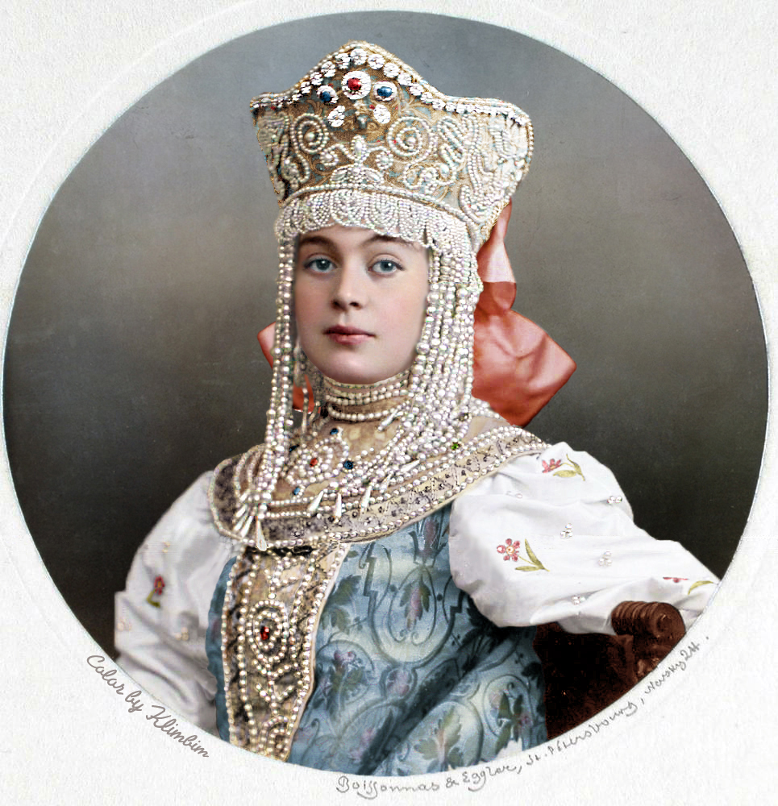

# The Kudashevs ~ and the von Nieroths and Trepovs

My "Granny" was Princess Maria Sergeyevna Kudasheva (1896–1990), known as Myra. She was born in Saint Petersburg, married my grandfather Norman Armour Sr, and died in New York. This folder is about her side of the family: the Kudashevs through her father, and the von Nieroths and Trepovs through her mother.

[Theo: a sentence or two on what Granny meant to you, or what she told you about Russia]

## How the three families join

* Granny's father ~ Prince [Sergei Vladimirovich Kudashev](../Wiki/Sergei-Vladimirovich-Kudashev-1863-1933/0-Sergei-Vladimirovich-Kudashev-1863-1933.md) (1863–1933)
* Granny's mother ~ Countess [Vera Maximilianovna von Nieroth](../Wiki/Vera-Maximilianovna-Kudasheva-von-Nieroth-1874-1920/Vera-Maximilianovna-Kudasheva-von-Nieroth-1874-1920.md) (1874–1920)
* Vera's father ~ Count [Maximilian Carl Benedict von Nieroth](../Wiki/Maximilian-Carl-Benedict-von-Nieroth-1846-1914/Maximilian-Carl-Benedict-von-Nieroth-1846-1914.md) (1846–1914)
* Vera's mother ~ [Anastasia Fyodorovna Trepova](../Wiki/Anastasia-Fyodorovna-Trepova-1849-1940/Anastasia-Fyodorovna-Trepova-1849-1940.md) (1849–1940)

Sergei and Vera married in 1894. Their children were Granny and her brother [Sergei Sergeyevich](../Wiki/Sergei-Sergeyevich-Kudashev-1901-1991/Sergei-Sergeyevich-Kudashev-1901-1991.md) (1901–1991).

Sergei's second wife was [Olga Ericovna von Pistohlkors](../Wiki/Olga-Ericovna-von-Pistohlkors-1888-1963/biography_of_olga_erikovna_von_pistohlkors_1888_1963.md) (1888–1963). Granny also had a half-sister, Olga, Sergei's daughter.

My full line back is in [Theo Armour-Lineage.md](<Theo Armour-Lineage.md>).

## The Kudashevs

The Kudashevs were a princely family of Tatar origin.

* [Nikolay Danilovich Kudashev](../Wiki/Nikolay-Danilovich-Kudashev-1784-1813/Nikolay-Danilovich-Kudashev-1784-1813.md) (1784–1813) ~ my 4x-great-uncle. A major general in the Napoleonic Wars, married to a daughter of Field Marshal Kutuzov. He died of wounds received at the Battle of Leipzig
* [Sergei Danilovich Kudashev](../Wiki/Sergei-Danilovich-Kudashev-1795-1862/biography_of_prince_sergei_danilovich_kudashev_1795_1862.md) (1795–1862) ~ my 3x-great-grandfather. Married Mathilde de Choiseul-Gouffier
* [Vladimir Sergeyevich Kudashev](../Wiki/Vladimir-Sergeyevich-Kudashev-1833-1871/Vladimir-Sergeyevich-Kudashev-1833-1871.md) (1833–1871) ~ my 2x-great-grandfather. Married Olga Nikolaevna Horvath
* [Sergei Vladimirovich Kudashev](../Wiki/Sergei-Vladimirovich-Kudashev-1863-1933/0-Sergei-Vladimirovich-Kudashev-1863-1933.md) (1863–1933) ~ my great-grandfather. Born in Kiev, died in Florence. His [painting collection](../Wiki/Sergei-Vladimirovich-Kudashev-1863-1933/Koudacheff-Collection/koudacheff-collection.md) has its own folder

Two other Kudashevs have pages. How they connect to our line is not yet written down:

* [Alexander Sergeyevich Kudashev](../Wiki/Alexander-Sergeyevich-Kudashev-1872-1917/Alexander-Sergeyevich-Kudashev-1872-1917.md) (1872–1917)
* [Nikolai Alexandrovich Kudashev](../Wiki/Nikolai-Alexandrovich-Kudashev-1868-1925/Nikolai-Alexandrovich-Kudashev-1868-1925.md) (1868–1925)

[Theo: the house on Bolshaya Morskaya, the Yusupov palace story]

## The von Nieroths

A Baltic German family. In Russian the name is Нирод ~ Nirod.

* [Maximilian Carl Benedict von Nieroth](../Wiki/Maximilian-Carl-Benedict-von-Nieroth-1846-1914/Maximilian-Carl-Benedict-von-Nieroth-1846-1914.md) (1846–1914) ~ my 2x-great-grandfather. Born in Saint Petersburg, died in Kiev
* [Fyodor Maximilianovich von Nieroth](../Wiki/Fyodor-Maximilianovich-von-Nieroth-1871-1952/Fyodor-Maximilianovich-von-Nieroth-1871-1952.md) (1871–1952) ~ Vera's brother, my great-great-uncle. A major general in the Imperial Russian Army. He died in Amblainville, France
* [Vera Maximilianovna](../Wiki/Vera-Maximilianovna-Kudasheva-von-Nieroth-1874-1920/Vera-Maximilianovna-Kudasheva-von-Nieroth-1874-1920.md) (1874–1920) ~ my great-grandmother. Born in Saint Petersburg, died in Paris

More on the family's origins is in [Neroths.md](Neroths.md).

[Theo: anything Granny said about her mother or her uncle]

## The Trepovs

* [Fyodor Fyodorovich Trepov](../Wiki/Fyodor-Fyodorovich-Trepov-1809-1889/Fyodor-Fyodorovich-Trepov-1809-1889.md), senior (1809–1889) ~ my 3x-great-grandfather. A Russian general and Governor of Saint Petersburg. Married Vera Vasilyevna Lukashevich. His birth year is 1809 by his service record; Russian Wikipedia gives 1812
* [Anastasia Fyodorovna Trepova](../Wiki/Anastasia-Fyodorovna-Trepova-1849-1940/Anastasia-Fyodorovna-Trepova-1849-1940.md) (1849–1940) ~ my 2x-great-grandmother. Born in Kiev, died in Amblainville, France

Anastasia's brothers:

* [Dmitri Feodorovich Trepov](<../Wiki/Dmitri Feodorovich Trepov-1850-1906/Dmitri Feodorovich Trepov-1850-1906.md>) (1850–1906)
* [Fyodor Fyodorovich Trepov](../Wiki/Fyodor-Fyodorovich-Trepov-1854-1938/Fyodor-Fyodorovich-Trepov-1854-1938.md), junior (1854–1938)
* [Alexander Fyodorovich Trepov](../Wiki/Alexander-Fyodorovich-Trepov-1862-1928/Alexander-Fyodorovich-Trepov-1862-1928.md) (1862–1928) ~ Prime Minister of the Russian Empire
* [Vladimir Fyodorovich Trepov](<../Wiki/Vladimir Fyodorovich Trepov-1863-1918/Vladimir Fyodorovich Trepov-1863-1918.md>) (1863–1918)

[Theo: the house in Poland paced out in a field; Alexander as a claim to fame]

## Names and Spellings

* Kudashev ~ also Koudacheff, Koudashev, Koudachev, Kudachew
* von Nieroth ~ also Nirod, Nirodt
* Trepov ~ also Trepoff

## In this folder

* [kudashev-lineage-chart.html](kudashev-lineage-chart.html) ~ chart of Granny's ancestors, with portraits and dates
* [Theo Armour-Lineage.md](<Theo Armour-Lineage.md>) ~ my line back through the Kudashevs
* [souvenirs-de-russie/](souvenirs-de-russie/) ~ [Princess Paley](../Wiki/Olga-Valerianovna-Paley-1865-1929/biography_of_princess_olga_valerianovna_paley_1865_1929.md)'s memoir, French and English
* [The Kudashev-von Nieroth Family.jpg](<The Kudashev-von Nieroth Family.jpg>) ~ family chart
* [Neroths.md](Neroths.md) and [Trepov.md](Trepov.md) ~ notes on the related families
* [kudashev-research-notes.md](kudashev-research-notes.md) ~ working links and loose ends
* [background/](background/) ~ Dutch Masters and Russian timelines
