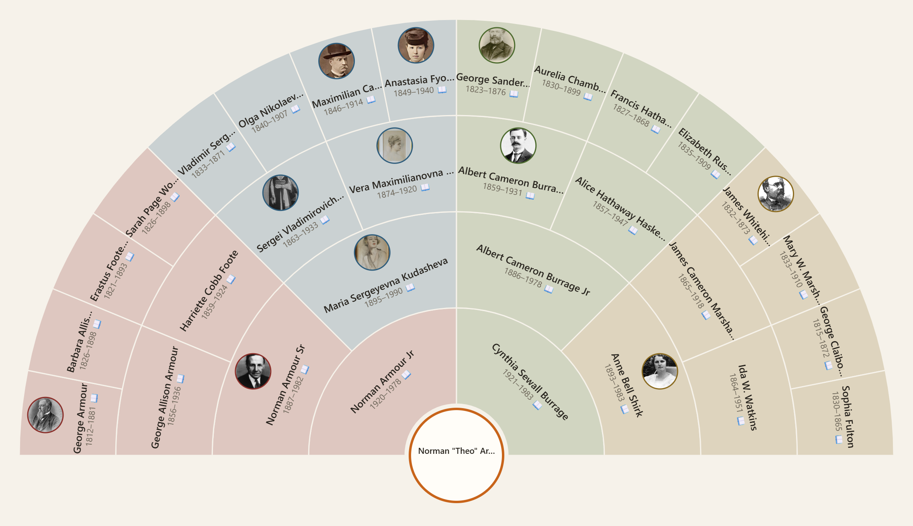
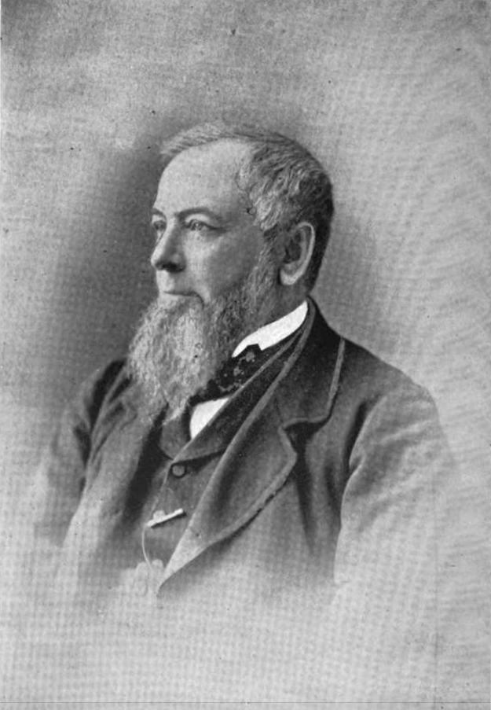
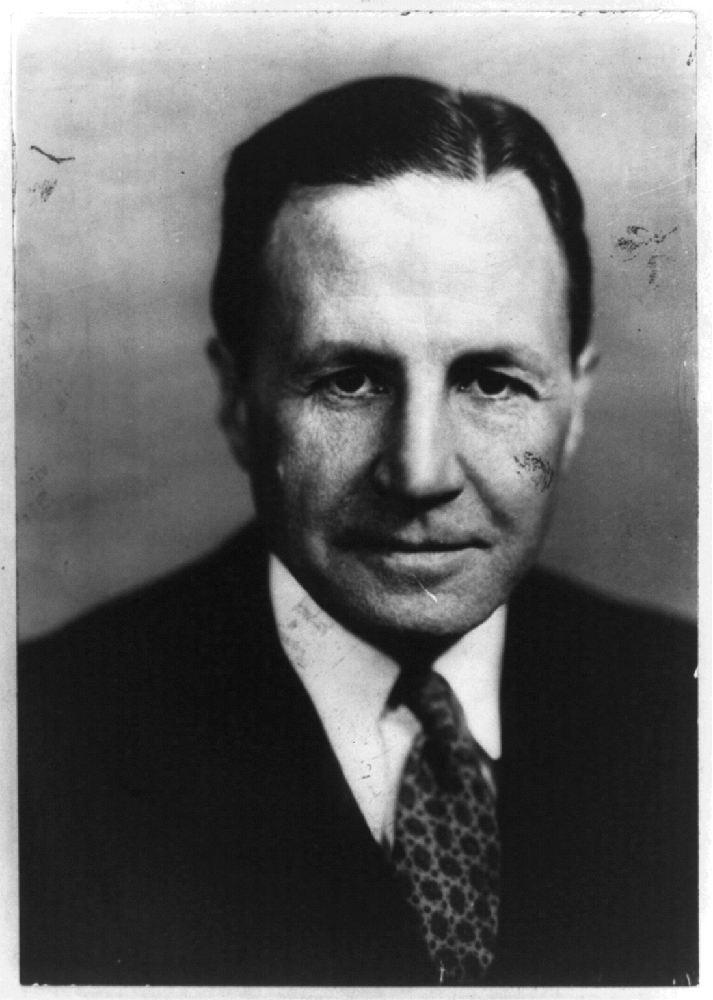
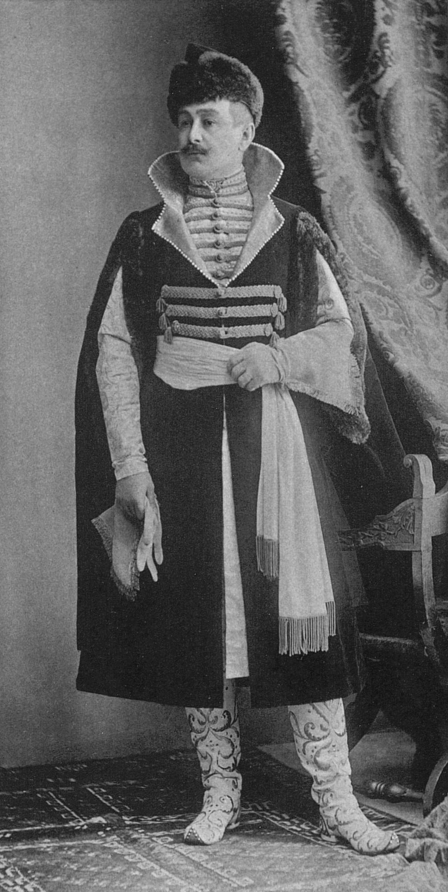
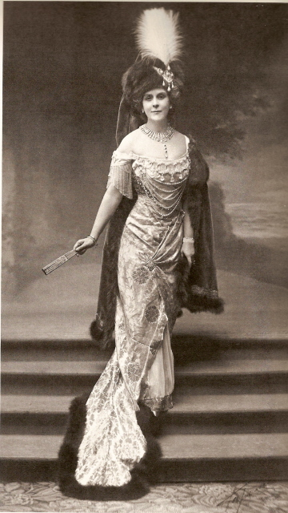
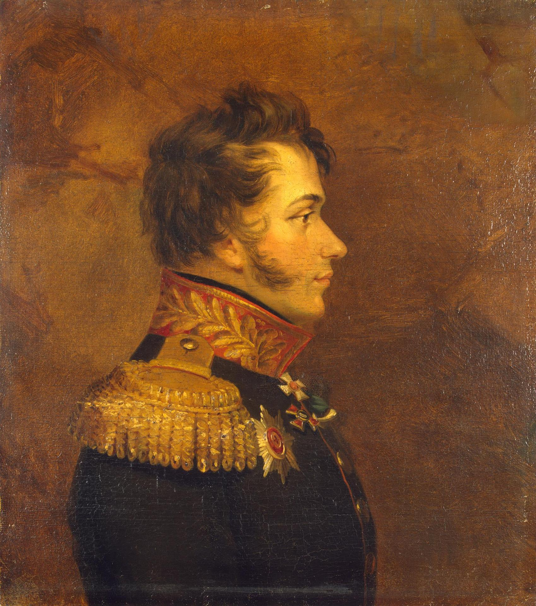
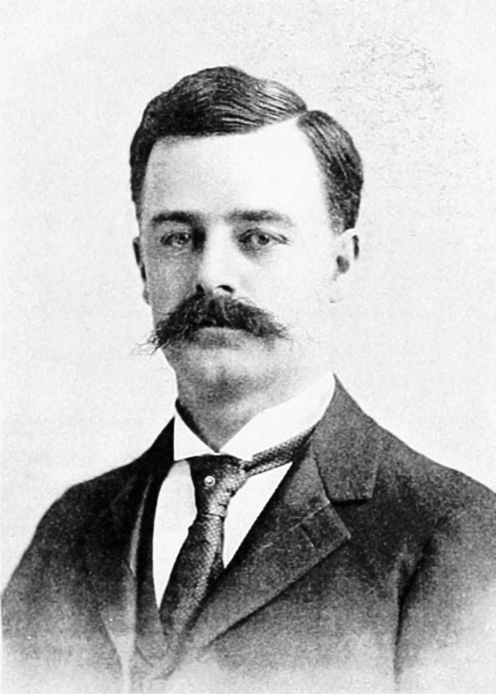
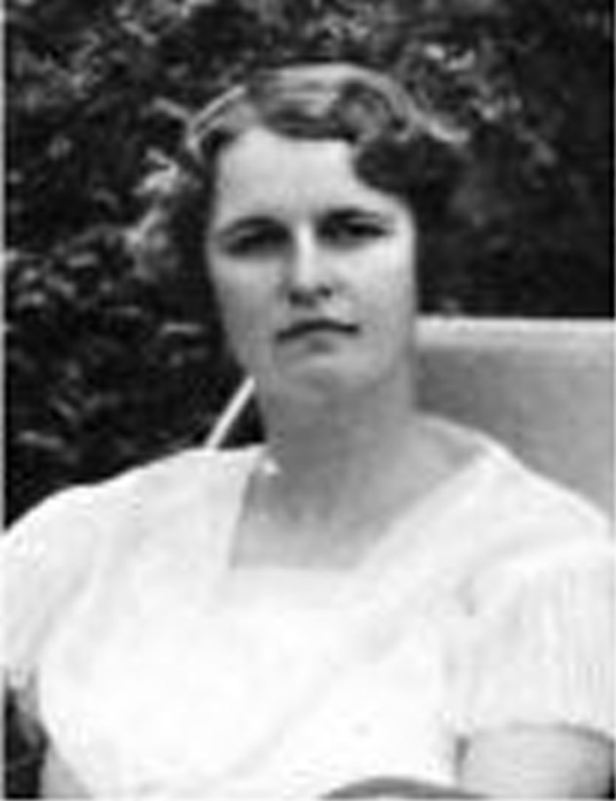
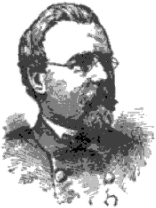

# [Theo Armour / Genealogy]( https://github.com/theo-armour/genealogy/tree/main )

## 🌳 My ancestors at a glance

[](https://theo-armour.github.io/gedcom-viewer/#wiki=Norman-Theo-Armour-III-1947-&layout=fan)

Four colors for my four grandparents' lines: Armour, Kudashev, Burrage and Shirk. Click the fan to open it in the [GEDCOM Viewer](https://theo-armour.github.io/gedcom-viewer/#wiki=Norman-Theo-Armour-III-1947-&layout=fan), where every name links to its biography.

## ✨ Did you know?

* 🚢 My 10th great-grandfather, John Howland, came over on the *Mayflower*. ~ [Theo Armour](Wiki/Norman-Theo-Armour-III-1947-/README-Norman-Theo-Armour-III-1947-.md)
* ⚔️ Prince Nikolay Kudashev, a general of the Napoleonic Wars, married the daughter of Field Marshal Kutuzov. ~ [Nikolay Danilovich Kudashev](Wiki/Nikolay-Danilovich-Kudashev-1784-1813/README-Nikolay-Danilovich-Kudashev-1784-1813.md)
* 🕵️ During the Russian Revolution my grandfather got back into Petrograd disguised as a dispatch bearer for the Norwegian Government. He married a Russian princess, my Granny. ~ [Norman Armour](Wiki/Norman-Armour-Sr-1887-1982/README-Norman-Armour-Sr-1887-1982.md)
* 🖼️ My great-grandfather Prince Sergei Kudashev collected 17th-century Dutch and Flemish Old Masters, including a *Peasant Wedding* attributed to Pieter Brueghel the Younger. In 1905 he sold them at auction in Amsterdam under a pseudonym, "Prince Tatarsky". ~ [Sergei Vladimirovich Kudashev](Wiki/Sergei-Vladimirovich-Kudashev-1863-1933/README-Sergei-Vladimirovich-Kudashev-1863-1933.md) · [the collection](Wiki/Sergei-Vladimirovich-Kudashev-1863-1933/Koudacheff-Collection/koudacheff-collection.md)
* 👑 Princess Paley's marriage to Grand Duke Paul, a son of Emperor Alexander II, cost him twelve years of banishment from Russia. ~ [Olga Valerianovna Paley](Wiki/Olga-Valerianovna-Paley-1865-1929/README-Olga-Valerianovna-Paley-1865-1929.md)
* 🏛️ My great-grandfather's house in Princeton is now the home of the university's president. ~ [George Allison Armour](Wiki/George-Allison-Armour-1856-1936/README-George-Allison-Armour-1856-1936.md)
* 🌿 My grandmother Anne Bell Burrage was one of the seven founders of The Herb Society of America. ~ [Anne Bell Burrage](Wiki/Anne-Bell-Burrage-1890-1983/README-Anne-Bell-Burrage-1890-1983.md)

## 🖼️ Some of the family

| [](Wiki/George-Armour-1812-1881/README-George-Armour-1812-1881.md) | [](Wiki/Norman-Armour-Sr-1887-1982/README-Norman-Armour-Sr-1887-1982.md) | [](Wiki/Sergei-Vladimirovich-Kudashev-1863-1933/README-Sergei-Vladimirovich-Kudashev-1863-1933.md) | [](Wiki/Olga-Valerianovna-Paley-1865-1929/README-Olga-Valerianovna-Paley-1865-1929.md) |
| :---: | :---: | :---: | :---: |
| **George Armour**<br>1812–1881<br>Chicago grain merchant | **Norman Armour**<br>1887–1982<br>diplomat | **Prince Sergei Kudashev**<br>1863–1933<br>courtier and art collector | **Princess Olga Paley**<br>1865–1929<br>wife of a Grand Duke |

| [](Wiki/Nikolay-Danilovich-Kudashev-1784-1813/README-Nikolay-Danilovich-Kudashev-1784-1813.md) | [](Wiki/Albert-Cameron-Burrage-Sr-1859-1931/README-Albert-Cameron-Burrage-Sr-1859-1931.md) | [](Wiki/Anne-Bell-Burrage-1890-1983/README-Anne-Bell-Burrage-1890-1983.md) | [](Wiki/James-Whitehill-Shirk-1832-1873/README-James-Whitehill-Shirk-1832-1873.md) |
| :---: | :---: | :---: | :---: |
| **Prince Nikolay Kudashev**<br>1784–1813<br>general of the Napoleonic Wars | **Albert Cameron Burrage**<br>1859–1931<br>copper and orchids | **Anne Bell Burrage**<br>1893–1983<br>gardener | **James W. Shirk**<br>1832–1873<br>gunboat captain at Shiloh |

## 📖 About this repository

This is my genealogy repository. It holds information about my family lineage and related genealogical data. All this data and the tools are public and open source. I hope you will use these ideas and methods to help you better understand where you come from.

The primary folder is [Wiki](Wiki/README.md). Following the principles of Wikipedia article organization, each person has their own folder. Inside it is their biography, named `README-` plus the folder name. There are 66 so far, covering my ancestors back to my great-great-grandparents and Sergio Pelà's line back to his. Each biography opens with a 🌳 "See in the GEDCOM Viewer" link that opens the viewer on that person. The conventions are in the [Genealogy Reference Manual](Wiki/0-genealgy-reference-manual.md).

The [GEDCOM Viewer](https://theo-armour.github.io/gedcom-viewer/) shows my master tree, [armour-genealogy.ged](GEDCOM-files/armour-genealogy.ged), a GEDCOM file I keep by hand. It has one person for each Wiki biography plus the few needed to connect them, and in the viewer each person links back to their biography. More in the [GEDCOM Files read me](GEDCOM-files/README.md).

### 🧬 What's a GEDCOM file?

GEDCOM (GEnealogical Data COMmunication) is the common language of family trees. It was created in the 1980s by The Church of Jesus Christ of Latter-day Saints for FamilySearch, and nearly every genealogy program and website can read and write it: Ancestry, MyHeritage, Geni, WikiTree, Gramps and many more.

A `.ged` file is plain text. Each line starts with a level number and a tag, so it can be read by people as well as programs. Here's George Armour, shortened a little, from my master tree:

```text
0 @I20@ INDI
1 NAME George /Armour/
1 SEX M
1 BIRT
2 DATE 24 APR 1812
2 PLAC Campbeltown, Argyll, Scotland
1 DEAT
2 DATE 13 JUN 1881
2 PLAC Brighton, Sussex, England
```

People (`INDI`) are joined into families (`FAM`) that name the husband, the wife and the children, and that's how the tree is built. Because it's a shared, open format, my family history isn't locked into any one website or program.

There are also folders for four families. The folders are named after the birth surnames of my grandparents: [Armour](Armour/README-Armour.md), [Kudashev](Kudashev/README-Kudashev.md), [Burrage](Burrage/README-Burrage.md) and [Shirk](Shirk/README-Shirk.md).

Good places to start:

* [The GEDCOM Viewer](https://theo-armour.github.io/gedcom-viewer/) ~ everyone with a biography, connected
* [Peeps in My Family](Peeps-in-My-Family.md) ~ the notable people in the four families, with my recollections
* [Granny's lineage chart](Kudashev/kudashev-lineage-chart.html) ~ my grandmother's ancestors and relatives, with portraits and dates

## 🔍 Help wanted: open mysteries

Every biography ends with its open questions. Here are four of my favorites. If you know an answer, I'd welcome hearing from you: [open an issue](https://github.com/theo-armour/genealogy/issues).

* 🕵️ **The Norwegian passport.** Did my grandfather go back to Petrograd to bring Granny's family out, or did he use it for his own journey to Finland? The accounts disagree. ~ [Norman Armour](Wiki/Norman-Armour-Sr-1887-1982/README-Norman-Armour-Sr-1887-1982.md)
* 🦏 **The sculptor of the Harvard rhinoceroses.** Katharine Lane Weems made the bronze rhinos at Harvard's Biological Laboratories. She's on an archived list of "Heroes" in this repository, but nobody has worked out how she's related. ~ [Katharine Lane Weems](Wiki/Katherine-Weems-1899-1989/README-Katherine-Weems-1899-1989.md)
* 🇮🇹 **Achille Pelà's parents.** Nothing here names them. ~ [Achille Pelà](Wiki/Achille-Pela-1921-1986/README-Achille-Pela-1921-1986.md)
* ⚖️ **Daughter or granddaughter?** Was my great-grandmother Ida Watkins Shirk a daughter of George C. Watkins, Chief Justice of Arkansas, or a granddaughter? A parish history of 1900 and a newspaper of 1915 disagree. ~ [Ida Watkins Shirk](Wiki/Ida-Watkins-Shirk-1864-1951/README-Ida-Watkins-Shirk-1864-1951.md)

## 🧭 More to explore

The folder titled "Online Genealogy" contains information about online genealogy resources, including Geni, Ancestry, MyHeritage, and WikiTree along with the links to the family databases I've created on those sites

The folder called "Documents" is mostly of little interest. It's a hodgepodge of notes, ideas, and other information that I use in the process of getting to this repository. I keep it here because it is part of my history after all.

Much of the data that is here has been collected via online web genealogy services. The links below will take you to the various websites I have used to build this repository.

## Links to Companion Projects

### Geni.com

* <https://www.geni.com/family-tree/index/6000000004118029730>

View of the GEDCOM files exported from Geni 2025-08-18

* <https://pewu.github.io/topola-viewer/#/view?url=https://theo-armour.github.io/genealogy/GEDCOM-files/2025/2025-08-18-export-geni/export-BloodTree.ged>
* <https://pewu.github.io/topola-viewer/#/view?url=https://theo-armour.github.io/genealogy/Wiki/Olga-Ericovna-von-Pistohlkors-1888-1963/export-geni/export-BloodTree.ged>

### Ancestry.com

Must be a member to access

* <https://www.ancestry.com/invite-ui/accept?token=>

### MyHeritage.com

* <https://www.myheritage.com/family-sites/armour/OYYV6PBSECQU5WE7JKWV7Q44V3NYJUI>

## Kudashev Website

* <https://www.kudashev.com/>


***

<center title="Hello! Click me to go up to the top" ><a class=a-dingbat href=javascript:window.scrollTo(0,0);> ❦ </a></center>

