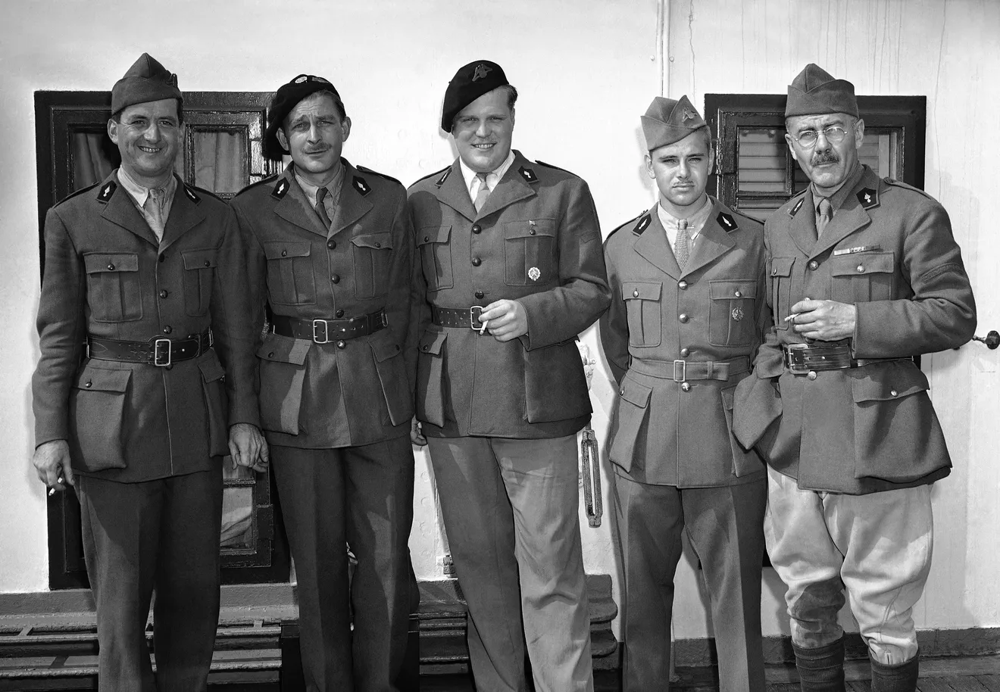

# Albert Cameron Burrage III

| `ghows_image-WL-96611be9-20be-4494-a06a-7c499e2dab99.webp` | Ambulance drivers arriving at New York aboard the liner *Manhattan* from France, 18 July 1940. The caption names them, left to right, as Charles L. Safford, Peter Jackson, King Stone, Albert C. Burrage III and H. Smith, which makes Burrage the fourth from the left. Associated Press photograph.[2] | [MetroWest Daily News](https://www.metrowestdailynews.com/picture-gallery/entertainment/2020/07/16/photos-today-in-history-july/66197863007/) |

**Albert Cameron Burrage III** (14 February 1919 – 8 or 9 August 1944), known as Cameron, was the only son of [Albert Cameron Burrage Jr](https://theo-armour.github.io/genealogy/#Wiki/Albert-Cameron-Burrage-Jr-1886-1978/README-Albert-Cameron-Burrage-Jr-1886-1978.md) and Anne Bell Shirk of Boston and Ipswich, Massachusetts. In 1940 he left Harvard to drive an ambulance in France with the American Field Service. He was later a captain in Combat Command A of the US 6th Armored Division, and he was killed in Brittany in August 1944.[1][3][4][7] He was a maternal uncle of Theo Armour.[1]

| **Albert Cameron Burrage III** | |
| :--- | :--- |
| **Born** | 14 February 1919 Boston or Ipswich, Massachusetts (see Open questions) |
| **Died** | 8 August 1944 (aged 25) (most sources; see Open questions) near Gouesnou, Finistère, France |
| **Resting place** | Brittany American Cemetery, Plot K, Row 13, Grave 19 |
| **Education** | St. Mark's School, Southborough Harvard College (left 1940) |
| **Service** | American Field Service, 1940 United States Army, Combat Command A, 6th Armored Division |
| **Rank** | Captain (service number O-414488) |
| **Awards** | Croix de Guerre (1939–1945); Purple Heart |
| **Parents** | [Albert Cameron Burrage Jr](https://theo-armour.github.io/genealogy/#Wiki/Albert-Cameron-Burrage-Jr-1886-1978/README-Albert-Cameron-Burrage-Jr-1886-1978.md) (1886–1978) [Anne Bell Shirk Burrage](https://theo-armour.github.io/genealogy/#Wiki/Anne-Bell-Burrage-1890-1983/Anne-Bell-Burrage-1890-1983.md) (1890–1983) |

## Family and early life

Albert Cameron Burrage III was born on 14 February 1919.[1][5][6] He was the son of Albert Cameron Burrage Jr and Anne Bell Shirk, and a grandson of the Boston attorney and copper industrialist [Albert Cameron Burrage Sr](https://theo-armour.github.io/genealogy/#Wiki/Albert-Cameron-Burrage-Sr-1859-1931/Albert-Cameron-Burrage-Sr-1859-1931.md).[1] He had two sisters, Anne Bell and [Cynthia Sewall](https://theo-armour.github.io/genealogy/#Wiki/Cynthia-Burrage-Hovey-1921-1983/README-Cynthia-Burrage-Hovey-1921-1983.md) (1921–1983).[1]

One family tree cites the 1920 United States census for him as a son in his parents' household at Hamilton, Massachusetts, and the 1930 census for the family in Boston.[6] *(Unsound: the census pages themselves have not been seen.)*

## St. Mark's and Harvard

He prepared for college at St. Mark's School and went on to Harvard, where he was captain of the freshman polo team.[3][4][7]

## American Field Service, 1940

In March 1940 *The Harvard Crimson* reported that eight Harvard men were among twenty-one American volunteers who had sailed on the liner *Manhattan* to drive ambulances in France for the American Field Service, paying their own expenses and serving without pay. Two of them, "A. Cameron Burrage III '41" and Lawrence W. Morgan, had left college to go. The paper said that Burrage, "just 21 and 'the baby of the section'", was going for the adventure, and quoted him as saying that the force that compelled him to go was "something in my New England blood". The article described him as "a resident of 5 Linden Street until Christmas".[3]

The American Field Service archive records him as a Second World War driver in unit FR 40-1, in the group "France 1940", and lists the Croix de Guerre (1939–1945) among his decorations.[4]

He came home with other drivers on the *Manhattan*, which reached New York on 18 July 1940 with 798 passengers, most of them American citizens leaving France, as the photograph above records.[2] In October 1940 the *Crimson* reported on the Harvard men who had served in the Field Service during the German invasion of France. It quoted the section commander, Willis, as saying that "A. C. Burrage 3rd '42 was the youngest, hardest working of the group and did a swell job." The same article said that seven of the Harvard men received the Croix de Guerre, but it did not name them all.[8]

In June 1941 "Cameron Burrage, brother of the bride" was an usher at his sister Cynthia's wedding to Norman Armour Jr at Ipswich.[9]

## Army service and death

He served in the United States Army as a captain, with service number O-414488, in Combat Command A of the 6th Armored Division. He entered the service from Massachusetts.[5][10][11]

In August 1944 the 6th Armored Division was in front of the port of Brest. The division's combat history says that its ultimatum to the fortress of Brest was refused, and that on 8 August a German force moving towards Brest from Morlaix by way of Plouvien struck the rear of the division, so that the commander, General Grow, called off the attack on Brest and turned his combat commands about.[12]

Burrage was killed on 8 August 1944 according to the American Battle Monuments Commission's records as reproduced by the 6th Armored Division association and by Interment.net.[10][11] The profile page and one family tree give the place as Gouesnou, on the outer defences of Brest;[12] the tree cites the *Boston Globe* of 26 August 1944 for this.[1][6] American War Memorials Overseas says that he was "one of the 75 soldiers killed during the liberation of Plabennec and Plouvien".[7] Other sources give 9 August (see Open questions).[4][5] No source read for this biography says how he was killed. He received the Purple Heart.[7][11]

He is buried at the Brittany American Cemetery, Plot K, Row 13, Grave 19.[7][10][11] He is listed on the "6th Armored Division Soldiers KIA Panel" of American War Memorials Overseas.[7]

## Residences

* **Hamilton, Massachusetts.** In his parents' household at the 1920 census, according to one family tree.[6]
* **Boston, Massachusetts.** At the 1930 census, according to the same tree.[6] His parents lived at 29 Hereford Street from about 1926.[13]
* **Ipswich, Massachusetts.** His parents' home, "Candlewood Farm". The *Boston Globe* report of his death, as cited in one tree, gives Ipswich as his residence.[6][9]
* **Southborough, Massachusetts**, at St. Mark's School.[3]
* **5 Linden Street**, while at Harvard, "until Christmas" before he sailed in 1940.[3]
* **France**, with the American Field Service, spring 1940.[3][4]

## Open questions

* **Date of death.** The ABMC data (via the 6th Armored Division association and Interment.net), American War Memorials Overseas, the profile page and one family tree give 8 August 1944.[1][6][7][10][11] The Geni GEDCOM export, MyHeritage's summary of Geni, and the American Field Service archive give 9 August 1944.[4][5] The ABMC record is the better evidence.
* **Place of death.** The profile page (from Geni's web page) and one tree give Gouesnou.[1][6] The Geni GEDCOM export and MyHeritage give "Plouvian", probably meaning Plouvien, another commune near Brest.[5] American War Memorials Overseas associates him with the fighting at Plabennec and Plouvien.[7] The profile page and the Geni export disagree with each other, although both come from Geni.
* **Place of birth.** Geni, MyHeritage and the profile page give Boston.[1][5] One tree (citing Find a Grave) and American War Memorials Overseas give Ipswich.[6][7] No birth record has been seen.
* **Harvard class.** The *Crimson* called him "'41" in March 1940 and "'42" in October 1940.[3][8]
* **How he died.** The brief asked whether the profile page and its photograph say how he died. They do not: the photograph is of his return from France in July 1940, not of his death.[1][2] Search results summarising other pages (TracesOfWar; a Find a Grave memorial) were not readable directly and are not relied on here.
* **The American Field Service record** gives his home as "Ipswich, N.Y." and his places of service as "Canada, France".[4] *(Unsound: "N.Y." is almost certainly an error for Massachusetts, and no other source mentions Canada.)*
* **American War Memorials Overseas** says that he "left Harvard in 1940 to join the American field service, in which he was a Captain in the field artillery".[7] *(Unsound: the Field Service was a volunteer ambulance service, and no other source gives him a rank in it; the sentence appears to run together his Field Service and Army careers.)*

## Questions for Theo

Points that family knowledge or family papers may settle. Each links to a conflict described above.

* **Date and place of death.** 8 August 1944 at Gouesnou (profile page, ABMC data) or 9 August at Plouvien (Geni export, MyHeritage, the American Field Service archive)?
* **How he died.** No source found says how. Was anything told in the family, or is there a letter from his unit?
* **Place of birth.** Boston (Geni, profile page) or Ipswich (one tree, American War Memorials Overseas)?
* **Harvard class.** Was he in the class of 1941 or 1942?
* **The Croix de Guerre.** The American Field Service archive lists it among his decorations. Does the family have the medal or its citation?
* **Name.** Was he known as Cameron in the family, as the 1941 wedding report suggests?

## References

1. "Albert Cameron Burrage III (1919–1944)". Profile page in this repository, with data from Geni. [Albert-Cameron-Burrage-III-1919-1944.md](https://theo-armour.github.io/genealogy/#Wiki/Albert-Cameron-Burrage-III-1919-1944/Albert-Cameron-Burrage-III-1919-1944.md); Geni: <https://www.geni.com/people/Albert-Burrage-III/364410217780007647>
2. Associated Press photograph, New York, 18 July 1940, in "Photos: Today in history, July". *MetroWest Daily News*, 16 July 2020. <https://www.metrowestdailynews.com/picture-gallery/entertainment/2020/07/16/photos-today-in-history-july/66197863007/>
3. "Harvard Men to Drive in French Ambulances". *The Harvard Crimson*, 25 March 1940. <https://www.thecrimson.com/article/1940/3/25/harvard-men-to-drive-in-french/>
4. "Burrage, Albert Cameron, III". *People in AFS*, AFS Archives. <https://the-afs-archive.org/people-in-afs/article/burrage-albert-cameron-iii-2-0255>
5. Geni GEDCOM export, record for Albert Cameron Burrage III (geni:364410217780007647), `Online-Genealogy/gedcom-files/2025-08-18-export-geni/export-BloodTree.ged`; and MyHeritage GEDCOM export quoting the Geni World Family Tree, `Online-Genealogy/gedcom-files/2025-08-18-myheritage-armour.ged`
6. Ancestry- and FamilySearch-derived family tree, record for Albert Cameron Burrage 3rd. Cites the 1920 census (Hamilton, Essex, roll T625_690, page 12B, ED 53), the 1930 census (Boston, page 7A, ED 0163), *The Boston Globe*, 26 August 1944, and Find a Grave memorial 56350862. None of these has been seen directly. `Online-Genealogy/gedcom-files/2025-08-28-matthew-family-tree.ged`
7. "Burrage Albert Cameron III". American War Memorials Overseas, Inc. <https://www.uswarmemorials.org/html/people_details.php?PeopleID=31617>
8. "Harvard Men War Heroes in France; Experience Horrors of Blitzkrieg". *The Harvard Crimson*, 1 October 1940. <https://www.thecrimson.com/article/1940/10/1/harvard-men-war-heroes-in-france>
9. "Cynthia Burrage and N. Armour, Jr., Wed". *Boston Sunday Post*, 29 June 1941, datelined Ipswich, 28 June. Clipping: [The_Boston_Post_29_Jun_1941.jpg](https://theo-armour.github.io/genealogy/Wiki/Cynthia-Burrage-Hovey-1921-1983/images/The_Boston_Post_29_Jun_1941.jpg). See also the [biography of Cynthia Sewall Burrage Hovey](https://theo-armour.github.io/genealogy/#Wiki/Cynthia-Burrage-Hovey-1921-1983/README-Cynthia-Burrage-Hovey-1921-1983.md).
10. "Table 1: Summary of all Sixers Interred at ABMC Cemeteries in Europe" (entry "BURRAGE ALBERT C III, CCA, CAPT, O-414488, MA, 8-Aug-44, K 13 19, BR"). Super Sixth, the 6th Armored Division association. <https://www.super6th.org/cemeteries/6AD_ABMC_ALL_BY_UNIT.pdf>
11. "Brittany American Cemetery, Saint James, France – Burial Records, Surnames A–C". *Interment.net*. <https://www.interment.net/data/france/saint-james/brittany-american-cemetery/records-a-c.htm>
12. "Combat History of the 6th AD: Brittany". Super Sixth. <https://super6th.org/cmbthist/cmbtbrtny.htm>
13. "29 Hereford". *Back Bay Houses*. <https://backbayhouses.org/29-hereford/>

## Further research

* His record in the American Battle Monuments Commission database (<https://www.abmc.gov>), to confirm the date of death and award details directly.
* The *Boston Globe* of 26 August 1944 and other Boston papers of August–September 1944, for the report of his death and how it happened.
* His Individual Deceased Personnel File (IDPF) from the US Army, and the after-action reports of Combat Command A, 6th Armored Division, for 7–9 August 1944.
* Find a Grave memorial 56350862 and the TracesOfWar entry (<https://tracesofwar.com/persons/73893/Burrage-III-Albert-C.htm>), which could not be read for this biography.
* The Harvard Memorial Church Second World War memorial (<https://memorialchurch.harvard.edu/world-war-ii-memorial>) and Harvard class reports for 1941 or 1942.
* The American Field Service history of the 1940 France section, and any citation for his Croix de Guerre.
* His birth record (Massachusetts vital records, 1919), to settle Boston or Ipswich.
