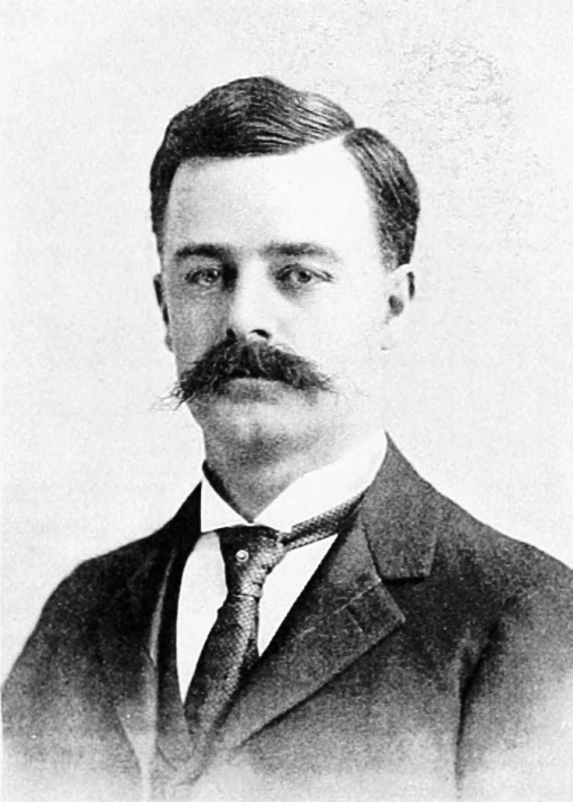

# Albert Cameron Burrage Sr

| `albert-burrage.jpg` | Albert Cameron Burrage (1859–1931).[1] | [Wikimedia Commons](https://commons.wikimedia.org/wiki/File:Albert_Cameron_Burrage_(1859%E2%80%931931).jpg) |

**Albert Cameron Burrage** (21 November 1859 – June 1931), often written A. C. Burrage, was a Boston lawyer, gas-company executive, copper-mining promoter, mineral collector and orchid grower. He made his first fortune as counsel to the Brookline Gas Light Company in the 1890s, then turned to copper mining. He was an organizer of the Amalgamated Copper Company and acquired the Chuquicamata mine in Chile, which he sold to the Guggenheims. He built the chateau-style Burrage House on Commonwealth Avenue in Boston and the Burrage Mansion in Redlands, California. He was president of the Massachusetts Horticultural Society and the first president of the American Orchid Society.[2][3][8][10] He was Theo Armour's maternal great-grandfather.[1]

| **Albert Cameron Burrage Sr** | |
| :--- | :--- |
| **Born** | 21 November 1859 Ashburnham, Massachusetts (some trees give 21 May; see Open questions) |
| **Died** | June 1931 (aged 71) 28 June at Beverly, or 29 June at West Manchester, Massachusetts (see Open questions) |
| **Education** | Harvard College (A.B. 1883) Harvard Law School (1884) |
| **Occupation** | Attorney; gas-company president; copper-mining promoter; horticulturist |
| **Offices** | Boston Common Council (1892) Boston Transit Commission President, Massachusetts Horticultural Society (from 1921) First president, American Orchid Society (1921, for eight years) |
| **Awards** | George Robert White Medal of Honor, Massachusetts Horticultural Society (1922) Lindley Medal, Royal Horticultural Society (1925) |
| **Spouse** | [Alice Hathaway Haskell](https://theo-armour.github.io/genealogy/#Wiki/Alice-Hathaway-Haskell-Burrage-1861-1947/README-Alice-Hathaway-Haskell-Burrage-1861-1947.md) (married 10 November 1885; died December 1947) |
| **Children** | [Albert Cameron Burrage Jr](https://theo-armour.github.io/genealogy/#Wiki/Albert-Cameron-Burrage-Jr-1886-1978/README-Albert-Cameron-Burrage-Jr-1886-1978.md) (1886–1978) Francis Hathaway (1888–1911) Russell Elizabeth Alice, Mrs Harold L. Chalifoux (1895–1987) |
| **Parents** | [George Sanderson Burrage](https://theo-armour.github.io/genealogy/#Wiki/George-Sanderson-Burrage-1823-1876/README-George-Sanderson-Burrage-1823-1876.md) (1823–1876) [Aurelia Chamberlin](https://theo-armour.github.io/genealogy/#Wiki/Aurelia-Chamberlin-Burrage-1830-1899/README-Aurelia-Chamberlin-Burrage-1830-1899.md) (also recorded as Amelia C. Chamberlain) |

## Family and early life

The family genealogy published in 1877, *The Burrage Memorial*, records "Albert Cameron, b. Nov. 21, 1859", the youngest of the five children of George Sanderson Burrage by his second wife, Aurelia Chamberlin, whom he had married on 1 January 1851. His father also had three children by his first wife, Martha G. Phelps.[4] The Boston Landmarks Commission describes him as a descendant of John Burrage, who came to the colonies from England in 1636; *The Burrage Memorial* is subtitled as a history of the descendants of John Burrage "who settled in Charlestown, Mass., in 1637".[3][4]

He was born at Ashburnham, Massachusetts.[1][2][3] His father and two uncles had built a chair factory on a tract of woodland there, and the settlement round it was made a post station called "Burrageville"; the business failed and was abandoned. About 1861 his father moved to Napa City, California, to grow grapes, and died there on 16 May 1876.[4] The Landmarks Commission says the family moved to California when Albert was three; Wikipedia says he went as a young child and stayed until he was eighteen; the Redlands Area Historical Society says he grew up in Napa.[2][3][5]

## Education and the gas business

According to Wikipedia he studied briefly in Europe and entered Harvard College in 1879, graduating *summa cum laude* in 1883.[2] Harvard's mineralogical museum confirms the A.B. of 1883.[6] He graduated from Harvard Law School in 1884 and was admitted to the Massachusetts bar in September 1884.[2][3]

He sat on the Boston Common Council in 1892, and the Landmarks Commission credits him with the "Burrage Ordinance", which barred city employees from membership of a political caucus, committee or convention.[2][3] He became counsel to the Brookline Gas Light Company (in 1892 according to Wikipedia, in 1893 according to the Landmarks Commission). The company won the right to supply gas in Boston, and his fee for the deal was large; the sources give different figures (see Open questions). He then became president of the Boston, South Boston, Roxbury and Dorchester gas light companies, described by the Landmarks Commission as the "Allied Gas Companies of Boston", in 1896.[2][3] In 1894 he was appointed to the Boston Transit Commission, which built the city's first subway.[2][3]

## Copper

In 1898 he gave up his gas-company posts and turned to copper mining.[2][3][6] He was one of the organizers of the Amalgamated Copper Company and, according to Wikipedia, a director until it was dissolved.[2][7] Wikipedia says that he was interested in processes for treating low-grade copper ores and that he was called the "Copper King".[2]

His largest venture was in Chile. In 1910 an American engineer named Bradley approached him about Chuquicamata, and Burrage sent engineers to examine it. From April 1911 he bought up mines and claims there, in partnership with Duncan Fox y Cía. He did not have the capital to develop the mine, so he approached the Guggenheim brothers, who organized the Chile Exploration Company in January 1912 and bought him out for US$25 million. Production began on 18 May 1915.[8] Wikipedia's article on Burrage describes him as a co-organizer of the Chile Exploration Company and the Chile Copper Company.[2]

Back Bay Houses adds that he owned several chemical companies through the Drugs and Dyestuffs Corporation of New York.[7] The Redlands Area Historical Society says he became a director of Standard Oil at the invitation of John D. Rockefeller *(Unsound: no other source seen says this, and the page gives no source)*.[5]

## Minerals

He collected minerals, especially crystallized gold. In 1911 he bought the gold collection of Georges de la Bouglise at auction in Paris.[2] In 1918 he wrote to the curator of Harvard's mineralogical museum offering a yearly prize of $100 for a student's study of crystalline gold using his collection.[6] He bequeathed his minerals, more than 1,500 specimens including the Bouglise golds and a collection of azurite and malachite from Bisbee, Arizona, to the Mineralogical and Geological Museum at Harvard.[6] The Landmarks Commission says the collection went to the Peabody Museum at Harvard (see Open questions).[3] At 314 Commonwealth Avenue special cases in the great hall were built to show the specimens.[3]

## Orchids and horticulture

He was best known in later life as a grower of orchids. The Landmarks Commission says he grew them in the glass-roofed conservatory of his Boston house, which had a wall covered with coral, and at two North Shore houses, Orchidvale in Beverly and Sea Home in Manchester.[3] One writer says that by 1922 his was the largest private collection of tropical orchids in the world, with more than 1,200 plants *(Unsound: a popular garden blog, with no source given)*.[9]

In 1921 he was elected president of the Massachusetts Horticultural Society and became the first president of the American Orchid Society, which he led for eight years until his health failed.[2][10] The Orchid Society says that through the 1920s he and the society were at the front of the national argument over controls on imported plants to keep out pests.[10] The Massachusetts Horticultural Society gave him its George Robert White Medal of Honor in 1922. Wikipedia says it was for his collection of orchids at Beverly; the Society's own list describes him as "President of Society's Board of Trustees" and records the award as a "Tribute".[2][11] At the Society's centennial (it was founded in 1829) he received a Centennial Medal "for eminent service in horticulture", and special medals for his group of orchids, for a tropical garden shown with his wife, and for a model of a rotating greenhouse.[11] In 1925 the Royal Horticultural Society awarded him the Lindley Medal for an exhibit of cypripediums at the Chelsea Flower Show.[2] He was a Fellow of the Royal Horticultural Society and a member of the horticultural societies of New York and Pennsylvania and of the Garden Club of America.[2][3] The orchid hybrid genus × *Burrageara* is named after him.[2] His library went to the Massachusetts Horticultural Society after his death.[3]

He published at least one work, his argument on municipal lighting before a committee of the Massachusetts legislature (1891).[2] *The Twenty-Minute-a-Day Garden* (Houghton Mifflin, 1943), which some catalogues attribute to him, is by his son (see Open questions).[12]

## Philanthropy

He paid for a hospital for disabled children on Bumpkin Island in Boston Harbor. The National Park Service gives 1900 as the year of its founding; Back Bay Houses says it was built in 1901–1902 to designs by Charles Brigham and opened in mid-1902.[7][13] In the First World War he lent the hospital, his yacht and other property to the war effort, and the Navy used the island as a training camp.[3][13] The hospital reopened briefly about 1940, closed during the Second World War, and burned in 1945.[13]

In Redlands, the historical society records gifts of $20,000 from Mrs Burrage toward a new Episcopal church, gifts to the Smiley Library, and money to build the University Club.[5]

## Family

He married **Alice Hathaway Haskell** of Boston on 10 November 1885.[2][14] Her birth is recorded variously (see Open questions). She died in December 1947.[7] They had four children:[3][7][14]

* **[Albert Cameron Burrage Jr](https://theo-armour.github.io/genealogy/#Wiki/Albert-Cameron-Burrage-Jr-1886-1978/README-Albert-Cameron-Burrage-Jr-1886-1978.md)** (30 August 1886 – 8 February 1978), Harvard 1908, metallurgist and mining engineer, who married Anne Bell Shirk in April 1915 and was the grandfather of Theo Armour.[7][14][15]
* **Francis Hathaway Burrage** (born 14 March 1888), Harvard 1910, banker, who married Marion Otis Gay in September 1911 and died in December 1911.[7][14]
* **Russell Burrage** (born 18 December 1889), Harvard 1911, who married Katharine Lee Baxter in April 1912.[7][14]
* **Elizabeth Alice Burrage** (12 July 1895 – 25 December 1987), who married Harold Leufroi Chalifoux in November 1916.[7][14]

## Death

Wikipedia, following the *New York Times* obituary of 30 June 1931, says that he died of heart disease on 29 June 1931 at his summer home, Sea Home, at West Manchester, Massachusetts, with his wife present. He had been in poor health; in the days before, he gave a reception on his yacht *Aztec* and attended the wedding of his granddaughter Katherine Lee Burrage to Forrester A. Clark.[2] Geni and one family tree give 28 June 1931 at Beverly.[1][14] No burial record has been seen.

## Residences

* **Ashburnham, Massachusetts**, where he was born in 1859.[4]
* **Napa, California**, from about 1861, as a child.[3][4][5]
* **Cambridge, Massachusetts**, at Harvard, from 1879 to 1884.[2]
* **140 Townsend Street, Boston**, before 1899.[7]
* **Hotel Somerset, Commonwealth Avenue, Boston**, in the winter of 1899–1900.[7]
* **314 Commonwealth Avenue, Boston** (the Burrage House), at the corner of Hereford Street. His wife bought the lots at 314–316 Commonwealth in January 1899, and the existing house at 316 was pulled down. Charles Brigham designed the house on the model of the château of Chenonceau; L. D. Willcutt & Son built it in 1899–1900, and the family lived there from the winter of 1900–1901. His widow stayed there until her death in 1947. A stable was built behind it at 325–327 Newbury Street.[3][7] The figures given for its cost and size differ (see Open questions).
* **"The Caravels", Cohasset, Massachusetts**, a summer home, sold in May 1911.[7] One family tree cites the 1900 census for him at Cohasset, a lawyer and head of household.[14]
* **"Monte Vista", 1205 West Crescent Avenue, Redlands, California** (now the Burrage Mansion). He bought 17.57 acres for $17,500; Brigham drew the plans, building began in October 1900 and the family moved in on 16 February 1901. The house, in the Mission Revival style, cost $84,770.[5][7] It was sold to Edgar G. Pratt for $100,000 in 1924 according to the Redlands historical society, or in 1926 according to Back Bay Houses.[5][7]
* **"The Needles", Hanson, Massachusetts**, a summer house that burned on 27 May 1907, with losses put at $75,000; it was rebuilt and was sold to the Camp Fire Girls in 1922.[2]
* **Orchidvale, Beverly, Massachusetts**, where he grew orchids.[3]
* **Sea Home (Seahome), Manchester, Massachusetts**, bought in 1921 and designed by Little and Browne; his summer home at his death.[2][3][7]

## Open questions

* **Date of birth.** *The Burrage Memorial* (1877), Wikipedia, the profile page and one family tree give 21 November 1859.[1][2][4][14] The Geni GEDCOM exports, MyHeritage and one Ancestry export give 21 May 1859, although the Geni record cites *The Burrage Memorial* as its source.[16] The 1877 book is the better evidence.
* **His mother's name.** *The Burrage Memorial* calls her Aurelia Chamberlin (once Chamberlain), as do Wikipedia and MyHeritage's copy of Geni.[2][4][16] The profile page and one family tree call her Amelia C. Chamberlain; that tree gives her birth as 3 February 1830 at Newbury, Vermont, and death as 2 October 1899 at Boston.[1][14]
* **Date and place of death.** Wikipedia, citing the *New York Times*, gives 29 June 1931 at West Manchester.[2] The profile page (from Geni) and one family tree give 28 June 1931 at Beverly.[1][14] The *Times* obituary itself has not been read.
* **His fee from the Brookline gas deal.** Wikipedia gives $800,000; the Landmarks Commission gives $700,000; a garden blog says "almost $1 million".[2][3][9]
* **His role in Amalgamated Copper.** Wikipedia calls him an organizer and director.[2] The Landmarks Commission calls him president of the Amalgamated Copper Company "which later became the Chile Copper Company", and Back Bay Houses similarly says Amalgamated was "later the Chile Copper Company".[3][7] The Chuquicamata history shows the Chile company as a separate, later Guggenheim venture, so these two statements look confused.[8]
* **Who organized the Chile Exploration Company.** Wikipedia's article on Burrage says he co-organized it; its article on Chuquicamata says the Guggenheims organized it in 1912 and bought him out.[2][8]
* **The cost and size of the Boston house.** The profile page, the *Peeps* entry and Wikipedia say 28 rooms and $600,000.[1][2] The Landmarks Commission gives an estimated building cost of $200,000. The two figures may measure different things (land, decoration, building), but no source explains the difference.[3]
* **Landmark status of the Boston house.** Wikipedia says it was designated a Boston Landmark in 2003.[2] The undated Landmarks Commission study report concerns the interior only, and notes the Commission's policy "not to designate private residential interior spaces"; it does not record the outcome.[3]
* **When the Boston house left the family.** Wikipedia says it became medical offices in 1948; the Landmarks Commission says it was sold at his widow's death in 1947; Back Bay Houses gives sales on 19 and 24 May 1948.[2][3][7]
* **Where his minerals went.** Harvard's own account says the Mineralogical and Geological Museum; the Landmarks Commission says the Peabody Museum.[3][6] Harvard's account says the collection arrived "some 35 years after" his 1918 letter, which would be about 1953, long after his death; this is unexplained.[6]
* **Number of children.** Wikipedia's infobox lists three (Albert Jr, Mrs Harold L. Chalifoux and Russell), probably because Francis had died in 1911; the Landmarks Commission, Back Bay Houses and the family trees give four.[2][3][7][14]
* **Birth year of Albert Jr.** Most sources give 1886; MyHeritage and one Ancestry export give 30 August 1887.[14][16]
* **His wife's birth.** Geni and her profile page give 6 October 1857 at Hong Kong; one family tree gives 6 October 1862 in China (as "Alice Lillian Hathaway Haskell"); the folder name in this repository uses 1861.[14][17]
* **His father's death.** *The Burrage Memorial* and the profile page give 16 May 1876; one family tree gives 16 August 1876.[4][14]
* **The Bumpkin Island hospital.** The National Park Service gives 1900 for its founding and 1945 for the fire; Back Bay Houses has it built in 1901–1902.[7][13]
* **Sale of the Redlands house.** 1924 (Redlands Area Historical Society) or 1926 (Back Bay Houses).[5][7]
* **Claims in the profile page and *Peeps* entry.** The statement that he "founded mining operations that revolutionized low-grade copper ore processing" goes further than the sources seen, which say only that he was interested in developing such processes.[1][2] The dates "1921–1929" for his Orchid Society presidency are consistent with "eight years" but no source seen gives 1929.[1][2]
* ***The Twenty-Minute-a-Day Garden*.** The PDF in [Burrage/](https://theo-armour.github.io/genealogy/#Burrage/README-Burrage.md) is filed under Albert C. Burrage (1859–1931), but it was copyrighted in 1943 and describes a garden at Ipswich in 1942, so it is the work of Albert Cameron Burrage Jr, who lived at Ipswich.[12][15] The Garden Club of America medal of 1961 linked in the same folder must also be the son's.[18]

## Questions for Theo

Points that family knowledge or family papers may settle. Each links to a conflict described above.

* **Death.** Did he die on 28 June 1931 at Beverly, as his profile page says, or on 29 June at "Sea Home", West Manchester, as the *New York Times* obituary is reported to say?
* **His mother's name.** Aurelia Chamberlin (*The Burrage Memorial*) or Amelia C. Chamberlain (his profile page)?
* ***The Twenty-Minute-a-Day Garden*.** The book is dated 1943 and describes a 1942 garden, so it appears to be by his son Albert Jr. Should the PDF in the Burrage folder, and the 1961 Garden Club of America medal in the Burrage Read Me, be credited to Albert Jr?
* **The *Peeps* entry.** Three claims there are not borne out by the sources found so far: that the Boston house cost $600,000 (the Landmarks Commission estimates $200,000), that he "revolutionized" low-grade copper processing, and that he was president of the American Orchid Society until 1929. Do you have a source for any of these, or should the wording change?
* **Russell.** Wikipedia names a son Russell among his children. Is anything known in the family about him?
* **The Bumpkin Island hospital and the Redlands house.** Are there family papers that date the hospital's founding (1900 or 1901–02) or the sale of the Redlands house (1924 or 1926)?

## References

1. "Albert Cameron Burrage (1859–1931)". Profile page in this repository, with data from Geni, and the entry in [Peeps-in-My-Family.md](https://theo-armour.github.io/genealogy/#Peeps-in-My-Family.md). [additional-notes-not-in-README.md](https://theo-armour.github.io/genealogy/#Wiki/Albert-Cameron-Burrage-Sr-1859-1931/additional-notes-not-in-README.md) (extracted from `Albert-Cameron-Burrage-Sr-1859-1931.md`); Geni: <https://www.geni.com/people/Albert-Burrage-Sr/364409776800007631>
2. "Albert Burrage". *Wikipedia*. Cites "A. C. Burrage dead; Boston attorney", *New York Times*, 30 June 1931, p. 25; "In Memorium", *American Orchid Society Bulletin* 1:1 (June 1932), pp. 2–4; *The Mineralogical Record* biographical archive; *New York Times*, 28 May 1907, p. 2. <https://en.wikipedia.org/wiki/Albert_Burrage>
3. Young, William, and David Payne. *The Burrage House: Study Report*. Boston Landmarks Commission, n.d. (about 2003), pp. 28–30. <https://www.cityofboston.gov/environment/pdfs/burrage.pdf>
4. Burrage, Alvah A. *The Burrage Memorial: A Genealogical History of the Descendants of John Burrage, who Settled in Charlestown, Mass., in 1637*. Boston: Alfred Mudge and Son, 1877, pp. 84, 109, 177. <https://archive.org/details/burragememorialg00burr>
5. Atchley, Tom. "Albert C. Burrage Home: 2010 Heritage Award Recipient". Redlands Area Historical Society. <https://rahs.org/awards/albert-c-burrage-home/>
6. Alonso-Perez, Raquel, and Theresa Smith. "Albert Burrage and his rare golds". Mineralogical and Geological Museum, Harvard University, on Google Arts & Culture. <https://artsandculture.google.com/story/albert-burrage-and-his-rare-golds-mineralogical-and-geological-museum-harvard-university/QgVBaHjadrxuKA>
7. "314 Commonwealth". *Back Bay Houses*. <https://backbayhouses.org/314-commonwealth/>
8. "Chuquicamata". *Wikipedia*. <https://en.wikipedia.org/wiki/Chuquicamata>
9. "Albert Cameron Burrage: Industrialist, Philanthropist, and Orchid Enthusiast". *The Daily Gardener*, 21 November 2019. <https://thedailygardener.org/otb20191121/>
10. "The AOS History". American Orchid Society. <https://www.aos.org/about-us/the-aos-history>
11. "Honorary Medals". Massachusetts Horticultural Society (list dated 11 May 2022): White Medal of Honor, 1922; Centennial Medals. <https://www.masshort.org/hubfs/Honorary%20Medals.Web.pdf>
12. Burrage, Albert C. *The Twenty-Minute-a-Day Garden*. Boston: Houghton Mifflin, 1943. Copy in this repository: `Burrage/The twenty-minute-a-day garden -- Burrage, Albert C_ (Albert Cameron), 1859-1931 -- Boston, Massachusetts, 1943.pdf`; also <https://archive.org/details/twentyminuteaday00burr>
13. "Bumpkin Island". Boston Harbor Islands, National Park Service. <https://www.nps.gov/boha/learn/historyculture/facts-bump.htm>
14. Ancestry- and FamilySearch-derived family tree, records for Albert Cameron Burrage, Alice Lillian Hathaway Haskell, their children and his parents. Cites the 1900 United States census (Cohasset, Norfolk, roll 669, page 23, enumeration district 1029), not seen directly. `Online-Genealogy/gedcom-files/2025-08-28-matthew-family-tree.ged`
15. "Albert Cameron Burrage Jr (1886–1978)". Profile page in this repository. [README-Albert-Cameron-Burrage-Jr-1886-1978.md](https://theo-armour.github.io/genealogy/#Wiki/Albert-Cameron-Burrage-Jr-1886-1978/README-Albert-Cameron-Burrage-Jr-1886-1978.md)
16. Geni GEDCOM exports (geni:364409776800007631), MyHeritage GEDCOM export (quoting the Geni World Family Tree) and Ancestry GEDCOM export. `Online-Genealogy/gedcom-files/theo/2025-08-30-export-geni/export-Ancestors.ged`, `Online-Genealogy/gedcom-files/2025-08-18-export-geni/export-BloodTree.ged`, `Online-Genealogy/gedcom-files/2025-08-18-myheritage-armour.ged`, `Online-Genealogy/gedcom-files/2025-08-18-ancestry-armour-ferté/2025-08-18-armour-ferte.ged`
17. "Alice Hathaway Haskell (1857–1947)". Profile page in this repository. [README-Alice-Hathaway-Haskell-Burrage-1861-1947.md](https://theo-armour.github.io/genealogy/#Wiki/Alice-Hathaway-Haskell-Burrage-1861-1947/README-Alice-Hathaway-Haskell-Burrage-1861-1947.md)
18. "Albert C. Burrage". Garden Club of America, medalists: Distinguished Service Medal, 1961, for experiments with small vegetables and fruits at his model farm in Ipswich. <https://www.gcamerica.org/medalists/albert-c-burrage>

## Further research

* The *New York Times* obituary of 30 June 1931 and the Boston papers of the same days, to settle the date and place of death, and a burial record.
* "In Memorium", *American Orchid Society Bulletin* 1:1 (June 1932), pp. 2–4.
* Harvard class reports for the class of 1883, which should give his own account of his career.
* The 1900 census entry at Cohasset, and his birth record in the Ashburnham town records.
* The *Mineralogical Record* biographical archive entry, and Harvard's records of when the mineral bequest arrived.
* The history of the Hanson house ("The Needles") and of Orchidvale at Beverly.
