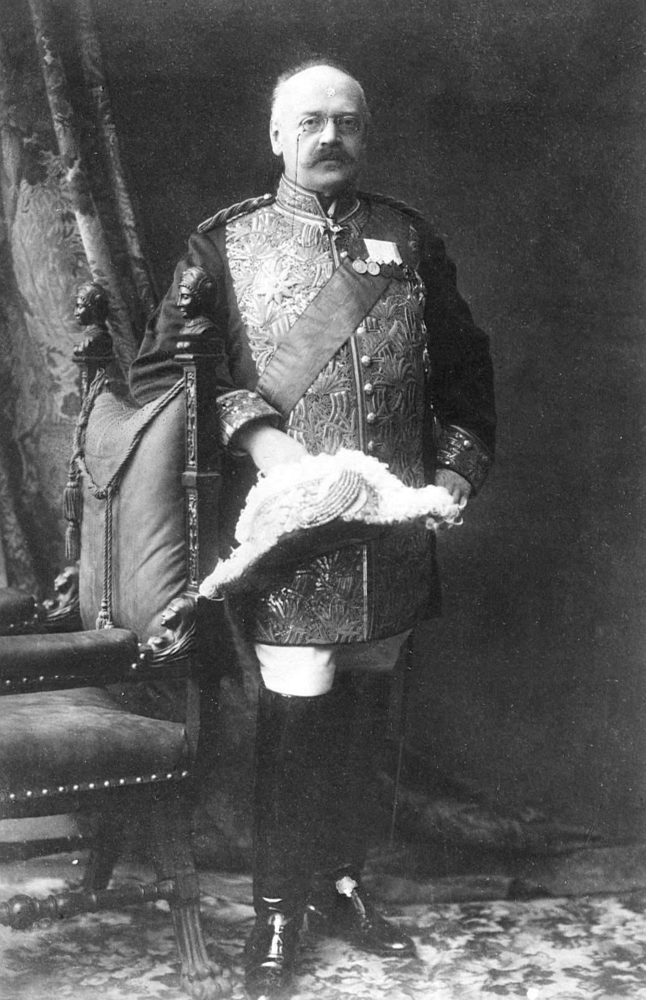

# Additional Notes Not in README — Alexander Fyodorovich Trepov

Extracted on 2026-11-21 from `Alexander-Fyodorovich-Trepov-1862-1928.md` by comparison against `README-Alexander-Fyodorovich-Trepov-1862-1928.md`.

## Additional Biographical & Family Details

* **Mother:** Vera Vasilyevna Trepova (born Lukashevich; married Trepov) — not named in README.
* **Siblings** (seven additional siblings beyond Anastasia, none named in README):
  * Yevgeniya Fyodorovna
  * Yuliya Fyodorovna
  * Sofya Fyodorovna
  * Fyodor Fyodorovich Jr.
  * Dmitri Fyodorovich (also recorded as Dmitriy Fyodorovich and Dimitri Feodorovitch)
  * Yelizaveta Fyodorovna
  * Vladimir Fyodorovich
  * [Anastasia Fyodorovna (also recorded as Anastatisya Fyodorovna)](../Anastasia-Fyodorovna-Trepova-1849-1940/Anastasia-Fyodorovna-Trepova-1849-1940.md) *(README mentions Anastasia without patronymic, alternate spelling, or profile link)*
* **Daughters' patronymics:** Yelena Aleksandrovna and Sofya Aleksandrovna (README gives only `Sofia, Yelena`).
* **Relation label:** `paternal 3x-great-uncle` (README describes him as "a brother of Theo Armour's great-great-grandmother Anastasia").
* **White Army support:** Explicitly states that after the October Revolution he "supported the White Army" in France (README describes his monarchist activity in Finland and France without mentioning the White Army).

## Alternate Names, Spellings & Locations

* **Subject's name variants:**
  * Modern transliteration: `Aleksandr Fyodorovich Trepov` (also recorded as `Aleksandr Fyodorovich Trepov`)
  * `Also seen as: Alexander Trepov ~ English Wikipedia`
* **Spouse's name:** `Sofya Dmitrievna Trepova (born Казина; also recorded as Sofya Dmitrievna Kazina)` (README uses `Sofia Dmitrievna Kazina`, without married surname or Cyrillic maiden name).
* **Daughter's name spelling:** `Sofya` (README uses `Sofia`).
* **Sister's name spelling:** `Anastatisya Fyodorovna`.
* **Birthplace spelling / Cyrillic:** `Kyiv (Киев), Russian Empire (Российская Империя)` (README writes `Kiev, Russian Empire`).
* **Death place (fuller location):** `Nice, Alpes-Maritimes, Provence-Alpes-Côte d'Azur, France` (README writes `Nice, France`).

## Discrepancies vs. README

* **Political characterization:** `Alexander-Fyodorovich-Trepov-1862-1928.md` describes him as "A reformer who clashed with Grigori Rasputin's influence at court, Trepov sought parliamentary reforms", whereas the README notes that Russian Wikipedia says historians have often described him as a "reactionary" and states only that he "sought the cooperation of the Duma".
* **Ministerial title:** `Alexander-Fyodorovich-Trepov-1862-1928.md` styles his post "Minister of Transport and Communications", whereas the README calls it "Minister of Transport".
* **Length of premiership:** `Alexander-Fyodorovich-Trepov-1862-1928.md` states he was "dismissed after only 50 days in office" (the README calculates 47 days and notes that other wiki pages say "50 days").
* **Relationship degree:** Listed as `paternal 3x-great-uncle`, whereas the README identifies him as a brother of Theo Armour's great-great-grandmother Anastasia (i.e., a great-great-uncle / 2x-great-uncle).

## Additional Links & Images

* Second portrait image (absent from README):
  
  * Source: [Wikimedia Commons — File:Trepov.jpg](https://commons.wikimedia.org/wiki/File:Trepov.jpg)
* External links absent from README:
  * [Grokipedia — Alexander Trepov](https://grokipedia.com/page/Alexander_Trepov)
  * [Everything Explained Today — Alexander Trepov](https://everything.explained.today/Alexander_Trepov/)
  * [Wikimedia Commons search for "trepov"](https://commons.wikimedia.org/w/index.php?search=trepov&title=Special%3AMediaSearch&type=image)
* Relative profile links in Genealogy section:
  * [Fyodor Fyodorovich Trepov Sr.](../Fyodor-Fyodorovich-Trepov-1809-1889/Fyodor-Fyodorovich-Trepov-1809-1889.md)
  * [Anastasia Fyodorovna (also recorded as Anastatisya Fyodorovna)](../Anastasia-Fyodorovna-Trepova-1849-1940/Anastasia-Fyodorovna-Trepova-1849-1940.md)
