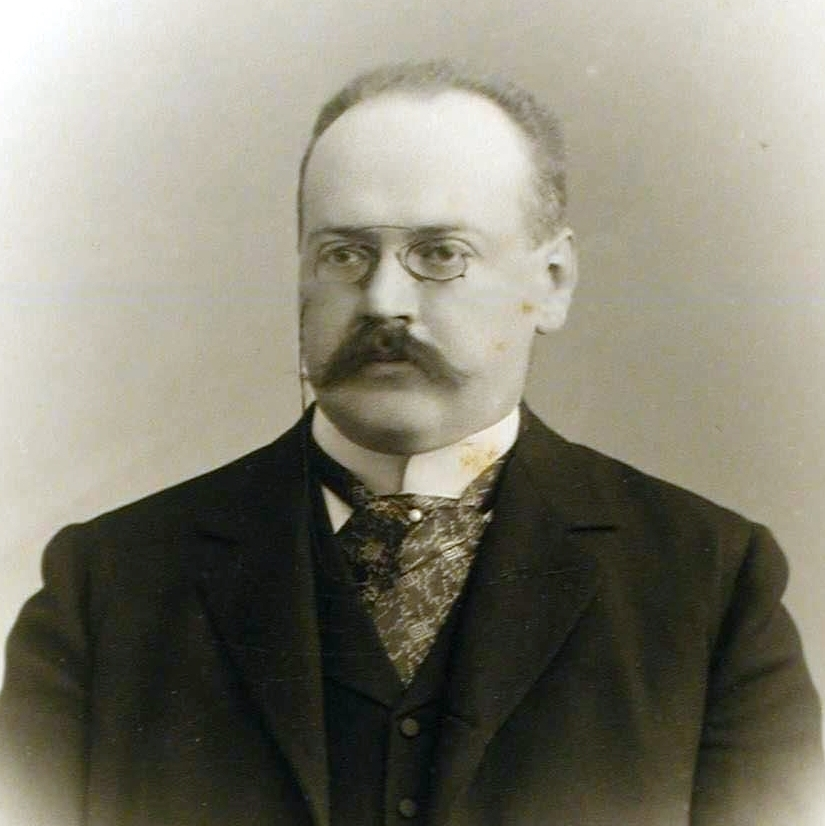

# Alexander Fyodorovich Trepov

| `alexander-trepov.jpg` | Alexander Fyodorovich Trepov, 21 December 1897. Photograph by A. A. Pasetti. Public domain.[4] | [Source](https://commons.wikimedia.org/wiki/File:Alexander_Trepov.jpg) |

**Alexander Fyodorovich Trepov** (Russian: Александр Фёдорович Трепов; 18 [30] September 1862 – 10 November 1928) was a Russian statesman. He was Minister of Transport from 1915 to 1916 and Chairman of the Council of Ministers (Prime Minister) of the Russian Empire from 10 (23) November to 27 December 1916 (9 January 1917), the second-last to hold the office. He tried and failed to remove the Interior Minister Alexander Protopopov and to buy [Grigori Rasputin](https://en.wikipedia.org/wiki/Grigori_Rasputin) out of politics, and was dismissed after 47 days. After the revolution he was a leader of the monarchist emigration in France.[1][2] He was a son of [General Fyodor Fyodorovich Trepov (senior)](https://theo-armour.github.io/genealogy/#Wiki/Fyodor-Fyodorovich-Trepov-1809-1889/biography_of_general_fyodor_fyodorovich_trepov_1812_1889.md) and a brother of Theo Armour's great-great-grandmother Anastasia.[3]

| **Alexander Fyodorovich Trepov** | |
| :--- | :--- |
| **Native name** | Александр Фёдорович Трепов |
| **Born** | 18 (30) September 1862 Kiev, Russian Empire |
| **Died** | 10 November 1928 (aged 66) Nice, France |
| **Resting place** | Russian Cemetery (Caucade), Nice |
| **Education** | Page Corps |
| **Offices** | Senator (1906) Member of the State Council (1914) Minister of Transport (30 October 1915 – 27 December 1916) Chairman of the Council of Ministers (10 November – 27 December 1916) |
| **Court ranks** | *Kammerherr* (1900); *Jägermeister* (1905); State Secretary (1916) |
| **Predecessor** | Boris Stürmer |
| **Successor** | Prince Nikolai Golitsyn |
| **Spouse** | Sofia Dmitrievna Kazina |
| **Children** | Sofia, Yelena |

## Early career

Trepov was born in Kiev and educated in the Page Corps. He served in the Life Guards Jäger Regiment, went onto the reserve in 1889, and joined the Ministry of the Interior as an official for special assignments. He owned 2,922 *desyatinas* of land (about 3,200 hectares) in Pereyaslav Uyezd of Poltava Governorate, and was marshal of the nobility of that district from 1892 to 1896.[1]

He was attached to the State Chancellery in 1896, became a *Kammerherr* in 1900 and a *Jägermeister* (master of the hunt) of the court on 6 December 1905. He was appointed a senator in 1906 and a member of the State Council on 1 January 1914.[1]

## Minister of Transport

In August 1915 he joined the Special Council for Defence, and on 30 October 1915 he became Minister of Transport. Under him the building of the [Murmansk railway](https://en.wikipedia.org/wiki/Kirov_Railway) was speeded up, to link the ice-free port of Murmansk with the rest of Russia; the Vologda–Arkhangelsk line was converted to broad gauge; and a department of highways was set up in the ministry.[1][2]

## Prime Minister

Trepov succeeded Boris Stürmer as Chairman of the Council of Ministers on 10 (23) November 1916, keeping the transport ministry.[1][2] He made the removal of Protopopov a condition of taking office. He sought the cooperation of the Duma, but when he addressed it on 2 December he was shouted down from the left.[2] The Emperor, under pressure from Empress Alexandra, kept Protopopov.[1][2]

According to English Wikipedia, Trepov then offered Rasputin 200,000 roubles, a house and a bodyguard if he would go back to Siberia and stay out of politics. The offer was carried by Trepov's brother-in-law General A. A. Mosolov. Rasputin refused and told the Empress.[2] Trepov was dismissed from both his offices on 27 December 1916 (9 January 1917), ten days after Rasputin's murder.[1][2]

Russian Wikipedia notes that historians have often described him as a "reactionary".[1]

## Revolution and emigration

After the October Revolution he was arrested by the Cheka. From the autumn of 1918 to January 1919 he was in Finland, where he headed the Special Committee for Russian Affairs in Helsingfors. He then settled in France and was one of the leaders of the Russian monarchists there, taking part in the monarchist congress at Bad Reichenhall in 1921.[1][2] On 16 February 1921 he was questioned in Paris as a witness by an investigator of the Omsk district court, about the activities of the monarchist groups in Moscow.[1]

He died in Nice on 10 November 1928 and was buried in the Russian cemetery there.[1]

## Family

He married **Sofia Dmitrievna Kazina**. They had two daughters, Sofia and Yelena.[1]

## Residences

* **Kiev.** Born there in 1862.[1]
* **Pereyaslav Uyezd, Poltava Governorate.** His estate; district marshal of the nobility, 1892–1896.[1]
* **St. Petersburg (Petrograd)**, in government service until 1917.[1]
* **Helsingfors (Helsinki)**, 1918–1919.[1]
* **France**, from 1919; he died in Nice.[1]

## Discrepancies and unverified claims

* **Length of his premiership.** From 10 November to 27 December 1916 (Old Style) is 47 days. Other pages of this wiki say "50 days".
* **The Rasputin bribe.** English Wikipedia gives the figure of 200,000 roubles and cites Massie, Mosolov, Pares and Radzinsky nearby, but does not attach a citation to the figure itself.[2]
* **A false report of his death.** *The New York Times Current History* reported in 1918 that he had been killed in Russia.[1]

## References

1. "Трепов, Александр Фёдорович". *Wikipedia* (Russian). Cites Куликов, С. В., *Бюрократическая элита Российской империи накануне падения старого порядка* (2004); Шикман, А. П., *Деятели отечественной истории* (1997); and the record of his examination by N. A. Sokolov, 16 February 1921. <https://ru.wikipedia.org/wiki/Трепов,_Александр_Фёдорович>
2. "Alexander Trepov". *Wikipedia*. Cites Pares, B., *The Fall of the Russian Monarchy*, p. 395; Radzinsky, E., *Rasputin: The Last Word*, p. 433; Mossolov, A. A., *At the Court of the Last Tsar* (1935). <https://en.wikipedia.org/wiki/Alexander_Trepov>
3. "Треповы". *Wikipedia* (Russian). <https://ru.wikipedia.org/wiki/Треповы>
4. "File:Alexander Trepov.jpg". *Wikimedia Commons*. Public domain. <https://commons.wikimedia.org/wiki/File:Alexander_Trepov.jpg>

## Further reading

* Pares, Bernard. *The Fall of the Russian Monarchy*. London: Jonathan Cape, 1939.
* Куликов, С. В. *Бюрократическая элита Российской империи накануне падения старого порядка (1914–1917)*. Ryazan, 2004.
* "Alexander Fedorovich Trepov". *Find a Grave*. <https://www.findagrave.com/memorial/128139665/alexander_fedorovich-trepov>
