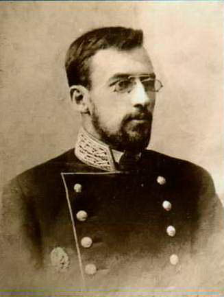

# Alexander Sergeyevich Kudashev (1872–1917) ~ Александр Сергеевич Кудашев

| `alexander-kudashev-1895.jpg` | Alexander Sergeyevich Kudashev, railway engineer's uniform (1895/1896) | [Wikimedia Commons](https://commons.wikimedia.org/wiki/File:%D0%90S_%D0%9Audashev.jpg) |

📖 [Biography](https://theo-armour.github.io/genealogy/#Wiki/Alexander-Sergeyevich-Kudashev-1872-1917/biography_of_prince_alexander_sergeyevich_kudashev_1872_1917.md)

## Genealogy

* Full name: Prince Alexander Sergeyevich Kudashev
* Birth: Feb 21 1872 (Feb 9 Old Style) - St. Petersburg
* Death: 1917? - place unknown
* Parents: Prince Sergei Sergeyevich Kudashev (1834–1915)
* Partner: Countess Yekaterina Vasilyevna Stenbock-Fermor
* Children: Sergei Alexandrovich (1895/96–1918/20)

## Names and Spellings

* Russian: Александр Сергеевич Кудашев
* Ukrainian: Олександр Сергійович Кудашев
* Also seen as: Kudashyev (Wikimedia Commons)

## Links

* <https://ru.wikipedia.org/wiki/Кудашев,_Александр_Сергеевич>
* <https://uk.wikipedia.org/wiki/Кудашев_Олександр_Сергійович>

## Life

Railway engineer, Kiev Polytechnic lecturer and aviation pioneer. His *Kudashev-1* made the first flight of an aeroplane built in the Russian Empire, in Kiev on 23 May 1910. He was a first cousin of my great-grandfather Sergei Vladimirovich Kudashev.

## Personal Comments

