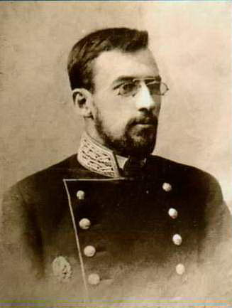
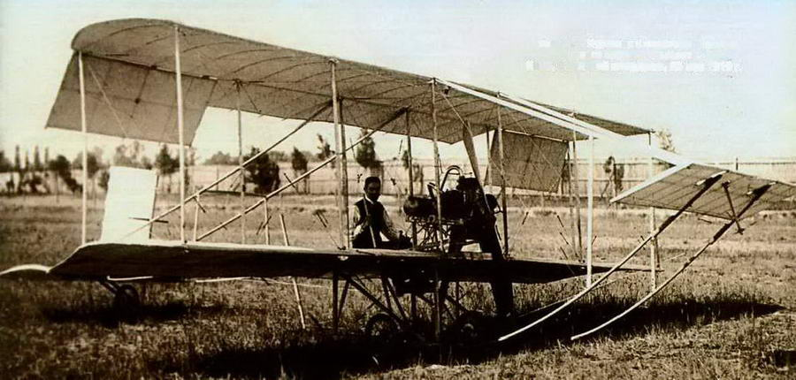
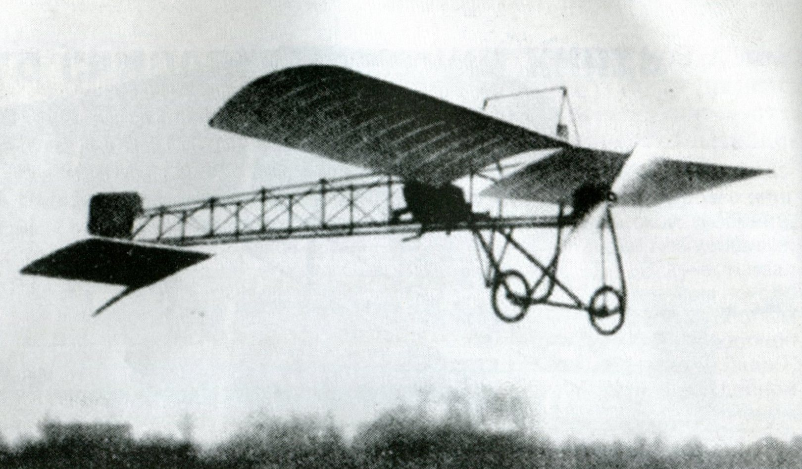
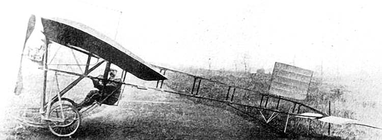

# Prince Alexander Sergeyevich Kudashev

🌳 [See in the GEDCOM Viewer](https://theo-armour.github.io/gedcom-viewer/#wiki=Alexander-Sergeyevich-Kudashev-1872-1917)

| `alexander-kudashev-1895.jpg` | Prince Alexander Sergeyevich Kudashev in the uniform of a railway engineer, 1895/1896. Unknown photographer. Public domain.[5] | [Source](https://commons.wikimedia.org/wiki/File:%D0%90S_%D0%9Audashev.jpg) |

**Prince Alexander Sergeyevich Kudashev** (Russian: Князь Александр Сергеевич Кудашев; Ukrainian: Олександр Сергійович Кудашев; 9 [21] February 1872 – 1917?) was a Russian railway and bridge engineer, a lecturer at the [Kyiv Polytechnic Institute](https://en.wikipedia.org/wiki/Kyiv_Polytechnic_Institute) and an aviation pioneer. On 23 May (5 June) 1910, at the Syrets hippodrome in Kiev, he flew the *Kudashev-1*. It is regarded as the first flight in the Russian Empire of an aeroplane built in the country.[1][2][3] He went on to design three more aircraft and worked in the aviation department of the Russo-Balt works under [Igor Sikorsky](https://en.wikipedia.org/wiki/Igor_Sikorsky).[1][2] He was a grandson of Prince [Sergei Danilovich Kudashev](https://theo-armour.github.io/genealogy/#Wiki/Sergei-Danilovich-Kudashev-1795-1862/README-Sergei-Danilovich-Kudashev-1795-1862.md), and a first cousin of Theo Armour's great-grandfather Prince Sergei Vladimirovich Kudashev.[2][4]

| **Prince Alexander Sergeyevich Kudashev** | |
| :--- | :--- |
| **Native name** | Князь Александр Сергеевич Кудашев |
| **Born** | 9 (21) February 1872 St. Petersburg, Russian Empire |
| **Died** | 1917 (date and place unknown) |
| **Education** | First St. Petersburg Classical Gymnasium (1890) St. Petersburg Institute of Railway Engineers (1895 or 1896) |
| **Occupations** | Railway and bridge engineer, lecturer, aircraft designer |
| **Known for** | *Kudashev-1* (1910), the first aeroplane built in the Russian Empire to fly |
| **Awards** | Great Silver Medal, Imperial Russian Technical Society (1911) |
| **Spouse** | Countess Yekaterina Vasilyevna Stenbock-Fermor (by first marriage Tolstaya) |
| **Children** | Sergei Alexandrovich (1895 or 1896 – 1918 or 1920) |
| **Father** | Prince Sergei Sergeyevich Kudashev (1834–1915) |
| **House** | Kudashev |

## Family background

Alexander Sergeyevich Kudashev was born in St. Petersburg on 9 (21) February 1872.[1][2] He was the son of Prince Sergei Sergeyevich Kudashev (1834–1915), a retired colonel who managed the Moscow branch of the State Noble Land Bank and wrote a history of Alexander I.[2][3][4] His mother is not named in the sources consulted. Through his father he was a grandson of Prince Sergei Danilovich Kudashev, Vice-Governor of Kiev. He was a nephew of Prince Vladimir Sergeyevich Kudashev and a first cousin of the philosopher Nikolai Berdyaev, whose mother Alexandra was his father's sister.[3][4]

## Engineering career

He graduated from the First St. Petersburg Classical Gymnasium in 1890, and from the Institute of Railway Engineers in 1895 (Russian Wikipedia) or 1896 (Ukrainian Wikipedia).[1][2] He began on the construction of the Tiflis–Kars railway, where he built a bridge over the Kura River.[1] From 1897 he lived in Kiev and worked for the South-Western Railway, and from 1898 he ran the dredging flotilla "Dnieper No. 4".[1] He was promoted to titular councillor in 1900.[2]

He taught at the Kiev Polytechnic Institute in 1899–1901, left for family reasons, and taught for a time at the Don Polytechnic Institute in Novocherkassk. He returned to Kiev in 1906 and until 1911 acted as extraordinary professor in the department of construction.[1][2] Ukrainian Wikipedia says he spent time in France, where he saw the beginnings of European aviation at first hand.[2] He was a full member of the Kiev Society of Aeronautics.[1]

## Aircraft

| `kudashev-1-1910.jpg` | The *Kudashev-1* biplane, with Kudashev in the pilot's seat, at the Syrets hippodrome, Kiev, 1910. Unknown photographer. Public domain.[6] | [Source](https://commons.wikimedia.org/wiki/File:%C2%AB%D0%9A%D1%83%D0%B4%D0%B0%D1%88%D0%B5%D0%B2-1%C2%BB.jpg) |

* **Kudashev-1 (1910).** A biplane with a 35 hp Anzani engine, weighing about 320 kg and built at the Kiev Polytechnic. According to the Kiev newspaper *Kievlyanin*, its first flight took place on 23 May (5 June) 1910 at the Syrets hippodrome, a straight hop of about 70 metres.[1][2] Some accounts mention four flights in all, the last ending against a fence.[1] It is described as the first flight in the Russian Empire of a domestically built aeroplane (the engine was French). The flight was not officially recognised at the time; Ukrainian Wikipedia says historians of aviation acknowledged Kudashev's priority only a century later.[2][3]
* **Kudashev-2 (autumn 1910).** A biplane with a 50 hp Gnome Omega engine. Ukrainian Wikipedia says the French copied its arched undercarriage for the Deperdussin.[1][2]
* **Kudashev-3 (winter 1910–1911).** A monoplane with a 35 hp Anzani, described as "исключительно лёгкий, простой и дешёвый" (exceptionally light, simple and cheap).[1][2]
* **Kudashev-4 (RBVZ-1, 1911).** A monoplane with a 50 hp Gnome, built in Riga for the Russo-Balt Wagon Works (RBVZ). It first flew on 2 April 1911 and on 28 April received the Great Silver Medal of the Imperial Russian Technical Society at the first aeronautics exhibition in St. Petersburg.[1][2] Kudashev was badly bruised landing it during the Second International Aviation Week in St. Petersburg (14–22 May 1911); the aircraft was later wrecked by the pilot Scipio del Campo.[1]

| `kudashev-4-1911.jpg` | The *Kudashev-4* (RBVZ-1) monoplane, 1911. Unknown photographer. Public domain.[6] | [Source](https://commons.wikimedia.org/wiki/File:%D0%9A%D1%83%D0%B4%D0%B0%D1%88%D0%B5%D0%B2-4.jpg) |

| `kudashev-3.jpg` | The *Kudashev-3* monoplane, 1910–1911. Unknown photographer. Public domain.[6] | [Source](https://commons.wikimedia.org/wiki/File:%D0%9A%D1%83%D0%B4%D0%B0%D1%88%D0%B5%D0%B2-3.jpg) |

In 1911, at Sikorsky's invitation, he joined the aviation department of the Russo-Balt works and later worked in Sikorsky's design bureau in St. Petersburg.[1][2]

## Later life and death

The accounts of his last years differ. Ukrainian Wikipedia says that in 1914, after a conflict with Russo-Balt's management, he left the firm, gave up aircraft design and moved to France, where he taught at the Polytechnic School in Paris.[2] Russian Wikipedia says he volunteered for the front after the outbreak of the First World War and was killed in 1917.[1] Ukrainian Wikipedia gives the date and place of death and burial as unknown. It notes that Prince Rifkat Kudashev, the family's biographer, found no record of him in the burial registers of [Sainte-Geneviève-des-Bois](https://en.wikipedia.org/wiki/Sainte-Genevi%C3%A8ve-des-Bois_Russian_Cemetery), the main Russian émigré cemetery near Paris.[2]

## Marriage and descendants

Kudashev married Countess Yekaterina Vasilyevna Stenbock-Fermor, whose previous married name was Tolstaya.[2] Their son:

* **Prince Sergei Alexandrovich Kudashev** (born 1895 or 1896). He was an army officer and died during the Civil War: in 1918 according to Ukrainian Wikipedia, or in 1920, of typhus in the Caucasus or in battle, according to the Russian Wikipedia article on his wife.[2][7] In early 1916 he married **Maria Pavlovna Cuvillier** ("Maya", 1895–1985), a poet and translator who was a friend of [Marina Tsvetaeva](https://en.wikipedia.org/wiki/Marina_Tsvetaeva). In April 1934 she married the French writer [Romain Rolland](https://en.wikipedia.org/wiki/Romain_Rolland).[7]
  * Their son, **Sergei Sergeyevich Kudashev** (1917–1941), was a postgraduate in mechanics and mathematics at Moscow University. Ukrainian Wikipedia says he was adopted by Romain Rolland. He served as a junior lieutenant and went missing at the front in November 1941.[2][7]

## Residences

* **St. Petersburg.** Born there in 1872, schooled there, and worked there again for Russo-Balt and Sikorsky from 1911.[1][2]
* **Transcaucasia.** He worked on the Tiflis–Kars railway from 1895.[1]
* **Kiev.** He lived in Kiev from 1897, working for the railway and teaching at the Polytechnic, where the *Kudashev-1* was built.[1][2]
* **Novocherkassk.** He taught at the Don Polytechnic Institute for a time between his two periods at Kiev.[2]
* **Riga.** He built the *Kudashev-4* at the Russo-Balt works in Riga in 1911.[1]
* **France.** He spent time there before 1910 and, according to one account, moved there in 1914.[2]
* **Mala Vyska.** Ukrainian Wikipedia says that the Kudashev princes held land at [Mala Vyska](https://en.wikipedia.org/wiki/Mala_Vyska) (formerly Kudasheva) and that the family estate survives there.[2] There is no evidence that Alexander himself lived there.

## Legacy

* **First flight.** The flight of 23 May 1910 is commemorated as the first flight of an aeroplane built in the Russian Empire. Its centenary in 2010 was marked by a monograph and by newspaper articles in Ukraine.[3][8]
* **Monument.** In July 2024 a monument by the sculptor Oleksandr Kuzmin was unveiled in the grounds of the Kyiv Polytechnic Institute, near Building No. 4, where the *Kudashev-1* was built.[2]

## Discrepancies and unverified claims

* **Date of the first flight.** The *Kievlyanin* date is 23 May (5 June) 1910.[1] The Commons description of the photograph says 23 March 1910.[6]
* **Year of graduation.** 1895 (Russian Wikipedia) or 1896 (Ukrainian Wikipedia).[1][2]
* **Death.** Killed at the front in 1917 (Russian Wikipedia) or date and place unknown, after moving to France in 1914 (Ukrainian Wikipedia).[1][2]
* **His son.** Born 1895 or 1896; died 1918 or 1920. The Russian Wikipedia article on his son's wife calls the son a "nephew" of Nikolai Berdyaev. By the family tree he was Berdyaev's first cousin once removed.[2][4][7]
* **Adoption by Romain Rolland.** This is stated by Ukrainian Wikipedia only.[2]

## References

1. "Кудашев, Александр Сергеевич". *Wikipedia* (Russian). Cites *Авиация и время*, special issue 2010; "Первый покоритель неба", *Вечерний Оренбург*, No. 27, 1 July 1998; and airwar.ru. <https://ru.wikipedia.org/wiki/Кудашев,_Александр_Сергеевич>
2. "Кудашев Олександр Сергійович". *Wikipedia* (Ukrainian). Cites Karamash & Tatarchuk (2010), Zgurovsky (2010), Shestakov in *Україна Молода* (2010), and a 2024 Kyiv Polytechnic Institute press release. <https://uk.wikipedia.org/wiki/Кудашев_Олександр_Сергійович>
3. Згуровский, Михаил. "Первопроходец воздухоплавания в России. К 100-летию полета первого российского самолета". *Зеркало недели* (ZN.ua), 21 May 2010. <https://zn.ua/SOCIUM/pervoprohodets_vozduhoplavaniya_v_rossii__k_100-letiyu_poleta_pervogo_rossiyskogo_samoleta.html>
4. "Prince Sergei Danilovich Kudashev". Theo Armour Genealogy. <https://theo-armour.github.io/genealogy/#Wiki/Sergei-Danilovich-Kudashev-1795-1862/README-Sergei-Danilovich-Kudashev-1795-1862.md>
5. "File:АS Кudashev.jpg". *Wikimedia Commons*. Public domain. <https://commons.wikimedia.org/wiki/File:%D0%90S_%D0%9Audashev.jpg>
6. "File:«Кудашев-1».jpg", "File:Кудашев-3.jpg" and "File:Кудашев-4.jpg". *Wikimedia Commons*. Public domain. The *Kudashev-4* image is credited to V. Tatarchuk and S. Karamash, *Авиация и время*, No. 3, 2010. <https://commons.wikimedia.org/wiki/File:%C2%AB%D0%9A%D1%83%D0%B4%D0%B0%D1%88%D0%B5%D0%B2-1%C2%BB.jpg>; <https://commons.wikimedia.org/wiki/File:%D0%9A%D1%83%D0%B4%D0%B0%D1%88%D0%B5%D0%B2-3.jpg>; <https://commons.wikimedia.org/wiki/File:%D0%9A%D1%83%D0%B4%D0%B0%D1%88%D0%B5%D0%B2-4.jpg>
7. "Кудашева, Мария Павловна". *Wikipedia* (Russian). Cites Anastasia Tsvetaeva's *Воспоминания* (2008) and B. Nosik, "Кто ты? – Майя", *Звезда*, 2001, No. 4. <https://ru.wikipedia.org/wiki/Кудашева,_Мария_Павловна>
8. Карамаш, С.; Татарчук, В. *Піонер-літакобудівник князь Олександр Кудашев* [Pioneer aircraft builder Prince Oleksandr Kudashev]. Kyiv, 2010. 72 pp. *(Not checked.)*

## Further reading

* Карамаш, С.; Татарчук, В. *Піонер-літакобудівник князь Олександр Кудашев*. Kyiv, 2010. The only book-length study.
* *Авиация и время*, No. 3, 2010 (special issue for the centenary of the first flight).
* "Биплан Кудашева" and "Кудашев-3". *Уголок неба* (airwar.ru). Aircraft data.
