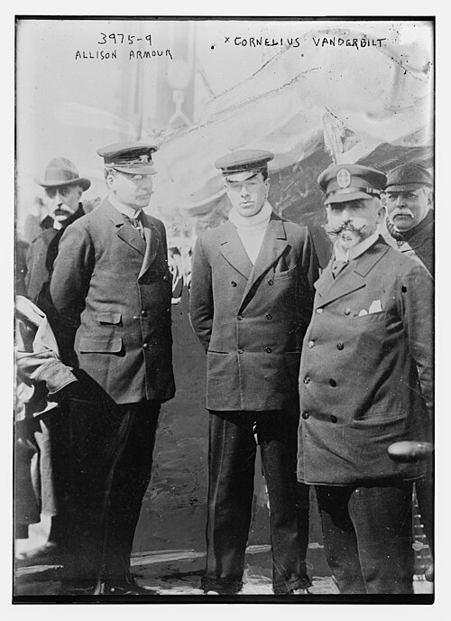

# Allison Vincent Armour

| `allison-armour.jpg` | Bain News Service photograph, Library of Congress call number LC-B2-3975-9, dated by the Library "between ca. 1915 and ca. 1920". Three men in yachting caps and double-breasted coats stand in the foreground, with two older men behind them. The caption written on the negative reads "3975-9 Allison Armour x Cornelius Vanderbilt". It does not say which of the men is Armour, and the Library notes that the title comes from unverified data supplied by the Bain News Service.[2] | [Library of Congress via Wikimedia Commons](https://commons.wikimedia.org/wiki/File:Allison,_Armour,_Cornelius_Vanderbilt_LOC_14778876346.jpg) |

**Allison Vincent Armour** (18 March 1863 – March 1941) was an American yachtsman who put his yachts at the service of science. A Chicago-born Yale graduate, he carried a Field Columbian Museum party to Yucatan in the *Ituna* in 1894–95, supported the American excavations at Cyrene in North Africa before the First World War, and from 1925 took botanists and zoologists of the United States Department of Agriculture and of Harvard on a series of voyages in the research yacht *Utowana*, a converted freighter. He was a member of the International Olympic Committee from 1908.[3][4][5][6][7] He was a son of [George Armour](https://theo-armour.github.io/genealogy/#Wiki/George-Armour-1812-1881/George-Armour-1812-1881.md), a brother of [George Allison Armour](https://theo-armour.github.io/genealogy/#Wiki/George-Allison-Armour-1856-1936/George-Allison-Armour-1856-1936.md), and Theo Armour's paternal great-great-uncle.[1][3][14]

| **Allison Vincent Armour** | |
| :--- | :--- |
| **Born** | 18 March 1863 Chicago, Illinois |
| **Died** | 6 or 7 March 1941 (aged 77; see Open questions) New York City |
| **Education** | Harvard School, Chicago Yale (B.A. 1884) |
| **Occupation** | Management of family estates; yachtsman and ship's master; patron of scientific expeditions |
| **Spouse** | Anne Louise Kelley (married 10 December 1885; died 3 April 1890) |
| **Children** | None |
| **Parents** | [George Armour](https://theo-armour.github.io/genealogy/#Wiki/George-Armour-1812-1881/George-Armour-1812-1881.md) (1812–1881) Barbara Allison (1826–1898) |

## Family and early life

Allison Vincent Armour was born in Chicago on 18 March 1863.[3][4] His father, George Armour, was in the words of the Yale *Obituary Record* "a merchant in Chicago, president Chicago Art Institute and Board of Trade"; his mother was Barbara Allison, "daughter of William Allison of Millbank, Scotland, and Chicago".[3] He was the fourth of five children named in the family trees: John William (1851–1865), George Allison (1856–1936), William (1858–1888), himself, and Mary Greenlee (1868–1958), later Mrs [Francis Meredyth Whitehouse](https://theo-armour.github.io/genealogy/#Wiki/Francis-Meredyth-Whitehouse-1848-1938/Francis-Meredyth-Whitehouse-1848-1938.md).[3][12]

He was prepared at the Harvard School in Chicago and took his B.A. at Yale in 1884, where he rowed in his class crew, sat on the Junior Promenade Committee and was a member of Psi Upsilon and Scroll and Key.[3] His father died in June 1881, three years before he graduated.[10]

David Fairchild, who knew him for many years, wrote that "of Allison's early life, I know little or nothing for he seldom spoke about it. It had been spent largely about Chicago and Lake Forest, but he was not related in any way, I believe, to the Phillip Armours."[4]

## Marriage

On 10 December 1885, in Chicago, he married Anne Louise Kelley, daughter of David and Sarah (Lovejoy) Kelley. They had no children, and she died on 3 April 1890.[3] He did not marry again. Fairchild recalled:

> Once as we drove through Nice, he remarked to me, pointing up at one of the fashionable hotels on the cliffs, "There is where the light of my life went out." He once showed me in the bedroom in his apartment in New York a very sad picture of her.[4]

## Chicago

The Yale record says he was with the Hide and Leather Bank in Chicago in 1885–86 and was then "occupied in management of family and other estates 1886-1941".[3] In these years he appears in the records of his father's church, the Second Presbyterian Church of Chicago, as a contributor to a mission church organised in 1887 and as a representative of the congregation on a church committee.[10]

He "received first papers as ship's master" in 1894.[3]

## The *Ituna* and Yucatan, 1894–1895

In December 1894 he invited a party of scientists to accompany him to Mexico in his steam yacht *Ituna*. William H. Holmes, Curator of Anthropology at the Field Columbian Museum in Chicago, described the voyage in the first number of the museum's anthropological series:

> The yacht Ituna sailed from New York, December 16th, 1894, bound for Havana and the Atlantic ports of Mexico. She was in charge of her owner, Mr. Allison V. Armour, who had with him as a guest Mr. Norman Williams of Chicago.[8]

Holmes, the museum's botanist Charles F. Millspaugh and Professor Allan Marquand of Princeton joined at Jacksonville, and Edward H. Thompson joined at Progreso. Three months were spent in Yucatan, Chiapas and Oaxaca; the party visited Chichen Itza among other ruins, and several of the photographs in Holmes's report are credited to Armour. Holmes left the yacht at New Orleans in March 1895 and Armour took her home by way of Havana, Nassau and Charleston.[8] Holmes's *Archeological Studies among the Ancient Cities of Mexico* and Millspaugh's work on the flora of Yucatan were the results.[4][8] Thomas Barbour wrote that "Allison often told of the satisfaction which this project gave him all the years of his life."[4]

## The first *Utowana*

In the winter of 1898–99 he took Millspaugh to the West Indies and Yucatan in what Millspaugh called "his new auxiliary steam sailing yacht 'Utowana'", with Jordan L. Mott Jr. and Edward S. Isham Jr. of New York as guests. They left New York on 24 December 1898 and collected in Bermuda, Puerto Rico, St. Thomas, Santo Domingo, Jamaica, Cuba, the Caymans, Cozumel and Yucatan until March 1899. Millspaugh published the plants as *Plantae Utowanae* (1900), with the title-page credit "Mr. Allison V. Armour, Owner and Master", and named a cycad and a spurge after him.[9]

His mother died in February 1898; see Open questions for the differing accounts, one of which places her death on his yacht.[12][13]

The Yale record sums up the next years: "in period 1894-1914 conducted botanical and archaeological expeditions for Field Museum of Chicago, Archaeological Institute of America, and American School of Classical Studies in Rome".[3] Barbour wrote that he "sailed a number of times to the Mediterranean" and "played a large part" in the archaeological work of David George Hogarth of Oxford and of Richard Norton, and that the "work in Cyrene was only terminated when the war began between the Italians and the Turks".[4] The Wikipedia article on Norton says that Norton used Armour's steam yacht to make the first archaeological survey of Cyrene in 1909, followed by excavations in 1910–1911.[15] The Archaeological Institute of America gave him a silver cup in 1911; he was its vice-president from 1914 to 1924, and a trustee of the American Academy in Rome in 1913–14.[3]

Fairchild wrote that he "spent a good many years on his first Utowana; at Kiel and Cowes during which time he had cultivated the friendship of some of the greatest political figureheads of those days".[4] He was decorated with the Prussian Order of the Red Eagle, second class, in 1912.[3] Barbour wrote that, while "unfailingly loyal to America at all times, he still had a warm spot in his heart for many of his old friends, from Emperor Wilhelm II down".[4]

He was a member of the International Olympic Committee from 1908.[3][7] The Yale record also lists the Intelligence Division of the United States Navy among the bodies for which he later conducted expeditions, and the Olympedia database says he served in Naval Intelligence during the First World War.[3][7]

## The research yacht *Utowana*, 1925–1934

In 1923 Armour had a large houseboat, also named *Utowana*, moored at Miami. There he put a question to David Fairchild, the plant explorer of the United States Department of Agriculture, which Fairchild remembered as: "If I should get a freighter and transform her into a Collecting Boat, would you go with me hunting for plants?"[4]

He bought a Swedish cargo steamer and had her converted at Gothenburg (Göteborg) into a diesel-engined yacht with a laboratory, a library and nine large cabins.[3][4][6] Barbour described her:

> The Utowana looked like just what she was, a small tramp steamer, as unyachtlike as could possibly be. Workmanlike looking she certainly was but not beautiful.[4]

She reached Casablanca on 19 June 1925, where Fairchild and the entomologist William Morton Wheeler came aboard for a trial cruise that ended at Genoa. A cylinder head then blew off near Naples and the yacht had to go back to Sweden; the Fairchilds went on to Ceylon by steamer, where Armour later joined them. With new engines fitted in 1927, the yacht made a cruise down the west coast of Africa with Fairchild, by way of the Canary Islands.[4] Fairchild's book *Exploring for Plants* (1930), subtitled "From Notes of the Allison Vincent Armour Expeditions for the United States Department of Agriculture, 1925, 1926, and 1927", is dedicated "to my friend Allison Vincent Armour without whose generosity, initiative, and kindness the events described in this book would never have come to pass".[5]

Thomas Barbour, of Harvard's Museum of Comparative Zoology, made four voyages in her between 1929 and 1934, three of them in the West Indies and one, in 1931, through the Panama Canal and up the Pacific coast to the Gulf of California.[4][6] The first, in 1929, also carried a naval officer, because the Secretary of the Navy "was anxious to obtain certain confidential information concerning some of the Lesser Antilles".[4] Barbour named a lizard from Roatán *Anolis allisoni* after him.[4] In 1933 the yacht called at Port-au-Prince, where Armour's nephew [Norman Armour](https://theo-armour.github.io/genealogy/#Wiki/Norman-Armour-Sr-1887-1982/Norman-Armour-Sr-1887-1982.md) was the American Minister, and carried him and his wife to Jamaica to see a doctor.[4] His sister and brother-in-law, Mr and Mrs Whitehouse, and his old friend Jordan L. Mott were frequent guests; Mott died on board in the Bahamas on 7 January 1931.[4]

The Yale record says that between 1924 and 1935 he "conducted fifteen scientific expeditions" for the Department of Agriculture, the Museum of Comparative Zoology at Harvard, the Peabody Museum at Yale, the Navy and the International Hydrographic Institute of Monaco, which "resulted in the introduction of over 4,000 new plants into the United States".[3] He was made a collaborator of the Bureau of Plant Industry and in 1931 received the Meyer Medal of the American Genetic Association.[3][6][7]

Barbour, writing in 1945, had on his desk "no less than twenty-two published reports based on collections made by naturalists while they were his guests on board the Utowana".[4]

## Character

Barbour described him as over six feet tall and over 200 pounds, "formal, almost stiff, at the first impression", moving "with a stately, rather old-fashioned dignity", but "one of the wittiest men that I ever knew, a born raconteur", and at bottom "essentially a shy man". He was "a distinguished epicure" and a painstaking host.[4] Marian Fairchild remembered his "perfectly enormous hands", his skill at fine handwork, and the workshop he kept in the hold of the yacht.[4]

## Death

He died in New York City in March 1941, of a heart attack, and was buried in Chicago. He was survived by his sister, Mrs Francis Meredith Whitehouse of Winter Park, Florida.[3] The Yale record notes that he had given generously to the Peabody Museum, the Art Gallery and the University Library at Yale, and left a bequest to Davenport College, of which he had been an associate fellow since 1934.[3]

Barbour ended his memoir: "with an humble and grateful heart I salute, express thanks, and wish peace to the manes of Allison Vincent Armour."[4]

## Residences

* **Chicago, Illinois.** Born there in 1863; the family trees cite the censuses of 1870 and 1880 for him in his father's house; married there in 1885.[3][12] Millspaugh still called him "of Chicago" in 1900.[9]
* **Lake Forest, Illinois**, according to Fairchild's recollection of what he had been told.[4]
* **New York City.** He had an apartment there, and died there; one family tree records him in Manhattan in 1940.[3][4][12]
* **Miami, Florida**, aboard his houseboat *Utowana* at the Brickell dock, 1923.[4]
* **Nassau, Bahamas**, where "the yacht spent long periods of time on sundry occasions".[4]
* **Aboard his yachts**, at Kiel and Cowes before 1914 and on the voyages described above.[4]

## Open questions

* **Date of death.** The Yale *Obituary Record*, the family trees and Olympedia give 6 March 1941.[3][7][12] Barbour, and Henderson and Powell following him, give 7 March.[4][6] The profile page links to a *New York Times* obituary whose web address is dated 7 March 1941, while Henderson and Powell cite it as 8 March, p. 16; the article could not be opened.[1][6][11] Barbour also says he died "at the age of 78"; by either date he was 77.[4]
* **His wife's death.** The Yale record says the marriage was in December 1885 and that she died on 3 April 1890.[3] Fairchild remembered being told that she "died not many months after his marriage; while they were on the honeymoon, in Nice".[4] The family trees in the repository do not record the marriage at all.[12]
* **International Olympic Committee.** The Yale record and the profile page give 1908–14.[1][3] Olympedia gives 1908–1920, and the Wikipedia article on William May Garland says Garland was offered the seat "recently vacated by Allison V. Armour" shortly before his own election in March 1922.[7][16] The profile page's words "Olympic Committee board member" are looser than the sources.
* **How many yachts were named *Utowana*.** Millspaugh called the *Utowana* of 1898 "new".[9] Barbour calls the pre-war *Utowana* a schooner that "succeeded the Ituna", adds "I am not sure but that there were several sailing yachts which bore the same name", and mentions a houseboat *Utowana* at Miami in 1923 before "the last Utowana".[4] The Wikipedia article on USS *Utowana* (SP-951), a yacht built in 1891 for William West Durant, says that vessel was "purchased by Allison V. Armour and refitted for scientific exploration" in the mid-1920s; that conflicts with Barbour, Fairchild and the Yale record, which all describe the research yacht as a converted Swedish cargo steamer.[3][4][17] Whether Armour ever owned the 1891 vessel is not established by anything read here.
* **Size of the research yacht.** Barbour: 210 feet long, about 1,600 tons, drawing ten feet.[4] Henderson and Powell, from Fairchild: 230 feet by 33 feet 10 inches, 1,315 tons, drawing 11–12 feet.[6]
* **Date of the conversion.** The Yale record says 1924; Fairchild saw the work in progress at Gothenburg in 1925.[3][4]
* **Number of expeditions.** The Yale record says fifteen between 1924 and 1935.[3] Olympedia, as read through an automated summary, says eight plant-research voyages from 1925 to 1931.[7] The two counts may not be measuring the same thing.
* **Plants introduced.** The Yale record says "over 4,000 new plants"; Henderson and Powell, citing the *New York Times* obituary, say "some 1,400 varieties".[3][6]
* **The medal's name.** The Yale record and Henderson and Powell print "Frank M. Meyer"; Olympedia has "Frank N. Meyer".[3][6][7]
* **His mother's death.** Harvey's *The Argyle Settlement* says "Mrs. Armour died on their son's yacht in Cuban waters"; two family trees give 1 February 1898 at Charleston, South Carolina.[12][13]
* **"An artist" in Rome.** Harvey also says that "Alison V. Armour ... became an artist and lived in Rome, Italy, being one of the founders of the art school at Rome".[13] The Yale record shows only that he was a trustee of the American Academy in Rome in 1913–14 and worked with the American School of Classical Studies there.[3]
* **The photograph.** The existing caption in this folder dates him "c. 1851–1940", which is wrong. Which of the men is Armour is not stated on the negative.[1][2]
* **Family recollections.** The repository's *Peeps in My Family* page records family stories that he raced his yacht against "Connie Vanderbilt", that the Kaiser was aboard his yacht when the telegram about Sarajevo arrived, that his expeditions included "discovering Carthage", and that his nephew Norman was on one of his trips round the world while a Princeton student.[14] The sources read confirm his presence at Kiel, his friendship with Wilhelm II and the photograph with Cornelius Vanderbilt, but say nothing of a race or of the telegram; and the North African site they name is Cyrene, not Carthage.[2][3][4]

## Questions for Theo

Points that family knowledge or family papers may settle. Each links to a conflict described above.

* **The photograph.** Which man in the Bain photograph is Allison? Is there a better portrait in the family?
* **Carthage or Cyrene.** The printed sources connect him with Cyrene in Libya. Was "Carthage" in the family story a slip, or a separate episode?
* **The Kaiser and the telegram.** Is there a letter, a log or a guest book behind the story of Kiel in June 1914?
* **Anne Louise Kelley.** Is anything known in the family about his wife, and about her death at Nice?
* **His mother's death.** On his yacht in Cuban waters, or at Charleston?
* **The Olympic Committee.** Should the profile page say "member of the International Olympic Committee from 1908" and leave the end date open?
* **Grandfather's cobra tattoo.** The *Peeps* page tells this story of a voyage with Allison. Should it be added here under a recollections heading, in your words?

## References

1. "Allison Vincent Armour (1863-1941)". Profile page in this repository. [Allison-Vincent-Armour-1863-1941.md](https://theo-armour.github.io/genealogy/#Wiki/Allison-Vincent-Armour-1863-1941/Allison-Vincent-Armour-1863-1941.md)
2. "Allison, Armour, Cornelius Vanderbilt". Bain News Service glass negative, George Grantham Bain Collection, Library of Congress, LC-B2-3975-9; file description at Wikimedia Commons. <https://commons.wikimedia.org/wiki/File:Allison,_Armour,_Cornelius_Vanderbilt_LOC_14778876346.jpg>; <https://hdl.loc.gov/loc.pnp/ggbain.22771>. Copy in this folder: [images/allison-armour.jpg](images/allison-armour.jpg)
3. "Allison Vincent Armour, B.A. 1884". *Obituary Record of Graduates of Yale University Deceased during the Year 1940–1941*. Bulletin of Yale University, series 38, no. 1 (1 January 1942), pp. 23–24. Read in an Internet Archive copy of <http://mssa.library.yale.edu/obituary_record/1925_1952/1940-41.pdf>
4. Barbour, Thomas. *Allison Armour and the Utowana: An Appreciation of Allison Vincent Armour and of the Services Which He Rendered to the Sciences of Archaeology, Botany, and Zoology*. Cambridge, Massachusetts: privately printed, 1945. Includes letters from Marian and David Fairchild dated May 1945. <https://archive.org/details/allison-armour-and-the-utowana-by-t-barbour>
5. Fairchild, David. *Exploring for Plants: From Notes of the Allison Vincent Armour Expeditions for the United States Department of Agriculture, 1925, 1926, and 1927*. New York: Macmillan, 1930. Title page and dedication. <https://archive.org/details/exploringforplan00fair>
6. Henderson, Robert W., and Robert Powell. "Thomas Barbour and the *Utowana* Voyages (1929–1934) in the West Indies". *Bonner zoologische Beiträge* 52 (2004), pp. 297–309. <https://archive.org/details/bonner-zoologische-beitraege-52-0297-0309>
7. "Allison Armour". Olympedia. Read through an automated summary, not word for word. <https://www.olympedia.org/athletes/899021>
8. Holmes, William H. *Archeological Studies among the Ancient Cities of Mexico*. Field Columbian Museum, Anthropological Series, vol. 1, no. 1. Chicago, 1895. Preface and "Voyage of the Yacht Ituna". <https://archive.org/details/archeologicalstu1121holm>
9. Millspaugh, Charles Frederick. *Plantae Utowanae: Plants Collected in Bermuda, Porto Rico, St. Thomas, Culebras, Santo Domingo, Jamaica, Cuba, the Caymans, Cozumel, Yucatan and the Alacran Shoals, Dec. 1898 to Mar. 1899. The Antillean Cruise of the Yacht Utowana. Mr. Allison V. Armour, Owner and Master*. Field Columbian Museum, 1900. <https://archive.org/details/plantaeutowanaep00mill>
10. *The Second Presbyterian Church of Chicago: June 1st, 1842, to June 1st, 1892*. Chicago, 1892. Read in the digitised text. <https://archive.org/details/secondpresbyter00illgoog>
11. "Allison V. Armour, Noted Yachtsman". *New York Times*, March 1941. Not seen; the site refused automated access. The link is on the profile page.[1]
12. Family trees in this repository, records for Allison Vincent Armour, his parents and his brothers and sister. The Ancestry- and FamilySearch-derived trees cite the United States censuses of 1870 and 1880, Charleston death records and Find a Grave memorial 93625956; none of these has been seen directly. `Online-Genealogy/gedcom-files/2025-08-18-export-geni/export-BloodTree.ged`, `Online-Genealogy/gedcom-files/2025-08-23-carley-armour-family-tree.ged` and `Online-Genealogy/gedcom-files/2025-08-28-matthew-family-tree.ged`
13. Harvey, Daniel G. *The Argyle Settlement in History and Story*. 1924. p. 14. <https://archive.org/details/argylesettlement00harv>
14. "Allison Vincent Armour ~ Paternal great-great-uncle", in *Notable People in the Armour Kudashev Burrage and Shirk Families*. This repository. [Peeps-in-My-Family.md](https://theo-armour.github.io/genealogy/#Peeps-in-My-Family.md); and "Armour Read Me", [README-Armour.md](https://theo-armour.github.io/genealogy/#Armour/README-Armour.md)
15. "Richard Norton (archaeologist)". *Wikipedia*. Cites "Americans Survey Ruins of Cyrene", *New York Times*, 6 June 1909, p. 30 (not seen). <https://en.wikipedia.org/wiki/Richard_Norton_(archaeologist)>
16. "William May Garland". *Wikipedia*; read only in a search-result extract. <https://en.wikipedia.org/wiki/William_May_Garland>
17. "USS Utowana (SP-951)". *Wikipedia*. <https://en.wikipedia.org/wiki/USS_Utowana_(SP-951)>

## Further research

* The *New York Times* obituary of March 1941, to settle the date of death and for the account of his yachting career.
* Chicago newspapers for the marriage of December 1885 and the death of Anne Louise Kelley Armour in April 1890.
* The Field Museum's records of the 1894–95 and 1898–99 expeditions; Holmes's 1895 field notes at the Smithsonian Institution Archives; and the photograph album of the 1895 expedition at the University of California, Riverside (MS 023).
* Warren Haskin, "The Allison V. Armour / William Henry Holmes 1895 Expedition to Mexico", *Bulletin of the History of Archaeology* 11(2), 2001; only the abstract was read.
* The Archaeological Institute of America's reports on Cyrene, 1909–1911, and the *New York Times* of 6 June 1909.
* German and British yachting records for the *Utowana* at Kiel and Cowes, and newspapers of June 1914.
* Lloyd's Register of American Yachts, to sort out the vessels named *Utowana* and their dates.
* The International Olympic Committee's own list of members, for the end of his term.
* The Smithsonian Institution Archives photograph "On Allison Armour's Yacht off Casablanca" (1925), which might be added to this folder if its terms allow.
* Find a Grave memorial 93625956, for the Chicago cemetery.
