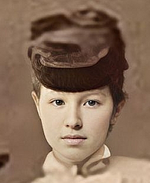

# Countess Anastasia Fyodorovna von Nieroth (Trepova)

| `nieroth_anastasia_large.jpg` | Countess Anastasia Fyodorovna von Nieroth, born Trepova (1849–1940). The source of this image was not recorded when it was added to this folder. | Source not recorded |

**Countess Anastasia Fyodorovna von Nieroth**, born **Trepova** (Russian: графиня Анастасия Фёдоровна Нирод, урождённая Трепова; 15 May 1849 – 25 September 1940), was the eldest child of General [Fyodor Fyodorovich Trepov (senior)](https://theo-armour.github.io/genealogy/#Wiki/Fyodor-Fyodorovich-Trepov-1809-1889/README-Fyodor-Fyodorovich-Trepov-1809-1889.md), city governor of St. Petersburg, and the wife of the courtier [Count Maximilian von Nieroth](https://theo-armour.github.io/genealogy/#Wiki/Maximilian-Carl-Benedict-von-Nieroth-1846-1914/README-Maximilian-Carl-Benedict-von-Nieroth-1846-1914.md). Four of her brothers held high office in the last decades of the Russian Empire, one of them as Prime Minister. She outlived her husband, her daughter and the Empire, and died in France at the age of 91.[1][2] She was the great-great-grandmother of Theo Armour.

| **Countess Anastasia Fyodorovna von Nieroth** | |
| :--- | :--- |
| **Native name** | Графиня Анастасия Фёдоровна Нирод (Трепова) |
| **Born** | 15 May 1849 Kiev, Russian Empire |
| **Died** | 25 September 1940 (aged 91) Amblainville, Oise, France |
| **Spouse** | Count Maximilian von Nieroth (1846–1914) |
| **Children** | [Fyodor](https://theo-armour.github.io/genealogy/#Wiki/Fyodor-Maximilianovich-von-Nieroth-1871-1952/README-Fyodor-Maximilianovich-von-Nieroth-1871-1952.md) (1871–1952) [Vera](https://theo-armour.github.io/genealogy/#Wiki/Vera-Maximilianovna-Kudasheva-von-Nieroth-1874-1920/README-Vera-Maximilianovna-Kudasheva-von-Nieroth-1874-1920.md) (1874–1920) |
| **Father** | General Fyodor Fyodorovich Trepov (1812–1889) |
| **Mother** | Vera Vasilyevna Lukashevich (1817 or 1821 – 1866) |

## Family

Anastasia Fyodorovna Trepova was born in Kiev on 15 May 1849, according to the genealogical record in this folder.[1] She was the eldest of the nine children of Fyodor Fyodorovich Trepov, then a gendarme officer, and Vera Vasilyevna Lukashevich.[2][3] Her mother died in 1866, the year her father was called to St. Petersburg as chief of police and the family was confirmed in the hereditary nobility.[2][3]

Her brothers and sisters were:[2]

* Yevgenia (born 1850), married name Albertova
* Yulia (1851–1923), maid of honour, who married Senator D. P. Sukhodolsky
* Sofia (1853–1927), maid of honour, who married Count Mikhail Evstafyevich Nirod
* [Fyodor](https://theo-armour.github.io/genealogy/#Wiki/Fyodor-Fyodorovich-Trepov-1854-1938/README-Fyodor-Fyodorovich-Trepov-1854-1938.md) (1854–1938), Governor-General of Kiev
* [Dmitri](https://theo-armour.github.io/genealogy/#Wiki/Dmitri%20Feodorovich%20Trepov-1850-1906/README-Dmitri-Feodorovich-Trepov-1850-1906.md) (1855–1906), Governor-General of St. Petersburg in 1905
* Yelizaveta (1858–1920), maid of honour, who married General A. A. Mosolov
* [Alexander](https://theo-armour.github.io/genealogy/#Wiki/Alexander-Fyodorovich-Trepov-1862-1928/README-Alexander-Fyodorovich-Trepov-1862-1928.md) (1862–1928), Prime Minister in 1916
* [Vladimir](https://theo-armour.github.io/genealogy/#Wiki/Vladimir%20Fyodorovich%20Trepov-1863-1918/README-Vladimir-Fyodorovich-Trepov-1863-1918.md) (1863–1918), Governor of Taurida

A research note in this wiki describes her as a former maid of honour to Empress Maria Feodorovna.[4] *(Unsound: no source is given for this.)*

## Marriage

She married Count Maximilian von Nieroth, a young official who had joined her father's office at the St. Petersburg police in 1868.[5] The date of the marriage has not been found. Their son was born in St. Petersburg in 1871.[6] They had two children:[5]

* **Count Fyodor (Theodor) Maximilianovich von Nieroth** (1871–1952), major general, who commanded the Life Guards Dragoon Regiment.
* **Countess Vera Maximilianovna von Nieroth** (1874–1920), maid of honour to Empress Alexandra Feodorovna, who in 1894 married Prince Sergei Vladimirovich Kudashev. Their daughter Maria married the American diplomat Norman Armour.[4]

Her husband rose to be a *Jägermeister* of the court and a member of the State Council, and owned land in Volhynia. Russian Wikipedia mentions an ancestral estate of hers there as well.[5] He died in May 1914.[5]

## Exile

Nothing has been found about how she left Russia. Her daughter Vera died in Paris in January 1920.[4] Her brother Vladimir was shot in 1918, and her brothers Fyodor and Alexander died in emigration in Nice.[2] She died on 25 September 1940, three months after the fall of France, at Amblainville in the Oise, where her son Fyodor lived.[1][6]

## Residences

* **Kiev.** Born there in 1849, when her father was serving in the gendarmes.[1][3]
* **Warsaw.** Her father served there from 1860 to 1866.[3] It is not recorded whether the family lived with him.
* **St. Petersburg**, from 1866, and throughout her married life.[3][5]
* **Volhynia Governorate.** Her husband's estates.[5]
* **Amblainville, Oise, France.** She died there in 1940.[1] Her son was living at the Château de Sandricourt in Amblainville.[6]

## Discrepancies and unverified claims

* **Her dates.** The day and place of her birth and death come from one online family tree (Geni), as recorded in this folder. Russian Wikipedia gives only the years 1849–1940.[1][2]
* **Maid of honour.** Unsourced (see above).[4]
* **Her given name.** Geni spells it "Anastatisya".[1]
* **The Shtenger connection.** Her father is said to have been the illegitimate son of F. A. Shtenger, and her husband's mother was a Shtenger. Whether she and her husband were related has not been established.[3][5]

## References

1. "Anastasia Fyodorovna Trepova (1849–1940)" (profile page, with the Geni record). Theo Armour Genealogy. <https://theo-armour.github.io/genealogy/#Wiki/Anastasia-Fyodorovna-Trepova-1849-1940/README-Anastasia-Fyodorovna-Trepova-1849-1940.md>
2. "Треповы". *Wikipedia* (Russian). <https://ru.wikipedia.org/wiki/Треповы>
3. "Трепов, Фёдор Фёдорович (старший)". *Wikipedia* (Russian). <https://ru.wikipedia.org/wiki/Трепов,_Фёдор_Фёдорович_(старший)>
4. "Sergei Vladimirovich Kudashev (1863–1933)" (profile page). Theo Armour Genealogy. <https://theo-armour.github.io/genealogy/#Wiki/Sergei-Vladimirovich-Kudashev-1863-1933/README-Sergei-Vladimirovich-Kudashev-1863-1933.md>
5. "Нирод, Максимилиан Евстафьевич". *Wikipedia* (Russian). <https://ru.wikipedia.org/wiki/Нирод,_Максимилиан_Евстафьевич>
6. "Fyodor Maximilianovich von Nieroth (1871–1952)" (profile page). Theo Armour Genealogy. <https://theo-armour.github.io/genealogy/#Wiki/Fyodor-Maximilianovich-von-Nieroth-1871-1952/README-Fyodor-Maximilianovich-von-Nieroth-1871-1952.md>
