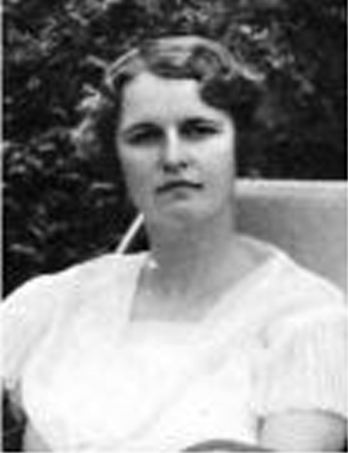

# Anne Bell Shirk Burrage

🌳 [See in the family tree](https://theo-armour.github.io/gedcom-viewer/#wiki=Anne-Bell-Burrage-1890-1983)

| `anne-burrage.jpg` | Anne Bell Burrage (born Shirk). The date and photographer are not recorded.[1] | Family / Herb Society of America collections |

**Anne Bell Burrage**, born **Anne Bell Shirk** (6 October 1893 – August 1983; see Open questions for the year of birth and the day of death), also known as Mrs Albert C. Burrage Jr, was an American gardener and civic organizer. She was one of the seven founders of The Herb Society of America, which was formally organized at her home in Ipswich, Massachusetts, on 23 August 1933, and she was its first president, in 1933–34.[2][3] In 1951 she became the first president of the Castle Hill Foundation, set up to help manage the Castle Hill estate at Ipswich.[10] She was born in Philadelphia, the daughter of the architect J. C. Marshall Shirk, and married Albert Cameron Burrage Jr of Boston in 1915.[1][6][8] She was the maternal grandmother of Theo Armour.[1]

| **Anne Bell Shirk Burrage** | |
| :--- | :--- |
| **Born** | 6 October 1893 (most sources; the profile page gives 1890) Philadelphia, Pennsylvania |
| **Baptized** | 24 June 1894, Philadelphia (according to two family trees) |
| **Died** | August 1983 (22 or 28 August; see Open questions) Ipswich, Massachusetts |
| **Resting place** | Highland Cemetery, Ipswich |
| **Known for** | A founder and first president (1933–34) of The Herb Society of America First president of the Castle Hill Foundation (1951) |
| **Spouse** | [Albert Cameron Burrage Jr](https://theo-armour.github.io/genealogy/#Wiki/Albert-Cameron-Burrage-Jr-1886-1978/README-Albert-Cameron-Burrage-Jr-1886-1978.md) (1886–1978), married April 1915 |
| **Children** | [Albert Cameron Burrage III](https://theo-armour.github.io/genealogy/#Wiki/Albert-Cameron-Burrage-III-1919-1944/README-Albert-Cameron-Burrage-III-1919-1944.md) (1919–1944) Anne Bell (see Open questions) [Cynthia Sewall Burrage Hovey](https://theo-armour.github.io/genealogy/#Wiki/Cynthia-Burrage-Hovey-1921-1983/README-Cynthia-Burrage-Hovey-1921-1983.md) (1921–1983) |
| **Parents** | [James Carson Marshall Shirk](https://theo-armour.github.io/genealogy/#Wiki/James-Cameron-Marshall-Shirk-1865-1918/README-James-Cameron-Marshall-Shirk-1865-1918.md) (1865–1918) [Ida Watkins Shirk](https://theo-armour.github.io/genealogy/#Wiki/Ida-Watkins-Shirk-1864-1951/README-Ida-Watkins-Shirk-1864-1951.md) |

## Family and early life

Anne Bell Shirk was born in Philadelphia on 6 October 1893, according to the Geni, MyHeritage and three Ancestry-derived family trees and to a headstone transcription.[13][14][15][16][17][22] The profile page in this repository gives the same day and month but the year 1890.[1] Two of the trees record her baptism at Philadelphia on 24 June 1894, citing the Historical Society of Pennsylvania's church and town records.[15][17]

Her father, James Carson Marshall Shirk (1865–1918), also recorded in family records as James Cameron Marshall Shirk, was a Philadelphia architect who had studied at the École des Beaux-Arts in Paris, and the son of the Union naval officer [James Whitehill Shirk](https://theo-armour.github.io/genealogy/#Wiki/James-Whitehill-Shirk-1832-1873/README-James-Whitehill-Shirk-1832-1873.md).[7] One family tree gives the marriage of her parents at Philadelphia on 20 April 1892, citing the same church records.[15]

Her mother, Ida Watkins, came from Little Rock, Arkansas. A history of Christ Church parish in Little Rock, published in 1900, lists Ida Watkins as a daughter of Chief Justice George C. Watkins of Arkansas and his second wife Sophia Fulton, a daughter of William S. Fulton, fourth governor of the Territory of Arkansas and later a United States senator. The same book records that "Ida married Marshall Shirk; they have one daughter, Anne Bell Shirk."[6] One family tree gives Ida Watkins's birth as 13 February 1864 at Little Rock and her death as 21 November 1951 at Ipswich.[15]

One family tree cites the 1910 United States census for her as a single daughter in a household in the 7th Ward of Philadelphia.[15] Her father died in 1918.[7] Nothing more is known here about her childhood or schooling.

## Marriage

She married Albert Cameron Burrage Jr, son of the Boston industrialist [Albert Cameron Burrage Sr](https://theo-armour.github.io/genealogy/#Wiki/Albert-Cameron-Burrage-Sr-1859-1931/README-Albert-Cameron-Burrage-Sr-1859-1931.md), in April 1915.[8] A Little Rock newspaper of 28 March 1915 reported that invitations had been received for the wedding of "Albert Cameron Burrage Jr., of Boston, Mass., and Miss Anne Bell Shirk, 1339 Pine street, Philadelphia", to take place on 7 April, and described her mother as a granddaughter of Chief Justice George Claiborne Watkins.[18] *(Unsound: seen only as a search-engine excerpt of the newspaper's OCR text; the page itself was not read. "Granddaughter" also conflicts with the 1900 parish history, which makes Ida Watkins a daughter of the Chief Justice.)* One family tree gives the date as 7 April 1915 and the place as "Christ's Church Chapel, Philadelphia", citing the *Boston Evening Transcript* of 7 April 1915 and the Knoxville *Journal and Tribune* of 11 April 1915.[15]

Her husband had graduated from Harvard in 1908, worked as a metallurgist in Bayonne, New Jersey, and then as a mining engineer in Boston. He was a horticulturist like his father and published a book on growing vegetables in 1954.[8] He was born on 30 August 1886 and died at Ipswich on 8 February 1978.[21]

They had three children:[1]

* **Albert Cameron Burrage III** (14 February 1919 – 8 August 1944), who died at Gouesnou, Brittany, France.[23]
* **Anne Bell**, known in one record as Nancy. By June 1941 she was Mrs William B. Chace of Uxbridge.[1][12][14]
* **Cynthia Sewall** (20 November 1921 – 12 September 1983), later Mrs Norman Armour Jr and then Mrs Chandler Hovey Jr.[12]

## The Herb Society of America

The Society's own history says that in 1933 seven women friends, six of whom lived in Boston and one of whom spent summers in New England, decided to form a society "whose intent and purpose was the study and research of herbs", and that "On August 23, 1933, at the Ipswich, Massachusetts home of Mrs. Albert C. (Anne) Burrage, Jr." the Society was formally organized.[2]

The inventory of the Society's archives names the seven founders as Adeline Philbrick Cole, Anne Shirk Burrage, Harriet Addams Brown, Corinna Searle Mitchell, Florence Brown Bratenahl, Ella Hulst Greenslet and Frances Torrey Norton. It says that the first organizational meeting was held in Wenham, Massachusetts, and that the founders soon sought the help of Dr Edgar Anderson of the Arnold Arboretum. Its list of presidents begins "Burrage, Anne Bell Shirk 1933-34", followed by Adeline P. Cole (1934–35) and Edgar Anderson (1935–36).[3] From 1935 the Society rented space at the Massachusetts Horticultural Society in Boston.[3]

In 1936 she wrote "Dittany Redivivus", an article in the Society's annual, *The Herbarist*; the Society's online index lists it under Herbal Folklore.[5]

The Society gave her its Special Award of Honor in 1981; she is the only person listed as receiving that award.[3][4]

The National Herb Garden at the U.S. National Arboretum in Washington, D.C., was the Society's gift to the nation. A trade-journal report of 1980 says that Joan Mondale and the Secretary of Agriculture, Bob Bergland, dedicated it, and that the Society had raised over $300,000 for it.[20] A post on the Society's blog says it was dedicated on 12 June 1980, "with Mrs. Albert C. Burrage, one of the founding members of The Herb Society of America, presenting the garden" and Joan Mondale accepting on behalf of the American people.[19] *(Unsound: the blog post could not be opened; this is taken from a search-engine excerpt of it.)*

## Ipswich Garden Club and Castle Hill

The history of the Ipswich Garden Club, founded in 1927, lists "Mrs. A.C. Burrage, Jr." as its president from June 1931 to 1933, so she held that office in the years just before the Herb Society was founded. The same page says that she was an officer of "the Federation", without naming the office or the years, and calls her "a very active member" of the club.[11]

On 18 January 1951 sixteen people, among them Anne Burrage, met at 44 Beacon Street, Boston, to form the Castle Hill Foundation, to assist with managing the Castle Hill estate at Ipswich, which had been bequeathed to The Trustees of Reservations in 1949. "The first President of the new corporation was Anne B.S. Burrage of Ipswich, MA."[10] The foundation's aims included preserving and restoring Castle Hill, supporting the fine arts and presenting public events on the property.[10] A local history of Ipswich describes 44 Beacon Street as "the Burrage home"; the Trustees' archive guide gives only the address.[9][10]

## Later life and death

In 1950 she inherited a property on Essex Road, Ipswich, under the will of Emily G. Patch, and in October 1953 she bought the adjoining lot at 74 Essex Road from Neil C. Raymond; the combined Burrage property was known as the "Patch Trust".[9] Two family trees cite the 1950 census for her at Ipswich, one of them as the wife in the household.[15][17] Her husband died in February 1978.[21]

She died at Ipswich in August 1983. The Geni record gives 22 August 1983; MyHeritage and a headstone transcription give 28 August 1983; the trees that cite the Social Security Death Index give only "August 1983".[1][13][14][15][16][22] MyHeritage gives her burial place as "Cowles/Highland Cemetery, Ipswich", and a local history of Ipswich illustrates the Burrage family tombstone at Highland Cemetery.[9][14] No obituary has been found.

## Residences

* **Philadelphia.** Born there; in the household of her parents, 7th Ward, in the 1910 census according to one tree; at 1339 Pine Street in March 1915 according to a newspaper excerpt.[15][18]
* **Hamilton, Massachusetts.** The couple lived there after their marriage.[8] One tree cites the 1920 census (Hamilton, Essex County), a 1921 city directory and a passport application of December 1923 that place her there.[15]
* **Boston.** 29 Hereford Street was their town address; the newspapers gave it in 1941, and one tree cites the 1930 census for her in Boston.[8][12][15]
* **Ipswich, Massachusetts.** Candlewood Farm.[8][12] The Herb Society was organized at her Ipswich home in 1933.[2] She was described as "of Ipswich" in 1951, appears in the 1950 census there according to two trees, owned the Essex Road property from 1950 and 1953, and died there in 1983.[9][10][15][17] The Ipswich Garden Club history associates her husband's gardens with Heartbreak Road; whether this is the same place as Candlewood Farm is not stated.[11]
* **Travel.** One tree records arrivals at New York from Trinidad on 24 March 1924 and at Boston from Liverpool on 18 October 1937, citing passenger lists that have not been seen.[15]

## Open questions

* **Year of birth.** The profile page, the folder name and the Peeps page give 1890.[1] The Geni record itself, as exported, gives 1893, although the profile page quotes Geni.[13] Every family tree export in this repository, and a headstone transcription, give 6 October 1893.[13][14][15][16][17][22] Two trees give a baptism in June 1894, and one gives her parents' marriage in April 1892, both of which fit 1893 better than 1890.[15][17] No birth record has been seen.
* **Day of death.** Geni and the profile page give 22 August 1983 (the Cynthia biography follows this); MyHeritage and the headstone transcription give 28 August 1983.[1][13][14][22] The Social Security Death Index, as cited, gives only the month.[15]
* **Where the Society was founded.** The Society's history page says it was formally organized at her Ipswich home on 23 August 1933; its archives inventory says the first organizational meeting was held in Wenham.[2][3] These may be two different meetings.
* **"Born into a prominent Boston family."** The *Life* section of the profile page says this.[1] She was born in Philadelphia to a Philadelphia and Arkansas family and married into the Boston Burrage family; the Peeps page says "Married into".[1][6][7]
* **"She gathered six fellow gardeners."** The profile page and Peeps entry say she gathered the others.[1] The Society's history and archives describe a study group of seven friends and do not say who brought them together.[2][3]
* **Her father's middle name.** Carson (Philadelphia Architects and Buildings, as cited on his profile page, and one tree) or Cameron (the folder name and her profile page).[1][7][15] The 1900 parish history and the 1915 newspaper call him simply Marshall Shirk or J. C. Marshall Shirk.[6][18]
* **Her mother's relation to Chief Justice Watkins.** Daughter, according to the 1900 parish history; granddaughter, according to the 1915 newspaper excerpt.[6][18] The parish history is the more detailed source.
* **Her elder daughter's name.** Anne Bell on the profile pages; "Nancy Burrage" in MyHeritage; "Anna Bell Burrage", born 18 July 1920 at Hamilton and died April 1994, in one Ancestry-derived tree.[1][14][15] None of these is sourced to a record that has been seen.
* **44 Beacon Street.** A local history calls it "the Burrage home" in 1951; the Trustees' guide gives only the address, and the family's town address in 1941 was 29 Hereford Street.[9][10][12]
* **Number at the Castle Hill meeting.** The local history says fifteen people met; the Trustees' guide names sixteen.[9][10]
* **Editor of the first bulletin.** A search-engine summary attributed to the Society's website the statement that she edited the Society's first bulletin, the forerunner of *The Herbarist*. The Society's current history page does not say this, and the page that may have said it no longer exists. It is not included above.

## Questions for Theo

Points that family knowledge or family papers may settle. Each links to a conflict described above.

* **Year of birth.** Every family-tree export and a headstone transcription give 6 October 1893; the folder name, the profile page and *Peeps* give 1890. Which is right? If it is 1893, the folder `Anne-Bell-Burrage-1890-1983` would be renamed and the links to it updated.
* **Day of death.** 22 August 1983 (profile page, Geni) or 28 August 1983 (MyHeritage, headstone transcription)? The Cynthia biography currently follows 22 August.
* **The profile page's "born into a prominent Boston family".** She was born in Philadelphia and married into the Burrages. Should that sentence change?
* **"She gathered six fellow gardeners."** The Society describes a study group of seven friends without saying who brought them together. Is there a family account that she was the one who gathered them?
* **Her father's middle name.** Carson or Cameron? His folder is named `James-Cameron-Marshall-Shirk-1865-1918`.
* **Her mother Ida Watkins.** Was Ida the daughter or the granddaughter of Chief Justice George C. Watkins?
* **Her elder daughter.** Was she known as Anne Bell, Anna Bell or Nancy?
* **Candlewood Farm and 44 Beacon Street.** Where exactly was Candlewood Farm? Was 44 Beacon Street a Burrage home in 1951?
* **Editor of the first bulletin.** Is there any family record that she edited the Herb Society's first bulletin?

## References

1. "Anne Bell Burrage (1890–1983)". Profile page in this repository, with data from Geni; and the entry "Anne Bell Burrage ~ Maternal grandmother" in [Peeps-in-My-Family.md](https://theo-armour.github.io/genealogy/#Peeps-in-My-Family.md). `Anne-Bell-Burrage-1890-1983.md` (merged into this README and removed); Geni: <https://www.geni.com/people/Anne-Burrage/6000000002789973022>
2. "History". The Herb Society of America. <https://www.herbsociety.org/about/history.html>
3. *An Inventory of Records and Manuscripts in The Herb Society of America Archives, 1933–2020*. Processed by James Shelly, 1996–1997; revised 2012, 2017, 2020 and January 2025. Sections "History", "9.2 Presidents' Biographical Information" and "E1 Special Award of Honor". <https://herbsociety.org/file_download/7966c212-0f58-4a8f-af6c-43ae91c0706b> (an earlier revision: <https://herbsociety.org/file_download/5f27403b-551b-4e36-9774-e0a10eb20be3>)
4. *The Herb Society of America Award Descriptions and Winners by Award*. The Herb Society of America. "Special Award of Honor: 1981 Anne Burrage". <https://www.herbsociety.org/file_download/inline/f4a502ae-9cd8-4c6a-bc29-7471db32b479>
5. "The Herbarist Archives". The Herb Society of America. Entry "Dittany Redivivus by Anne Burrage - 1936". <https://herbsociety.org/hsa-learn/herb-information/the-herbarist/hsa-herbarist-collection.html/title/the-herbarist-2008>
6. Cantrell, Ellen Harrell. *The Annals of Christ Church Parish of Little Rock, Arkansas, from 1839 to 1899*. Little Rock: Arkansas Democrat Co., 1900, pp. 57–59 (section "William S. Fulton"). <https://archive.org/details/annalsofchristch00cant>
7. "James Carson Marshall Shirk (1865–1918)". Profile page in this repository, citing Philadelphia Architects and Buildings and the AIA Historical Directory. [README-James-Cameron-Marshall-Shirk-1865-1918.md](https://theo-armour.github.io/genealogy/#Wiki/James-Cameron-Marshall-Shirk-1865-1918/README-James-Cameron-Marshall-Shirk-1865-1918.md)
8. "314 Commonwealth". *Back Bay Houses*. <https://backbayhouses.org/314-commonwealth/>
9. Harris, Gordon. "74 Essex Rd., the Willard B. and Harriett Manning Kinsman House (1851)". *Historic Ipswich*. Cites the conveyance by Emily G. Patch to Anne B. Burrage (Essex deeds 3719:187) and the sale of the lot by Neil Raymond to Anne B. Burrage, October 1953. <https://historicipswich.net/74-essex-rd/>
10. Keane, Brenda. *Guide to Castle Hill Foundation Archive (1928–2001)*, CH.MS.Coll.3. The Trustees of Reservations Archives & Research Center, April 2016, updated October 2016. <https://thetrustees.access.preservica.com/wp-content/uploads/sites/72/2016/10/Castle_Hill_Foundation_Archive_FINAL_10_25_2016.pdf>
11. "IGC History". Ipswich Garden Club. <http://ipswichgardenclub.blogspot.com/p/igc-history.html>
12. "Cynthia Sewall Burrage Hovey". Biography in this repository, citing the *Boston Sunday Post*, 29 June 1941, and the *Boston Daily Record*, 28 June 1941. [README-Cynthia-Burrage-Hovey-1921-1983.md](https://theo-armour.github.io/genealogy/#Wiki/Cynthia-Burrage-Hovey-1921-1983/README-Cynthia-Burrage-Hovey-1921-1983.md)
13. Geni GEDCOM exports, record for Anne Bell Shirk (geni:6000000002789973022). `GEDCOM-files/2025/2025-08-18-export-geni/export-BloodTree.ged` and `GEDCOM-files/2025/2025-08-30-export-geni/export-Ancestors.ged`
14. MyHeritage GEDCOM export, record for Anne Bell Shirk, quoting the Geni World Family Tree and a burial record. `GEDCOM-files/2025/2025-08-18-myheritage-armour.ged`
15. Ancestry- and FamilySearch-derived family tree, records for Anne Bell Shirk, her parents and her children. Cites the 1910, 1920, 1930 and 1950 United States censuses; Historic Pennsylvania Church and Town Records (reel 638); U.S. passport applications (December 1923); New York and Boston passenger lists; U.S. city directories; the Social Security Death Index; the Massachusetts Death Index, 1970–2003; and newspaper marriage indexes. None of these records has been seen directly. `GEDCOM-files/2025/2025-08-28-matthew-family-tree.ged`
16. Ancestry-derived family tree, record for Anne Bell Shirk. `GEDCOM-files/2025/2025-08-23-carley-armour-family-tree.ged`
17. Ancestry GEDCOM export, record for Anne Bell Shirk. Cites Pennsylvania and New Jersey Church and Town Records and the 1950 census. `GEDCOM-files/2025/2025-08-18-ancestry-armour-ferté/2025-08-18-armour-ferte.ged`
18. *Daily Arkansas Gazette* (Little Rock), 28 March 1915, p. 26. Seen only as a search-engine excerpt of the OCR text. <https://www.newspapers.com/newspage/138391981/>
19. "When It Comes to Women's History Month, The Herb Society of America Could Write Volumes". *The Herb Society of America Blog*. Seen only as a search-engine excerpt; the page refused automated access. <https://blog.herbsociety.org/when-it-comes-to-womens-history-month-the-herb-society-of-america-could-write-volumes/>
20. "Mondale, Bergland dedicate herb garden". Trade-journal news page, 1980 (file dated August 1980), Michigan State University Libraries, Turfgrass Information Center. <https://archive.lib.msu.edu/tic/wetrt/article/1980aug12.pdf>
21. "Albert Cameron Burrage Jr (1886–1978)". Profile page in this repository, with data from Geni. [README-Albert-Cameron-Burrage-Jr-1886-1978.md](https://theo-armour.github.io/genealogy/#Wiki/Albert-Cameron-Burrage-Jr-1886-1978/README-Albert-Cameron-Burrage-Jr-1886-1978.md)
22. "Anne Bell Burrage (Shirk), 6 October 1893 – 28 August 1983", Highland Cemetery, Ipswich. *BillionGraves*. Seen only as a search-result title; the page refused automated access. <https://billiongraves.com/grave/Anne-Bell-Shirk-Burrage/19502034>
23. "Albert Cameron Burrage III (1919–1944)". Profile page in this repository, with data from Geni. [README-Albert-Cameron-Burrage-III-1919-1944.md](https://theo-armour.github.io/genealogy/#Wiki/Albert-Cameron-Burrage-III-1919-1944/README-Albert-Cameron-Burrage-III-1919-1944.md)

## Further research

* Her birth record or the 1894 baptism entry (Historic Pennsylvania Church and Town Records, reel 638), to settle 1890 or 1893.
* Her death record and any obituary of August 1983, in the *Ipswich Chronicle*, the *Boston Globe* or the Herb Society's newsletter.
* The 1915 wedding reports in the *Boston Evening Transcript* (7 April) and the *Daily Arkansas Gazette* (28 March).
* Dorothy G. Spencer's history *The Herb Society of America, 1933–1993*, and the founders' and presidents' files in the Society's archives, for her part in the founding and for the Wenham and Ipswich meetings.
* *The Herbarist* for 1935 and 1936, including "Dittany Redivivus", and whether she edited the first bulletin.
* The Highland Cemetery headstone, to read the dates directly.
