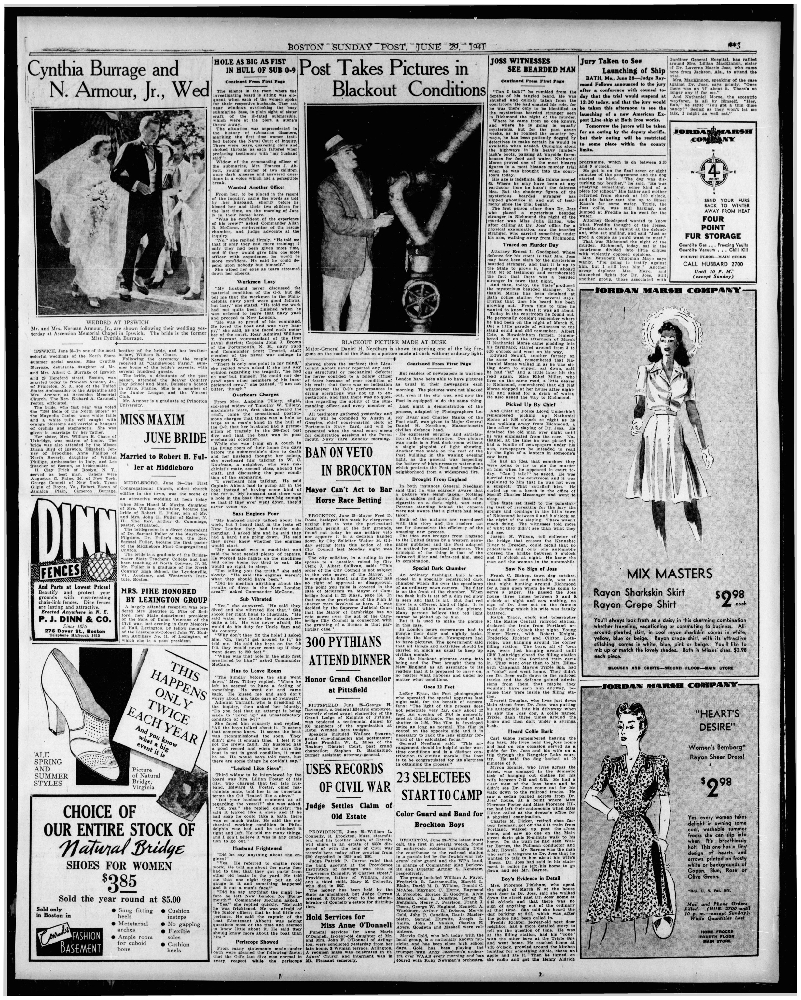

# Cynthia Sewall Burrage Hovey

| `The_Boston_Post_29_Jun_1941.jpg` | "Cynthia Burrage and N. Armour, Jr., Wed". *Boston Sunday Post*, 29 June 1941. The photograph at top left shows the couple after the wedding at Ipswich.[2] | Family collection of newspaper clippings |

**Cynthia Sewall Burrage** (20 November 1921 – 12 September 1983), later Mrs Norman Armour Jr and then Mrs Chandler Hovey Jr, was a daughter of a Boston and Ipswich, Massachusetts, family. Boston newspapers reported that she was voted the "1940 Belle of the North Shore", and her wedding at Ipswich in June 1941 to the son of the United States Ambassador to Argentina was covered as one of the main society weddings of that summer.[1][2][3] She was the mother of Theo Armour.[1]

| **Cynthia Sewall Burrage Hovey** | |
| :--- | :--- |
| **Born** | 20 November 1921 Boston, Massachusetts (most sources; see Open questions) |
| **Died** | 12 September 1983 (aged 61) New Haven County, Connecticut (most sources; see Open questions) |
| **Education** | Beaver Country Day School Mme. Boissier's School, Paris |
| **Spouses** | [Norman Armour Jr](https://theo-armour.github.io/genealogy/#Wiki/Norman-Armour-Jr-1920-1978/Norman-Armour-Jr-1920-1978.md) (married 28 June 1941; divorced 1952) Chandler Hovey Jr |
| **Parents** | [Albert Cameron Burrage Jr](https://theo-armour.github.io/genealogy/#Wiki/Albert-Cameron-Burrage-Jr-1886-1978/Albert-Cameron-Burrage-Jr-1886-1978.md) (1886–1978) [Anne Bell Shirk Burrage](https://theo-armour.github.io/genealogy/#Wiki/Anne-Bell-Burrage-1890-1983/Anne-Bell-Burrage-1890-1983.md) (1890–1983) |

## Family and early life

Cynthia Sewall Burrage was born on 20 November 1921, in Boston according to most of the family trees that record her.[1][5][6][8] She was the daughter of Albert Cameron Burrage Jr and Anne Bell Shirk, and a granddaughter of the industrialist and attorney [Albert Cameron Burrage Sr](https://theo-armour.github.io/genealogy/#Wiki/Albert-Cameron-Burrage-Sr-1859-1931/Albert-Cameron-Burrage-Sr-1859-1931.md).[1][10][11] Her mother was a founder of The Herb Society of America, which was established at the family's home in Ipswich in 1933.[10]

She had an elder brother, [Albert Cameron Burrage III](https://theo-armour.github.io/genealogy/#Wiki/Albert-Cameron-Burrage-III-1919-1944/Albert-Cameron-Burrage-III-1919-1944.md) (1919–1944), and a sister, Anne Bell.[1] By June 1941 her sister was Mrs William B. Chace of Uxbridge.[2]

One family tree cites the 1930 United States census for her as a daughter in a household in Boston.[8] In 1941 the newspapers described her parents as "of Ipswich and 29 Hereford street, Boston", and "Candlewood Farm" at Ipswich as their summer home.[2][3]

## Schooling and debut

The *Boston Sunday Post* reported in 1941 that she had attended the Beaver Country Day School and Mme. Boissier's School in Paris, France, and that she was a member of the Junior League and the Vincent Club.[2]

The same report said that in 1940 she was voted the "1940 Belle of the North Shore" at the Magnolia Casino.[2] The *Boston Post* repeated this in 1952, adding that the vote was taken "at an exclusive social event in the Magnolia Casino" and that she "was one of the most beautiful debutantes of that season".[4] The *Boston Daily Record* called her a "post-debutante" in June 1941 and said she had been "dubbed glamour girl of the 1930-40 debutantes" (the years are given here as printed).[3]

## Marriage to Norman Armour Jr

Her engagement to Norman Armour Jr was announced late in April 1941.[3] He was the son of [Norman Armour Sr](https://theo-armour.github.io/genealogy/#Wiki/Norman-Armour-Sr-1887-1982/Norman-Armour-Sr-1887-1982.md), then United States Ambassador to Argentina, and was described as "of Princeton, N. J." and a graduate of Princeton University.[2][3]

They were married on Saturday 28 June 1941 at Ascension Memorial Church in Ipswich. The rector, the Rev. Richard A. Cartmell, officiated.[2][3] The *Boston Daily Record* of that morning headed its society column "Cynthia Burrage Is N. Shore Bride Today" and reported that the bridegroom's parents had travelled from South America for the wedding.[3] The *Boston Sunday Post* of the next day reported that she was given in marriage by her father, that her sister was matron of honor, and that her brother Cameron Burrage and her brother-in-law William B. Chace were among the ushers. The best man was H. Clay Frick of Roslyn, New York. After the ceremony the couple received "several hundred guests" at Candlewood Farm.[2] The *Post* described the bride's dress:

> The bride, who last year was voted the "1940 Belle of the North Shore" at the Magnolia Casino, wore white faille and a white tulle veil caught with orange blossoms and carried a bouquet of orchids and stephanotis.[2]

The couple had three children.[1][4] The marriage ended in divorce in August 1952; the *Boston Post* reported the decree from Reno, Nevada, under the date 22 August 1952.[4]

## Later life

She later married Chandler Hovey Jr, and was known afterwards as Cynthia Hovey.[1][5] One family tree gives the date of this marriage as 3 January 1961 and the place as "Middlebury", without naming a state or a source.[8] No newspaper announcement of the marriage has been found.

She died on 12 September 1983, in New Haven County, Connecticut, according to most of the family trees. One of them cites the Connecticut Death Index.[1][5][6][8] Her mother had died at Ipswich three weeks earlier, on 22 August 1983.[10] No obituary or burial record has been found.

## Residences

* **Boston, Massachusetts.** Recorded in the 1930 census as a daughter in a Boston household, according to one family tree.[8] In 1941 her parents' town address was 29 Hereford Street.[2]
* **Ipswich, Massachusetts.** "Candlewood Farm", her parents' summer home, where her wedding reception was held in 1941.[2][3] In 1952 the *Boston Post* still described her as "of Ipswich".[4]
* **Paris, France**, while at Mme. Boissier's School. The dates are not given.[2]
* **Connecticut**, where she died in 1983.[1][8]

## Open questions

* **Place of birth.** Geni, MyHeritage and one Ancestry-derived tree give Boston.[1][5][6][8] Another Ancestry-derived tree gives Hamilton, Essex County, Massachusetts.[7] No birth record has been seen.
* **Date of birth.** Most trees give 20 November 1921.[1][5][6][7][8] One Ancestry export gives 22 November 1922.[9]
* **Date and place of death.** Most trees give 12 September 1983 in New Haven or New Haven County, Connecticut.[1][5][6][7][8] One Ancestry export gives 9 September 1983 at Hartford, Connecticut.[9]
* **Place and date of the first marriage.** The two Boston newspapers place the wedding at Ipswich on 28 June 1941.[2][3] MyHeritage (quoting Geni) and one Ancestry export give "1941, Boston".[6][9] Another tree gives "July 1941".[8] The newspapers, written on the day and the day after, are the better evidence.
* **Name of the church.** The 1941 reports call it "Ascension Memorial Church"; the *Post*'s photograph caption says "Ascension Memorial Chapel"; the 1952 report says "Church of the Ascension".[2][3][4]
* **Year of her debut.** The *Post* in June 1941 calls her "a debutante of the past season". The *Record* on the day before refers to "the 1930-40 debutantes", which is probably a misprint for 1939–40.[2][3] The two reports do not clearly agree on the season.
* **Order of the marriages.** The profile page, following Geni, lists Chandler Hovey Jr before Norman Armour Jr.[1] The newspapers show that the marriage to Norman Armour Jr came first.[2][4]
* **Chandler Hovey Jr.** Geni gives his birth as 1912 in Boston.[5] Another tree names him Chandler Buss Hovey Jr and gives 26 March 1915 at Brookline, Massachusetts.[8] Neither is sourced.
* **Atlantic crossing, 1939.** One tree attaches to her a passenger-list entry for an arrival at New York from Le Havre on 27 April 1939.[8] This would fit her schooling in Paris, but the same record in that tree also carries entries that plainly belong to her mother-in-law, so the attribution is unsafe until the passenger list itself is checked.
* **Her sister's name.** The profile page gives Anne Bell.[1] MyHeritage's summary of the Geni record gives "Nancy Burrage".[6]

## References

1. "Cynthia Burrage Hovey (1921–1983)". Profile page in this repository, with data from Geni. [Cynthia-Burrage-Hovey-1921-1983.md](https://theo-armour.github.io/genealogy/#Wiki/Cynthia-Burrage-Hovey-1921-1983/Cynthia-Burrage-Hovey-1921-1983.md); Geni: <https://www.geni.com/family-tree/index/6000000002789967033>
2. "Cynthia Burrage and N. Armour, Jr., Wed". *Boston Sunday Post*, 29 June 1941, datelined Ipswich, 28 June. The page number in the header appears to be 3. Clipping: [images/The_Boston_Post_29_Jun_1941.jpg](images/The_Boston_Post_29_Jun_1941.jpg)
3. Winslow, Constance. "Cynthia Burrage Is N. Shore Bride Today". *Boston Daily Record*, Saturday 28 June 1941, p. 17. Clipping: [images/The_Boston_Record_28_Jun_1941_17.jpg](images/The_Boston_Record_28_Jun_1941_17.jpg)
4. "Society Belle in Reno Divorce From Armour". *Boston Post*, Saturday 23 August 1952, p. 2, datelined Ipswich, 22 August. Clipping: [images/The_Boston_Post_23_Aug_1952.jpg](images/The_Boston_Post_23_Aug_1952.jpg)
5. Geni GEDCOM exports, records for Cynthia Sewall Burrage (geni:6000000002789967033) and Chandler Hovey Jr (geni:6000000002789967083). `Online-Genealogy/gedcom-files/2025-08-18-export-geni/export-BloodTree.ged` and `Online-Genealogy/gedcom-files/theo/2025-08-30-export-geni/export-Ancestors.ged`
6. MyHeritage GEDCOM export, record for Cynthia Sewall Burrage, quoting the Geni World Family Tree. `Online-Genealogy/gedcom-files/2025-08-18-myheritage-armour.ged`
7. Ancestry-derived family tree, record for Cynthia Sewall Burrage. Cites "Ancestry Family Tree" and an index entry for *The Ottawa Citizen*, 15 May 1941 (not seen). `Online-Genealogy/gedcom-files/2025-08-23-carley-armour-family-tree.ged`
8. Ancestry- and FamilySearch-derived family tree, record for Cynthia Sewall Burrage. Cites the Connecticut Death Index, 1949–2012; Massachusetts Town and Vital Records; the 1930 United States census (Boston, Suffolk, page 7A, enumeration district 0163); and New York passenger lists. None of these records has been seen directly. `Online-Genealogy/gedcom-files/2025-08-28-matthew-family-tree.ged`
9. Ancestry GEDCOM export, record for "Cynthia Burrage Armour". `Online-Genealogy/gedcom-files/2025-08-18-ancestry-armour-ferté/2025-08-18-armour-ferte.ged`
10. "Anne Bell Burrage (1890–1983)". Profile page in this repository. [Anne-Bell-Burrage-1890-1983.md](https://theo-armour.github.io/genealogy/#Wiki/Anne-Bell-Burrage-1890-1983/Anne-Bell-Burrage-1890-1983.md)
11. "Albert Cameron Burrage Jr (1886–1978)". Profile page in this repository. [Albert-Cameron-Burrage-Jr-1886-1978.md](https://theo-armour.github.io/genealogy/#Wiki/Albert-Cameron-Burrage-Jr-1886-1978/Albert-Cameron-Burrage-Jr-1886-1978.md)

## Further research

* Her birth record (Massachusetts vital records, 1921), to settle Boston or Hamilton.
* The Connecticut Death Index entry and any obituary of September 1983, in Connecticut or Boston-area newspapers.
* The engagement announcement of late April 1941 in the Boston papers, and the item in *The Ottawa Citizen* of 15 May 1941 that two family trees cite.
* Reports of the 1940 "Belle of the North Shore" vote at the Magnolia Casino, in the Boston papers of that summer.
* A record or announcement of her marriage to Chandler Hovey Jr.
* The New York passenger list of 27 April 1939.
