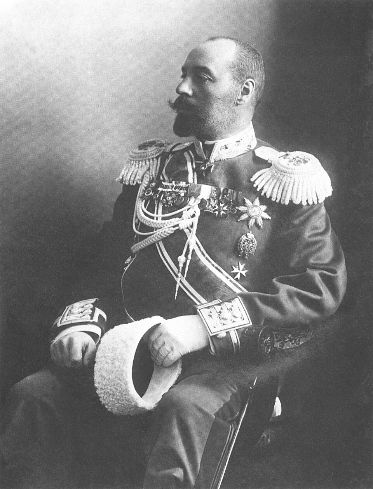

# General Dmitri Fyodorovich Trepov

| `dmitri-trepov-1905.jpg` | Dmitri Fyodorovich Trepov, Governor-General of St. Petersburg, 1905. Unknown photographer. Public domain.[3] | [Source](https://commons.wikimedia.org/wiki/File:Dmitry_Fyodorovich_Trepov,_1905.jpg) |

**Dmitri Fyodorovich Trepov** (Russian: Дмитрий Фёдорович Трепов; 2 [14] December 1855 – 2 [15] September 1906) was a Russian general and police chief. He was chief of police of Moscow from 1896 to 1905. After [Bloody Sunday](https://en.wikipedia.org/wiki/Bloody_Sunday_(1905)) in January 1905 he was made Governor-General of St. Petersburg with sweeping powers, and then Deputy Minister of the Interior in charge of the police. He was the most powerful man in Russia's internal security during the [Revolution of 1905](https://en.wikipedia.org/wiki/1905_Russian_Revolution), and his order to the troops, "патронов не жалеть" (do not spare the cartridges), became a byword for repression.[1] He was a son of [General Fyodor Fyodorovich Trepov (senior)](https://theo-armour.github.io/genealogy/#Wiki/Fyodor-Fyodorovich-Trepov-1812-1889/biography_of_general_fyodor_fyodorovich_trepov_1812_1889.md) and a brother of Theo Armour's great-great-grandmother Anastasia.[2]

| **Dmitri Fyodorovich Trepov** | |
| :--- | :--- |
| **Native name** | Дмитрий Фёдорович Трепов |
| **Born** | 2 (14) December 1855 St. Petersburg |
| **Died** | 2 (15) September 1906 (aged 50) St. Petersburg |
| **Resting place** | Court Church of Saints Peter and Paul, Peterhof (tomb destroyed after 1917) |
| **Education** | Page Corps |
| **Rank** | Major general (1900); of the Imperial Suite (1903) |
| **Offices** | Chief of police, Moscow (1896–1905) Governor-General of St. Petersburg (January–October 1905) Deputy Minister of the Interior (from May 1905) Palace Commandant (from 26 October 1905) |
| **Spouse** | Sofia Sergeyevna Blokhina (1862–1915) |
| **Children** | Sofia, Tatyana, Maria |

## Early career

Trepov was educated in the Page Corps and served in the Life Guards Horse Regiment. In the [Russo-Turkish War](https://en.wikipedia.org/wiki/Russo-Turkish_War_(1877%E2%80%931878)) of 1877 he served under General Gurko and was wounded in the leg at the Battle of Telish.[1]

## Moscow, 1896–1905

In 1896 he became acting chief of police (*ober-politsmeister*) of Moscow, replacing Vlasovsky, who was blamed for the [Khodynka disaster](https://en.wikipedia.org/wiki/Khodynka_Tragedy) at the coronation of Nicholas II. He was confirmed in the post in 1900 with the rank of major general. He put down revolutionary activity, especially among students, and backed [Sergei Zubatov](https://en.wikipedia.org/wiki/Sergei_Zubatov)'s scheme of police-sponsored workers' organisations.[1]

On 2 January 1905 a nineteen-year-old named Poltoratsky shot at him; the bullet passed through his coat.[1]

## St. Petersburg, 1905

By a decree of 11 January 1905, two days after Bloody Sunday, Trepov was appointed Governor-General of St. Petersburg. He was at first lodged in a wing of the Winter Palace. In May he also became Deputy Minister of the Interior, in command of the police and the Corps of Gendarmes.[1]

During the general strike of October 1905 he had a notice posted in the capital calling for calm and telling the troops to put down disorder at once, with the words "патронов не жалеть".[1] After the [October Manifesto](https://en.wikipedia.org/wiki/October_Manifesto) he left his posts and on 26 October 1905 became Palace Commandant, responsible for the safety of the Emperor. He was counted among the court group opposed to the Prime Minister, [Sergei Witte](https://en.wikipedia.org/wiki/Sergei_Witte).[1]

On 1 July 1906 General S. V. Kozlov, who looked like Trepov, was shot dead by mistake at a concert in Peterhof.[1]

## Death

Trepov died suddenly on 2 (15) September 1906 of heart disease. Rumours of suicide were dismissed after a post-mortem examination. He was buried in the Court Church of Saints Peter and Paul at Peterhof. His wife was buried beside him in 1915. The tomb was destroyed after the revolution.[1] *The New York Times* headed its obituary "Death of Gen. Trepoff: Most hated Russian, marked for assassination".[4]

## Family

He married **Sofia Sergeyevna Blokhina** (1862–1915). They had three daughters: Sofia (married name Glebova), Tatyana (Gall) and Maria (Brünner). All three emigrated after the revolution. Russian Wikipedia also records an illegitimate son, Fyodor Khristoforovich Platonov (born 1877), by the ballerina Maria Petipa.[1]

His brother-in-law General A. A. Mosolov, husband of his sister Yelizaveta, wrote memoirs that are a principal source on him.[1]

## In literature

He is said to be the model for "General T." in [Joseph Conrad](https://en.wikipedia.org/wiki/Joseph_Conrad)'s novel *Under Western Eyes* (1911).[1]

## Residences

* **St. Petersburg.** Born there; an officer of the Horse Guards.[1]
* **Moscow**, 1896–1905, as chief of police.[1]
* **Winter Palace, St. Petersburg**, in 1905.[1]
* **Peterhof.** He was buried there in 1906.[1]

## Discrepancies and unverified claims

* **Birth year.** Russian Wikipedia gives 2 (14) December 1855. The folder for this page and the Wikimedia Commons caption give 1850.[1][3]
* **The illegitimate son.** This is stated by Russian Wikipedia; its source has not been checked.[1]

## References

1. "Трепов, Дмитрий Фёдорович". *Wikipedia* (Russian). Cites the Brockhaus and Efron dictionary; Мосолов, А. А., *При дворе последнего императора*; Витте, С. Ю., *Воспоминания*; Герасимов, А. В., *На лезвии с террористами*. <https://ru.wikipedia.org/wiki/Трепов,_Дмитрий_Фёдорович>
2. "Треповы". *Wikipedia* (Russian). <https://ru.wikipedia.org/wiki/Треповы>
3. "File:Dmitry Fyodorovich Trepov, 1905.jpg". *Wikimedia Commons*. Public domain. <https://commons.wikimedia.org/wiki/File:Dmitry_Fyodorovich_Trepov,_1905.jpg>
4. "Death of Gen. Trepoff". *The New York Times*, 16 September 1906. <https://www.nytimes.com/1906/09/16/archives/death-of-gen-trepoff-most-hated-russian-marked-for-assassination-he.html> *(Headline only; the article has not been read.)*

## Further reading

* "Dmitri Feodorovich Trepov". *Wikipedia*. <https://en.wikipedia.org/wiki/Dmitri_Feodorovich_Trepov>
* Mossolov, A. A. *At the Court of the Last Tsar*. London: Methuen, 1935.
