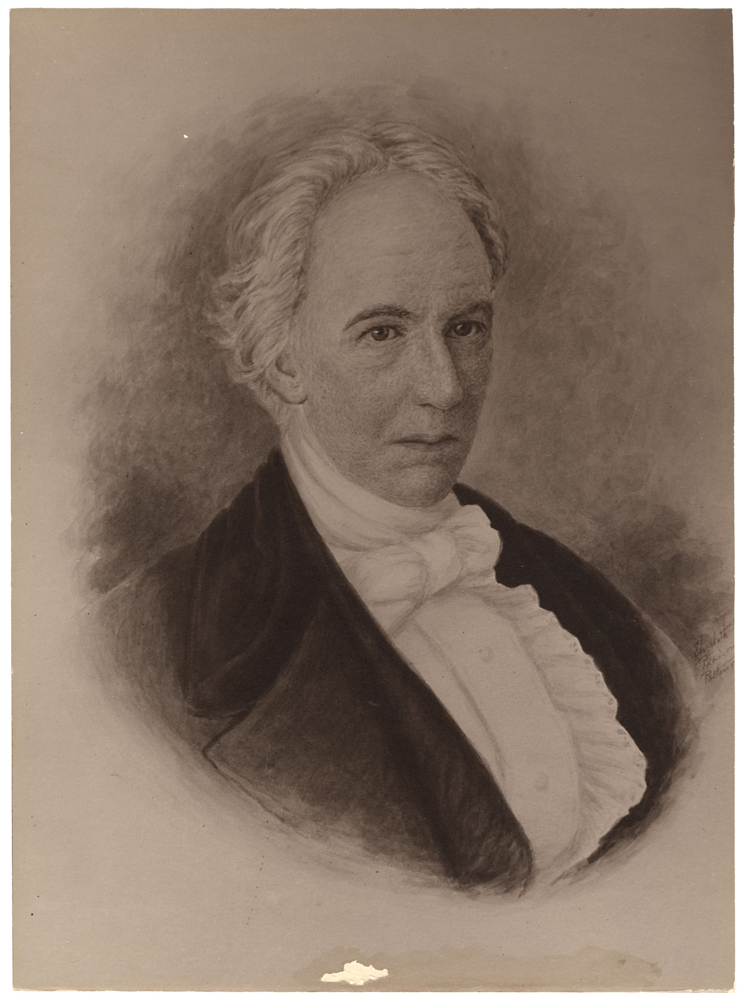

# Erastus Foote

🌳 [See in the GEDCOM Viewer](https://theo-armour.github.io/gedcom-viewer/#wiki=Erastus-Foote-1777-1856)

| `erastus-foote.jpg` | Erastus Foote (1777–1856). Photograph of a painted or drawn bust portrait: an older man with white hair, in a dark coat, white stock and ruffled shirt. There is a signature at the right edge that has not been read with confidence. The Maine State Archives describes it as a "Painted portrait of Erastus Foote. Maine Attorney General, 1820."[10] | [Wikimedia Commons](https://commons.wikimedia.org/wiki/File:Erastus_Foote.jpg), which credits the Maine State Archives |

**Erastus Foote** (19 September 1777 – 14 July 1856) was a Connecticut-born lawyer who practised for about fifteen years at Camden and about forty at Wiscasset, in what became the State of Maine. He was county attorney of Lincoln County, a colonel of Massachusetts militia in the War of 1812, a member of both houses of the Massachusetts legislature, and a member of the first Senate of Maine, and in 1820 Governor William King appointed him the new state's first attorney general, an office he held for about twelve years.[2][3][7] His granddaughter Harriette Cobb Foote married [George Allison Armour](https://theo-armour.github.io/genealogy/#Wiki/George-Allison-Armour-1856-1936/README-George-Allison-Armour-1856-1936.md), which makes him Theo Armour's paternal great-great-great-grandfather.[11][12]

| **Erastus Foote** | |
| :--- | :--- |
| **Born** | 19 September 1777 Waterbury (now Plymouth), Connecticut (see Open questions) |
| **Died** | 14 July 1856 (aged 78) Wiscasset, Lincoln County, Maine |
| **Occupation** | Lawyer; county attorney; legislator; Attorney General of Maine |
| **Spouses** | Susan Carlton (married 1812; died 28 June 1817) Eliza Carlton, her sister (married 9 July 1820) |
| **Children** | By Susan: Mary Wood (1813–1814), Erastus Miles (1815–1816), Susan Eliza (b. 1817) By Eliza: [Erastus](https://theo-armour.github.io/genealogy/#Wiki/Erastus-Foote-Jr-1821-1893/README-Erastus-Foote-Jr-1821-1893.md) (1821–1893), Mary Todd (b. 1823), Abigail (1825–1826), Ann Butler (b. 1827) |
| **Parents** | Obed Foote (1741–1797) Mary Todd (1742–1815) |

## Family and early life

Erastus Foote was born on 19 September 1777, the eighth of the eleven children of Obed Foote and Mary Todd.[2] Nathaniel Goodwin's Foote genealogy, published in 1849 while Erastus was living, describes Obed as "first of that part of Waterbury, now Plymouth, afterwards of Gill, (Mass.)", and Mary as the daughter of the Rev. Samuel Todd, a Yale graduate and the first minister of Northbury parish in Waterbury. They had married on 3 December 1761.[2] William Willis, in his history of the Maine bar (1863), says that Erastus was born at Waterbury.[3]

Obed Foote died at Gill on 21 September 1797, "mortally wounded raising a house in that place, eleven days before his death". His widow married the Rev. Jonathan Leavitt of Heath, Massachusetts, in 1798, and died at "Bernardstown", Massachusetts, in 1815.[2]

Erastus did not go to college. At nineteen he entered the office of Judge Samuel Hinckley at Northampton, Massachusetts, read law there for four years, and was admitted to the bar of Hampshire County in May 1800.[2][3]

## Camden, 1800–1815

He settled at Camden, in the District of Maine, then part of Massachusetts, in 1800 or 1801 (see Open questions). He was the town's second lawyer, succeeding John Hathaway, who had died shortly before.[3][5] Willis says that the town then had no more than a thousand people, but that his business "was drawn from a much larger space of country".[3]

Reuel Robinson's history of Camden (1907) records that he acquired through an execution a house in the middle of the village, afterwards called the "Foote House", which was used as a dwelling and tavern while he owned it and stood until 1853.[5] The town more than once appointed "Erastus Foote, Esq." its agent to answer in the courts at Wiscasset for the bad state of its roads.[5] His sister Rhoda married Nathaniel Martin, a Camden trader, in 1806.[5]

In 1811 he succeeded Benjamin Ames as county attorney for Lincoln County, and he held that office until Maine separated from Massachusetts.[2][3] In 1812 he was elected a senator in the Massachusetts legislature.[2][3]

### The War of 1812

On 2 July 1812, a few days after war was declared, a Camden town meeting chose a Committee of Public Safety; Foote's name stands first in the list.[5] In the same year he was appointed to command the fifth regiment of the second brigade, eleventh division, of the Massachusetts militia, to which the Camden companies belonged.[3][5]

The regiment was called out in 1814, when the British took Castine and threatened the coast.[3] On 2 November 1814 the frigate *Furieuse* appeared off Camden to demand the return of a captured sloop and her cargo. Robinson relates that "Col. Foote" was one of those who met the British boat under a flag of truce, and that he and a selectman, Robert Chase, were then sent aboard the frigate to explain that the town could not comply.[5]

Willis was cool about this part of his career: "His exploits as a military man did not add to his reputation, and were made the theme of much raillery by the party which he had abandoned, whenever his name was brought forward for political office."[3] Willis says that Foote had been elected senator in 1812 "on the Federal ticket", but when the war came "gave his adhesion to the National administration, and sustained the war measures of Mr. Madison".[3]

## Wiscasset and statehood

In 1815 he moved to Wiscasset, the shire town of Lincoln County, "where he had married his wife".[2][3][4] He stood for Congress as the candidate of the Democratic party and lost; Robinson records that at Camden, in an election of 4 November that his narrative places in 1816, Benjamin Orr had 67 votes and "Erastus Foote, a former citizen of the town", 54.[3][5]

He took the side of those who wanted Maine separated from Massachusetts. He was elected to the Massachusetts House of Representatives in 1819 and, in Willis's words, "supported vigorously the measures proposed to accomplish that favorite object".[2][3] He was then elected to the first Senate of Maine in 1820.[2][3][7]

## Attorney General of Maine

Before his term in the Senate was out, Governor William King appointed him attorney general of the new state. Willis reports that King "remarked that he knew no man better qualified for the office than Col. Foote".[3] Goodwin records that he was reappointed in 1824 and again in 1828.[2] The Maine Legislature's list of attorneys general gives his service as 1820–1831 and names Jonathan P. Rogers of Bangor as his successor.[7]

Two judgments of him as a prosecutor are quoted by Willis. The historian William D. Williamson called him "a very correct, able and faithful prosecuting officer", adding that "it is said that he never lost but a single indictment for defect in form". Benjamin Orr, his old opponent, is reported to have said: "It is almost impossible to wrest a criminal out of the hands of Brother Foote."[3]

Willis's own portrait is more mixed:

> He was a handsome man, of florid countenance, a cheerful expression, tall, of a fine figure, and with a self-reliance amply sufficient to set off these qualities. His manner was somewhat pompous, and his arguments verbose, but he had no difficulty in saying what he wanted to say, and making himself understood. He was kind and genial in his disposition, and of a sanguine temperament.[3]

## Later life

After leaving office he went back to practice at Wiscasset, and in 1840 he was elected to the Maine House of Representatives.[2][3] He was a trustee of Bowdoin College from 1820 for twenty-four years, and the college gave him an honorary Master of Arts degree in 1821.[3]

He died at Wiscasset on 14 July 1856, aged seventy-eight.[8] Willis says that he was then the oldest practising lawyer in the state.[3] He is buried in Evergreen Cemetery, Wiscasset, where the inscription is transcribed as "Hon. Erastus Foote, died July 14, 1856, AEt. 78yrs."[8]

## Marriages and children

He married first, in 1812, Susan Carlton, daughter of Col. Moses Carlton of Wiscasset. She was born on 28 January 1796 and died on 28 June 1817, aged twenty-one. On 9 July 1820 he married her sister Eliza, who was born on 1 July 1798.[2] Moses Carlton outlived his son-in-law and died later in 1856, aged ninety-one.[3] One family tree gives Eliza's death as 27 June 1880 at Wiscasset.[11]

Goodwin lists seven children. By Susan: Mary Wood (born 20 December 1813, died 13 January 1814), Erastus Miles (born 31 August 1815, died 10 February 1816) and Susan Eliza (born 1 January 1817). By Eliza: Erastus (born 6 September 1821), Mary Todd (born 25 December 1823), Abigail (born 31 August 1825, died 7 September 1826) and Ann Butler (born 8 October 1827).[2]

The surviving son, Erastus Foote Jr, was a lawyer at Wiscasset in 1849.[2] The family trees record that he married Sarah Page Wood, that their daughter Harriette Cobb Foote was born at Wiscasset on 15 November 1859, and that he died at Chicago on 20 February 1893.[11] Harriette married George Allison Armour at Chicago on 27 April 1882; their son [Norman Armour Sr](https://theo-armour.github.io/genealogy/#Wiki/Norman-Armour-Sr-1887-1982/README-Norman-Armour-Sr-1887-1982.md) was the father of [Norman Armour Jr](https://theo-armour.github.io/genealogy/#Wiki/Norman-Armour-Jr-1920-1978/README-Norman-Armour-Jr-1920-1978.md) and the grandfather of Theo Armour.[11][12]

## Residences

* **Waterbury (now Plymouth), Connecticut**, where he was born, and **Gill, Massachusetts**, where his parents later lived.[2][3]
* **Northampton, Massachusetts**, as a law student, about 1796–1800.[3]
* **Camden, Maine**, from 1800 or 1801 to 1815. He owned the "Foote House" in the centre of the village.[3][5]
* **Wiscasset, Maine**, from 1815 until his death in 1856.[2][3]

## Open questions

* **Date of birth.** Goodwin, Find a Grave and the family trees give 19 September 1777.[2][8][11] Willis says "October, 1777".[3] Goodwin was published in Foote's lifetime and is the better evidence.
* **Place of birth.** Willis says Waterbury, Connecticut, and the family trees agree.[3][11] Goodwin does not state the place outright, but places his father in the part of Waterbury that became Plymouth.[2] Robinson's history of Camden says "Col. Foote was a native of Gill, Mass."[5] Gill is where his parents later lived and his father died; no birth record has been seen.
* **Where he first practised.** Willis says he "commenced practice in Northampton".[3] Goodwin says he "opened an office in Concord, in the same State, but removed to Camden, Maine, in July of the same year".[2]
* **When he came to Camden.** Goodwin says July 1800, and the two Camden histories say 1800.[2][4][5] Willis says 1801, and so does a 1929 newspaper article quoted on Find a Grave.[3][8]
* **His politics in 1812.** Willis says he was elected to the Massachusetts Senate "on the Federal ticket" and changed sides when war came.[3] Wikipedia says he was elected "as a Jeffersonian Republican", and the profile page calls him a Jeffersonian Republican throughout.[1][9]
* **Massachusetts Senate: 1812 or 1819.** Goodwin, Willis and the Camden histories put the Senate in 1812 and the House in 1819.[2][3][4][5] The Maine State Archives' exhibit text says he "served in the Massachusetts Senate in 1819".[6]
* **When he left office as attorney general.** The Maine Legislature's list, the Maine State Archives and Wikipedia say 1831.[6][7][9] Willis says he was succeeded in 1832; the Camden histories say he held the office twelve years; Williamson, quoted by Willis, said "about fourteen years".[3][4][5]
* **Maine House: 1840 or 1841.** Goodwin says he was elected in 1840.[2] The Legislature's list shows "H 1841".[7] These may be the year of election and the year of the session; this has not been checked.
* **Date of death.** The gravestone as transcribed on Find a Grave, and the family trees, give 14 July 1856.[8][11] The digitised text of Willis reads "July 4, 1856, at the age of seventy-nine".[3] The digitised text of Locke's *Sketches* reads "July 14, 1806, aged 78 years", where the year is plainly a misprint or a scanning error.[4]
* **Carlton or Carleton.** Goodwin, Willis and Locke spell his wives' family name Carlton.[2][3][4] The family trees and Wikipedia spell it Carleton.[9][11] Goodwin calls their father Col. Moses Carlton; Locke calls him "Maj. Carlton".[2][4]
* **His place among his brothers and sisters.** Goodwin lists eleven children of Obed and Mary Foote, with Erastus the eighth.[2] Wikipedia calls him "the fifth of six children".[9]
* **Number of children.** Goodwin lists seven, three by the first wife and four by the second.[2] Wikipedia says five, "one with his first wife ... and four with his second".[9] Willis says that by his second wife he had "one son ... and several daughters".[3]
* **His son's college.** Goodwin says that Erastus Jr "graduated at Bowdoin College".[2] The digitised text of Willis says he was "a graduate of Harvard in the class of 18-13", presumably 1843.[3]
* **Freemasonry.** A 1929 article in *The Otsego Farmer & Republican* of Cooperstown, New York, quoted on Find a Grave, says that he joined Amity Lodge at Camden in 1801, was its master in 1806, and in November 1806 became a member of a Mark lodge at Cooperstown, for reasons the article could not explain.[8] The article itself has not been seen.
* **The portrait.** Wikimedia Commons dates it "before 1820" and gives the artist as unknown.[10] The sitter looks old for a man of forty-two, and the image is a photograph of an artwork that carries a signature. Its date and maker have not been established.

## Questions for Theo

Points that family knowledge or family papers may settle. Each links to a conflict described above.

* **Carlton or Carleton?** Which spelling did the family use for his wives' name?
* **Harriette Cobb Foote.** Is anything known in the family about her father, Erastus Foote Jr, and his move from Wiscasset to Chicago?
* **The portrait.** Is there a family copy, or any note of who made it and when?
* **The second image.** The folder holds two files of the same portrait, `erastus-foote.jpg` and `Erastus_Foote.jpg`. This page uses the first. Is the second still wanted?
* **The profile page.** It says he was elected to the Massachusetts Senate in 1812 as a Jeffersonian Republican. Willis, who wrote within seven years of his death, says he was elected as a Federalist and changed sides during the war. Should the profile page change?

## References

1. "Erastus Foote 1777 – 1856". Profile page in this repository. `Erastus-Foote-1777-1856.md` (merged into this README and removed)
2. Goodwin, Nathaniel. *The Foote Family: or, The Descendants of Nathaniel Foote, One of the First Settlers of Wethersfield, Conn.* Hartford: Case, Tiffany and Company, 1849. Family of Obed Foote (no. 1995), pp. 192–193; family of Erastus Foote (no. 2171), p. 222; Appendix X, "Hon. Erastus Foote", pp. 319–320. <https://archive.org/details/footefamilyordes00good>
3. Willis, William. *A History of the Law, the Courts, and the Lawyers of Maine, from Its First Colonization to the Early Part of the Present Century*. Portland, 1863. "Erastus Foote. 1801–1856", pp. 392–395. <https://archive.org/details/historyoflawcour00will>
4. Locke, John L. *Sketches of the History of the Town of Camden, Maine*. Hallowell: Masters, Smith & Company, 1859. Biographical sketch of Col. Foote, about pp. 218–220. Read in the Internet Archive's machine-read text, which is badly garbled on these pages. <https://archive.org/details/sketchesofhistor00lock_0>
5. Robinson, Reuel. *History of Camden and Rockport, Maine*. Camden: Camden Publishing Company, 1907. The Foote House, p. 102; Committee of Public Safety, p. 143; the fifth regiment, p. 161; the *Furieuse*, pp. 188–189; his removal to Wiscasset and a sketch of his life, pp. 199–200; the election for Congress, p. 206. Nathaniel Martin, p. 220. The passages on his agency for the town were read without noting the page. <https://archive.org/details/historyofcamdenr00robi>
6. "Attorney General: Erastus Foote (1777-1856)". Maine State Archives, *Maine's First Leaders* exhibit, Digital Maine. <https://digitalmaine.com/arc_200_exhibit_first_leaders/1/>
7. "Maine Attorneys General, 1820–". Maine State Legislature, Law and Legislative Reference Library. <https://legislature.maine.gov/9250>
8. "Erastus Foote I (1777–1856)". Find a Grave memorial 36411786, Evergreen Cemetery, Wiscasset. It quotes *The Otsego Farmer & Republican* (Cooperstown, New York), 9 August 1929, p. 3 (not seen). <https://www.findagrave.com/memorial/36411786/erastus-foote>
9. "Erastus Foote". *Wikipedia*. Its "Early life" section is marked as unreferenced. <https://en.wikipedia.org/wiki/Erastus_Foote>
10. "File:Erastus Foote.jpg", Wikimedia Commons, <https://commons.wikimedia.org/wiki/File:Erastus_Foote.jpg>; and "1820, Erastus Foote", Maine State Archives, attorneys general portraits, Digital Maine, <https://digitalmaine.com/arc_agportraits/47/>
11. Family trees in this repository, records for Erastus Foote I, Eliza Carleton, Erastus Foote Jr, Sarah Page Wood, Harriette Cobb Foote, George Allison Armour and Norman Armour Sr. None cites a source for the Foote events. `GEDCOM-files/2025/2025-08-30-export-geni/export-Ancestors.ged` (Geni), `GEDCOM-files/2025/2025-08-23-carley-armour-family-tree.ged` and `GEDCOM-files/2025/2025-08-28-matthew-family-tree.ged`
12. "Armour Read Me". `Armour/README-Armour.md` in this repository.

## Further research

* The printed pages of Willis and Locke, to check the dates that the digitised texts garble (his death, and his son's college class).
* Waterbury and Plymouth, Connecticut, vital and church records for his birth or baptism in 1777.
* Wiscasset newspapers and the *Eastern Argus* of July 1856 for an obituary. Locke appears to say (the digitised text is garbled) that his sketch drew on an obituary notice prepared by Foote's son.
* The records of the Maine and Massachusetts legislatures for the exact years and party labels of his service, and the Governor and Council records for his three appointments as attorney general.
* Bowdoin and Harvard catalogues for Erastus Foote Jr.
* A letter of 3 March 1814 from Moses Carlton Jr and others to President Madison, calendared in the *Papers of James Madison* (Founders Online), which recommends "Erastus Foote of Camden" for an office. The abstract could not be read for this biography. <https://founders.archives.gov/documents/Madison/03-07-02-0301>
* The Maine State Archives' record of the portrait, for the artist and date.
* The 1929 article in *The Otsego Farmer & Republican* about his Masonic medal.
