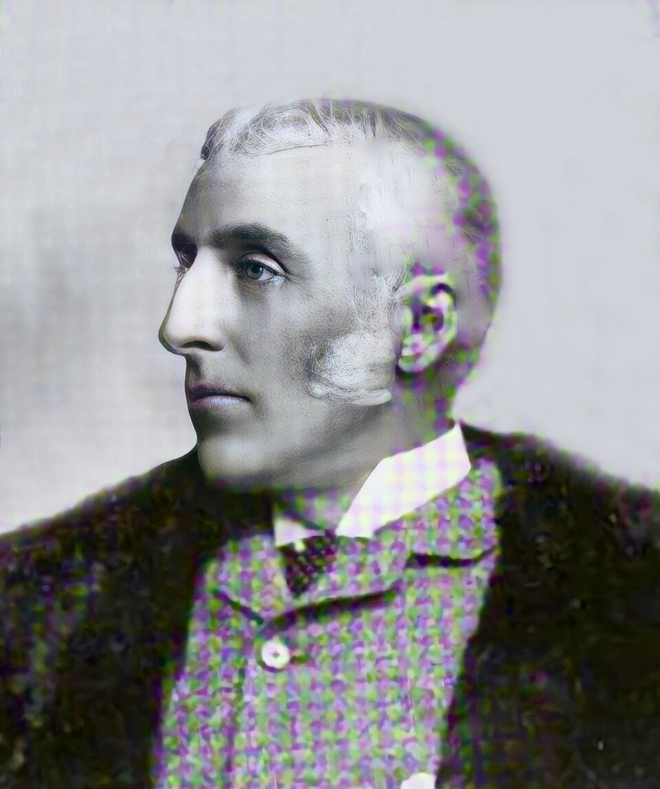

# Francis Meredyth Whitehouse

| `Francis_M._Whitehouse_architect.jpg` | Francis M. Whitehouse. Head-and-shoulders photograph of a man in profile facing left, with grey hair and side-whiskers, in a dark jacket and a patterned waistcoat or shirt. The copy shows blotches of colour and appears to have been colourised from a black-and-white original. Undated. | Source not recorded. The file has the same name as the lead image of the Wikipedia article, which gives no photographer or source.[1] |

**Francis Meredyth Whitehouse** (2 October 1848 – 8 March 1938), who practised as F. M. Whitehouse, was a Chicago architect. A son of the second Episcopal Bishop of Illinois, he was the junior partner of Edward J. Burling in the firm of Burling & Whitehouse, which built churches, commercial buildings and some of the large houses of Chicago in the 1880s, and he is credited with the Church of the Epiphany and with Festival Hall at the World's Columbian Exposition of 1893.[1][2][3][4] He married Mary Greenlee Armour, a daughter of [George Armour](https://theo-armour.github.io/genealogy/#Wiki/George-Armour-1812-1881/README-George-Armour-1812-1881.md) and a sister of Theo Armour's great-grandfather [George Allison Armour](https://theo-armour.github.io/genealogy/#Wiki/George-Allison-Armour-1856-1936/README-George-Allison-Armour-1856-1936.md); he was therefore Theo Armour's great-great-uncle by marriage, and not a blood relation.[5][6][7][8]

| **Francis Meredyth Whitehouse** | |
| :--- | :--- |
| **Born** | 2 October 1848 New York City |
| **Died** | 8 March 1938 (aged 89) Winter Park, Florida |
| **Occupation** | Architect (Burling & Whitehouse; F. M. Whitehouse) |
| **Spouse** | Mary Greenlee Armour (died 1958; see Open questions for her year of birth) |
| **Children** | Meredyth Whitehouse (see Open questions) |
| **Parents** | Rt. Rev. Henry John Whitehouse (1803–1874) Evelina Harriet Bruen (1806–1864) |

## Family and early life

Francis Meredyth Whitehouse was born in New York City on 2 October 1848.[1] His father, Henry John Whitehouse, was the second Episcopal Bishop of Illinois, in office from 1852 until his death in Chicago in 1874. His mother was Evelina Harriet Bruen, whom the bishop had married on 8 August 1835.[9]

Wikipedia lists six children of the bishop: Henry Bruen (1838–1889), an attorney; Edward Norman (1839–1904), a naval officer; Frederic Cope (1842–1911), an attorney and Egyptologist; William FitzHugh (1846–1909), an attorney; Louisa Bruen (1847–1919); and Francis Meredyth, the youngest.[9] The headline of his *New York Times* obituary called him the "last surviving son of Bishop".[10]

He studied architecture at the University of Göttingen in Germany.[1][5]

## Burling & Whitehouse

Wikipedia says that Whitehouse began as a draftsman for the Chicago architect Edward Burling and later became the junior partner in the firm; these statements carry no citation there.[1] The Driehaus Museum says that after Burling and his partner Adler parted in 1878, Burling formed his last firm with Francis M. Whitehouse, and that the two worked together until Burling's death in February 1892.[2] Another account says Whitehouse joined Burling in 1879.[3]

*Industrial Chicago*, published in 1891 while the firm was at work, named Burling & Whitehouse among "the earliest modernizers of architecture in Chicago". Of the houses it said:[4]

> Architect Whitehouse is credited with the Cudahy, the Higginbotham, the Hutchinson, the Yerkes, the George Armour and the Loomis residences. The first and last named are considered the best works of Burling & Whitehouse, in the field of domestic architecture.[4]

The "George Armour" residence in that list links his practice to his wife's family. George Armour died in 1881, so the house may have been built for his widow or for his son; *Industrial Chicago* does not say.[4][6]

The Glessner House museum names Francis Whitehouse among the local architects whom the residents of Prairie Avenue engaged.[11]

At the Church of the Epiphany he included a panel in the altar reredos honouring his father, the bishop.[3]

## The World's Columbian Exposition

Whitehouse designed the Choral Building, also called Festival Hall, for the World's Columbian Exposition held in Chicago in 1893.[1] The Driehaus Museum also credits the Burling and Whitehouse partnership with building entrances and the Casino at the fair, and notes that Burling died before it opened.[2]

## Marriage and later life

Whitehouse married Mary Armour. Wikipedia gives her only as "Mary née Armour" and names one child, a son called Meredyth.[1] A page about the couple's bookplate says: "Whitehouse married Mary Armour, the daughter of grain industry magnet George Armour."[5] Two family trees in this repository agree: both record Mary Greenlee Armour, married name Whitehouse, as a child of George Armour, and one of them, which names her mother as Barbara Allison, cites the 1870 and 1880 United States censuses for her as a daughter in the Armour household in Chicago.[7][8] No record or announcement of the marriage has been seen, and its date is not known.

The bookplate page says that "for all intent and purposes Whitehouse retired while still in his prime in 1893", and that he and Mary refurbished the Cove Farm estate at Manchester-by-the-Sea, Massachusetts, and then "built their own estate, Crowhurst, on its neighboring property".[5] Wikipedia, citing a *Boston Globe* society column of 1912, says he enjoyed yachting and spent time at one of his estates in Manchester, Massachusetts.[1] The bookplate itself was designed by the painter Robert Strong Woodward and engraved by a Mr Elwell; the same page says that Mary gave it to the West Chicago Public Library in 1922.[5]

He died at Winter Park, Florida, on 8 March 1938, aged 89.[1][10] His widow died at Winter Park on 16 May 1958, according to the family trees.[7][8] One of the trees gives her burial as Green-Wood Cemetery in Brooklyn, citing a Find a Grave memorial that has not been read.[8] Bishop Whitehouse is also buried at Green-Wood.[9]

## Works

Buildings credited to Whitehouse or to Burling & Whitehouse in the sources read. Dates are those the sources give.

* **Samuel M. Nickerson House**, 40 East Erie Street, Chicago. Begun 1879, completed 1883. Now the Richard H. Driehaus Museum; on the National Register of Historic Places since 1976 and a Chicago Landmark since 1977.[2][12] See Open questions for who designed it. [Wikipedia](https://en.wikipedia.org/wiki/Samuel_M._Nickerson_House); [Driehaus Museum](https://driehausmuseum.org/blog/view/speaking-of-architecture-the-life-and-work-of-edward-j.-burling)
* **Church of the Epiphany**, 201 South Ashland Avenue, Chicago. Built 1885, bell tower 1887, of Lake Superior sandstone, in the style then called Norman and now called Richardsonian Romanesque. Added to the National Register of Historic Places on 5 February 1998.[3][13] [Wikipedia](https://en.wikipedia.org/wiki/Church_of_the_Epiphany_(Chicago)); [chicago.designslinger](https://chicagodesignslinger.blogspot.com/2015_02_20_archive.html)
* **John Cudahy residence**, Michigan Boulevard and Thirty-third Street, Chicago. Designed 1885, in "the Flemish-Gothic style", of Connecticut Longmeadow stone.[4]
* **St. Paul's church**, Prairie Avenue and Thirtieth Street, Chicago. Designed 1886.[4]
* **Pedestal of the Ulysses S. Grant Monument**, Lincoln Park, Chicago. The equestrian statue is by Louis Rebisso; the granite pedestal was designed by Burling & Whitehouse. Dedicated 7 October 1891.[14] [Wikipedia](https://en.wikipedia.org/wiki/Ulysses_S._Grant_Monument)
* **Warehouse**, north-west corner of Adams Street and Fifth Avenue, Chicago, on the site of the burned Phelps, Dodge & Palmer warehouse. 1888–1889.[4]
* **Loomis residence**, Lake Shore Drive, Chicago. Designed June 1890.[4]
* **Blair building**, 202–204 Wabash Avenue, Chicago. Designed 1891.[4]
* **Higinbotham, Hutchinson, Yerkes and George Armour residences**, Chicago. Credited to Whitehouse without dates or addresses.[2][4]
* **Festival Hall (Choral Building)**, World's Columbian Exposition, Chicago, 1893.[1] [Wikipedia](https://en.wikipedia.org/wiki/Francis_M._Whitehouse)
* **First National Bank Building**, Chicago. Wikipedia says he "helped design" it, without a citation or date.[1]
* **"Minnewoc"**. Listed in the Wikipedia infobox as a significant design, but not described in the article.[1]

*Industrial Chicago* (1891) is the fullest near-contemporary source and can be read at the [Internet Archive](https://archive.org/details/industrialchicag01good).[4]

## Residences

* **New York City.** Born there in 1848.[1]
* **Göttingen, Germany**, as a student of architecture. Dates not given.[1][5]
* **Chicago, Illinois**, during his practice, from about 1879 to the early 1890s.[2][3][4] No home address has been found.
* **Manchester-by-the-Sea, Massachusetts.** Cove Farm, and then "Crowhurst" on the neighbouring property.[1][5]
* **Winter Park, Florida**, where he died in 1938 and his widow in 1958.[1][7]

## Open questions

* **The relationship to Theo Armour.** It rests on Mary being George Armour's daughter. The sources for that are the bookplate page and two family trees, one of which cites the 1870 and 1880 censuses.[5][7][8] No marriage record, obituary or will naming her as George Armour's daughter has been read. The Wikipedia article on George Armour, as read, names none of his daughters.[15]
* **Mary or Alice.** The Geni tree holds two records. One is "Mary Greenlee Armour", married name Whitehouse, a child of George Armour. The other is "Alice Whitehouse", a child of George Armour and Barbara Allison, married to "Frank Whitehouse", with a child "Merideth Whitehouse". MyHeritage lists "Alice Whitehouse" as a sibling of George Allison Armour, and his profile page lists both "Mary Greenlee and Alice" among his siblings.[6][7][16] Wikipedia, the bookplate and one other tree know only Mary.[1][5][8] The "Alice" and "Frank" records look like a second, mistaken copy of Mary and Francis, but this has not been proved; George Armour may have had two daughters.
* **Mary's year of birth.** Geni and one family tree give 16 March 1868 at Chicago.[7][8] The American Aristocracy website gives her dates as 1858–1958.[17] If the firm built a house for her family in the 1880s and she was the architect's wife by then, 1858 fits better, but no record has been seen.
* **Their child.** Wikipedia says "a son named Meredyth".[1] The Geni record for "Merideth Whitehouse" is marked female.[7] The newspaper item that Wikipedia cites for the son is a *Chicago Tribune* "Obituary" dated 12 April 1916, twenty-two years before Francis died; it has not been seen, and whose obituary it is remains unknown.[1]
* **His father's name.** Wikipedia gives Henry John Whitehouse; the bookplate page gives "John Henry Whitehouse".[5][9]
* **When the partnership began and ended.** After 1878 (Driehaus Museum) or in 1879 (chicago.designslinger).[2][3] Wikipedia says that "in 1889 he left the partnership and started his own firm", without a citation.[1] But *Industrial Chicago* records Burling & Whitehouse designing buildings in June 1890 and in 1891, and the Driehaus Museum says the two worked together until Burling died in February 1892.[2][4]
* **Who designed the Nickerson House.** Wikipedia credits Edward J. Burling "of the firm of Burling and Whitehouse"; the bookplate page credits Whitehouse.[5][12]
* **The Grant Monument.** The bookplate page calls him the architect of "Ulysses S. Grant's Monument in New York City".[5] The monument for which Burling & Whitehouse designed the pedestal is in Lincoln Park, Chicago.[14]
* **The bookplate page generally.** One passage on that page runs straight from George Armour into "He created the grain elevator system" and the presidency of the Chicago Board of Trade. Those are George Armour's achievements, as his profile page shows, not Whitehouse's.[5][6]
* **Senator Sheldon Whitehouse.** An archived note in this repository says of the senator: "ancestor husband of Alice Armour".[18] Wikipedia traces the senator's descent from the bishop through William FitzHugh Whitehouse, Francis's brother, then the diplomat Sheldon Whitehouse (1883–1965) and Ambassador Charles S. Whitehouse (1921–2001).[9][19] On that evidence Francis was the brother of the senator's great-grandfather, not the senator's ancestor.
* **The portrait.** The source and date of the photograph in this folder are not recorded, and it appears to have been colourised.

## Questions for Theo

Points that family knowledge or family papers may settle. Each links to a conflict described above.

* **Mary or Alice.** Did George Armour have one daughter who married a Whitehouse, or two daughters, Mary Greenlee and Alice? Was Francis known in the family as Frank?
* **Mary's birth year.** 1858 or 1868?
* **Meredyth.** Was Meredyth Whitehouse a son or a daughter? Were there other children?
* **The George Armour house.** Which house did Whitehouse design for the family, and for whom: George Armour's widow Barbara, or George Allison Armour?
* **Senator Whitehouse.** The senator descends from Francis's brother William. Should the archived note be read that way?
* **Manchester.** Is anything known in the family about Cove Farm or Crowhurst at Manchester-by-the-Sea, or about the Whitehouses at Winter Park?
* **The marriage.** When and where were Francis and Mary married?

## References

1. "Francis M. Whitehouse". *Wikipedia*. Cites, among others, "Obituary", *Chicago Tribune*, 12 April 1916; "Table Gossip", *The Boston Globe*, 11 August 1912; Kim Coventry, *Classic Country Estates of Lake Forest* (2003), p. 301; and Joseph M. Di Cola and David Stone, *Chicago's 1893 World's Fair* (2012), p. 45 (none of these seen). <https://en.wikipedia.org/wiki/Francis_M._Whitehouse>
2. "[Speaking of Architecture] The Life and Work of Edward J. Burling". The Richard H. Driehaus Museum, 28 June 2013. <https://driehausmuseum.org/blog/view/speaking-of-architecture-the-life-and-work-of-edward-j.-burling>
3. "Church of the Epiphany - Epiphany Episcopal Church". chicago.designslinger, 20 February 2015. <https://chicagodesignslinger.blogspot.com/2015_02_20_archive.html>
4. *Industrial Chicago*, vol. 1, "The Building Interests". Chicago: Goodspeed Publishing Company, 1891. Read in the digitised text, which carries scanning errors: the houses credited to Whitehouse, the Cudahy residence, the Loomis residence (p. 264), St. Paul's church, the Adams Street warehouse and the Blair building. <https://archive.org/details/industrialchicag01good>
5. "Whitehouse, Francis Meredyth & Mary Armour, Bookplate". Robert Strong Woodward website, undated. Quotes an article by Harry Elmore Hurd in *The Breeze*, 1 May 1931 (not seen). <https://www.robertstrongwoodward.com/Gallery/WhitehouseFMBookplate.html>
6. "George Armour (1812 – 1881)" and "George Allison Armour (1856–1936)". Profile pages in this repository. [README-George-Armour-1812-1881.md](https://theo-armour.github.io/genealogy/#Wiki/George-Armour-1812-1881/README-George-Armour-1812-1881.md); [README-George-Allison-Armour-1856-1936.md](https://theo-armour.github.io/genealogy/#Wiki/George-Allison-Armour-1856-1936/README-George-Allison-Armour-1856-1936.md)
7. Geni GEDCOM export, records for Mary Greenlee Armour (geni:6000000156285149822), Alice Whitehouse (geni:364469281720003339), Frank Whitehouse (geni:3967274353610044153) and Merideth Whitehouse (geni:3967276657350123228). `Online-Genealogy/gedcom-files/2025-08-18-export-geni/export-BloodTree.ged`
8. Ancestry- and FamilySearch-derived family tree, record for Mary Greenlee Armour in the family of George Armour Sr and Barbara Allison. Cites the 1870 census (Chicago Ward 1, page 1A), the 1880 census (Chicago, page 367c, enumeration district 014), Cook County will records and Find a Grave memorial 57230118. None of these records has been seen directly. `Online-Genealogy/gedcom-files/2025-08-28-matthew-family-tree.ged`
9. "Henry John Whitehouse". *Wikipedia*. <https://en.wikipedia.org/wiki/Henry_John_Whitehouse>
10. "Francis M. Whitehouse; Last Surviving Son of Bishop Is Stricken in Florida". *New York Times*, 10 March 1938. Not seen; the headline and date are taken from the citation in reference 1. <https://www.nytimes.com/1938/03/10/archives/francis-m-whitehouse-last-surviving-son-of-bishop-is-stricken-in.html>
11. "Prairie Avenue". Glessner House. <https://glessnerhouse.org/prairie-avenue>
12. "Samuel M. Nickerson House". *Wikipedia*. <https://en.wikipedia.org/wiki/Samuel_M._Nickerson_House>
13. "Church of the Epiphany (Chicago)". *Wikipedia*. <https://en.wikipedia.org/wiki/Church_of_the_Epiphany_(Chicago)>
14. "Ulysses S. Grant Monument". *Wikipedia*. Cites "Chicago's Grant Monument", *The Illustrated American*, vol. 8, no. 87, 17 October 1891, p. 408 (not seen). <https://en.wikipedia.org/wiki/Ulysses_S._Grant_Monument>
15. "George Armour". *Wikipedia*. <https://en.wikipedia.org/wiki/George_Armour>
16. MyHeritage GEDCOM export, record for George Allison Armour, which lists "Alice Whitehouse" among his siblings. `Online-Genealogy/gedcom-files/2025-08-18-myheritage-armour.ged`
17. "Francis Meredyth Whitehouse (1848-1938)" and "Mary (Armour) Whitehouse (1858-1958)". American Aristocracy. <https://americanaristocracy.com/people/francis-meredyth-whitehouse>; <https://americanaristocracy.com/people/mary-greenlee-armour-whitehouse>
18. "Peeps in My Family", archived copy, section "More possible connections". `Documents/archive/notable-forbearers/Peeps-in-My-Family.md`
19. "Sheldon Whitehouse (diplomat)". *Wikipedia*. <https://en.wikipedia.org/wiki/Sheldon_Whitehouse_(diplomat)>

## Further research

* The *New York Times* obituary of 10 March 1938, and any obituary in the Chicago, Boston or Winter Park papers.
* The *Chicago Tribune* item of 12 April 1916 and the *Boston Globe* "Table Gossip" of 11 August 1912 that Wikipedia cites.
* A record or newspaper announcement of the marriage, probably in Chicago.
* George Armour's will and the Cook County probate records, and the 1870 and 1880 census pages, to settle whether there were daughters named both Mary and Alice.
* Find a Grave memorials 57230074 (Francis) and 57230118 (Mary), and the Green-Wood Cemetery burial register.
* The George Armour residence credited to Whitehouse in *Industrial Chicago*: its address, date and client.
* Kim Coventry, *Classic Country Estates of Lake Forest* (2003), p. 301, for a biographical note.
* Manchester Historical Museum and Historic New England, which holds a photograph catalogued as the F. Meredyth Whitehouse House at Manchester-by-the-Sea (catalogue record not read).
* Columbia University Libraries, which is reported to hold an original design drawing for Festival Hall (catalogue record not read).
* "Minnewoc": what and where it was.
