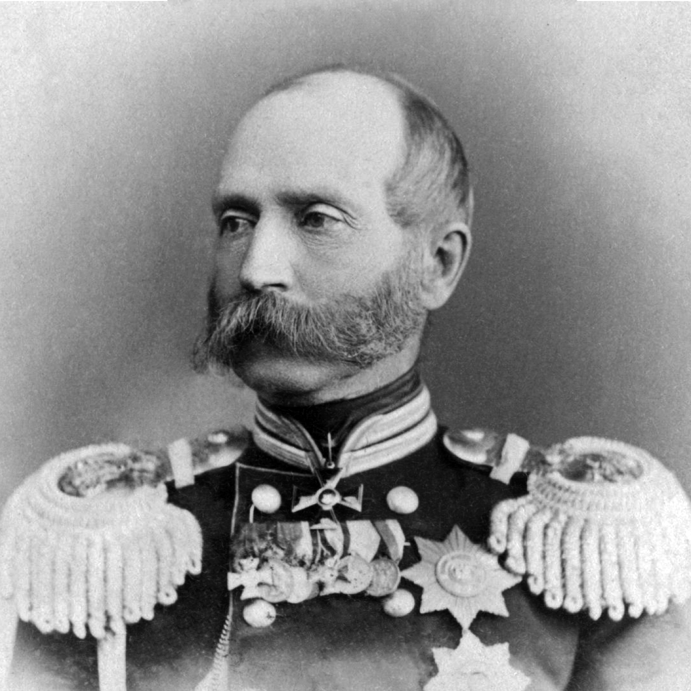

# General Fyodor Fyodorovich Trepov (senior)

| `fyodor-trepov.jpg` | Fyodor Fyodorovich Trepov, 1869. Photograph by Charles Bergamasco. Public domain.[3] | [Source](https://commons.wikimedia.org/wiki/File:Trepov_F_F_old.jpg) |

**Fyodor Fyodorovich Trepov** (Russian: Фёдор Фёдорович Трепов; 4 [16] May 1812 – 23 November [5 December] 1889), called "senior" to distinguish him from his son, was a Russian general and police chief. He was chief of police in Warsaw during the Polish unrest of the early 1860s, chief of police of St. Petersburg from 1866, and the city's first *gradonachalnik* (city governor) from 1873 to 1878. He is best remembered for being shot and wounded in 1878 by the revolutionary [Vera Zasulich](https://en.wikipedia.org/wiki/Vera_Zasulich), whose acquittal by a jury became one of the most famous trials in Russian history.[1] Four of his sons rose to high office, among them a prime minister. His eldest daughter, [Anastasia](https://theo-armour.github.io/genealogy/#Wiki/Anastasia-Fyodorovna-Trepova-1849-1940/biography_of_countess_anastasia_fyodorovna_von_nieroth_trepova_1849_1940.md), was the great-great-grandmother of Theo Armour.[1][2]

| **Fyodor Fyodorovich Trepov** | |
| :--- | :--- |
| **Native name** | Фёдор Фёдорович Трепов |
| **Born** | 4 (16) May 1812 (his service record: 1809) |
| **Died** | 23 November (5 December) 1889 Kiev, Russian Empire |
| **Resting place** | Vydubychi Monastery, Kiev |
| **Service** | Imperial Russian Army; Corps of Gendarmes; police |
| **Rank** | General of cavalry (1878); adjutant general (1867) |
| **Offices** | Chief of police, Warsaw (1860–1861) Police-master general, Kingdom of Poland (1863–1866) Chief of police, St. Petersburg (1866–1873) City governor of St. Petersburg (1873–1878) |
| **Spouse** | Vera Vasilyevna Lukashevich (1817 or 1821 – 1866) |
| **Children** | Anastasia, Yevgenia, Yulia, Sofia, Fyodor, Dmitri, Yelizaveta, Alexander, Vladimir |

## Origins

Trepov's origins are obscure. Russian Wikipedia gives his birth as 4 (16) May 1812, but notes that his service record says 1809 and that some books say 1803. Officially he was "из обер-офицерских детей" (the child of a junior officer) and a Lutheran. He is described as the illegitimate son of F. A. Shtenger, an Active State Councillor who was director of the towns of Pavlovsk and Gatchina.[1] On 2 November 1866 the Senate confirmed him and his children in the hereditary nobility for "his personal merits", and the family received its own coat of arms.[2]

## Career

He studied at the Nikolaev Engineering School but left through illness, and in 1828 entered the civil service. In 1831 he enlisted as a private in the Novgorod Cuirassier Regiment and fought in the suppression of the [Polish uprising](https://en.wikipedia.org/wiki/November_Uprising). He was promoted after the Battle of Grochów, decorated for saving his commander, and made a cornet that year.[1]

From 1835 he served in gendarme and uhlan units, became a colonel in 1853, and commanded the Gendarme Regiment in Kiev from 1854 to 1860.[1]

* **Warsaw and Poland, 1860–1866.** He was appointed chief of police in Warsaw in November 1860. In February 1861 he was struck on the head by a stone during street disturbances, and was promoted to major general. From 1863 he headed the gendarme district of the Kingdom of Poland. On 21 October 1863 he was wounded in the head with an axe by an assassin; Russian Wikipedia says he seized the axe and wounded his attacker. In December 1863 he became police-master general of the Kingdom.[1]
* **St. Petersburg, 1866–1878.** After Dmitry Karakozov's attempt on the life of Alexander II in 1866, Trepov was made chief of police (*ober-politsmeister*) of St. Petersburg. He was promoted to lieutenant general and granted an entailed estate (a *majorat*) in Poland with an income of 5,000 roubles a year. He became adjutant general in 1867. When the office of city governor was created, he held it from 10 (22) April 1873 to 23 May (4 June) 1878.[1]

## The Zasulich affair

On 25 July (6 August) 1877 Trepov ordered the flogging of an imprisoned populist, A. S. Bogolyubov, who had not taken off his cap to him. Russian Wikipedia notes that this broke the law of 1863 banning corporal punishment.[1] On 24 January (5 February) 1878 Vera Zasulich came to his reception room and shot him, wounding him in the left side. On 31 March (12 April) 1878 a jury acquitted her. Liberal opinion applauded the verdict and conservatives condemned it.[1] Trepov left office two months later, with promotion to general of cavalry.[1]

## Family

He married **Vera Vasilyevna Lukashevich** (1817 or 1821 – 1866). They had nine children:[1][2]

* **[Anastasia](https://theo-armour.github.io/genealogy/#Wiki/Anastasia-Fyodorovna-Trepova-1849-1940/biography_of_countess_anastasia_fyodorovna_von_nieroth_trepova_1849_1940.md)** (1849–1940), who married [Count Maximilian von Nieroth](https://theo-armour.github.io/genealogy/#Wiki/Maximilian-Carl-Benedict-von-Nieroth-1846-1914/biography_of_count_maximilian_von_nieroth_1846_1914.md).
* **Yevgenia** (born 1850), married name Albertova.
* **Yulia** (1851–1923), maid of honour, who married Senator D. P. Sukhodolsky.
* **Sofia** (1853–1927), maid of honour, who married Count M. E. Nirod, a master of the horse.
* **[Fyodor](https://theo-armour.github.io/genealogy/#Wiki/Fyodor-Fyodorovich-Trepov-1854-1938/biography_of_general_fyodor_fyodorovich_trepov_1854_1938.md)** (1854–1938), Governor-General of Kiev.
* **[Dmitri](https://theo-armour.github.io/genealogy/#Wiki/Dmitri%20Feodorovich%20Trepov-1850-1906/biography_of_general_dmitri_fyodorovich_trepov_1855_1906.md)** (1855–1906), Governor-General of St. Petersburg in 1905.
* **Yelizaveta** (1858–1920), maid of honour, who married General A. A. Mosolov, head of the chancellery of the Ministry of the Imperial Court.
* **[Alexander](https://theo-armour.github.io/genealogy/#Wiki/Alexander-Fyodorovich-Trepov-1862-1928/biography_of_alexander_fyodorovich_trepov_1862_1928.md)** (1862–1928), Prime Minister in 1916.
* **[Vladimir](https://theo-armour.github.io/genealogy/#Wiki/Vladimir%20Fyodorovich%20Trepov-1863-1918/biography_of_vladimir_fyodorovich_trepov_1863_1918.md)** (1863–1918), Governor of Taurida.

## Residences

* **Kiev.** He commanded the gendarmes there in 1854–1860; several of his children were born there; and he died there in 1889.[1]
* **Warsaw**, 1860–1866.[1]
* **St. Petersburg**, 1866–1878.[1]
* **Poland.** He held an entailed estate there from 1866.[1] Theo Armour's grandmother told him that the family marked out the plan of a house by pacing it in a field in Poland, and that the rooms turned out too large to heat in winter.[4]

No street address has been found for any of these.

## Death

Trepov died in Kiev on 23 November (5 December) 1889 and was buried at the Vydubychi Monastery.[1]

## Discrepancies and unverified claims

* **Birth year.** 1812 (Russian Wikipedia), 1809 (his service record, and the profile page in this folder) or 1803.[1]
* **Parentage.** The Shtenger story is given by Russian Wikipedia; it has not been checked against its sources.[1] The mother of his son-in-law Count Maximilian von Nieroth was also a Shtenger (von Stenger). Whether the two were related has not been established.
* **His rank.** General of cavalry in the article text; general of artillery in its information box.[1]
* **Sofia's husband.** The sources call the husbands of both Anastasia and Sofia "Count M. E. Nirod". They were two different men: Maximilian Evstafyevich and Mikhail Evstafyevich.[2]

## References

1. "Трепов, Фёдор Фёдорович (старший)". *Wikipedia* (Russian). Cites Шикман, А. П., *Деятели отечественной истории* (1997); Бауман, А. Л., *Руководители Санкт-Петербурга* (2003); Очкур, Р. В., in *Военно-исторический журнал*, 2010, no. 9; *Список генералам по старшинству* (1889). <https://ru.wikipedia.org/wiki/Трепов,_Фёдор_Фёдорович_(старший)>
2. "Треповы". *Wikipedia* (Russian). Cites *Энциклопедия российских немцев* and *Общий гербовник*, part 19, p. 40. <https://ru.wikipedia.org/wiki/Треповы>
3. "File:Trepov F F old.jpg". *Wikimedia Commons*. Charles Bergamasco, 1869. Public domain. <https://commons.wikimedia.org/wiki/File:Trepov_F_F_old.jpg>
4. "Fyodor Trepov (senior)", Personal Recollections. *Peeps in My Family*. Theo Armour Genealogy. <https://theo-armour.github.io/genealogy/#Peeps-in-My-Family.md>

## Further reading

* "Fyodor Trepov". *Wikipedia*. <https://en.wikipedia.org/wiki/Fyodor_Trepov>
* Кони, А. Ф. *Воспоминания о деле Веры Засулич* [Memoirs of the Vera Zasulich case]. The account by the presiding judge.
* Милютин, Д. А. *Воспоминания, 1863–1864*. On Trepov in Poland.
