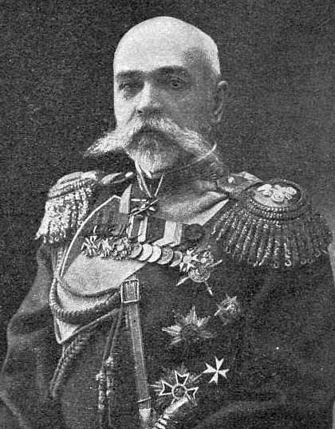

# General Fyodor Fyodorovich Trepov (junior)

🌳 [See in the family tree](https://theo-armour.github.io/gedcom-viewer/#wiki=Fyodor-Fyodorovich-Trepov-1854-1938)

| `fyodor-trepov-junior-1915.jpg` | General Fyodor Fyodorovich Trepov (junior), 1915. Photograph by M. L. Levenson. Public domain.[3] | [Source](https://commons.wikimedia.org/wiki/File:Trepov_Fedor_Fedorovich.jpg) |

**Fyodor Fyodorovich Trepov** (Russian: Фёдор Фёдорович Трепов; 13 [25] May 1854 – 27 March 1938), called "junior", was a Russian general and administrator. He governed the Vyatka, Volhynia and Kiev governorates, sat in the Senate and the State Council, and was Governor-General of Kiev, Podolia and Volhynia from 1908 to 1914. In 1916–1917 he was military governor-general of the Austrian territory occupied by the Russian army. He died in emigration in Nice.[1] He was the eldest son of [General Fyodor Fyodorovich Trepov (senior)](https://theo-armour.github.io/genealogy/#Wiki/Fyodor-Fyodorovich-Trepov-1809-1889/README-Fyodor-Fyodorovich-Trepov-1809-1889.md) and a brother of Theo Armour's great-great-grandmother Anastasia.[2]

| **Fyodor Fyodorovich Trepov** | |
| :--- | :--- |
| **Native name** | Фёдор Фёдорович Трепов |
| **Born** | 13 (25) May 1854 |
| **Died** | 27 March 1938 (aged 83) Nice, France |
| **Resting place** | Russian Cemetery (Caucade), Nice |
| **Education** | Page Corps (1873) |
| **Rank** | General of cavalry (1909); adjutant general (1909) |
| **Offices** | Governor of Vyatka (1894–1896) Governor of Volhynia (1896–1898) Governor of Kiev (1898–1903) Senator (1903) Member of the State Council (1905) Governor-General of Kiev, Podolia and Volhynia (1908–1914) Military Governor-General of Galicia and Bukovina (1916–1917) |
| **Spouse** | Yelizaveta Sergeyevna von Kilchen (1856–1937) |
| **Children** | Vera (1881–1958), Yelizaveta (1885–1978) |

## Early career

Trepov graduated from the Page Corps in 1873 and was commissioned a cornet in the Life Guards Horse Regiment. In 1877–1878 he was adjutant to the commander of the Orenburg Military District and took part in the [Russo-Turkish War](https://en.wikipedia.org/wiki/Russo-Turkish_War_(1877%E2%80%931878)). From 10 May 1881 he was an official for special assignments under the Governor-General of Kiev, Podolia and Volhynia. He became a colonel in 1884.[1]

## Governor and senator

He was Vice-Governor of the Ural Oblast from 1892 to 1894, and was promoted to major general in 1894. He was then Governor of Vyatka from 11 August 1894, Governor of Volhynia from 9 July 1896, and Governor of Kiev from 17 April 1898 to 5 April 1903. He was promoted to lieutenant general in 1901 and appointed a senator in 1903.[1]

During the [Russo-Japanese War](https://en.wikipedia.org/wiki/Russo-Japanese_War) he was chief plenipotentiary of the Russian Red Cross, and then head of the medical service of the Manchurian Army from 17 April 1904 to 1 June 1905. He received the Golden Weapon "For Bravery" on 24 January 1905. On 18 November 1905 he was appointed to the State Council, where he sat with the right.[1]

## Governor-General of Kiev

From 18 December 1908 to 30 September 1914 Trepov was Governor-General of Kiev, Podolia and Volhynia, the three south-western governorates. He was promoted to general of cavalry and made adjutant general in 1909.[1] It was during his term that the Prime Minister, [Pyotr Stolypin](https://en.wikipedia.org/wiki/Pyotr_Stolypin), was shot at the Kiev opera house in September 1911.

## First World War and emigration

In late 1914 he was assistant to Prince Alexander of Oldenburg, head of the army's medical and evacuation service. From 4 October 1916 he was military governor-general of the Austro-Hungarian territory occupied by Russian forces in Galicia and Bukovina. He was dismissed for illness on 31 March 1917, after the February Revolution, with the right to his uniform and pension.[1]

After the October Revolution he emigrated to France. He died in Nice on 27 March 1938 and was buried in the Russian cemetery there.[1]

## Family

He married **Yelizaveta Sergeyevna von Kilchen** (1856–1937), daughter of General Sergei Alexeyevich von Kilchen. She died in Nice. They had two daughters:[1]

* **Vera Fyodorovna** (1881–1958), who married a Gudim-Levkovich and died in Nice.
* **Yelizaveta (Ella) Fyodorovna** (1885–1978), who married P. A. Demidov and died in Nice.

## Residences

* **St. Petersburg**, as a Horse Guards officer from 1873.[1]
* **Kiev.** He served there from 1881, as governor in 1898–1903, and as governor-general in 1908–1914.[1]
* **Uralsk, Vyatka and Zhitomir**, as vice-governor and governor, 1892–1898.[1]
* **Nice**, after the revolution until his death in 1938.[1]

## Discrepancies and unverified claims

* **Loss of the rank of adjutant general in March 1917.** Russian Wikipedia marks this statement as lacking a source.[1]
* **Russian Wikipedia's article** carries a notice that its current version has not been reviewed.[1]

## References

1. "Трепов, Фёдор Фёдорович (младший)". *Wikipedia* (Russian). Cites the project "Русская армия в Великой войне" (grwar.ru). <https://ru.wikipedia.org/wiki/Трепов,_Фёдор_Фёдорович_(младший)>
2. "Треповы". *Wikipedia* (Russian). <https://ru.wikipedia.org/wiki/Треповы>
3. "File:Trepov Fedor Fedorovich.jpg". *Wikimedia Commons*. M. L. Levenson, 1915. Public domain. <https://commons.wikimedia.org/wiki/File:Trepov_Fedor_Fedorovich.jpg>

## Further reading

* "Fyodor Trepov (junior)". *Wikipedia*. <https://en.wikipedia.org/wiki/Fyodor_Trepov_(junior)>
