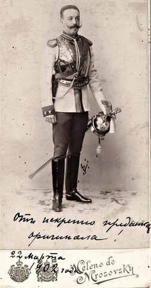

# Count Fyodor Maximilianovich von Nieroth

| `nirod_fedor_maksimilianovic_001_2__large.jpg` | Count Fyodor (Theodor) Maximilianovich von Nieroth. The source of this image was not recorded when it was added to this folder. | Source not recorded |

**Count Fyodor Maximilianovich von Nieroth** (Russian: граф Фёдор Максимилианович Нирод; German: Theodor Graf von Nieroth; 1871 – 1952) was a Russian cavalry general. An officer of the Life Guards Horse Regiment and aide-de-camp to the Emperor, he commanded the Life Guards Dragoon Regiment at the outbreak of the First World War and won the St. George Sword in its first days. He later commanded Guards cavalry brigades and a detachment in Persia. He fought with the White armies in the Civil War and spent the last thirty years of his life in France, where he was a leading figure among the veterans of the Imperial Guard.[1][2] He was the brother of Theo Armour's great-grandmother Vera, and Theo Armour is named after him.[3]

| **Count Fyodor Maximilianovich von Nieroth** | |
| :--- | :--- |
| **Native name** | Граф Фёдор Максимилианович Нирод |
| **Also known as** | Theodor von Nieroth |
| **Born** | 20 June (2 July) 1871 (other sources: 20 July [1 August]) St. Petersburg |
| **Died** | 26 March or 4 April 1952 Paris or Amblainville, France |
| **Resting place** | Père Lachaise Cemetery, Paris |
| **Education** | Page Corps (1892) |
| **Service** | Imperial Russian Army (1892–1917); Volunteer Army and Armed Forces of South Russia |
| **Rank** | Major general of the Imperial Suite (1912) |
| **Commands** | 16th Irkutsk Hussar Regiment (1911) Life Guards Dragoon Regiment (1912) Brigades of the 1st and 2nd Guards Cavalry Divisions Kurdistan detachment (1916) |
| **Awards** | St. George Sword (1915); Order of St. Vladimir, 3rd and 2nd class |
| **Spouse** | Princess Darya Mikhailovna Cantacuzène, Countess Speranskaya (1878–1944) |
| **Children** | Mikhail (1899–1944), Darya (1900–1979) |
| **Father** | [Count Maximilian von Nieroth](https://theo-armour.github.io/genealogy/#Wiki/Maximilian-Carl-Benedict-von-Nieroth-1846-1914/README-Maximilian-Carl-Benedict-von-Nieroth-1846-1914.md) (1846–1914) |
| **Mother** | [Anastasia Fyodorovna Trepova](https://theo-armour.github.io/genealogy/#Wiki/Anastasia-Fyodorovna-Trepova-1849-1940/README-Anastasia-Fyodorovna-Trepova-1849-1940.md) (1849–1940) |

## Early life

He was born in St. Petersburg in the summer of 1871, the son of Count Maximilian von Nieroth, an official of the Ministry of the Interior, and Anastasia Fyodorovna Trepova. His grandfather General Fyodor Trepov was then chief of police of the capital.[1][2] He finished a classical gymnasium in 1890 and the Page Corps in 1892, and was commissioned a cornet in the Life Guards Horse Regiment.[1]

## Military career

He rose through the ranks of lieutenant, staff captain and captain of the Horse Guards. In 1905 he was appointed *Flügel-adjutant* (aide-de-camp to the Emperor). He was promoted to colonel in 1907, and from 1907 to 1911 was adjutant to Grand Duke [Nikolai Nikolaevich](https://en.wikipedia.org/wiki/Grand_Duke_Nicholas_Nikolaevich_of_Russia_(1856%E2%80%931929)).[1]

In 1911 he was given command of the 16th Irkutsk Hussar Regiment, and in 1912 of the Life Guards Dragoon Regiment, with promotion to major general.[1][2]

## First World War

Nieroth took the Life Guards Dragoons to war in August 1914 with the Guards cavalry in East Prussia. On 10 January 1915 he was awarded the St. George Sword. The citation, as given by Estonian Wikipedia, records that on 1 August 1914 near Schirwindt in East Prussia he repelled the attack of an enemy cavalry brigade with his regiment and a battery of Guards horse artillery, and that he was wounded in the action but stayed at his post.[2]

From January 1915 he commanded a brigade of the 2nd Guards Cavalry Division, and he also commanded a brigade of the 1st.[1][2] In 1916 he led the Kurdistan detachment in the [Persian campaign](https://en.wikipedia.org/wiki/Persian_campaign_(World_War_I)), and he briefly commanded the Combined Kuban Cossack Division.[1]

## Civil War and emigration

During the Civil War he served in General Denikin's Volunteer Army and the Armed Forces of South Russia, and Russian Wikipedia counts him among those evacuated to Gallipoli.[1][2] He settled in France in 1920. He was a founder of the Russian Club in Paris and represented it at the monarchist congress at Bad Reichenhall in 1921, which his uncle Alexander Trepov also attended.[1][4] He was chairman of the veterans' associations of the Life Guards Dragoon Regiment and the Life Guards Horse Regiment. He published memoirs of the First World War and of his years in the Page Corps.[1]

Theo Armour records that he lived at Amblainville, in the Oise north of Paris, at the Château de Sandricourt, where he was gamekeeper.[3] His mother died at Amblainville in 1940.[5]

He died in the spring of 1952 and was buried at [Père Lachaise](https://en.wikipedia.org/wiki/P%C3%A8re_Lachaise_Cemetery) in Paris.[1]

## Family

In 1897 or 1898, in St. Petersburg, he married **Princess Darya Mikhailovna Cantacuzène, Countess Speranskaya** (1878–1944), daughter of Prince Mikhail Rodionovich Cantacuzène, Count Speransky (1848–1894), and Elisabeth Sicard.[1][2] They had two children:[1][2]

* **Mikhail Fyodorovich** (1899–1944)
* **Darya Fyodorovna** (1900–1979)

## Residences

* **St. Petersburg.** Born there; served there in the Horse Guards and on the staff of Grand Duke Nikolai Nikolaevich until 1911.[1]
* **Paris**, from 1920.[1]
* **Château de Sandricourt, Amblainville, Oise.**[3]

## Discrepancies and unverified claims

* **Birth date.** 20 June 1871 (Geni), 2 July 1871 (Estonian Wikipedia; the same day in the New Style) or 20 July (1 August) 1871 (Russian Wikipedia).[1][2][3]
* **Date and place of death.** 26 March 1952 in France (Estonian Wikipedia), 4 April 1952 in Paris (Russian Wikipedia) or 1952 at Amblainville (Geni).[1][2][3]
* **Year of marriage.** 1897 (Estonian Wikipedia) or 1898 (Russian Wikipedia).[1][2]
* **Date of the Schirwindt action.** 1 August 1914 as given, presumably Old Style (14 August New Style). Russia had been at war for less than two weeks.
* **The 1969 visit.** The profile page in this folder records a meeting with him at Sandricourt in 1969. He died in 1952.[3]
* **Source not read.** The fullest record of his service, on the site *Русская армия в Великой войне* (ria1914.info), could not be loaded.

## References

1. "Нирод, Фёдор Максимилианович". *Wikipedia* (Russian). <https://ru.wikipedia.org/wiki/Нирод,_Фёдор_Максимилианович>
2. "Theodor von Nieroth (1871–1952)". *Wikipedia* (Estonian), as translated on the profile page [3]. <https://et.wikipedia.org/wiki/Theodor_von_Nieroth_(1871%E2%80%931952)>
3. "Fyodor Maximilianovich von Nieroth (1871–1952)" (profile page, with the Geni record and Theo Armour's notes). Theo Armour Genealogy. <https://theo-armour.github.io/genealogy/#Wiki/Fyodor-Maximilianovich-von-Nieroth-1871-1952/README-Fyodor-Maximilianovich-von-Nieroth-1871-1952.md>
4. "Alexander Trepov". *Wikipedia*. <https://en.wikipedia.org/wiki/Alexander_Trepov>
5. "Anastasia Fyodorovna Trepova (1849–1940)" (profile page). Theo Armour Genealogy. <https://theo-armour.github.io/genealogy/#Wiki/Anastasia-Fyodorovna-Trepova-1849-1940/README-Anastasia-Fyodorovna-Trepova-1849-1940.md>

## Further reading

* "Нирод Федор Максимилианович". *Русская армия в Великой войне*. <https://www.ria1914.info/index.php/Нирод_Федор_Максимилианович>
* "Château de Sandricourt". *American Aristocracy*. <https://americanaristocracy.com/houses/chateau-de-sandricourt>
* Волков, С. В. *Офицеры российской гвардии*. Moscow, 2002.
