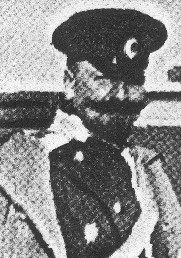

# Additional Notes Not in README — Count Fyodor Maximilianovich von Nieroth

Extracted on 2026-11-21 from `Fyodor-Maximilianovich-von-Nieroth-1871-1952.md` by comparison against `README-Fyodor-Maximilianovich-von-Nieroth-1871-1952.md`.

## Personal Recollections & Comments

From **Sandricourt**:

> This is the chateau where Uncle Theo was living when I met him in 1969. He was the game-keeper. It is located in the Oise department of France, about 50 miles north of Paris.

From **My Comments**:

> Theo Armour says: "My nickname comes from my uncle Theo."

## Additional Biographical & Family Details

* **Family background:** Described as belonging to the **Baltic German** von Nieroth family.
* **Father's role and full name:** Listed in Genealogy as Count [Maximilian Carl Benedict von Nieroth](../Maximilian-Carl-Benedict-von-Nieroth-1846-1914/Maximilian-Carl-Benedict-von-Nieroth-1846-1914.md), and described in both the "From Claude?" blurb and the Estonian Wikipedia translation as a **courtier** (the README describes him as an official of the Ministry of the Interior).
* **Sister:** Explicitly linked in Genealogy as [Vera Maximilianovna](../Vera-Maximilianovna-Kudasheva-von-Nieroth-1874-1920/Vera-Maximilianovna-Kudasheva-von-Nieroth-1874-1920.md) (the README refers to her as "Theo Armour's great-grandmother Vera" without patronymic or link).
* **Civil War commander's full name:** Names **Anton Denikin** as leader of the White Volunteer Army (the README says "General Denikin").
* **Specific brigade command:** The Estonian Wikipedia translation specifies that from January 1915 he commanded the **2nd Brigade** of the 2nd Guards Cavalry Division (the README states "a brigade of the 2nd Guards Cavalry Division").

## Alternate Names, Spellings & Locations

* **Russian (with verification note):** `Фёдор Максимилианович Нирод ~ verify`
* **German:** `Theodor von Nieroth ~ Baltic German family name; Estonian Wikipedia uses this form`
* **Modern transliteration:** `Fyodor Maksimilianovich Nirod`
* **Alternate transliteration in Genealogy:** `Fyodor Maksimilianovich von Nieroth`
* **Name note:** `Theodor is the German equivalent of Fyodor`
* **Mother's alternate recording:** `Anastatisya Fyodorovna Nieroth` (`also recorded as Anastatisya Fyodorovna Nieroth; married Nieroth`; linked to [Anastasia Fyodorovna Trepova](../Anastasia-Fyodorovna-Trepova-1849-1940/Anastasia-Fyodorovna-Trepova-1849-1940.md))
* **Spouse's Geni recording:** `Daria Nieroth (born Fstin. Cantacuzin Gfin. Speransky)`
* **Children's spellings:** `Mikhail Fyodorovich` and `Daria` (Genealogy); `Mihhail von Nieroth (born 1899)` and `Daria von Nieroth (born 1900)` (Estonian Wikipedia translation)
* **Death region:** `Amblainville, Picardie, France` (the README lists `Amblainville, France` and `Amblainville, Oise`)

## Discrepancies vs. README

* **World War I command scope:**
  * The README states he commanded the Life Guards Dragoon Regiment from 1912 and, from January 1915, "a brigade of the 2nd Guards Cavalry Division" (and also a brigade of the 1st).
  * The Estonian Wikipedia translation specifies he was "the commander of the 2nd Brigade of the 2nd Cavalry Division of the Guards Cavalry Division" from January 1915.
  * The "From Claude?" biographical summary claims he led the Life Guards Dragoon Regiment "through the First World War" and "went on to command the 2nd Guards Cavalry Division" (division level rather than brigade level).
* **Father's occupation:** Both the Estonian Wikipedia translation and the "From Claude?" summary describe Maximilian von Nieroth as a "courtier", whereas the README calls him "an official of the Ministry of the Interior".

## Additional Links & Images

### Second Portrait Image (not in README)

| `theodor-nieroth.jpeg` | Fyodor Maximilianovich von Nieroth (1871–1952), also known as Theodor von Nieroth | [Wikimedia Commons](https://commons.wikimedia.org/wiki/File:Fyodor_M._Nirod.jpeg) |

### External Links Not in README

* Geni profile: <https://www.geni.com/people/Count-Fyodor-von-Nieroth/6000000019324085685>
* Estonian National Archives (Order of St. George biographies of non-Estonians): <https://www.ra.ee/apps/georgi/html/mitte-eestlaste_elulood.html>
* Wikimedia Commons search (`trepov`): <https://commons.wikimedia.org/w/index.php?search=trepov>
* Château de Sandricourt on Google Maps: <https://maps.app.goo.gl/H5u86RCxDhKYx5xL9>
* *New York Times* (20 September 1908), "R. Goelet Buys a Chateau; Pays $300,000 for Sandricourt": <https://www.nytimes.com/1908/09/20/archives/r-goelet-buys-a-chateau-pays-300000-for-sandricourt-may-be-for-his.html>
* Sandricourt Shoot: <https://sandricourtshoot.com/en/>

## Research Notes, Drafts & Correspondence

### Draft Summary ("From Claude?")

> From Claude?
>
> Born July 2, 1871, in Saint Petersburg into the Baltic German von Nieroth family, Fyodor was the son of the courtier Maximilian von Nieroth and Anastasia Trepova — a grandson of Fyodor Trepov (senior). After graduating from the elite Page Corps in 1892, he served in a Guards cavalry regiment, was promoted to colonel in 1907, and commanded the 16th Hussar Regiment (1911) and then the Life Guards Dragoon Regiment (1912), leading the latter through the First World War. In January 1915 he was awarded the Sword of St. George for repelling an enemy cavalry brigade near Schirwindt in East Prussia, where he was wounded but stayed in the field; he went on to command the 2nd Guards Cavalry Division. During the Russian Civil War he served in Anton Denikin's White Volunteer Army before emigrating, and died in France on March 26, 1952.

### Full English Translation of Estonian Wikipedia Article

Source: <https://et.wikipedia.org/wiki/Theodor_von_Nieroth_(1871%E2%80%931952)>

> Theodor von Nieroth (2 July 1871 – 26 March 1952) was a military officer of the Russian Empire. During the Russian Civil War, he fought in the Volunteer Army.
>
> ### Biography
> Theodor von Nieroth was descended from the Nieroth family. He was born the son of courtier Maximilian von Nieroth (1846–1914) and Anastasia Trepova (born 1849). [1]
>
> Theodor von Nieroth entered military service at a young age. After graduating from the Paažikorpus (1892), he served in the Guards Cavalry Regiment[2].
>
> In 1907, Theodor von Nieroth was promoted to colonel[2].
>
> In 1911 he was appointed to the 16th Hussar Regiment and in 1912. Bodyguard Dragoon Regiment. He also served in this position during World War I. From January 1915 he was the commander of the 2nd Brigade of the 2nd Cavalry Division of the Guards Cavalry Division[2].
>
> Theodor von Nieroth took part in the Russian Civil War as part of the White Guard Volunteer Army led by Anton Denikin[2].
>
> Theodor von Nieroth died on 26 March 1952 in France.
>
> ### Awards
>
> On 10 January 1915, Theodor von Nieroth was awarded the Sword of George.
>
> "In a battle on 01.08.1914 near Schirwindt in East Prussia, the enemy cavalry brigade repelled the attack of the enemy's cavalry brigade with its regiment and guard artillery battery. Nieroth was wounded in this battle, but remained in the line."
>
> ### Family
> Theodor von Nieroth married in 1897. in St. Petersburg Daria, Princess Cantacuzène, with Countess Speransky, who was the daughter of Mikhail Rodionovich, Prince Cantacuzène, Count Speransky (1848–1894) and Elisabeth Sicard. The marriage produced:[1]
>
> * Mihhail von Nieroth (born 1899)
> Daria von Nieroth (born 1900)
