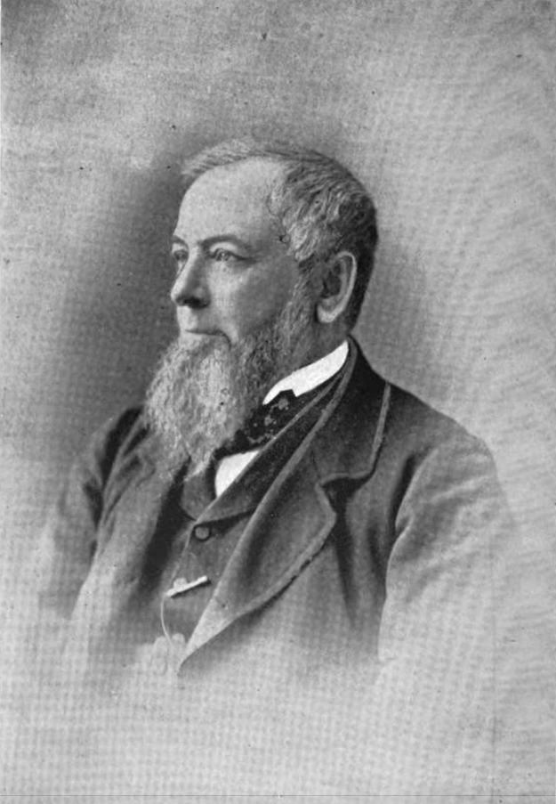

# George Armour

| `george-armour.png` | George Armour (1812–1881). Half-length photographic portrait of an elderly bearded man in a dark coat, seen in left profile, reproduced as a halftone. Wikimedia Commons describes it as a reproduction from *The Second Presbyterian Church of Chicago: June 1st, 1842, to June 1st, 1892* (Chicago, 1892), and dates the photograph to about the 1870s; that book lists a portrait of George Armour among its plates.[2][3] | [Wikimedia Commons](https://commons.wikimedia.org/wiki/File:George-armour-photo-second-presbyterian-church-of-chicago.png) |

**George Armour** (24 April 1812 – 13 June 1881) was a Scottish-born Chicago businessman. A tradesman from Campbeltown in Argyll, he came to Illinois in the 1830s, worked as a contractor on canals and railroads, and from the 1850s was a partner in the grain-elevator firms Munger & Armour and Armour, Dole & Co. He was president of the Board of Trade of the City of Chicago for 1875, a trustee of the Merchants' Loan and Trust Company, the first president of the Chicago Academy of Fine Arts (from 1882 the Art Institute of Chicago), and an elder of the Second Presbyterian Church, whose tower was completed in his memory in 1884.[2][3][4][5][6][7] He was not related to the meat packer Philip Danforth Armour.[2] He was the father of [George Allison Armour](https://theo-armour.github.io/genealogy/#Wiki/George-Allison-Armour-1856-1936/README-George-Allison-Armour-1856-1936.md) and [Allison Vincent Armour](https://theo-armour.github.io/genealogy/#Wiki/Allison-Vincent-Armour-1863-1941/README-Allison-Vincent-Armour-1863-1941.md), and Theo Armour's paternal great-great-grandfather.[1][14]

| **George Armour** | |
| :--- | :--- |
| **Born** | 24 April 1812 (baptised 28 April 1812) Campbeltown, Argyll, Scotland |
| **Died** | 13 June 1881 (aged 69; see Open questions) Brighton, England |
| **Occupation** | Wheelwright; canal and railroad contractor; grain-elevator proprietor |
| **Spouse** | [Barbara Allison](https://theo-armour.github.io/genealogy/#Wiki/Barbara-Allison-Armour-1826-1898/README-Barbara-Allison-Armour-1826-1898.md) (married 28 or 29 August 1850; see Open questions) |
| **Children** | John William (1851–1865) [George Allison](https://theo-armour.github.io/genealogy/#Wiki/George-Allison-Armour-1856-1936/README-George-Allison-Armour-1856-1936.md) (1856–1936) William (1858–1888) [Allison Vincent](https://theo-armour.github.io/genealogy/#Wiki/Allison-Vincent-Armour-1863-1941/README-Allison-Vincent-Armour-1863-1941.md) (1863–1941) Mary Greenlee, Mrs Francis Meredyth Whitehouse (1868–1958) |
| **Parents** | Archibald Armour (1782–1828) and Ann Greenlees (1785–1859), according to the family trees (see Open questions) |

🌳 [See in the family tree](https://theo-armour.github.io/gedcom-viewer/#wiki=George-Armour-1812-1881)

## Family and early life

George Armour was born at Campbeltown, Argyll, on 24 April 1812 and baptised there on 28 April, according to the family trees, two of which cite Scottish birth and baptism indexes.[11][12] The memorial tablet placed by his widow in the Second Presbyterian Church of Chicago says "Born in Campbeltown, Scotland".[3]

The family trees give his parents as Archibald Armour (born at Campbeltown on 9 February 1782; died there on 23 December 1828) and Ann Greenlees (born at Southend, Argyll, on 8 September 1785; died at Ottawa, Illinois, on 28 September 1859), who were married at Campbeltown on 3 July 1806.[11][12] Other sources name his father differently; see Open questions.

Daniel G. Harvey's *The Argyle Settlement in History and Story* (1924) says of him that "he was a wheel-wright and worked his way across the ocean as a cooper or ship carpenter".[4]

## Emigration and the Argyle Settlement

Harvey wrote that "the first to leave Kintyre for Illinois were the Armour boys, John and George, brothers, and their cousin, James Armour, who came in the year 1834 and located at Ottawa", and that they "were not farmers; they were tradesmen or mechanics". James took up a claim on Willow Creek, on the line between Boone and Winnebago counties, and gave it up to his cousins, who built a log cabin fourteen feet square on it to hold the claim.[4] Harvey tells this story of the brothers mowing hay there:

> George hung his scythe on a tree and said to his brother John that he thought he could make a living easier than that. John said to him, "Your scythe is not hung right." He meant that the blade was not rightly adjusted to the handle. George pointed to the tree and said, "I think the scythe is hung right now."[4]

The brothers went back to Ottawa and then to Scotland on a visit, where their account of Illinois encouraged others to follow; Harvey treats them as the forerunners of the colony of Kintyre people in northern Illinois known as the Argyle Settlement. Their uncle John Greenlee and his family came out with the Armours' help and occupied the Armour cabin.[4]

The year of his emigration is given differently in other sources; see Open questions.

## Contractor

According to Harvey, on his return to America George "got his start in life by taking contracts on the Illinois and Michigan Canal work and on grading railroads".[4] The Wikipedia article on him, citing his obituary in the *Chicago Tribune* of 14 June 1881, adds that he lived at Joliet and Lockport and was a sub-contractor with George Steel; the obituary has not been seen for this biography.[2][13] One family tree cites the 1850 United States census for him at Ottawa, LaSalle County, with the occupation "Contractor".[12]

## Grain elevators

The *Encyclopedia of Chicago* says that "in 1854, Wesley Munger and George Armour started a Chicago grain-warehousing company called Munger & Armour", which became Munger, Wheeler & Co. when Hiram Wheeler entered the firm in 1863, and which owned large grain elevators beside the depot of the Chicago & North Western Railroad.[7] The same work says that Armour, Dole & Co. "was founded in 1860 by George Armour, Charles Dole, and Wesley Munger", owned an elevator at the depot of the Chicago, Burlington & Quincy Railroad with a capacity of 850,000 bushels, and remained among the city's leading grain warehousers after the Civil War, with a combined capacity of 2.1 million bushels in 1871 and 6.3 million by the early 1880s.[7] The Board of Trade's report for 1875 lists three elevators under Armour, Dole & Co.[5]

Harvey, writing in 1924, called the firms "Armour and Doal" and "Armour and Munger", and said that George "became a millionaire, one of the merchant princes of America".[4] The family trees cite the 1860 and 1870 censuses with his occupation as "Grain Merchant" and the 1880 census as "Grain Elevator".[12]

The Chicago elevator proprietors of these years were much criticised, and the Wikipedia article gives an account of the Munn & Scott affair of 1872, in which it says Armour bought out the Munn interests. That account rests on sources not seen for this biography.[2]

## Board of Trade and banking

The Board of Trade's eighteenth annual report lists "George Armour, President" among the officers for 1875, and the directors' report in that volume is signed by him as president. The same report lists him on the Committee of Appeals for the term expiring in 1878.[5] A. T. Andreas's *History of Chicago* records his death in 1881 among the members of the Board, calling him "a former president of the Board".[6]

Andreas lists him among the trustees of the Merchants' Loan and Trust Company at the time of the fire of 1871.[6] The Wikipedia article says he was one of the founders of that bank in 1857.[2]

## Art, church and civic life

Andreas records that the Chicago Academy of Fine Arts was incorporated on 24 May 1879 and renamed the Art Institute of Chicago on 21 December 1882, and that "the first president of the Art Institute was George Armour, E. W. Blatchford being vice-president".[6] His son Allison's Yale obituary likewise describes him as "president Chicago Art Institute and Board of Trade".[10]

The roll printed in the history of the Second Presbyterian Church of Chicago appears to show him received by letter on 29 June 1864; the columns are run together in the digitised text. He was a trustee in 1866 and 1869–70, served on the committee that superintended the building of the new church after the fire of 1871, and was elected and ordained an elder in April 1877. When the completed building was left with a debt of $80,000, he and John Crerar, as trustees, gave $10,000 each towards paying it off.[3]

Harvey records that he gave $500 to the building fund of the Willow Creek church in the Argyle Settlement, and that he presented Campbeltown "with a red granite drinking fountain which stands today at the head of the quay".[4] The Wikipedia article gives the fountain's inscription as "the gift of George Armour, Esq, of Chicago US, a native of this town, 1881", and says he was also a founder and trustee of the Chicago YMCA and a founding member of the Commercial Club of Chicago; the sources cited there have not been seen.[2]

The same article, citing the 1881 *Tribune* obituary, says that the only political position he ever held was that of presidential elector for Hayes in 1876, and that a challenge to his eligibility was answered when a record of his naturalization was found.[2][13] His son's passport application of 1920 says that he was naturalized before a court in Illinois, which appears to be written "La Salle Circuit".[9]

## Marriage and children

He married Barbara Allison in Illinois in August 1850.[11][12] She was born in Scotland in May 1826; the Yale obituary of their son Allison calls her the "daughter of William Allison of Millbank, Scotland, and Chicago".[10][11][12]

Five children are named in the family trees: John William (born October 1851; died 13 May 1865); George Allison (27 March 1856 – 8 June 1936); William (27 December 1858 – 21 May 1888); Allison Vincent (18 March 1863 – 6 March 1941); and Mary Greenlee (16 March 1868 – 16 May 1958), who married the Chicago architect [Francis Meredyth Whitehouse](https://theo-armour.github.io/genealogy/#Wiki/Francis-Meredyth-Whitehouse-1848-1938/README-Francis-Meredyth-Whitehouse-1848-1938.md).[10][11][12] The Wikipedia article says that G. P. A. Healy painted a portrait of John William, and that Lawrence Alma-Tadema painted Barbara in London in 1865.[2]

## Death and memorial

George Armour died at Brighton, England, on 13 June 1881.[3][8][11] The Wikipedia article says he was on a voyage to Europe made in the hope of improving his health, and that the cause was "rheumatism of the heart".[2] One family tree cites the 1881 census of England for him at Brighton as a lodger, an "American Citizen Temporarily Here".[12]

The church history says that "his remains were brought home and appropriate services held in the Church", and the trees give his burial as Chicago; the Wikipedia article names Graceland Cemetery.[2][3][11][12]

After his death his widow authorised Norman Williams to complete the tower and spire of the Second Presbyterian Church in his memory, and his children gave a bell, first rung on 26 June 1884.[3] The tablet in the south entrance reads, in part:

> This tower has been completed to the glory of God and in loving memory of George Armour by his widow A.D. MDCCCLXXXIV. A good man — a loving husband — a wise father — a faithful friend.[3]

Barbara Armour died in 1898; see Open questions for the place.

## Residences

* **Campbeltown, Argyll, Scotland.** Born there in 1812.[3][11]
* **Ottawa, LaSalle County, Illinois**, from the 1830s. Harvey places him there from 1834; one tree cites the 1850 census there.[4][12]
* **Argyle Settlement (Willow Creek), Boone and Winnebago counties, Illinois**, briefly in the 1830s, in a log cabin built to hold a land claim.[4]
* **Joliet and Lockport, Illinois**, according to the Wikipedia article, citing the 1881 obituary.[2]
* **Waukegan, Lake County, Illinois.** The family is cited there in the 1860 census, and a Waukegan newspaper item of 1868 is cited for him; the Wikipedia article says the family had a summer house there.[2][12]
* **Chicago, Illinois.** The Wikipedia article says the first family home was on Michigan Avenue near Monroe Street, and that after the fire of 1871 the family built a house at 1945 South Prairie Avenue, in 1872.[2] The trees cite the 1870 census for Ward 1 and the 1880 census.[12]
* **Brighton, England**, as a visitor at his death in 1881.[3][12]

## Open questions

* **His father's name.** Four family trees name his parents as Archibald Armour and Ann (or Anne) Greenlees.[11][12] The Yale obituary of his son says George was the "son of George Armour of Campbelltown, Scotland".[10] Harvey says that James Armour, a shoemaker and John Greenlee's brother-in-law, was "father of the Armours who were at Ottawa".[4] A note in the repository's Armour research files mentions a further tree that gave his mother as Margaret Turner, and treats it as an error.[12] No baptismal entry has been seen.
* **Year of emigration.** Harvey says 1834.[4] His son's passport application of 1920 says he emigrated from Greenock "on or about May 10, 1832" and lived in the United States from 1832 to 1881.[9] One family tree records an arrival at New Orleans on 21 December 1835, aboard the *Lyons* from Liverpool, which could be his return from the visit to Scotland or a different George Armour.[12] The Wikipedia article says he helped the Greenlees leave Campbeltown in 1836.[2]
* **When he settled in Chicago.** The church tablet of 1884 calls him "a resident of this city forty years", which implies about 1841.[3] The Wikipedia article says he resettled in Chicago "in the early 1850s"; the trees cite censuses that place the household at Ottawa in 1850 and Waukegan in 1860.[2][12] His son's passport application gives his residence as Chicago for the whole period 1832–1881.[9]
* **Date of the marriage.** The trees give 29 August 1850 in Cook County and 28 August 1850 in Lake County, Illinois, citing different marriage indexes.[12]
* **Age at death.** The obituary list in the 1896 Chicago directory says "aged 69", which agrees with a birth in April 1812.[8] The church history says he died "in the sixty-eighth year of his age".[3]
* **Eldership.** The church history's narrative says he was elected an elder in April 1877 and then that he "gave his valued services to the Session for fourteen years" before his death in 1881. Its list of elders prints his term as "1877-91".[3] These cannot all be right; 1877–81 fits the date of his death.
* **Year as president of the Board of Trade.** The Board's own report shows him as president for 1875.[5] The profile page says 1875–1876; the Wikipedia article says 1875 in its text and "1870" in its summary box.[1][2]
* **"Inventor" and "founder".** The profile page credits him with the "invention of mechanized grain elevator systems" and with founding the YMCA of Chicago.[1] The Wikipedia article itself says the first steam elevators were built at Buffalo in 1842 and that another firm built Chicago's first large steam elevator in 1854, and calls him "a founder and trustee" of the YMCA.[2] The sources read for this biography show him as a partner in two leading elevator firms, not as an inventor.[7]
* **His name.** Two trees call him "George N. Armour Sr."[11][12] Every printed source read gives plain "George Armour".[3][4][5][6]
* **Number of children and marriages.** The trees based on census records name five children.[12] The Geni export also lists "Alice Whitehouse" as a daughter in addition to Mary Greenlee, and attaches two further families to him, one with a wife recorded only as "?? Vincent"; none of this is sourced.[11] "Alice" may be a duplicate of Mary, who married Francis M. Whitehouse.[10]
* **Barbara Allison's birth.** The trees give 14 or 15 May 1826; one places it at "Milton, East Lothian, Lanarkshire", which is not a consistent place name.[11][12] The Wikipedia article, citing the *Chicago Tribune* of 3 February 1898, says Aberdeen.[2][13] The Yale record connects her father with Millbank.[10]
* **Barbara Allison's death.** Two trees give 1 February 1898 at Charleston, South Carolina, citing Charleston death records.[12] Harvey says "Mrs. Armour died on their son's yacht in Cuban waters".[4] The Geni and MyHeritage exports give February 1893 or 1893, in Illinois.[11] The *Tribune* article of 3 February 1898 supports the year 1898.[13]

## Questions for Theo

Points that family knowledge or family papers may settle. Each links to a conflict described above.

* **His father.** Archibald, George or James Armour? Is there a family Bible or a Campbeltown record?
* **"George N."** Is the middle initial "N." known in the family, or is it an error in the online trees?
* **Barbara Allison's death.** At Charleston, on Allison's yacht in Cuban waters, or both (the yacht at Charleston)?
* **The profile page.** It says he invented mechanized grain elevators, founded the YMCA of Chicago and was president of the Board of Trade in 1875–1876. Should these be reworded to "partner in the firms that built", "a founder of" and "1875"?
* **The portraits.** Are the Healy portrait of John William and the Alma-Tadema portrait of Barbara still in the family?
* **"Alice".** Was there a daughter Alice as well as Mary Greenlee (Mrs Whitehouse)?

## References

1. "George Armour (1812 – 1881)". Profile page in this repository. [additional-notes-not-in-README.md](https://theo-armour.github.io/genealogy/#Wiki/George-Armour-1812-1881/additional-notes-not-in-README.md) (extracted from `George-Armour-1812-1881.md`); Geni: <https://www.geni.com/people/George-Armour/364407867780007569>
2. "George Armour". *Wikipedia*, read 21 November 2026. <https://en.wikipedia.org/wiki/George_Armour>. Portrait file description: <https://commons.wikimedia.org/wiki/File:George-armour-photo-second-presbyterian-church-of-chicago.png>
3. *The Second Presbyterian Church of Chicago: June 1st, 1842, to June 1st, 1892*. Chicago, 1892. List of portraits; lists of elders and trustees; "Church Buildings", pp. 46–47 (tower and memorial tablets); narrative of the Session; roll of members. Read in the digitised text. <https://archive.org/details/secondpresbyter00illgoog>
4. Harvey, Daniel G. *The Argyle Settlement in History and Story*. 1924. pp. 12–16. <https://archive.org/details/argylesettlement00harv>
5. *Eighteenth Annual Report of the Trade and Commerce of Chicago, for the Year Ended December 31, 1875*. Chicago: Board of Trade, 1876. Officers for 1875; report of the directors; table of elevator warehouses. <https://archive.org/details/5222970_18>
6. Andreas, A. T. *History of Chicago from the Earliest Period to the Present Time*, vol. 3. Chicago, 1886. Board of Trade, 1881; "The Art Institute of Chicago"; "The Merchants' Loan and Trust Company". The index gives pp. 320, 421 and 439 for George Armour. Read in the digitised text. <https://archive.org/details/historyofchicago03andruoft>
7. "Armour, Dole & Co." and "Munger, Wheeler & Co." *Encyclopedia of Chicago*, Dictionary of Leading Chicago Businesses. Read in Internet Archive copies. <http://www.encyclopedia.chicagohistory.org/pages/2555.html>; <http://www.encyclopedia.chicagohistory.org/pages/2783.html>
8. "Obituary" list of old settlers, *Directory, City of Chicago*, 1896, transcribed by Deb Haines for the USGenWeb Archives, 2006: "Armour, George, died, Brighton, Eng., June 13, 1881, aged 69." Read in an Internet Archive copy. <http://files.usgwarchives.net/il/cook/obits/n/names28nob.txt>
9. United States passport application of George A. Armour, sworn 12 January 1920. Image in this repository: [007572682_00072.jpg](../George-Allison-Armour-1856-1936/images/007572682_00072.jpg). The handwriting is hard to read in places.
10. "Allison Vincent Armour, B.A. 1884". *Obituary Record of Graduates of Yale University Deceased during the Year 1940–1941*. Bulletin of Yale University, series 38, no. 1 (1 January 1942), pp. 23–24. Read in an Internet Archive copy of <http://mssa.library.yale.edu/obituary_record/1925_1952/1940-41.pdf>
11. Geni and MyHeritage GEDCOM exports, records for George Armour, Barbara Allison, Archibald Armour and their children. `GEDCOM-files/2025/2025-08-18-export-geni/export-BloodTree.ged`, `GEDCOM-files/2025/2025-08-30-export-geni/export-Ancestors.ged` and `GEDCOM-files/2025/2025-08-18-myheritage-armour.ged`
12. Ancestry- and FamilySearch-derived family trees, records for George Armour Sr, Barbara Allison, Archibald Armour, Ann Greenlees and the children; with the accompanying research notes. They cite Scottish birth and baptism indexes, the United States censuses of 1850–1880, the 1881 census of England, Illinois marriage indexes, Cook County wills, Charleston death records and Find a Grave memorial 112151470. None of these records has been seen directly. `GEDCOM-files/2025/2025-08-23-carley-armour-family-tree.ged`, `GEDCOM-files/2025/2025-08-28-matthew-family-tree.ged` and `Online-Genealogy/fiverr/jeff-carley/alt lineage with bios.txt`
13. "George Armour – Death of a Sterling Chicago Business Man", *Chicago Tribune*, 14 June 1881, p. 9; and "Grieve for Mrs Armour", *Chicago Tribune*, 3 February 1898. Not seen; cited from the Wikipedia article.[2]
14. "Armour Read Me". This repository. [README-Armour.md](https://theo-armour.github.io/genealogy/#Armour/README-Armour.md)

## Further research

* The *Chicago Tribune* obituary of 14 June 1881 and the article on Barbara Armour of 3 February 1898, which lie behind much of the Wikipedia article.
* The Campbeltown parish register for April 1812, to settle his father's name.
* The LaSalle County naturalization record, and the passenger list of the *Lyons* (New Orleans, December 1835).
* The Charleston, South Carolina, death record of 1 February 1898 for Barbara Armour.
* His will in the Cook County probate records, which two family trees cite.
* Find a Grave memorials 112151470 (George) and 112151576 (Barbara), and the Graceland Cemetery records.
* The printed pages of Andreas, vol. 3, pp. 320, 421 and 439, to check the digitised text.
