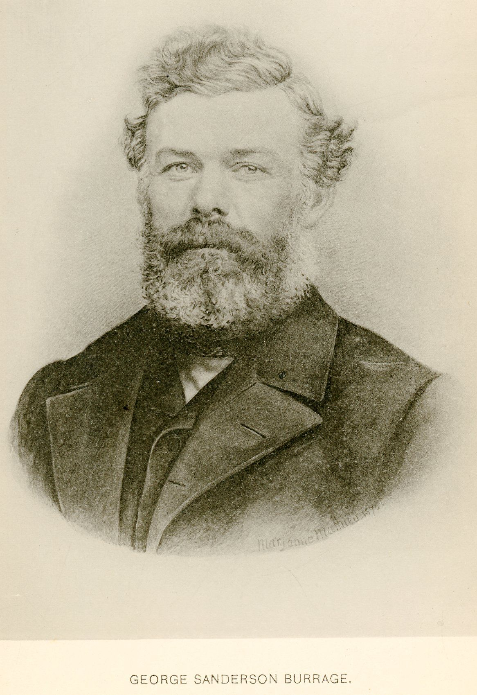

# George Sanderson Burrage

🌳 [See in the GEDCOM Viewer](https://theo-armour.github.io/gedcom-viewer/#wiki=George-Sanderson-Burrage-1823-1876)

| `george-sanderson-burrage.jpeg` | George Sanderson Burrage (1823–1876). Engraved or drawn portrait with the printed caption "GEORGE SANDERSON BURRAGE." The signature at lower right appears to read "Marianne Mathieu" with a date in the 1870s; it is faint and the reading is uncertain. | Source not recorded |

**George Sanderson Burrage** (15 May 1823 – 16 May 1876) was a Massachusetts chair manufacturer who later planted vineyards in Napa County, California. Born in Leominster, he founded with his brothers the chair-making settlement of Burrageville in Ashburnham, Massachusetts, served as a selectman of Ashburnham, and moved to Napa about 1861, where he was a partner in the Vine Cliff Vineyard near Yountville.[1][2][3][4] He was the father of the copper industrialist [Albert Cameron Burrage Sr](https://theo-armour.github.io/genealogy/#Wiki/Albert-Cameron-Burrage-Sr-1859-1931/README-Albert-Cameron-Burrage-Sr-1859-1931.md) and Theo Armour's maternal great-great-grandfather.[5][6]

| **George Sanderson Burrage** | |
| :--- | :--- |
| **Born** | 15 May 1823 Leominster, Worcester County, Massachusetts |
| **Died** | 16 May 1876 (aged 53) Napa County, California (see Open questions) |
| **Occupation** | Chair manufacturer; vineyard owner and grape grower |
| **Spouses** | Martha G. Phelps of Leominster (married 2 April 1844; died 6 August 1849) [Aurelia Chamberlin](https://theo-armour.github.io/genealogy/#Wiki/Aurelia-Chamberlin-Burrage-1830-1899/README-Aurelia-Chamberlin-Burrage-1830-1899.md) (married 1 January 1851) (see Open questions for the name) |
| **Children** | By Martha: Clara A. (b. 1844), Ellen M. (1847–1867), Mary E. (1849–1849) By Aurelia: Cora Chamberlin (b. 1851), William Henry (1854–1854), Martha Bayley (1855–1855), Charles Dana (b. 1857), [Albert Cameron](https://theo-armour.github.io/genealogy/#Wiki/Albert-Cameron-Burrage-Sr-1859-1931/README-Albert-Cameron-Burrage-Sr-1859-1931.md) (1859–1931) |
| **Parents** | Deacon William Burrage (1768–1844) Roxanna Sanderson of Lancaster |

## Family and early life

George Sanderson Burrage was born at Leominster, Massachusetts, on 15 May 1823.[1][7] He was the eldest son of the second marriage of Deacon William Burrage (born 2 September 1768), a tanner and currier in the north part of Leominster who was chosen a deacon of the First Congregational Church in 1814 and held the office until his death in 1844. William had married first, in 1792, Mary Joslin, and second, on 21 June 1821, Roxanna Sanderson of Lancaster.[1]

Roxanna had eight children. *The Burrage Memorial* (1877) lists them as George Sanderson; William F. (1826–1873); Mary Jane (1829–1851); Charles W. (born 1830); Henry Augustus (1833–1838); Martha Ann (1835–1863), who married Porter M. Kimball; Henry Waldo (1840–1841); and Dana Barrett (1842–1843). Five of them survived their father.[1] George also had half-brothers and half-sisters from his father's first marriage, among them Capt. Leonard Burrage (born 1797) of Leominster.[1]

## Burrageville, Ashburnham

George married Martha G. Phelps of Leominster on 2 April 1844. They had three daughters; Martha died on 6 August 1849.[1] On 1 January 1851 he married Aurelia Chamberlin, by whom he had five more children.[1]

*The Burrage Memorial* says that soon after his first marriage he moved to Ashburnham and bought a large tract of woodland there with a good water-privilege. His brothers William F. and Charles W. joined him in building a factory and making chairs, and the village that grew up around the works was made a post station named "Burrageville". The *Memorial* adds that "the enterprise did not prove a success, and was eventually abandoned by all the brothers".[1]

The *History of Ashburnham* (1887) gives more detail. It says that George S. Burrage, "then of Leominster", bought from George L. Beals, about 1848, a saw-mill, a dwelling-house and a large tract of timber land for thirteen thousand dollars. The saw-mill burned and was rebuilt, with chairs made in its upper story. Under the firm name of Burrage Brothers, George, William F. and Charles W. built a paint shop in 1853 and a chair factory, 40 by 100 feet, in the following year, and kept a store and several tenement houses. The chair factory burned in 1858 "and the enterprise was crippled beyond recovery". William F. retired from the firm in 1857, and Charles sold his interest to George, who became sole owner again in 1859.[2] The Burrageville post office was established on 12 December 1854, with Charles W. Burrage as the first postmaster, and was kept in the Burrage store.[2]

George was elected one of the three selectmen of Ashburnham in 1857 and again in 1858.[2] The town history says of the brothers that "while residents of this town they were useful and prominent citizens and occupied many positions of trust".[2] His son Albert Cameron was born on 21 November 1859; Albert's own Harvard class report gives the place as North Ashburnham.[1][6]

## Napa County, California

According to *The Burrage Memorial*, about 1861 George moved to Napa City, California, "where he became engaged in the business of grape raising".[1] His son Albert went to California with his parents as a child and stayed there until he was eighteen, and he prepared for college partly in California.[6][8]

In 1873 C. A. Menefee's *Historical and Descriptive Sketch Book of Napa, Sonoma, Lake, and Mendocino* described "the fine vineyard of Mr. G. S. Burrage, Northeast of Yountville", planted on hillsides "which were useless for any other purpose".[3] The same book describes the Vine Cliff Vineyard of "Messrs. Burrage & Tucker, proprietors", about three miles northeast of Yountville, as "one of the most romantic spots in Napa Valley". It reported that the vineyard then held 65,000 vines, only 10,000 of them native or Mission, that it had been "commenced seven years ago", and that it had produced 19,000 gallons of wine in the previous two years. The wine cellar was four stories high and built into the hillside so that grapes were crushed on the top floor and the juice ran down to the floors below without hoisting.[3] The present Vine Cliff winery dates its founding to 1870–1871, "when George Burrage and Thomas Tucker purchased 500 acres from the Yount estate", and says its caves date from 1871.[4]

His partner was probably his son-in-law: George's daughter Cora Chamberlin Burrage married Thomas J. Tucker of Napa City on 31 May 1870.[1] None of the sources read states outright that the two Tuckers are the same man. His eldest daughter, Clara, who married Frank S. Poland in 1865, is also described as "of Ashburnham, Mass., and Napa City, Cal."[1]

In January 1875 the Napa Valley Water Company was incorporated with a capital of five hundred thousand dollars, to bring water from Rector Creek and other creeks to Napa City, Vallejo, Mare Island and Benicia. The digitised text of the 1881 *History of Napa and Lake Counties* lists among its trustees "G. S. Burraze", which is probably an error in the scan or in the printing for G. S. Burrage. The book says that "the usual outcome attended this company's efforts".[9]

## Death

George Sanderson Burrage died on 16 May 1876, at the age of fifty-three. *The Burrage Memorial* says he died at Napa City; the profile page gives Napa County.[1][5] The *Memorial*, published the following year, closed its account of him:

> It may be said of him that he was ambitious, industrious, honest, and of more than ordinary intelligence; but, as is sometimes the case, he seemed doomed by the Fates not to meet with success commensurate to his ambition, his worth, or his ability.[1]

His tombstone, in the photograph in this folder, reads:[10]

> GEORGE S. BURRAGE, BORN IN LEOMINSTER, MASS. MAY 15, 1823, DIED MAY 16, 1876.

The photograph does not show the name of the cemetery, and it has not been confirmed from a record seen for this biography. The profile page links to a Find a Grave memorial for him.[5]

In 1903–1904 his daughter-in-law Alice Burrage paid for Trinity Episcopal Church in Redlands, California, as a memorial to his widow, "Mrs. Aurelia Burrage".[11]

## Residences

* **Leominster, Massachusetts.** Born there in 1823; described as "of Leominster" at his first marriage in 1844 and still "then of Leominster" when he bought the Ashburnham property about 1848.[1][2]
* **Ashburnham (Burrageville), Massachusetts**, from the mid-1840s or about 1848 until about 1861. Selectman in 1857 and 1858.[1][2]
* **Napa County, California**, from about 1861 until his death in 1876: Napa City, and the Vine Cliff Vineyard about three miles northeast of Yountville.[1][3]

## Open questions

* **When he moved to Ashburnham.** *The Burrage Memorial* says "soon after his first marriage", which was in 1844.[1] The *History of Ashburnham* says he bought the Beals saw-mill and land "about 1848".[2]
* **Date of death.** The tombstone, *The Burrage Memorial*, the *History of Ashburnham* and Geni give 16 May 1876.[1][2][7][10] One Ancestry-derived family tree gives 16 August 1876, without a source.[12] The tombstone is the better evidence.
* **Place of death.** The *Memorial* says Napa City; the profile page and family trees say Napa County.[1][5][12] These do not conflict, but the exact place (town or vineyard) is not recorded.
* **His second wife's name.** *The Burrage Memorial*, Albert's Harvard class report and Geni give **Aurelia Chamberlin** (or Chamberlain).[1][6][7] The Redlands church that was built in her memory names her "Mrs. Aurelia Burrage".[11] The profile page and one family tree give **Amelia C. Chamberlain**; that tree also gives her birth as 3 February 1830 at Newbury, Orange County, Vermont, and her death as 2 October 1899 at Boston, without sources.[5][12] "Amelia" appears to be a misreading of Aurelia.
* **Siblings on the profile page.** The profile page lists "Charles Dana" among George's siblings. *The Burrage Memorial* lists Charles Dana as George's son (born 20 February 1857); the youngest brother was Dana Barrett (1842–1843).[1][5]
* **When the Vine Cliff vineyard was begun.** Menefee, writing in 1873, said it was "commenced seven years ago", that is, about 1866.[3] The present winery dates the purchase of 500 acres from the Yount estate to 1870–1871.[4] The two may refer to different stages (first planting and a later purchase); this has not been settled.
* **Date of the move to California.** The *Memorial* says "about the year 1861".[1] The *History of Ashburnham* says only that he became sole owner of the Burrageville property again in 1859 and later "removed to California".[2] It is not known whether the family went with him at once.
* **A second George S. Burrage.** *The Burrage Memorial* says that Capt. Leonard Burrage of Leominster took into partnership in tanning and shoe-making "his cousin, George S. Burrage", from about 1830 to 1844.[1] This cannot be the subject, who was born in 1823 and was Leonard's half-brother, and the book's index does not list that page under his name. Care is needed not to merge the two.
* **The Napa Valley Water Company trustee.** The digitised 1881 county history reads "G. S. Burraze".[9] The printed page has not been checked.
* **The portrait.** The source and date of the portrait in this folder are not recorded, and the artist's signature is not certainly legible.

## Questions for Theo

Points that family knowledge or family papers may settle. Each links to a conflict described above.

* **His second wife's name.** Aurelia Chamberlin (*The Burrage Memorial*, Harvard, Geni) or Amelia C. Chamberlain (his profile page)? If Aurelia, the profile page needs correcting.
* **"Charles Dana" on the profile page.** In *The Burrage Memorial*, Charles Dana is George's son, not his brother. Should the profile page's list of siblings change?
* **The portrait.** Where did the portrait in his folder come from? The signature seems to read "Marianne Mathieu" with a date in the 1870s; is that known in the family?
* **The tombstone.** Where is it? The photograph shows the inscription but not the cemetery.
* **Vine Cliff.** Is anything known in the family about the vineyard near Yountville or his partner Thomas Tucker?

## References

1. Burrage, Alvah A. *The Burrage Memorial: A Genealogical History of the Descendants of John Burrage, Who Settled in Charlestown, Mass., in 1637*. Boston: A. Mudge & Son, 1877. Narrative of Deacon William Burrage and his children, pp. 81–86; register entry 159, pp. 164–165; entries 224–231, pp. 169–170; entries 334–341, p. 177; entries 492–493, p. 188. <https://archive.org/details/burragememorialg00burr>
2. Stearns, Ezra S. *History of Ashburnham, Massachusetts, from the Grant of Dorchester Canada to the Present Time, 1734–1886*. 1887. Town officers, p. 239; "Burrageville", pp. 415–416; post office, p. 532. <https://archive.org/details/historyofashburn00stea>
3. Menefee, C. A. *Historical and Descriptive Sketch Book of Napa, Sonoma, Lake, and Mendocino*. 1873. "Agricultural Resources", pp. 197–198 and 207–209. <https://archive.org/details/historicaldescri01mene>
4. "Our Story". Vine Cliff Winery. <https://vinecliff1871.com/story>
5. "George Sanderson Burrage (1823–1876)". Profile page in this repository, with data from Geni. `George-Sanderson-Burrage-1823-1876.md` (merged into this README and removed); Geni: <https://www.geni.com/people/George-Burrage/6000000002789973055>; Find a Grave memorial 151877066 (not read; the site refused automated access): <https://www.findagrave.com/memorial/151877066/george_sanderson-burrage>
6. *Harvard College Class of 1883. Sixth Report*. Boston, 1913. Entry for Albert Cameron Burrage, pp. 15–17. <https://archive.org/details/6threportclass1883harvuoft>
7. Geni GEDCOM exports, record for George Sanderson Burrage (geni:6000000002789973055), with the note "Source: The Burrage Memorial". `GEDCOM-files/2025/2025-08-18-export-geni/export-BloodTree.ged` and `GEDCOM-files/2025/2025-08-30-export-geni/export-Ancestors.ged`
8. "Albert Burrage". *Wikipedia*. Cites "In Memoriam", *American Orchid Society Bulletin*, vol. 1, no. 1 (June 1932), pp. 2–4. <https://en.wikipedia.org/wiki/Albert_Burrage>
9. *History of Napa and Lake Counties, California*. 1881. Water companies, p. 252. <https://archive.org/details/historyofnapalak00palm>
10. Tombstone of George S. Burrage. Photograph, [images/tombstone.jpg](images/tombstone.jpg). Cemetery not identified.
11. "Trinity Episcopal Church". Redlands Area Historical Society, Heritage Award, 1980. <https://rahs.org/awards/trinity-episcopal-church/>
12. Ancestry- and FamilySearch-derived family tree, records for George Sanderson Burrage and Amelia C Chamberlain. No sources cited for these events. `GEDCOM-files/2025/2025-08-28-matthew-family-tree.ged`

## Further research

* The Find a Grave memorial (151877066), to identify the cemetery shown in the tombstone photograph.
* The 1860 United States census for Ashburnham and the 1870 census for Napa County, for the household and the timing of the move west.
* Napa newspapers of May 1876 (the *Napa County Reporter* and the *Napa Register*) for an obituary and the cause of death.
* Napa County deeds for the Vine Cliff purchase, to settle the 1866 and 1870–1871 dates, and for the identity of Thomas J. Tucker.
* Massachusetts vital records for his marriages of 1844 and 1851 and for Aurelia Chamberlin's birth and death.
* The origin of the portrait, possibly a published plate.
