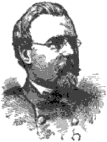
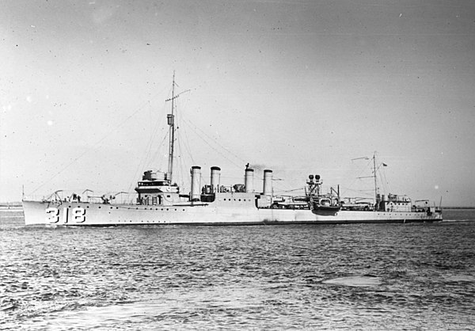

# James Whitehill Shirk

| `james-shirk.png` | James W. Shirk (1832–1873). Small engraved head-and-shoulders portrait of a bearded man wearing spectacles and a buttoned uniform coat, turned to the viewer's right. The engraver, date and original publication are not recorded.[9] | [Wikimedia Commons](https://commons.wikimedia.org/wiki/File:James_W._Shirk_(1832%E2%80%931873).png), according to the profile page |

**James Whitehill Shirk** (16 July 1832 – 10 February 1873), in the records of his own time always James W. Shirk, was an officer of the United States Navy. He entered the service as a midshipman in 1849 and in the Civil War commanded the gunboat *Lexington* at Fort Henry and at the battle of Shiloh, and the ironclad *Tuscumbia* in the passage of the Vicksburg batteries and at Grand Gulf, and afterwards a division of the Mississippi Squadron.[1][3][4] He died a commander, in Washington, D.C., at the age of forty.[1][5] The destroyer USS *Shirk* (DD-318) was named for him.[7] He was the father of the Philadelphia architect [J. C. Marshall Shirk](https://theo-armour.github.io/genealogy/#Wiki/James-Cameron-Marshall-Shirk-1865-1918/README-James-Cameron-Marshall-Shirk-1865-1918.md) and Theo Armour's maternal great-great-grandfather.[2][9][13]

| **James Whitehill Shirk** | |
| :--- | :--- |
| **Born** | 16 July 1832 Pennsylvania (see Open questions for the year and the place) |
| **Died** | 10 February 1873 (aged 40) Washington, D.C. |
| **Resting place** | Erie Cemetery, Erie, Pennsylvania (cemetery association records) |
| **Occupation** | Officer, United States Navy, 1849–1873; commander from 1866 |
| **Spouse** | [Mary W. Marshall](https://theo-armour.github.io/genealogy/#Wiki/Mary-W-Marshall-Shirk-1833-1910/README-Mary-W-Marshall-Shirk-1833-1910.md) of Erie (1833–1910; see Open questions) |
| **Children** | Three were living in 1884, among them [James C. Marshall Shirk](https://theo-armour.github.io/genealogy/#Wiki/James-Cameron-Marshall-Shirk-1865-1918/README-James-Cameron-Marshall-Shirk-1865-1918.md) (1865–1918) (see Open questions) |
| **Parents** | David Shirk (1806–1873) Mary Whitehill |

## Family and early life

James W. Shirk was born in Pennsylvania on 16 July 1832, according to the record of his service printed in his lifetime.[1] He was a son of David Shirk and Mary Whitehill, both "natives of Pennsylvania, the former of German, the latter of English extraction".[2]

The *History of Erie County* (1884), in its sketch of his younger brother, says that David Shirk was a tanner, born in Lancaster County, Pennsylvania, in 1806, who came to Waterford in Erie County, kept a tannery there until 1842, moved in that year to Erie City and was in the foundry business there for thirty-three years. (The digitised text gives the year he came to Waterford as "1888", which cannot be right; 1838 is probably meant.) David Shirk was a Democrat, president of the Select Council of Erie in 1860, and an elder of a Presbyterian church organized in Erie in 1871; he died on 21 November 1873, nine months after his son.[2]

The same sketch lists four children: James W.; Elizabeth, who married W. R. Davenport of Erie in June 1856; Charles C. (born at Waterford on 1 September 1841), later of the Chicago & Erie Stove Company; and Kate.[2] A later county history lists a James W. Shirk among the Erie County pupils of the Erie Academy, and Elizabeth W. Shirk among the girls.[14]

## Early naval career

Hamersly's *Records of Living Officers of the U.S. Navy* (1870) gives his service as follows. He was appointed from Pennsylvania on 26 March 1849 and served in the sloop *John Adams* on the coast of Africa, 1849–51, and in the steam-frigate *Mississippi* in the East India Squadron, 1851–4. He was promoted to passed midshipman in 1854 and to master on 16 September 1855, and was commissioned lieutenant on 6 November 1856. The entry also lists the sloop *Plymouth* on the Atlantic coast (printed as 1858, but placed before 1854), the sloop *Saratoga* in the Home Squadron, 1856–8, the steamer *Michigan* "on the lakes" in 1859, and the sloop *Saranac* in the Pacific Squadron, 1859–60.[1]

The *Mississippi* was the ship in which Commodore Matthew C. Perry left Norfolk on 24 November 1852 on his mission to Japan, and in which he hauled down his flag at New York on 23 April, at the end of the expedition.[15] Hamersly's dates therefore place Shirk in that ship during the expedition. His name has not been found in the text of Perry's *Narrative*, and no list of the ship's officers has been seen (see Open questions).[15]

## Civil War

### The *Lexington*: Fort Henry and Shiloh

In 1861 Shirk joined the naval forces being formed on the western rivers.[1] On 1 December 1861 he reported from St. Louis on the grounding of the new gunboat *Pittsburg*, which he had been ordered to take to Cairo with twenty-five men.[3] On 1 January 1862 Flag-Officer Andrew H. Foote wrote from Cairo that he proposed to send "the gunboat Lexington, in command of Lieutenant Shirk" to join the *Conestoga* in guarding the Ohio, Cumberland and Tennessee rivers.[3]

He commanded the *Lexington*, a wooden gunboat, at the bombardment and surrender of Fort Henry on the Tennessee on 6 February 1862.[1] With the *Tyler* (Lieutenant William Gwin) she then went ahead of the army up the Tennessee, and Hamersly lists engagements at Pittsburg Landing on 1 March and with batteries at Eastport, Mississippi, on 11 March and Chickasaw, Alabama, on 23 March 1862.[1]

At the battle of Shiloh, on 6 April 1862, the *Lexington* was lying at Crump's Landing. Shirk's own report, written two days later, says that on hearing cannon he went up to Pittsburg Landing, returned to Crump's, and came up again. With no instructions from the shore the gunboats "were forced to remain inactive hearers of the desperate fight" until the Union left was forced back and the enemy's shot fell around them. Between 4:10 and 4:40 p.m. the two gunboats silenced the batteries opposite them. At 5:35 p.m., the enemy "having gained a position on the left of our lines, within an eighth of a mile of the landing and of the transports", they fired again. From 1 a.m. on the 7th until daylight the *Lexington* threw a shell every fifteen minutes into the enemy's camp. On the second day, not being allowed to fire, he "spent the morning and part of the afternoon in acts of mercy, picking up the wounded who had found their way to the river and conveying them to the hospital boats".[3]

Gwin, the senior officer, reported that "Lieutenant Commanding Shirk deserves the greatest praise for the efficient manner in which the battery of the Lexington was served."[3] General Grant's report of the battle said of the repulse of the last attack on the landing: "much is due to the presence of the gunboats Tyler and Lexington and their able commanders, Captains Gwin and Shirk."[3] Leonard Swett, who rode over the field afterwards, wrote to President Lincoln on 30 July 1862: "I believe the gunboats Lexington and Tyler, commanded by Lieutenants Gwin and Shirk, saved our army from defeat. At least it is within bounds to say they rendered us invaluable services", and he urged that both be promoted.[3]

Shirk was commissioned lieutenant-commander on 16 July 1862.[1] Hamersly lists him also at St. Charles on the White River on 17 June 1862, at Haines' Bluff on 27 December, at Chickasaw Bayou from 28 December 1862 to 1 January 1863, and at Arkansas Post in January 1863.[1]

### The *Tuscumbia*: Vicksburg and Grand Gulf

In 1863 he commanded the new ironclad *Tuscumbia*.[1][4] On the night of 16 April 1863 Rear-Admiral David D. Porter ran the batteries of Vicksburg. The *Tuscumbia* was placed last in the line, behind the army transports, "to see that the transports did not turn back. This duty Lieutenant-Commander Shirk performed handsomely", Porter reported. When two transports tried to turn upstream, Shirk "drove them back and stayed behind them until the Forest Queen was disabled; he then took her in tow and placed her out of reach of the enemy's shot".[4] Shirk's own report says that Porter had told him he was to be "the whipper-in to the fleet", and that the *Tuscumbia* was struck below the water line and leaked freely, but that there were no casualties on board.[4]

At Grand Gulf on 29 April 1863 the *Tuscumbia* engaged the upper and heaviest fort from 8:25 a.m. until her port engine was disabled and she dropped down out of action. Shirk reported that a shell entered the forward turret through a gun port and exploded, killing four men, that another disabled every man but one at a stern gun, and that "the ship was struck 81 times by shot and shell".[4] He complained that the armour plates "were never put on in a proper manner, and wherever a shot struck the armor the bolts were started". Porter forwarded his report on the ship's defects to the Navy Department on 8 May 1863, writing of "the miserable manner in which that vessel has been built".[4]

Hamersly adds the attack on Vicksburg of 22 May 1863 and says that he was "almost constantly under fire of the batteries at Vicksburg" from 19 May (the end date is printed as 4 June; the Navy's later account says until the surrender on 4 July 1863).[1][7]

### Division commander

Hamersly gives him the command of the *Tuscumbia* "and a division of the Mississippi Squadron, 1863–4"; the Navy's later account calls it the Seventh Division.[1][7] In November 1864, after three light-draught gunboats were burned in the Tennessee River near Johnsonville, "Lieutenant-Commander Shirk, the Division Commander, took prompt measures to regain the control of the Tennessee river", though he could not with his "tin-clad" gunboats force the enemy from their position at Johnsonville.[1]

## Later service and death

After the war he was at the Philadelphia Navy Yard (Hamersly prints "1866–7"). He was commissioned commander on 25 July 1866, served in the steam-frigate *Franklin* in the European Squadron in 1867–8, and was on special duty at the Navy Department from 1869.[1]

He died in Washington on the evening of 10 February 1873. The Washington *Evening Star* of the next day reported that he died of pneumonia, that he was a native of Erie, Pennsylvania, and that at his death he held the office of assistant hydrographer in the Navy; "he leaves a wife and several children".[5] (The newspaper has been read only in the Library of Congress's uncorrected OCR text, which is damaged in places.) On 7 March the same paper printed the nomination of Lieutenant-Commander Beatty P. Smith to be a commander from 11 February 1873, "vice Commander James W. Shirk, deceased".[6]

The records of the Erie Cemetery Association list "Shirk, James W. Comm", died 10 February 1873, in section B, lot 14.[8]

## Marriage and children

He married Mary W. Marshall, the elder daughter of James C. Marshall of Erie and his wife Eliza Weatherbee. Her father (born 1799) was a lawyer who settled in Erie in 1828, lived at Girard from 1830 to 1844, and from 1867 was president of the Marine National Bank of Erie.[2] The date and place of the marriage have not been found.

In 1884 her father's sketch in the county history said: "Mary W. is the widow of Commander James W. Shirk, U. S. Navy (she has three children, all living in Philadelphia)".[2] One of them was James C. Marshall Shirk, born in Philadelphia on 23 June 1865, who became an architect.[16] A MyHeritage index entry for the 1880 census, quoted in one family tree, names the children in the household as David Marshall Shirk, J. Marshall Shirk and Fannie Shirk; the census page has not been seen.[11]

The Erie Cemetery records list Mary W. Shirk, born 19 August 1833, died 8 August 1910, in the same lot as her husband.[8]

## USS *Shirk*

The destroyer USS *Shirk* (DD-318), of the *Clemson* class, was named for him. She was built by the Bethlehem Shipbuilding Corporation at San Francisco: laid down on 13 February 1919, launched on 20 June 1919, sponsored by Miss Ida Lawlor Dunnigan, and commissioned on 5 February 1921. She served on the Pacific coast, was decommissioned on 8 February 1930, and was sold for scrap in January 1931.[7]

| `uss-shirk.jpg` | A four-funnelled destroyer under way, with the number 318 painted on her bow. It appears to be the Naval History and Heritage Command photograph NH 43150, "USS Shirk (DD-318) underway, during the later 1920s", which illustrates the Wikipedia article; the source of this copy is not recorded.[7] | Source not recorded |

## Residences

* **Pennsylvania.** Born in 1832; the town is not established (see Open questions). His father lived at Waterford, Erie County, until 1842 and then in Erie City.[2]
* **Erie, Pennsylvania.** A pupil of the Erie Academy; listed among the regular naval officers "from Erie County" in the Civil War.[2][14]
* **At sea and on the western rivers**, 1849–1865: the coast of Africa, the East Indies, the Great Lakes, the Pacific, and the Mississippi, Tennessee and White rivers.[1]
* **Philadelphia.** At the Navy Yard after the war; his son was born in Philadelphia in June 1865, and his widow's three children were living there in 1884.[1][2][16]
* **Washington, D.C.** On duty at the Navy Department from 1869; died there in 1873.[1][5]

## Open questions

* **Year of birth.** Hamersly (1870), the Navy's account and MyHeritage give 16 July 1832.[1][7][11] Two Ancestry-derived trees give 16 July 1831.[12] The Geni record, as exported in 2025, gives only "1821", although the profile page quotes Geni for 16 July 1832.[9][10] The cemetery record gives no birth date.[8] 1821 would make him twenty-seven or twenty-eight on appointment as a midshipman and must be an error.
* **Place of birth.** Hamersly says only "Pennsylvania".[1] The *Evening Star* called him "a native of Erie".[5] The county history says his father was born in Lancaster County and came to Waterford in a year printed as "1888", probably 1838, which would be six years after James was born.[2] A bookseller's notice of a modern biography is reported to call him a Lancaster County native; neither the notice nor the book has been seen.[17]
* **Middle name: Whitehill or Whitehall.** Every record of his own time seen for this biography calls him James W. Shirk. Geni and the profile page give "Whitehill"; MyHeritage gives "Whitehall".[9][10][11] The county history gives his mother's maiden name as Whitehill, and one tree gives her as "Mary A Whitehill", which favours Whitehill.[2][12] No record giving his own middle name in full has been seen.
* **His parents' dates.** For David Shirk: born 25 May 1806 (cemetery record), 7 May 1806 (Geni), or 1803 (one tree); died 21 November 1873 (county history, cemetery record, one tree).[2][8][10][12] MyHeritage also names a grandfather, David Shirk (1781–1863), without a source.[11] The cemetery record lists both a Mary Ann Shirk who died on 29 October 1840 and a Mary A. Shirk who died on 1 March 1880 in David's lot; as Charles C. was born in 1841, the second is presumably the mother, but this is not stated.[2][8]
* **His wife's name and dates.** The county history calls her Mary W. Marshall, daughter of James C. Marshall and Eliza Weatherbee.[2] The cemetery record, Geni and two trees give 19 August 1833 – 8 August 1910, and the trees give Girard as her birthplace.[8][10][12] MyHeritage calls her "Mary Weatherbee Marshall" and gives 1840–1900.[11] The cemetery dates are the better evidence.
* **Date of the marriage.** The profile page says "they married around 1861/1862", without a source.[9] Nothing has been found to confirm it.
* **The children.** "Three children" in 1884; "several" in 1873.[2][5] The names David Marshall, J. Marshall and Fannie come from a census index entry that has not been seen.[11] A George S. W. Shirk, who died on 21 June 1864, lies in the same cemetery lot as James and Mary; his relationship to them is not stated.[8]
* **Early cruises.** The Navy's account says he "cruised between 1849 and 1860 on the coasts of Africa, East India, and North America, in the gunnery ship, Plymouth".[7] Hamersly names five other ships for those years and gives the *Plymouth* a single year.[1] Hamersly is the earlier and more detailed source.
* **Perry's expedition to Japan.** Hamersly's entry puts him in the *Mississippi* in the East India Squadron in "1851–4"; the ship did not sail for Japan until November 1852.[1][15] Whether he was on board for the visits to Japan in 1853 and 1854 has not been confirmed from a muster roll or officer list.
* **The siege of Vicksburg.** Hamersly prints "from May 19th to June 4th, 1863"; the Navy's account says 19 May to 4 July 1863.[1][7]
* **"Seventh Division."** The number comes from the Navy's later account; Hamersly says only "a division".[1][7]
* **Duty after 1866.** Hamersly: Philadelphia Navy Yard, then the *Franklin* in 1867–8, then special duty from 1869.[1] The Navy's account: European Squadron and "special duty for the Navy Department from 1866 to 1872".[7] The *Evening Star* says he was assistant hydrographer when he died.[5]
* **A second Shirk in the squadron.** In early 1863 the squadron recorded that the resignation of "Acting Master's Mate Charles C. Shirk" had been accepted.[4] Whether this was his brother Charles C. Shirk of Erie is not established.
* **The Dictionary of American Naval Fighting Ships.** The Navy's own page for USS *Shirk* could not be opened for this biography. Its text is taken here from the Wikipedia articles, which incorporate it, and from the copy quoted in a MyHeritage record.[7][11]

## Questions for Theo

Points that family knowledge or family papers may settle. Each links to a conflict described above.

* **Japan.** The Peeps page records a family belief that he was connected with a voyage to Japan, and says no connection could be found.[13] Hamersly's 1870 record puts him in the *Mississippi*, Commodore Perry's ship, in the East India Squadron in the years of Perry's expedition. Is there anything in family papers (a journal, letters, a souvenir) that would confirm he was there?
* **The epaulettes and sword.** The Peeps page mentions them.[13] Is there an inscription or a maker's name on either?
* **Whitehill or Whitehall.** Is his middle name written out in any family paper?
* **Where he was born.** Lancaster County, Waterford or Erie?
* **His marriage.** When and where did he marry Mary W. Marshall? The Peeps page speaks of "a Southern Belle"; Mary Marshall was born at Girard, Pennsylvania, and the Arkansas family was that of his son's wife, Ida Watkins.[2][13]
* **The "issues" noted in the journal on 2025-12-18.** Were they the conflicting birth years (1821, 1831, 1832)?
* **"Union Army officer."** The profile page's comments call him a Union Army officer; he was a naval officer.[9] Should that line change?

## References

1. Hamersly, Lewis R. *The Records of Living Officers of the U.S. Navy and Marine Corps: with a History of Naval Operations during the Rebellion of 1861–5*. Philadelphia: J. B. Lippincott & Co., 1870. Entry "Commander James W. Shirk", p. 119; history of the Mississippi Squadron, pp. 296, 298–300 and 309. <https://archive.org/details/cu31924098819968>
2. *History of Erie County, Pennsylvania*. Chicago: Warner, Beers & Co., 1884. Officers from Erie County, p. 474; a Presbyterian church organized in 1871 and the death of David Shirk, p. 554; sketch of W. R. Davenport, p. 884; sketch of James C. Marshall, p. 925; sketch of Charles C. Shirk, pp. 951–952; lists of city officers. Read in the digitised text, with some page numbers taken from running heads. <https://archive.org/details/historyoferiecou00bate>
3. *Official Records of the Union and Confederate Navies in the War of the Rebellion*, series I, vol. 22. Washington, 1908. Shirk's report on the *Pittsburg*, p. 448; Foote, 1 January 1862, p. 479; reports of Gwin and Shirk on Shiloh, 8 April 1862, pp. 763–765; extract from Grant's report and the letter of Leonard Swett, p. 766. <https://archive.org/details/officialrecordso0022vari>
4. *Official Records of the Union and Confederate Navies in the War of the Rebellion*, series I, vol. 24. Acceptance of the resignation of Charles C. Shirk, p. 192; Porter's report on the passage of Vicksburg, pp. 553–554; Shirk's report, 17 April 1863, pp. 562–564; Shirk's report on Grand Gulf, 30 April 1863, pp. 620–621; Porter and Shirk on the defects of the *Tuscumbia*, pp. 658–659. <https://archive.org/details/officialrecordso0024unse>
5. "Death of Commander Shirk" (heading as reconstructed from the OCR). *Evening Star* (Washington, D.C.), 11 February 1873, p. 1. Read in uncorrected OCR text. <https://www.loc.gov/resource/sn83045462/1873-02-11/ed-1/?sp=1>
6. List of naval nominations. *Evening Star* (Washington, D.C.), 7 March 1873, p. 1. Read in uncorrected OCR text. <https://www.loc.gov/resource/sn83045462/1873-03-07/ed-1/?sp=1>
7. "James Shirk" and "USS Shirk". *Wikipedia*. Both incorporate text from the *Dictionary of American Naval Fighting Ships* and cite *Ships' Data, U.S. Naval Vessels, 1911–1935* and the *Baltimore Sun* of 12 February 1873 (not seen). <https://en.wikipedia.org/wiki/James_Shirk>; <https://en.wikipedia.org/wiki/USS_Shirk>. The Navy's page (not seen; the site refused the connection): <https://www.history.navy.mil/research/histories/ship-histories/danfs/s/shirk.html>
8. "Erie Cemetery, Erie, Pennsylvania: Surnames Sh–Si". *Interment.net*. Records "acquired from the Erie Cemetery Association on December 2, 2016". <https://www.interment.net/data/us/pa/erie/erie-cemetery/records-sh-si.htm>
9. "James Whitehill Shirk (1832–1873)". Profile page in this repository, with data from Geni. [additional-notes-not-in-README.md](https://theo-armour.github.io/genealogy/#Wiki/James-Whitehill-Shirk-1832-1873/additional-notes-not-in-README.md) (extracted from `James-Whitehill-Shirk-1832-1873.md`); Geni: <https://www.geni.com/people/James-Shirk/6000000209225000864>
10. Geni GEDCOM exports, records for James Whitehill Shirk (geni:6000000209225000864), David Shirk and Mary W. Marshall. `Online-Genealogy/gedcom-files/2025-08-18-export-geni/export-BloodTree.ged` and `Online-Genealogy/gedcom-files/theo/2025-08-30-export-geni/export-Ancestors.ged`
11. MyHeritage GEDCOM export, records for "James Whitehall Shirk", "Mary Weatherbee Marshall" and two David Shirks, quoting a census index entry and a copy of the Navy's biography. `Online-Genealogy/gedcom-files/2025-08-18-myheritage-armour.ged`
12. Ancestry-derived family trees, records for James W Shirk, Mary W. Marshall, David Shirk and Mary A Whitehill. No sources are cited for James; Mary W. Marshall's dates cite the Find a Grave index (memorial 5992871, not seen). `Online-Genealogy/gedcom-files/2025-08-23-carley-armour-family-tree.ged` and `Online-Genealogy/gedcom-files/2025-08-28-matthew-family-tree.ged`
13. "James Whitehill Shirk ~ Maternal great-great-grandfather". Entry in [Peeps-in-My-Family.md](https://theo-armour.github.io/genealogy/#Peeps-in-My-Family.md); and [Shirk/README-Shirk.md](https://theo-armour.github.io/genealogy/#Shirk/README-Shirk.md)
14. *Nelson's Biographical Dictionary and Historical Reference Book of Erie County, Pennsylvania*. Erie: S. B. Nelson, 1896. Lists of Erie Academy pupils and of officers from Erie County; sketch of W. R. Davenport. Read in the digitised text; page numbers not taken. <https://archive.org/details/nelsonsbiographi00whit>
15. Hawks, Francis L., comp. *Narrative of the Expedition of an American Squadron to the China Seas and Japan, Performed in the Years 1852, 1853, and 1854, under the Command of Commodore M. C. Perry*. Vol. 1. Washington, 1856. Departure from Norfolk, p. 80; contents of the last chapter. The digitised text was searched for "Shirk" without result. <https://archive.org/details/narrativeofexped01perr>
16. "J. C. Marshall Shirk". Obituary, *Journal of the American Institute of Architects*, vol. 6, no. 12 (December 1918), p. 585. <https://archive.org/details/sim_journal-of-the-american-institute-of-architects_1918-12_6_12>
17. Shirck, Laurence C. *The Life and Times of James W. Shirk, Distinguished Civil War Naval Officer*. Sold by Masthof Press. Not seen; known only from a search-engine summary of the bookseller's page, which could not be opened. <https://www.masthof.com/products/the-life-and-times-of-james-w-shirk-distinguished-civil-war-naval-officer>

## Further research

* Laurence C. Shirck's biography (reference 17), which may settle the birthplace, the marriage and the children.
* The *Dictionary of American Naval Fighting Ships* entry and the Navy's list of officers, 1798–1900, on the Naval History and Heritage Command site, and its photograph NH 45548, catalogued as "Commander James W. Shirk, USN" (none of these pages could be opened).
* The *Baltimore Sun* obituary of 12 February 1873, the *Evening Star* page image, and Erie newspapers of February 1873 for the funeral.
* Muster rolls or officer lists of the *Mississippi*, 1852–1855, for Perry's expedition.
* *Official Records of the Union and Confederate Navies*, series I, vols. 23, 25 and 26, for the rest of his war service and the division command of 1863–1864.
* The 1850, 1860 and 1870 censuses (Erie, Philadelphia, Washington), and the 1880 census of Philadelphia for his widow and children.
* A marriage record or newspaper notice, probably at Erie, and the Find a Grave memorials for the Erie Cemetery lot.
* Lancaster County records for David Shirk and Mary Whitehill.
