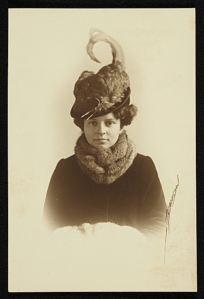

# Katharine Lane Weems

| `Katharine-Lane-Weems.jpg` | Sepia studio photograph of a girl or young woman facing the camera, in a tall feathered hat, a fur collar and a dark coat, with a white fur muff. A photographer's signature runs up the lower right edge; it is not clearly legible. Undated. | Source not recorded. Probably from the Katharine Lane Weems papers at the Archives of American Art; see Open questions.[1] |

**Katharine Lane Weems** (22 February 1899 – 11 February 1989), born **Katharine Ward Lane**, was a Boston sculptor known for her realistic bronzes of animals. Her largest work was for the Biological Laboratories at Harvard University: the bronze doors, the animal friezes carved in the brick walls, and the two bronze rhinoceroses at the entrance, unveiled in 1937. Her other public works in Boston include the Lotta Fountain on the Charles River Esplanade and *Dolphins of the Sea* at the New England Aquarium.[1][2][3] She has a folder in this genealogy, but no family relationship to Theo Armour has been established from the sources read; see Open questions.

| **Katharine Lane Weems** | |
| :--- | :--- |
| **Born** | 22 February 1899 Boston, Massachusetts |
| **Died** | 11 February 1989 (aged 89) Rockport, Massachusetts |
| **Occupation** | Sculptor |
| **Spouse** | Fontaine Carrington Weems (married 1947) |
| **Children** | None recorded in the sources read |
| **Parents** | Gardiner Martin Lane Emma Louise Gildersleeve |

## Family and early life

Katharine Ward Lane was born in Boston on 22 February 1899, the only child of Gardiner Martin Lane and Emma Louise Gildersleeve.[1][2][4] Her father was a financier and the president of the board of trustees of the Museum of Fine Arts, Boston.[1][5] Her mother's father was the classical scholar Basil Lanneau Gildersleeve.[1] She was named after her father's sister, Katharine Ward Lane, a watercolourist who died in 1893.[1]

The Lane family bought the house at 53 Marlborough Street, in Boston's Back Bay, in 1905, and added an extension on its west side. The French Library, which now occupies the house, describes the family as Francophiles who took French lessons.[6]

She went to the May School in Boston.[1][4]

## Training

She studied at the School of the Museum of Fine Arts, Boston; one account gives the years as 1918 to 1922.[2][4] *Who's Who in Massachusetts* of 1940 calls her a "pupil of Charles Grafly, Anna Huntington, and Brenda Putnam".[4] Wikipedia names her teachers at the Museum School as Charles Grafly and George Demetrios, and says that she attended the summer studios of Anna Hyatt Huntington and had the support of Huntington and Brenda Putnam, who both worked in New York.[1] Huntington encouraged her to work from live animals.[5]

## Career

She was elected to the National Association of Women Painters and Sculptors in 1925.[1] In 1926 she won a bronze medal at the Sesquicentennial Exposition in Philadelphia.[1][4] The honours listed in her *Who's Who* entry of 1940 continue with the Widener Memorial gold medal of the Pennsylvania Academy of the Fine Arts; an honourable mention at the Paris Salon in 1928; the Joan of Arc gold medal of the National Association of Women Painters and Sculptors in 1928; a bronze medal at the Boston Tercentenary fine arts exhibition in 1930; the Anna Hyatt Huntington prize in 1931; and the Speyer prize of the National Academy of Design in 1932. The same entry records her as a National Academician in 1939.[4]

Her largest commission was the sculpture for Harvard's new Biological Laboratories in Cambridge, built in the early 1930s: bronze entrance doors, friezes of more than thirty species of wild animals carved into the brick of the upper walls, and two bronze Indian rhinoceroses flanking the entrance. She studied a female rhinoceros at the Bronx Zoo for the pair. Each weighs about three tons.[1][2] The rhinoceroses were unveiled on 12 May 1937 by President-emeritus A. Lawrence Lowell and George R. Agassiz. *The Harvard Crimson* reported the next day that the unveiling marked the completion of the building, and that the sculptor had named the animal on the right "Queen Bess" and the other "Queen Victoria".[3] The Cambridge Historical Commission remarks that "despite this great accomplishment, Weems's work was given little local fanfare".[2]

She served on the Massachusetts Arts Commission from 1941 to 1947, was elected to the National Institute of Arts and Letters in 1952, and received a sculpture award from the National Academy of Design in 1960.[1]

She gave most of her work to the Museum of Science in Boston, which holds the largest collection of her sculpture; a permanent gallery of her small animal bronzes was created there in 1965.[1][2][5] In 1987 the Katharine Lane Weems Chair in Decorative Arts was created at the Museum of Fine Arts, Boston.[1]

Her bronzes are usually signed "KATHARINE LANE WEEMS" or "KATHARINE LANE" on the base.[5] A memoir, *Odds Were Against Me*, as told to Edward Weeks, was published in 1985 (not seen).[1]

## Marriage and later life

In 1947 she married Fontaine Carrington Weems, known as "Canny", whom the Cambridge Historical Commission calls a longtime friend. She had exhibited as Katharine Ward Lane and afterwards exhibited as Katharine Lane Weems.[1][2]

In 1961 she gave the house at 53 Marlborough Street to the French Library.[1][6]

She died at Rockport, Massachusetts, on 11 February 1989.[1][2] Her papers are at the Archives of American Art of the Smithsonian Institution, catalogued as the "Katharine Lane Weems papers, 1865-1989", and at Harvard University.[1]

## Works

* **Bronze doors, brick friezes and two rhinoceroses**, Biological Laboratories, Harvard University, Cambridge, Massachusetts. Early 1930s; the rhinoceroses unveiled 12 May 1937.[1][2][3] [Cambridge Historical Commission](https://cambridgehistoricalcommission.blog/2019/03/13/katharine-weems/); [*The Harvard Crimson*, 1937](https://www.thecrimson.com/article/1937/5/13/rhinoceri-unveiling-marks-completion-of-biological/)
* **Lotta Fountain**, Charles River Esplanade, Boston, 1939, with the architect Edwin Dodge.[1] [Wikipedia](https://en.wikipedia.org/wiki/Katharine_Lane_Weems)
* ***Dolphins of the Sea***, outside the New England Aquarium, Boston, 1977.[1][5]
* ***Narcisse Noir*** (a dog), Museum of Fine Arts, Boston, and the museum at Reading, Pennsylvania.[4]
* ***Pigmy African Elephant***, Museum of Fine Arts, Boston.[4]
* ***Circus Horse***, ***Doe and Fawn***, ***Whippet*** and ***Greyhounds Unleashed***, in the Archer Huntington collection in South Carolina, now Brookgreen Gardens.[1][4]
* ***Greek Horse***, Friends of Art, Baltimore.[4]
* ***Bear***, Spee Club, Cambridge.[4]
* **Thirty bronze animal sculptures** given to the Museum of Science, Boston.[2]

Wikipedia also lists her work in the collections of the Boston Athenæum, the Pennsylvania Academy of the Fine Arts and the Baltimore Museum of Art.[1] An article on her bronzes and their marks is in [*Yankee*](https://newengland.com/yankee/sculpting).[5]

## Residences

* **53 Marlborough Street, Boston.** Bought by the Lane family in 1905; still her home address in 1940; given by her to the French Library in 1961.[4][6]
* **Summer Street, Manchester, Massachusetts.** Her summer residence in 1940.[4]
* **Rockport, Massachusetts**, where she died in 1989.[1][2]

## Open questions

* **The relationship to Theo Armour. Not established.** Her profile page in this repository holds only a link to Wikipedia, and an archived list of "Heroes" names her without saying how she is connected.[7][8] The surnames Weems, Lane and Gildersleeve do not occur as names of persons in any of the GEDCOM family trees in this repository, and she is not in `Peeps-in-My-Family.md`.[9] None of the outside sources read mentions the Armour, Burrage, Shirk or Kudashev families. She was an only child and no children are recorded, so any link would be through her parents' families, through her husband, or through friendship rather than kinship. One coincidence of place may be worth following: she had a summer home at Manchester, Massachusetts, the town where Albert Cameron Burrage Sr had his summer home and where Francis Meredyth Whitehouse and his wife Mary Armour had an estate.[4][10] That is not evidence of a relationship.
* **Katharine or Katherine.** The folder and the profile page spell her name "Katherine".[7] She spelt it **Katharine**: her bronzes are signed "KATHARINE LANE WEEMS" or "KATHARINE LANE", and the Archives of American Art, Wikipedia, the Cambridge Historical Commission and the 1940 *Who's Who in Massachusetts* all use that spelling.[1][2][4][5] The "Katherine" spelling does appear in print: *The Harvard Crimson* of 1937 called her "Katherine W. Lane", and Wikipedia's own footnote cites the *Who's Who* entry as "LANE, Katherine Ward", although the digitised text of that entry reads "Katharine".[1][4][3]
* **Year of birth.** All modern sources give 1899.[1][2][5] The digitised text of *Who's Who in Massachusetts* reads "b. Boston, Feb. 22, 1889".[4] This is probably an error in the scan or in the printing; the printed page has not been checked.
* **The Widener gold medal.** 1926 according to Wikipedia; 1927 according to *Who's Who in Massachusetts*.[1][4]
* **Her teachers.** *Who's Who* (1940) names Grafly, Huntington and Putnam; Wikipedia names Grafly and George Demetrios as her teachers and Huntington and Putnam as supporters.[1][4]
* **The names of the rhinoceroses.** "Queen Bess" and "Queen Victoria" in *The Harvard Crimson* at the unveiling; "Bessie" and "Victoria" in Wikipedia and the Cambridge Historical Commission.[1][2][3]
* **Whose house.** Wikipedia calls 53 Marlborough Street "the Weems family home"; the French Library says the Lane family bought it in 1905, long before her marriage.[1][6]
* **Her husband's name.** "Carrington Weems" in Wikipedia; "Fontaine Carrington 'Canny' Weems" at the Cambridge Historical Commission.[1][2] His dates and family have not been confirmed from a source read.
* **The portrait.** The photograph in this folder has no recorded source. Wikipedia's lead image is titled "Katharine Lane Weems, circa 1915. Katharine Lane Weems papers, Archives of American Art, Smithsonian Institution", and the folder's image may be the same photograph, but the two have not been compared.[1]

## Questions for Theo

Points that family knowledge or family papers may settle. Each links to a conflict described above.

* **How is she connected to the family?** Was Katharine Lane Weems a relation, and if so through whom: the Lanes, the Gildersleeves, or her husband Carrington Weems? Or was she a friend or neighbour of the Burrages on the North Shore?
* **Did the family own any of her work**, or did she make a portrait of a family animal?
* **The folder name.** She spelt her name Katharine. Keep the folder as "Katherine-Weems-1899-1989", or rename it?
* **The photograph.** Where did the photograph in her folder come from?

## References

1. "Katharine Lane Weems". *Wikipedia*. Cites, among others, "Katharine Lane Weems papers, 1865-1989", Archives of American Art, Smithsonian Institution; Louise Todd Ambler, *Katharine Lane Weems: Sculpture and Drawings* (Boston Athenaeum, 1987); and Katharine Lane Weems, *Odds Were Against Me: A Memoir*, as told to Edward Weeks (New York: Vantage Press, 1985) (none of these seen). <https://en.wikipedia.org/wiki/Katharine_Lane_Weems>
2. Partenheimer, Meta. "Katharine Weems: Sculptor". Cambridge Historical Commission blog, 13 March 2019. <https://cambridgehistoricalcommission.blog/2019/03/13/katharine-weems/>
3. "Rhinoceri Unveiling Marks Completion Of Biological Laboratory Construction". *The Harvard Crimson*, 13 May 1937. <https://www.thecrimson.com/article/1937/5/13/rhinoceri-unveiling-marks-completion-of-biological/>
4. *Who's Who in Massachusetts*, 1940–41. Boston: Larkin, Roosevelt & Larkin, 1940. Entry for "LANE, Katharine Ward, sculptor", p. 461 according to Wikipedia. Read in the digitised text, which carries scanning errors. <https://archive.org/details/whoswhoinmassach12unse>
5. Riedel, Catherine. "Antiques: Creatures in Bronze". *Yankee*, 20 February 2008. <https://newengland.com/yankee/sculpting>
6. Haslett, Jamie. "Chez Nous: A History of Our Home". French Library, 26 February 2019. <https://frenchlibrary.org/2019/02/26/chez-nous-a-history-of-our-home/>
7. "Katherine-Weems-1899-1989". Profile page in this repository. [Katherine-Weems-1899-1989.md](https://theo-armour.github.io/genealogy/#Wiki/Katherine-Weems-1899-1989/Katherine-Weems-1899-1989.md)
8. "Heroes". Archived note in this repository, which lists "Katherine Weems ~ (1899 - 1989) American sculptor". `Documents/archive/notable-forbearers/heroes.md`
9. GEDCOM family trees in this repository, searched for the surnames Weems, Lane and Gildersleeve: `Online-Genealogy/gedcom-files/2025-08-18-export-geni/export-BloodTree.ged`, `Online-Genealogy/gedcom-files/theo/2025-08-30-export-geni/export-Ancestors.ged`, `Online-Genealogy/gedcom-files/2025-08-18-myheritage-armour.ged`, `Online-Genealogy/gedcom-files/2025-08-23-carley-armour-family-tree.ged`, `Online-Genealogy/gedcom-files/2025-08-28-matthew-family-tree.ged` and `Online-Genealogy/gedcom-files/2025-08-18-ancestry-armour-ferté/2025-08-18-armour-ferte.ged`
10. Biographies in this repository: [Albert Cameron Burrage Sr](https://theo-armour.github.io/genealogy/#Wiki/Albert-Cameron-Burrage-Sr-1859-1931/README-Albert-Cameron-Burrage-Sr-1859-1931.md), for his summer home at West Manchester, and [Francis Meredyth Whitehouse](https://theo-armour.github.io/genealogy/#Wiki/Francis-Meredyth-Whitehouse-1848-1938/README-Francis-Meredyth-Whitehouse-1848-1938.md), for the Whitehouse estate at Manchester-by-the-Sea.

## Further research

* The finding aid and biographical note of the Katharine Lane Weems papers at the Archives of American Art, and her papers at the Schlesinger Library, Harvard. Both sites refused automated access. Her diaries and correspondence are the likeliest place to find a link to the Burrage or Armour families.
* Her memoir, *Odds Were Against Me* (1985), and Louise Todd Ambler's catalogue (1987), for family, friends and neighbours at Manchester.
* Obituaries of February 1989 in the *Boston Globe* and the *New York Times*.
* Fontaine Carrington Weems: his dates, family and first career. A catalogue summary that was not read directly describes papers of an F. Carrington Weems (1884–1966) of the Princeton class of 1907; whether he is her husband, and whether there is a Princeton connection with the Armours, has not been checked.
* The Lane summer house at Manchester, said in a catalogue summary that was not read directly to have been called "The Chimneys".
* The printed page of *Who's Who in Massachusetts*, for the year of birth and the spelling of her name.
* Collection records at the Museum of Fine Arts, Boston, the Museum of Science and Brookgreen Gardens, for a fuller list of works.
