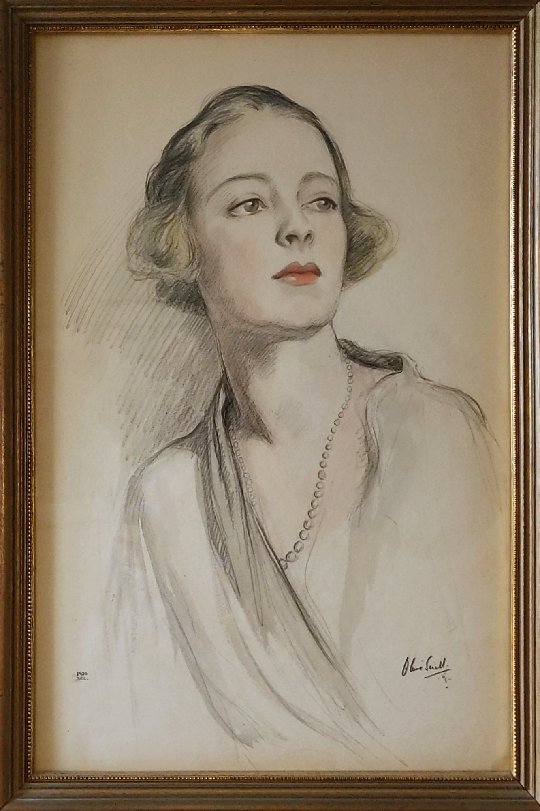

# Additional Notes Not in README — Maria Sergeyevna Kudasheva

Extracted on 2026-11-21 from `Maria-Sergeyevna-Kudasheva-1896-1990.md` by comparison against [README-Maria-Sergeyevna-Kudasheva-1896-1990.md](README-Maria-Sergeyevna-Kudasheva-1896-1990.md).

## Personal Recollections & Comments

From `Maria-Sergeyevna-Kudasheva-1896-1990.md` (`## My Comments`, verbatim):

> I loved my grandmother and had excellent communication with her. Nonetheless, I know very little about my grandmother's youth. I know she spoke seven languages quite fluently. I remember her reminiscing that she had her debutante "coming out party" with one of the Tsarina's daughters, but I don't know which one.
>
> After my grandmother left Russia and married my grandfather, she apparently devoted her life to his career and to being a good American.
>
> As far as I know, my father spoke little or no Russian. Apart from family members, as far as I know, she had few Russian friends.

## Additional Biographical & Family Details

* **Specific place of death:** `New York, New York, United States` (the README lists only `United States`).
* **Additional sibling:** `Olga`, listed alongside brother Sergei Sergeyevich (`Siblings: Sergei Sergeyevich and Olga`; the README mentions only brother Prince Sergei Sergeyevich Kudashev).
* **Spouse's style and suffix:** `The Honorable Norman Armour, Sr` (the README omits the title `The Honorable` and the `Sr` suffix).
* **Son's death year:** `1978`, recorded in the linked wiki path for Norman Armour Jr. (`Norman-Armour-Jr-1920-1978`; the README lists only `Norman Armour Jr. (b. 1920)`).
* **Youth & family life details (from "My Comments"):** Spoke seven languages quite fluently; had her debutante "coming out party" with one of the Tsarina's daughters; devoted her life after marriage to her husband's career and being a good American; her son (Theo Armour's father) spoke little or no Russian; apart from family members, she had few Russian friends.

## Alternate Names, Spellings & Locations

* **French transliteration:** `Myra Sergéievna Koudacheff ~ as used in émigré documents`
* **Variant surname spellings:** `Koudachev ~ Geni`; `Koudacheff ~ Sweden-era documents`
* **Family nickname:** `"Granny"` (`Known as: Myra; "Granny"`)

## Discrepancies vs. README

* **Number of languages spoken:** Theo Armour's personal comments note that she spoke **seven languages** quite fluently; the README mentions only three (Russian, French, and English).
* **Birth year:** The source lists `Apr 7 1896` exclusively (`1896–1990` in the heading), whereas the README gives `7 April 1895 (or 1896)`.
* **Place of death:** The source specifies `New York, New York, United States`, whereas the README lists `United States`.
* **Siblings:** The source lists `Sergei Sergeyevich and Olga`, whereas the README mentions only her younger brother Sergei Sergeyevich.

## Additional Links & Images

* **1921 Olive Snell portrait (local image):**
  
  [images/1921-olive-snell-myra-koudachev-armour.jpg](images/1921-olive-snell-myra-koudachev-armour.jpg)
* **1921 Olive Snell portrait (external URL):** [https://evereverland.github.io/2019/everlandings/theo-armour/armour-fine-art/1921-olive-snell-myra-koudachev-armour.jpg](https://evereverland.github.io/2019/everlandings/theo-armour/armour-fine-art/1921-olive-snell-myra-koudachev-armour.jpg)
* **Geni profile:** [https://www.geni.com/people/Princess-Myra-Armour/364408351200007646](https://www.geni.com/people/Princess-Myra-Armour/364408351200007646)
* **Relative wiki links (not linked in README):**
  * [Sergei Vladimirovich Kudashev](../Sergei-Vladimirovich-Kudashev-1863-1933/README-Sergei-Vladimirovich-Kudashev-1863-1933.md)
  * [Vera Maximilianovna von Nieroth](../Vera-Maximilianovna-Kudasheva-von-Nieroth-1874-1920/README-Vera-Maximilianovna-Kudasheva-von-Nieroth-1874-1920.md)
  * [Sergei Sergeyevich](../Sergei-Sergeyevich-Kudashev-1901-1991/README-Sergei-Sergeyevich-Kudashev-1901-1991.md)
  * [Norman Armour, Sr](../Norman-Armour-Sr-1887-1982/README-Norman-Armour-Sr-1887-1982.md)
  * [Norman](../Norman-Armour-Jr-1920-1978/README-Norman-Armour-Jr-1920-1978.md)

## Research Notes, Drafts & Correspondence

* **Russian spelling verification note:** `Russian: Мария Сергеевна Кудашева ~ verify`
