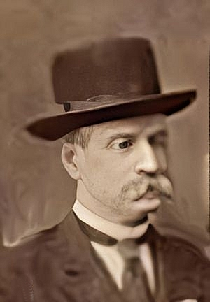

# Count Maximilian von Nieroth

| `nieroth_maximilian_large.jpg` | Count Maximilian von Nieroth (1846–1914). The source of this image was not recorded when it was added to this folder. | Source not recorded |

**Count Maximilian Carl Benedict von Nieroth** (Russian: граф Максимилиан Евстафьевич Нирод; 30 December 1846 or 1848 – 24 May 1914) was a Russian official and courtier of Baltic German family. He spent his career in the Ministry of the Interior, became a *Jägermeister* (master of the hunt) of the imperial court in 1898, and in the last months of his life was a member of the State Council, elected by the zemstvo of Volhynia.[1] He married [Anastasia Fyodorovna Trepova](https://theo-armour.github.io/genealogy/#Wiki/Anastasia-Fyodorovna-Trepova-1849-1940/README-Anastasia-Fyodorovna-Trepova-1849-1940.md), daughter of General Fyodor Trepov. Their daughter Vera, Princess Kudasheva, was Theo Armour's great-grandmother.[1][2]

| **Count Maximilian von Nieroth** | |
| :--- | :--- |
| **Native name** | Граф Максимилиан Евстафьевич Нирод |
| **Born** | 30 December 1846 (other sources: 1848) St. Petersburg |
| **Died** | 24 May 1914 Tsarskoye Selo (other sources: Kiev) |
| **Resting place** | Vydubychi Monastery, Kiev |
| **Education** | Imperial Alexander Lyceum (1868, silver medal) |
| **Offices** | Member of the Council of the Minister of the Interior (1898–1913) Member of the State Council (8 October 1913 – 24 May 1914) |
| **Court rank** | *Jägermeister* (1898) |
| **Spouse** | Anastasia Fyodorovna Trepova (1849–1940) |
| **Children** | [Fyodor](https://theo-armour.github.io/genealogy/#Wiki/Fyodor-Maximilianovich-von-Nieroth-1871-1952/README-Fyodor-Maximilianovich-von-Nieroth-1871-1952.md) (1871–1952) [Vera](https://theo-armour.github.io/genealogy/#Wiki/Vera-Maximilianovna-Kudasheva-von-Nieroth-1874-1920/README-Vera-Maximilianovna-Kudasheva-von-Nieroth-1874-1920.md) (1874–1920) |
| **Father** | Count Evstafy Evstafyevich Nirod (Gustaf Reinhold Johan von Nieroth), general of cavalry |
| **Mother** | Paulina Fyodorovna Shtenger (Pauline Dorothea Elisabeth von Stenger) |
| **Religion** | Lutheran |

## Family background

The Nieroths (in Russian, Нирод, Nirod) were a family of counts settled in the Baltic provinces of the Russian Empire. Maximilian was born in St. Petersburg, the son of the cavalry general Count Evstafy Evstafyevich Nirod and Paulina Fyodorovna, born Shtenger.[1] Genealogical records in this folder give his parents' German names as Gustaf Reinhold Johan von Nieroth and Pauline Dorothea Elisabeth von Stenger, and name four siblings: Gustav Friedrich Nikolai, Alexander Wilhelm Julius, Heloise Augusta Johanna (married Crichton) and Moritz Nikolai Pontius.[2]

## Career

He graduated from the Imperial Alexander Lyceum in 1868 with a silver medal and entered the Ministry of the Interior, attached to the office of the chief of police of St. Petersburg. The chief of police was then General Fyodor Trepov, whose daughter he married. In 1873 he became head of the foreign section of the city governor's chancellery, again under Trepov, and in 1875 an official for special assignments under the Minister of the Interior.[1][3]

In 1898 he was made a *Jägermeister* of the court and a member of the Council of the Minister of the Interior, where he sat until 1913. He was also an honorary justice of the peace in the Zhitomir district from 1884, a council member of the Home for the Mentally Ill from 1880 to 1913, an honorary guardian from 1905, and from 1907 manager of the Mary Magdalene and Alexandra women's hospitals in St. Petersburg.[1]

On 8 October 1913 he was elected to the State Council by the provincial zemstvo of Volhynia. He sat with the right and belonged to the monarchist Russian Assembly.[1]

## Estates and residences

* **St. Petersburg.** Born there, and served there throughout his career.[1]
* **Volhynia Governorate.** He owned about 4,226 *desyatinas* (about 4,600 hectares) there, in addition to an ancestral estate of his wife's, and was a justice of the peace in the Zhitomir district.[1]
* **Tsarskoye Selo.** According to the parish register, he died there.[1]

No street address has been found.

## Death

He died on 24 May 1914 of cancer of the liver. Russian Wikipedia, citing the register of the Church of St. Catherine in Tsarskoye Selo, places his death there, and his burial at the Vydubychi Monastery in Kiev, where his father-in-law was buried.[1]

## Awards

Order of St. Stanislaus, 2nd class (1870) and 1st class (1887); Order of St. Anne, 2nd class (1878) and 1st class (1892); Order of St. Vladimir, 3rd class (1885) and 2nd class (1896); Order of the White Eagle (1902); Order of St. Alexander Nevsky (1908), with diamonds (1913).[1]

## Family

He married **Anastasia Fyodorovna Trepova** (1849–1940). They had two children:[1]

* **[Count Fyodor Maximilianovich](https://theo-armour.github.io/genealogy/#Wiki/Fyodor-Maximilianovich-von-Nieroth-1871-1952/README-Fyodor-Maximilianovich-von-Nieroth-1871-1952.md)** (1871–1952), major general of the Imperial Suite.
* **[Countess Vera Maximilianovna](https://theo-armour.github.io/genealogy/#Wiki/Vera-Maximilianovna-Kudasheva-von-Nieroth-1874-1920/README-Vera-Maximilianovna-Kudasheva-von-Nieroth-1874-1920.md)** (1874–1920), who married Prince Sergei Vladimirovich Kudashev and died in Paris.

## Discrepancies and unverified claims

* **Birth year.** 1846 (the *Baltisches Biographisches Lexikon* and the genealogical records in this folder) or 1848 (Russian Wikipedia).[1][2]
* **Place of death.** Tsarskoye Selo (Russian Wikipedia, from the parish register) or Kiev (the genealogical records in this folder). He was buried in Kiev.[1][2]
* **"Master of the hunt".** *Jägermeister* was a court rank. Other pages of this wiki describe him as a chamberlain as well; Russian Wikipedia does not.[1]
* **His wife's ancestral estate.** Russian Wikipedia mentions one in Volhynia but does not name it.[1]
* **The Shtenger connection.** His mother was a Shtenger, and his father-in-law, Fyodor Trepov, is said to have been the illegitimate son of F. A. Shtenger. Whether the two were related has not been established.
* **Two Counts M. E. Nirod.** His wife's sister Sofia married Count Mikhail Evstafyevich Nirod, a master of the horse. Mikhail does not appear among Maximilian's siblings in the records in this folder.[2][4]

## References

1. "Нирод, Максимилиан Евстафьевич". *Wikipedia* (Russian). Cites *Государственный совет Российской империи: 1906–1917* (Moscow: РОССПЭН, 2008), p. 184; the register of the Church of St. Catherine, Tsarskoye Selo (ЦГИА СПб, f. 19, op. 127, d. 3002, p. 129); and "Nieroth, Maximilian Gf. v. (1846–1914)", *Baltisches Biographisches Lexikon digital*, p. 547. <https://ru.wikipedia.org/wiki/Нирод,_Максимилиан_Евстафьевич>
2. "Maximilian Carl Benedict von Nieroth (1846–1914)" (profile page with genealogical records). Theo Armour Genealogy. <https://theo-armour.github.io/genealogy/#Wiki/Maximilian-Carl-Benedict-von-Nieroth-1846-1914/Maximilian-Carl-Benedict-von-Nieroth-1846-1914.md>
3. "Трепов, Фёдор Фёдорович (старший)". *Wikipedia* (Russian). <https://ru.wikipedia.org/wiki/Трепов,_Фёдор_Фёдорович_(старший)>
4. "Треповы". *Wikipedia* (Russian). <https://ru.wikipedia.org/wiki/Треповы>

## Further reading

* *Baltisches Biographisches Lexikon digital*. Entry "Nieroth, Maximilian Gf. v.". <https://bbld.de/>
* "Nieroth". *Wikipedia* (German and Estonian) on the family.
