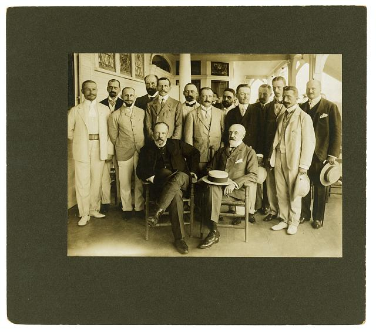

# Nikolai Alexandrovich Kudashev (1868–1925) ~ Николай Александрович Кудашев

| `1905-russian-peace-commission-portsmouth.jpg` | Russian Peace Commission and staff, Portsmouth, N.H. (1905); "Prince Kudashev" is among the staff, not individually identified | [Library of Congress](https://www.loc.gov/item/2005680336/) |

📖 [Biography](https://theo-armour.github.io/genealogy/#Wiki/Nikolai-Alexandrovich-Kudashev-1868-1925/biography_of_prince_nikolai_alexandrovich_kudashev_1868_1925.md)

## Genealogy

* Full name: Prince Nikolai Alexandrovich Kudashev
* Birth: 1868
* Death: 1925 - Paris (another source: 1921)
* Parents: Prince Alexander Sergeyevich Kudashev (1830–1877), Sofia Ivanovna Orlova
* Siblings: Ivan Alexandrovich Kudashev (diplomat)

## Names and Spellings

* Russian: Николай Александрович Кудашев
* Also seen as: Prince Kudashev (US State Department, 1920; Library of Congress photograph caption, 1905)

## Links

* <https://ru.wikipedia.org/wiki/Кудашев,_Николай_Александрович>
* <https://www.ceeol.com/search/article-detail?id=1201286> (Samoylov, 2023)

## Life

Diplomat in Tokyo, Portsmouth (1905), Constantinople and Washington; head of the Diplomatic Chancellery at army headquarters in 1914–1916; and the last envoy of the Russian Empire to China (1916–1920). He refused to recognise the Bolsheviks and stayed at his post in Peking until China closed the Russian missions in 1920. He died in Paris. He was a first cousin of my great-grandfather Sergei Vladimirovich Kudashev.

## Personal Comments

