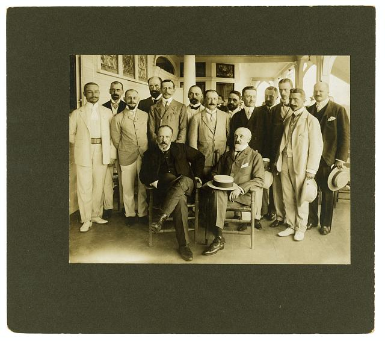

# Prince Nikolai Alexandrovich Kudashev

| `1905-russian-peace-commission-portsmouth.jpg` | "Russian Peace Commission and their staff", Portsmouth, New Hampshire, 1905. Baron Rosen and Count Sergei Witte are seated in front of the staff: "Secretary Korostovetz, Plancon, Shipov, and Prince Kudashev among others". The Library of Congress record does not say which figure is Kudashev. No known restrictions on publication.[5] | [Source](https://www.loc.gov/item/2005680336/) |

*No identified portrait of Prince Nikolai Alexandrovich has been found.*

**Prince Nikolai Alexandrovich Kudashev** (Russian: Князь Николай Александрович Кудашев; 1868 – 1925) was a Russian diplomat and the last envoy of the Russian Empire to China. He served in Tokyo, at the [Portsmouth peace conference](https://en.wikipedia.org/wiki/Treaty_of_Portsmouth) of 1905, in Constantinople and in Washington. During the First World War he ran the diplomatic chancellery at army headquarters. From 1916 he was envoy in Peking, first for the Emperor and then for the Provisional Government. He refused to recognise the Bolsheviks and remained in office, still recognised by the Chinese government, until China closed the Russian missions in September 1920. He died in emigration in Paris.[1][2][3] He was a grandson of Prince [Sergei Danilovich Kudashev](https://theo-armour.github.io/genealogy/#Wiki/Sergei-Danilovich-Kudashev-1795-1862/README-Sergei-Danilovich-Kudashev-1795-1862.md), and a first cousin of Theo Armour's great-grandfather Prince Sergei Vladimirovich Kudashev.[4]

| **Prince Nikolai Alexandrovich Kudashev** | |
| :--- | :--- |
| **Native name** | Князь Николай Александрович Кудашев |
| **Born** | 1868 |
| **Died** | 1925 Paris, France |
| **Nationality** | Russian |
| **Education** | St. Petersburg University |
| **Occupation** | Diplomat |
| **Office** | Envoy Extraordinary and Minister Plenipotentiary to China (1916–1917; in office until 1920) |
| **Predecessor** | Vasily Nikolayevich Krupensky |
| **Ranks** | *Kammerherr* (chamberlain) Active State Councillor |
| **Father** | Prince Alexander Sergeyevich Kudashev (1830–1877) |
| **Mother** | Sofia Ivanovna Orlova |
| **Relatives** | Prince Ivan Alexandrovich Kudashev (brother, diplomat) [Alexander Izvolsky](https://en.wikipedia.org/wiki/Alexander_Izvolsky) (brother-in-law) |
| **House** | Kudashev |

## Family background

Nikolai Alexandrovich Kudashev was born in 1868.[1] His father, Prince Alexander Sergeyevich Kudashev (1830–1877), was a director of private banks in Kiev and a son of Prince Sergei Danilovich Kudashev. His mother was Sofia Ivanovna, born Orlova.[1][6][7] In 1872 Princess Sofia Kudasheva bought a house and grounds at Bulvarno-Kudriavska Street 25 in Kiev, which her husband mortgaged on her behalf. Alexander Sergeyevich died of tuberculosis on 5 September 1877, when Nikolai was about nine, and the house was sold the same year.[6]

His brother Ivan Alexandrovich Kudashev was also a diplomat.[1] Russian Wikipedia calls Nikolai the *svoyak* of Alexander Izvolsky, foreign minister in 1906–1910. The word means a man married to his wife's sister, but Nikolai's wife is not named in the sources consulted.[1] He was a nephew of Prince Vladimir Sergeyevich Kudashev, Theo Armour's 2x-great-grandfather.[4]

He graduated from St. Petersburg University.[1]

## Diplomatic career

* **Tokyo.** First secretary of the Russian embassy in 1902.[1]
* **Portsmouth, 1905.** Member of the Russian delegation, led by Count [Sergei Witte](https://en.wikipedia.org/wiki/Sergei_Witte) and Baron [Roman Rosen](https://en.wikipedia.org/wiki/Roman_Rosen), that negotiated the [Treaty of Portsmouth](https://en.wikipedia.org/wiki/Treaty_of_Portsmouth) ending the Russo-Japanese War.[1][5]
* **Constantinople.** First secretary of the embassy from 1906.[1]
* **Washington.** Chargé d'affaires in the United States, 1910–1913.[1]
* **Army headquarters (Stavka), 1914–1916.** Director of the Diplomatic Chancellery at the headquarters of the Supreme Commander-in-Chief, the link between the Stavka and the Foreign Ministry.[1]
* **Peking, 1916–1920.** He was appointed envoy to China on 7 March 1916, succeeding Vasily Krupensky.[1] After the February Revolution he continued as the Provisional Government's representative. After the October Revolution he refused to recognise the Soviet government. The Chinese government continued to recognise him, and Russian Wikipedia gives his formal tenure as ending on 26 November 1917.[1][2] He remained in Peking until 1920. On 10 September 1920 the American minister in Peking, Charles Crane, reported to Washington that the Chinese government expected the Russian legation and consulates "be closed forthwith at the initiative of Prince Kudashev".[3]

The historian N. A. Samoylov, who wrote the only detailed study of his time in Peking, concludes that "N. A. Kudashev was not an outstanding diplomat", but that "he played a prominent role at a turning point in the development of Russian-Chinese relations".[2]

## Emigration and death

He moved to France in 1921 and died in Paris in 1925.[1] Another source gives 1921 as the year of death.[8] His place of burial has not been found.

## Residences

* **Kiev.** He spent his childhood there. His mother's house, bought in 1872, was at Bulvarno-Kudriavska Street 25 (now 27).[6]
* **Diplomatic postings.** Tokyo (1902–), Portsmouth, New Hampshire (1905), Constantinople (1906–), Washington (1910–1913), army headquarters (1914–1916) and Peking (1916–1920), where the Russian legation stood in the Legation Quarter.[1]
* **Paris.** He lived there from 1921 until his death.[1]

## Discrepancies and unverified claims

* **Death year.** 1925 (Russian Wikipedia, *Российское зарубежье во Франции*) or 1921 (paris1814.com).[1][8]
* **End of his mission.** Formally 26 November 1917 by Russian Wikipedia's list of envoys, but in practice he remained in office until September 1920.[1][2][3]
* **Education.** St. Petersburg University according to Russian Wikipedia. One search summary mentions the Corps of Pages instead; this has not been confirmed.[1]
* **Portsmouth photograph.** The figure who is Kudashev is not identified.[5]

## References

1. "Кудашев, Николай Александрович". *Wikipedia* (Russian). Cites Крылов-Толстикович, А. Н., *Придворный календарь на 1915 год* (2015), p. 361; *Российское зарубежье во Франции 1919–2000*, biographical dictionary (2008), p. 771; and Taube, M. A., *Зарницы* (2007), p. 124. <https://ru.wikipedia.org/wiki/Кудашев,_Николай_Александрович>
2. Самойлов, Н. А. "Князь Н. А. Кудашев — последний посланник Российской империи в Китае" [Prince N. A. Kudashev: the last envoy extraordinary of the Russian Empire to China]. *Новейшая история России*, vol. 13, no. 3 (2023), pp. 606–620. doi:10.21638/spbu24.2023.306. <https://www.ceeol.com/search/article-detail?id=1201286> *(Abstract only; the full text has not been read.)*
3. "The Minister in China (Crane) to the Secretary of State", telegram No. 253, Peking, 10 September 1920. *Papers Relating to the Foreign Relations of the United States, 1920*, vol. I, doc. 804. <https://history.state.gov/historicaldocuments/frus1920v01/d804>
4. "Prince Vladimir Sergeyevich Kudashev" and "Prince Sergei Danilovich Kudashev". Theo Armour Genealogy. <https://theo-armour.github.io/genealogy/#Wiki/Vladimir-Sergeyevich-Kudashev-1833-1871/README-Vladimir-Sergeyevich-Kudashev-1833-1871.md>
5. "Russian Peace Commission and their staff". Photographic print, [1905]. Library of Congress Prints and Photographs Division, LOT 2624, no. 5; LC-DIG-ppmsca-08803. No known restrictions on publication. <https://www.loc.gov/item/2005680336/>
6. "Воровского, 27 (бывшая Бульварно-Кудрявская, 25)". *Код Киева* (kiev-code.com.ua). <https://kiev-code.com.ua/site/page.php?lang=RU&id_part=599>
7. *Список титулованным родам и лицам Российской империи*. St. Petersburg, 1892. pp. 283–284. Names Sergei Danilovich's son Alexander (titular councillor) and a grandson Alexander Alexandrovich. Quoted in "Кудашевы". *Wikipedia* (Russian). <https://ru.wikipedia.org/wiki/Кудашевы>
8. "Пекин". *paris1814.com*. <https://paris1814.com/%D0%BF%D0%B5%D0%BA%D0%B8%D0%BD>

## Further reading

* Самойлов, Н. А. "Князь Н. А. Кудашев — последний посланник Российской империи в Китае" (2023), full text. Also in the St. Petersburg University repository: <https://dspace.spbu.ru/handle/11701/44229>
* *Российское зарубежье во Франции 1919–2000: биографический словарь*. Moscow: Наука, 2008. Vol. 1, p. 771.
* "List of ambassadors of Russia to China". *Wikipedia*. <https://en.wikipedia.org/wiki/List_of_ambassadors_of_Russia_to_China>
