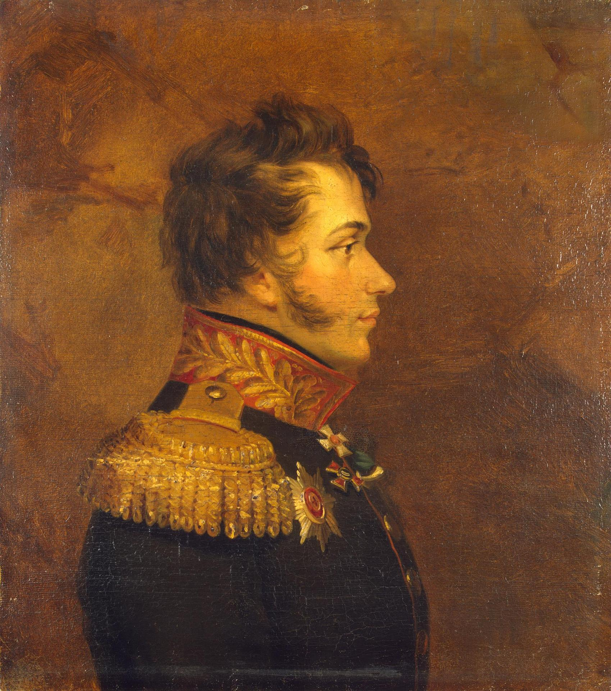
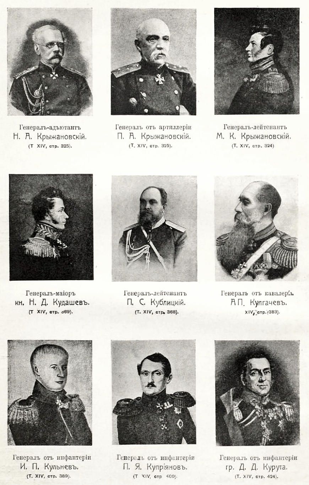
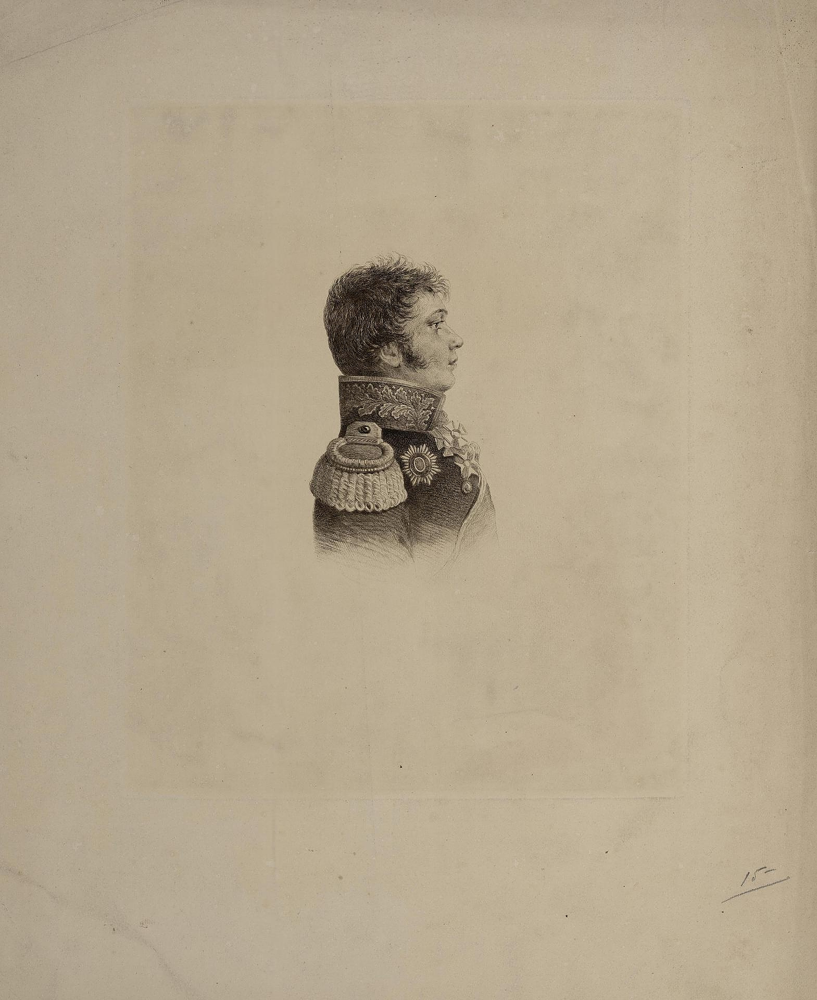

# Prince Nikolay Danilovich Kudashev

| `nikolay-kudashev.jpg` | Prince Nikolay Danilovich Kudashev (1784–1813). Workshop of [George Dawe](https://en.wikipedia.org/wiki/George_Dawe), c. 1825, [Military Gallery of the Winter Palace](https://en.wikipedia.org/wiki/Military_Gallery), State Hermitage. Public domain.[10] | [Source](https://commons.wikimedia.org/wiki/File:Kudashev_Nikolay_Danilovich.jpg) |

**Prince Nikolay Danilovich Kudashev** (Russian: Князь Николай Данилович Кудашев; 1784 – 28 October [9 November] 1813) was a Russian cavalry officer and major general of the [Napoleonic Wars](https://en.wikipedia.org/wiki/Napoleonic_Wars). He was the son-in-law of Field Marshal [Mikhail Kutuzov](https://en.wikipedia.org/wiki/Mikhail_Kutuzov). In 1812 he commanded one of the army's partisan detachments against Napoleon's forces around Moscow, and in 1813 he led the vanguard of [Matvei Platov](https://en.wikipedia.org/wiki/Matvei_Platov)'s Cossack corps. He was mortally wounded near Altenburg during the campaign that ended at the [Battle of Leipzig](https://en.wikipedia.org/wiki/Battle_of_Leipzig) and is buried in Leipzig. His portrait hangs in the Military Gallery of the Winter Palace.[1][2][3] He was the elder brother of [Prince Sergei Danilovich Kudashev](https://theo-armour.github.io/genealogy/#Wiki/Sergei-Danilovich-Kudashev-1795-1862/README-Sergei-Danilovich-Kudashev-1795-1862.md).[4]

| **Prince Nikolay Danilovich Kudashev** | |
| :--- | :--- |
| **Native name** | Князь Николай Данилович Кудашев |
| **Born** | 1784 Russian Empire (place not recorded in the sources consulted) |
| **Died** | 28 October (9 November) 1813 near Leipzig, Saxony |
| **Resting place** | [St. Alexis Memorial Church of Russian Glory](https://en.wikipedia.org/wiki/Russian_Memorial_Church_of_Saint_Alexius_(Leipzig)), Leipzig |
| **Allegiance** | Russian Empire |
| **Service** | Imperial Russian Army: Life Guards Horse Regiment (*Лейб-гвардии Конный полк*) |
| **Years of service** | 1801–1813 |
| **Rank** | Major general (1812) |
| **Wars** | [War of the Third Coalition](https://en.wikipedia.org/wiki/War_of_the_Third_Coalition) (1805), [War of the Fourth Coalition](https://en.wikipedia.org/wiki/War_of_the_Fourth_Coalition) (1807), [Finnish War](https://en.wikipedia.org/wiki/Finnish_War) (1808–1809), [French invasion of Russia](https://en.wikipedia.org/wiki/French_invasion_of_Russia) (1812), [War of the Sixth Coalition](https://en.wikipedia.org/wiki/War_of_the_Sixth_Coalition) (1813) |
| **Awards** | [Order of St. George](https://en.wikipedia.org/wiki/Order_of_St._George), 4th class (1809) and 3rd class (1813); Order of St. Vladimir; Order of St. Anne; Golden Sword "For Bravery" |
| **Spouse** | Yekaterina Mikhailovna Golenishcheva-Kutuzova (1787–1826) |
| **Children** | Yekaterina Nikolayevna (1811–1872) |
| **Father** | Prince Daniil (Danila) Ivanovich Kudashev |
| **Mother** | Yekaterina Sergeyevna, born Princess Baratova |

🌳 [See in the family tree](https://theo-armour.github.io/gedcom-viewer/#wiki=Nikolay-Danilovich-Kudashev-1784-1813)

## Family background

Nikolay Danilovich Kudashev was born in 1784 into the Kudashev princely family of Tatar origin. The family traced its descent from Murza Chepai Kudashev, who took part in the defence of Moscow in 1618.[1][2] His father was Colonel Prince Daniil (Danila) Ivanovich Kudashev, who received a large grant of land from Catherine II. Reznik's local history of Beletskovka, near Kremenchuk, calls Nikolay his eldest son.[2][4] His mother was Princess Yekaterina Sergeyevna, born Baratova (born 1764).[2][5] Sources disagree on his father's dates: 1737–c. 1840 (Kobyakov, VGD), 1737–1816 (Reznik) and 1760–1845 (Russian Wikipedia, Geni).[2][4][5]

His younger brother Sergei Danilovich (1795–1862) became Vice-Governor of Kiev. Through him Nikolay was the great-great-great-great-uncle of Theo Armour.[4][11]

## Military career

### Early service, 1801–1811

Kudashev entered the Life Guards Horse Regiment as an *unter-officer* (non-commissioned officer) on 30 January 1801 and was made a cornet in 1802.[1][2] He fought at the [Battle of Austerlitz](https://en.wikipedia.org/wiki/Battle_of_Austerlitz) in 1805 and was awarded the Order of St. Anne, 3rd class. He was promoted to *poruchik* (lieutenant) on 1 February 1806.[1][2] At the [Battle of Heilsberg](https://en.wikipedia.org/wiki/Battle_of_Heilsberg) on 29 May 1807 he distinguished himself and received the Order of St. Vladimir, 4th class, and a golden sword inscribed "For Bravery".[2]

In the Finnish War against Sweden he served as adjutant to Grand Duke [Konstantin Pavlovich](https://en.wikipedia.org/wiki/Grand_Duke_Konstantin_Pavlovich_of_Russia).[1][2] At [Kuortane](https://en.wikipedia.org/wiki/Battle_of_Ruona%E2%80%93Salmi), with the bridge burnt under enemy fire, he "провёл вброд свой эскадрон" (led his squadron across by the ford). He then attacked the Swedish fortifications, drove off their infantry and secured the crossing for the main Russian force. Two days later he led two companies of *jägers* (light infantry) in pursuit of an enemy detachment and took a Swedish fieldwork.[2] He received the Order of St. George, 4th class (No. 929), on 15 February 1809.[1][2] He was promoted to colonel on 13 October 1811.[1][2]

### 1812: Kutuzov's staff and the partisan war

In 1812 Kudashev served on the staff of his father-in-law, Kutuzov, and fought at the [Battle of Borodino](https://en.wikipedia.org/wiki/Battle_of_Borodino).[1][3] In early September, after the French entered Moscow, Kutuzov appointed him to command one of the army's partisan detachments. It was made up of three cavalry regiments: two of Don Cossacks and the 1st Bashkir Regiment.[1][2] The detachment operated between the Tula (Serpukhov) and Old Kashira roads, in the Podolsk and Serpukhov districts and around Lopasnya, harassing French foragers and communications.[2] It then joined Platov's corps in the pursuit of the retreating French army, and in November Kudashev distinguished himself in the fighting at [Krasnoi](https://en.wikipedia.org/wiki/Battle_of_Krasnoi).[1][3]

The poet [Vasily Zhukovsky](https://en.wikipedia.org/wiki/Vasily_Zhukovsky), writing at army headquarters in the autumn of 1812, named him among the partisan leaders in *Певец во стане русских воинов* (*A Bard in the Camp of the Russian Warriors*):[6]

> Кудашев скоком через ров
> И лётом на стремнину;

(Kudashev at a gallop over the ditch, and in full flight up the steep.)

He was promoted to major general on 26 December 1812.[1][2]

| `1914-military-encyclopedia-portrait-plate.jpg` | Plate from Sytin's *Военная энциклопедия* (Military Encyclopedia), vol. XIV, St. Petersburg, 1914. "Генералъ-маіоръ кн. Н. Д. Кудашевъ" (T. XIV, p. 369) is in the middle row, on the left. Public domain.[7] | [Source](https://commons.wikimedia.org/wiki/Category:Nikolay_Danilovich_Kudashev) |

### 1813: Germany, Altenburg and death

On 25 March 1813 he received the Order of St. George, 3rd class (No. 281), for his conduct in the pursuit of the French from Maloyaroslavets to the Niemen, including the actions at Krasnoi and Kovno.[1][2] In the German campaign of 1813 he commanded the vanguard of Platov's cavalry corps.[2] On 16 (28) September 1813 Platov's corps, joined by "its vanguard under Major General Prince N. D. Kudashev", attacked a French cavalry corps of about 8,000 men at [Altenburg](https://en.wikipedia.org/wiki/Altenburg) in Saxony.[8] In the fighting that preceded the Battle of Leipzig, while commanding combined dragoon regiments, Kudashev was mortally wounded near Altenburg.[1][2]

He died of his wounds on 28 October (9 November) 1813, near Leipzig, aged about 29.[1][2] He was first buried in Leipzig. A century later his remains were placed in the crypt of the St. Alexis Memorial Church of Russian Glory, built in Leipzig for the centenary of the battle and consecrated in 1913.[1][2][9]

| `nikolay-kudashev-rundaltzov-engraving.jpg` | "Портрет генерал-майора Н. Д. Кудашева" (Portrait of Major General N. D. Kudashev). Engraving by Mikhail Rundaltsov after the Military Gallery portrait, early 20th century, State Hermitage. Public domain.[10] | [Source](https://commons.wikimedia.org/wiki/File:Kudashev_Nikolay_Danilovich_by_Mikhail_Rundaltzov_-_Hermitage.jpg) |

## Marriage and descendants

Kudashev married **Yekaterina Mikhailovna Golenishcheva-Kutuzova** (26 July 1787 – 31 December 1826), the youngest daughter of Field Marshal Mikhail Kutuzov.[1][2] A 2010 newspaper article describes Kudashev as a close friend of Kutuzov, who "отдал ему в жены свою дочь Екатерину Михайловну" (gave him his daughter Yekaterina Mikhailovna as wife).[12] The date of the marriage is not given in the sources consulted. Their only child was:

* **Yekaterina Nikolayevna Kudasheva** (11 August 1811 – 14 September 1872). She married first K. F. Pilar von Pilchau and second Baron Napoleon von Heuningen-Hune.[1][2]

After Kudashev's death his widow married Major General I. S. Sorochinsky in 1815. She lived in Moscow and was buried at the [Donskoy Monastery](https://en.wikipedia.org/wiki/Donskoy_Monastery).[1]

## Legacy

* **Military Gallery.** His portrait, from George Dawe's workshop, hangs among the portraits of the generals of 1812–1814 in the Military Gallery of the Winter Palace.[1][10]
* **Leipzig.** His tomb is in the crypt of the St. Alexis Memorial Church of Russian Glory.[1][2]
* **Zhukovsky.** He is named in Zhukovsky's *A Bard in the Camp of the Russian Warriors*.[6]
* **Lopasnya.** His partisan detachment is remembered in the local history of the Chekhov (formerly Lopasnya) district near Moscow.[2]

## Residences

No residence of Nikolay's own has been documented. He served from 1801 in the Life Guards Horse Regiment, which was stationed in St. Petersburg. His father's estates were at Beletskovka, near Kremenchuk in Poltava Governorate, and, from 1804, Veselyi Kut in Chigirin Uyezd, Kiev Governorate.[4][14] It is not known whether he lived on either estate.

## Discrepancies and unverified claims

* **Birthplace and exact birth date.** These are not given in any source consulted.
* **Date of Kuortane.** Kobyakov dates the ford episode 19–21 August 1809.[2] The Battle of Kuortane (Ruona–Salmi) was fought on 1–2 September 1808 (New Style).[15] The year 1809 is probably an error.
* **Date of the mortal wound.** Kobyakov gives 6 October 1813.[2] Runivers dates the action at Altenburg to 16 (28) September 1813.[8] Another online account says he died of wounds on 18 October 1813. Russian Wikipedia and Kobyakov give the date of death as 28 October (9 November) 1813.[1][2]
* **First burial.** The directory *Война 1812 года* (brdn.ru) is reported to say he was first buried in St. John's cemetery (*Johannisfriedhof*) in Leipzig and reburied in 1913. The page could not be loaded to confirm this.[9]
* **His father's dates and his mother's surname.** See "Family background". The mother is Baratova in Kobyakov and VGD, and Baranova in earlier pages of this wiki.
* **Order of St. Vladimir.** Kobyakov gives the 4th class for Heilsberg (1807).[2] Russian Wikipedia lists the 2nd and 3rd classes without dates.[1]

## References

1. "Кудашев, Николай Данилович". *Wikipedia* (Russian). Cites *Российский архив*, vol. VII (1996), p. 438 (commentary by A. A. Podmazo), and the *Военная энциклопедия* (1914), vol. 14, p. 369. <https://ru.wikipedia.org/wiki/Кудашев,_Николай_Данилович>
2. Кобяков, Юрий. "России славные сыны" [Glorious Sons of Russia]. *Чехов сегодня*, 23 August 2008. Republished by МБУК "Музей памяти Лопасненского края", 25 January 2021. <https://xn--j1abcm.xn--p1ai/item/667919>
3. "Portrait of Nikolai Danilovich Kudashev (1784–1813)". *Presidential Library* (prlib.ru), after the State Hermitage record. <https://www.prlib.ru/en/node/359025>
4. Резник, А. "Князь Д. И. Кудашев и его семья в истории Белецковки". *KremenHistory*, 7 September 2018. <https://kremenhistory.org.ua/knjaz-d-i-kudashev-i-ego-semja-v-istorii-beleckovki/>
5. "Кудашев Данило Иванович 1737". *КУДАШЕВ: Персональный список*. VGD forum. <https://baza.vgd.ru/1/17728>; and "Danilo Ivanovitch Kuodashev (1760–1845)". *Geni*. <https://www.geni.com/people/Danilo-Kuodashev/6000000002659953365>
6. Жуковский, В. А. "Певец во стане русских воинов" (1812; text of the 1815 edition). *Wikisource* (Russian), lines 309–310. <https://ru.wikisource.org/wiki/Певец_во_стане_русских_воинов_(Жуковский)>
7. "Портреты к статьям «Крыжановские», «Кудашев»… ВЭС (СПб, 1914).jpg". *Wikimedia Commons*. From *Военная энциклопедия* (Sytin), vol. XIV, 1914. Public domain. <https://commons.wikimedia.org/wiki/Category:Nikolay_Danilovich_Kudashev>
8. "28 сентября (16 сентября) 1813 года". *Руниверс: Календарь событий 1813 года*. <https://runivers.ru/russianhistory/zagranichnye-pokhody/calendar-sobytiy-1813/09/28-sentyabrya-16-sentyabrya-1813-goda-473634/>
9. "Кудашев Николай Данилович". *Война 1812 года. Биографический справочник* (brdn.ru). <https://www.brdn.ru/person/272.html> *(Known only from a search-result summary; the page could not be loaded.)*
10. "File:Kudashev Nikolay Danilovich.jpg" (workshop of George Dawe, 1825) and "File:Kudashev Nikolay Danilovich by Mikhail Rundaltzov - Hermitage.jpg". *Wikimedia Commons*. Public domain. <https://commons.wikimedia.org/wiki/File:Kudashev_Nikolay_Danilovich.jpg>; <https://commons.wikimedia.org/wiki/File:Kudashev_Nikolay_Danilovich_by_Mikhail_Rundaltzov_-_Hermitage.jpg>
11. "Theo Armour – Lineage". Theo Armour Genealogy. [Kudashev/Theo Armour-Lineage.md](https://theo-armour.github.io/genealogy/#Kudashev/Theo%20Armour-Lineage.md)
12. Згуровский, Михаил. "Первопроходец воздухоплавания в России. К 100-летию полета первого российского самолета" [A pioneer of aeronautics in Russia]. *Зеркало недели* (ZN.ua), 21 May 2010. <https://zn.ua/SOCIUM/pervoprohodets_vozduhoplavaniya_v_rossii__k_100-letiyu_poleta_pervogo_rossiyskogo_samoleta.html>
13. Колпакиди, А.; Север, А. *Спецназ ГРУ*. Moscow: Яуза, Эксмо, 2008. pp. 81–82. ISBN 978-5-699-28983-7. Listed as literature in [1]. *(Not checked; not cited in the text.)*
14. Pokhilevich, Lavrenty (1864). *Сказания о населенных местностях Киевской губернии*. Entry "Веселый Кут". Summarised at <http://otkudarodom.ua/ru/veselyy-kut>
15. "Battle of Ruona–Salmi" (Battle of Kuortane). *Wikipedia*. <https://en.wikipedia.org/wiki/Battle_of_Ruona%E2%80%93Salmi>

## Further reading

* *Военная энциклопедия* [Military Encyclopedia]. Ed. V. F. Novitsky et al. Vol. 14. St. Petersburg: I. D. Sytin, 1914. p. 369, "Кудашев, Николай Данилович, князь".
* Подмазо, А. А. "Словарь русских генералов, участников боевых действий против армии Наполеона Бонапарта в 1812–1815 гг." *Российский архив*, vol. VII. Moscow, 1996. p. 438.
* Михайловский-Данилевский, А. И. *Описание Отечественной войны в 1812 году*. St. Petersburg, 1839. Account of the army partisan detachments.
* Лобанов-Ростовский, А. Б. *Русская родословная книга*. 2nd ed. Vol. 1. St. Petersburg, 1895.
* Moscow Central State Archive (ЦГА Москвы), F. 2125, Op. 1, D. 872, f. 51: register of the Church of the Burning Bush (Неопалимой Купины), cited by Russian Wikipedia for the family.
