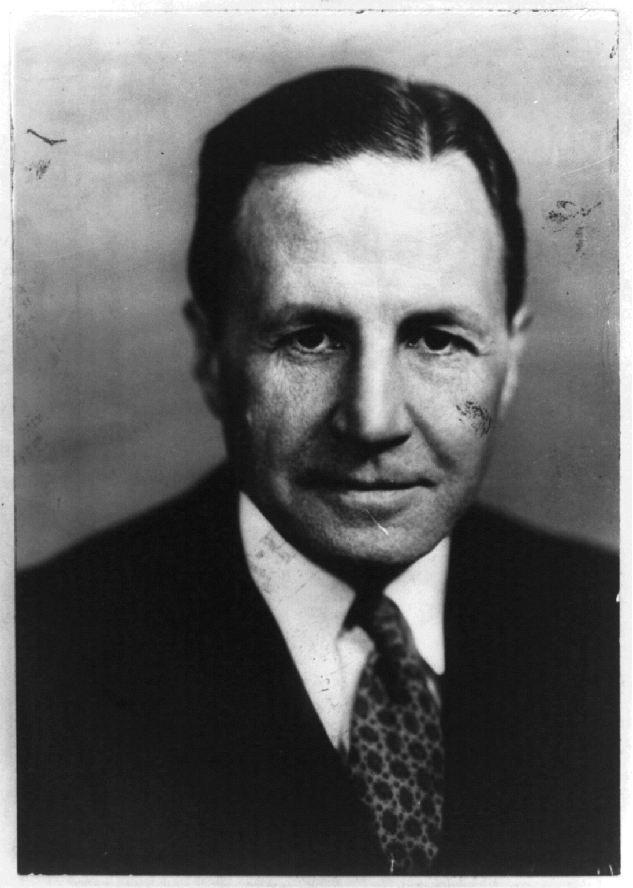

# Norman Armour Sr

| `norman-armour.jpg` | Norman Armour (1887–1982). Head-and-shoulders studio photograph in a dark suit and patterned tie. The print is not dated. | [Wikimedia Commons](https://commons.wikimedia.org/wiki/File:Norman_Armour.jpg), as recorded on the profile page[1] |

**Norman Armour** (14 October 1887 – 27 September 1982) was an American career diplomat. He entered the diplomatic service in 1916, served at the American Embassy in Russia through the revolutions of 1917 and 1918, and was later Minister to Haiti and Canada, Ambassador to Chile, Argentina, Spain, Venezuela and Guatemala, and Assistant Secretary of State for Political Affairs.[2][3][4] In 1919 he married Princess Myra Koudacheff ([Maria Sergeyevna Kudasheva](https://theo-armour.github.io/genealogy/#Wiki/Maria-Sergeyevna-Kudasheva-1896-1990/README-Maria-Sergeyevna-Kudasheva-1896-1990.md)).[4][7] He was Theo Armour's paternal grandfather.[1][13]

| **Norman Armour Sr** | |
| :--- | :--- |
| **Born** | 14 October 1887 Brighton, England (see Open questions for the day) |
| **Died** | 27 September 1982 (aged 94) New York, New York |
| **Occupation** | Diplomat (United States Foreign Service) |
| **Spouse** | [Maria (Myra) Sergeyevna Kudasheva](https://theo-armour.github.io/genealogy/#Wiki/Maria-Sergeyevna-Kudasheva-1896-1990/README-Maria-Sergeyevna-Kudasheva-1896-1990.md) (married 2 February 1919) |
| **Children** | [Norman Armour Jr](https://theo-armour.github.io/genealogy/#Wiki/Norman-Armour-Jr-1920-1978/README-Norman-Armour-Jr-1920-1978.md) (1920–1978) |
| **Parents** | [George Allison Armour](https://theo-armour.github.io/genealogy/#Wiki/George-Allison-Armour-1856-1936/README-George-Allison-Armour-1856-1936.md) (1856–1936) [Harriette Cobb Foote](https://theo-armour.github.io/genealogy/#Wiki/Harriette-Cobb-Foote-Armour-1859-1924/README-Harriette-Cobb-Foote-Armour-1859-1924.md) (1859–1924) |

## Family and early life

Norman Armour was born at Brighton, England, on 14 October 1887, "of American parents" in the words of the State Department's *Register*.[2][4] His parents were George Allison Armour of Chicago and Harriette Cobb Foote.[1][9][10] His paternal grandfather was the Scottish-born Chicago grain merchant [George Armour](https://theo-armour.github.io/genealogy/#Wiki/George-Armour-1812-1881/README-George-Armour-1812-1881.md).[13]

In 1895 his father bought the John P. Stockton house at 83 Stockton Street, Princeton, New Jersey, which *A Princeton Companion* calls "the childhood home of Barbara Armour and her four brothers".[11] His sister was [Barbara Armour Lowrie](https://theo-armour.github.io/genealogy/#Wiki/Barbara-Armour-Lowrie-1889-1981/README-Barbara-Armour-Lowrie-1889-1981.md), who married the clergyman and Kierkegaard translator [Walter Lowrie](https://theo-armour.github.io/genealogy/#Wiki/Walter-Lowrie-1868-1959/README-Walter-Lowrie-1868-1959.md).[1][11] Find a Grave links him to three brothers: William (1892–1958), Allison (1896–1955) and Edmund (1899–1912).[9] The profile page gives a longer list of siblings (see Open questions).[1]

Wikipedia says he attended St. Paul's School.[8] Princeton's finding aid for his papers says he took his B.A. at Princeton in 1909, graduated from Harvard Law School in 1913, and returned to Princeton for an M.A. in 1915.[4] The State Department *Register* for 1918, as transcribed in the research report in this folder, adds that he was employed in a law office in Newark in 1913–14 and was admitted to the New Jersey bar in 1914; its dates for his degrees differ (see Open questions).[2]

## Entry into the diplomatic service

The 1918 *Register* records that he served in the Embassy in Vienna for three months in 1912 and in the Embassy in Paris for eight months in 1915–16, before he was commissioned. He passed the diplomatic examination on 10 April 1916, was appointed Secretary of Embassy or Legation of class five on 17 May 1916, and was assigned to Petrograd on 22 May 1916. He was promoted to class four on 3 August 1916 and to class three on 13 July 1917.[2]

## Russia, 1916–1918

Armour served at the American Embassy in Petrograd under Ambassador David R. Francis. The list of principal persons in *Foreign Relations of the United States* for 1918 describes him as "Second Secretary of the Embassy in Russia".[2][5] A report by him on the fall of the Tsarist regime, dated 26 March 1917, is printed in a later collection of the Embassy's papers (not seen).[2]

When Francis left Vologda for Archangel on 25 July 1918, he left Armour behind. Armour described what followed in a telegram to the Secretary of State sent from Stockholm on 13 September 1918:[5]

> When Ambassador left Vologda for Archangel on July 25 he left me in Vologda as connecting link between himself and consulates.

On 1 August the Bolshevik commissioner Kedrov demanded that the remaining diplomats move to Moscow. Armour refused "on ground of presence of nationals". He reported that "troops entered the Embassy during the night and took us with our baggage to the train which left August 3 under guard of ten soldiers". At Yaroslavl the guard was increased, and he wrote:[5]

> Fearing that the latter might attempt to seize our documents I burned the red and green codes which had been entrusted me by the Ambassador before his departure.

At Moscow the party was held in the train for an hour until Chicherin ordered its release.[5] By 13 September he was in Stockholm.[5]

He reached the United States early in November 1918. *The New York Times* of 6 November reported his arrival at "an Atlantic port" on a British liner from England, in a party of American officials returning from Russia, and gave his account of conditions under the Bolsheviks. The same report says:[6]

> Mr. Armour said he had a Norwegian passport, and got back to Petrograd, disguised as a dispatch bearer for the Norwegian Government.

Later accounts connect this journey with the escape from Petrograd of his future wife and her family; they do not agree on the details (see Open questions).[2][4][8][12] The research report in this folder tests several family recollections of these years against the record; the recollections themselves are on the profile page.[1][2]

## Marriage

His engagement to Princess Myra Koudacheff was announced in *The New York Times* on 2 November 1918 (not seen).[2][8] He was assigned to the Embassy in Brussels on 17 December 1918.[2] They were married in Stockholm on 2 February 1919. *The Washington Herald* of 4 February reported:[7]

> Announcement has been made of the marriage yesterday in Stockholm of Princess Myra Koudacheff and Norman H. Armour, second secretary of the American Embassy in Brussels. Ira Nelson Morris, American Minister to Sweden, was best man. Mr. Armour, whose home is in Chicago, was former second secretary of the American Embassy in Petrograd, and left there last September.

Their only child, Norman Armour Jr, was born in Brussels on 10 February 1920.[1][10][14]

## Posts between the wars

The 1922 *Register*, as summarised in the research report, records his assignment to The Hague on 14 June 1920, promotion to Secretary of class two on 28 June 1920, and assignment to Montevideo on 3 August 1921.[2] Wikipedia and the biography of his wife in this repository list the posts that followed: the Department of State in Washington (1922–1924), Rome, Tokyo (1925–1928) and Paris (1928–1932).[8][12] Wikipedia says that after the death of Ambassador Myron T. Herrick on 31 March 1929 he was chargé d'affaires in Paris until a successor was chosen.[8] None of these later postings has been checked against a State Department *Register* for this biography.

## Minister and Ambassador

The Office of the Historian of the State Department lists him as a career Foreign Service officer, resident of New Jersey, with these appointments as chief of mission:[3]

| Post | Appointed | Credentials presented | Left post |
| :--- | :--- | :--- | :--- |
| Minister to Haiti | 25 July 1932 (recess appointment); reappointed 17 March 1933 | 7 November 1932; 11 April 1933 | 21 March 1935 |
| Minister to Canada | 29 May 1935 | 7 August 1935 | 15 January 1938 |
| Ambassador to Chile | 17 January 1938 | 21 April 1938 | 10 June 1939 |
| Ambassador to Argentina | 18 May 1939 | 19 June 1939 | 29 June 1944 |
| Ambassador to Spain | 15 December 1944 | 24 March 1945 | 1 December 1945 |
| Ambassador to Venezuela | 20 September 1950 | 7 December 1950 | 2 October 1951 |
| Ambassador to Guatemala | 15 September 1954 (recess appointment) | 18 October 1954 | 9 May 1955 |

In Haiti, according to Wikipedia, he signed an agreement with the Haitian foreign minister on 7 August 1933 for the return of government functions to Haitians and the withdrawal of the United States Marines, who left on 14 August 1934.[8] Princeton's finding aid also places him in "Haiti during the withdrawal of American troops".[4]

He was Ambassador to Argentina through most of the Second World War. Wikipedia, citing newspapers of the time, says that the United States withheld recognition from the government of General Farrell in 1944 and that Armour was recalled in June of that year.[8] He was then appointed to Spain, where he served for about eight months in 1945.[3][8]

He was Assistant Secretary of State for Political Affairs from 1 July 1947 (appointed 10 June) until 15 July 1948.[3] His papers include his appointments as political adviser to the United States delegation to the inter-American conference at Petropolis, Brazil, in 1947 and as a delegate to the Ninth International Conference of American States at Bogotá in 1948.[4]

## Later life and death

Wikipedia says that in a 1976 interview he said he was proudest of having protested, in 1954, against Senator Joseph R. McCarthy's attacks on members of the Foreign Service.[8] Find a Grave says he "joined with other retired diplomats in 1954" in that protest.[9] Princeton gave him its Woodrow Wilson Award in 1957, and after retiring he continued to advise the State Department and to lecture at Princeton and elsewhere.[4]

Princeton's finding aid sums up his reputation:[4]

> He was reputed to be the "ideal" diplomat: straightforward, communicative, and aristocratically old-fashioned.

*Time* magazine used the same phrase in 1941, calling him Norman ("The Ideal Diplomat") Armour.[14] Wikipedia says *The New York Times* once called him "the perfect diplomat".[8]

He died in New York on 27 September 1982, aged 94, and is buried in Princeton Cemetery.[1][8][9] His widow gave his papers to Princeton University in 1984. The collection (two boxes, 1913–1983) includes about 145 letters to him from Presidents Hoover, Roosevelt, Truman, Eisenhower and Nixon.[4]

## Residences

* **Brighton, England.** Born there in 1887.[2][4]
* **Princeton, New Jersey.** His father's house at 83 Stockton Street from 1895.[11] The 1918 *Register* gives his home as Princeton.[2] Family trees cite the 1900 census and the 1905 and 1915 New Jersey state censuses for him there (not seen).[10]
* **Petrograd and Vologda, Russia**, 1916–1918.[2][5]
* **Brussels, The Hague, Montevideo, Washington, Rome, Tokyo and Paris**, 1919–1932, on diplomatic assignments.[2][8][12]
* **Haiti, Canada, Chile, Argentina, Spain, Venezuela and Guatemala**, as chief of mission between 1932 and 1955.[3]
* **Bedminster, Somerset County, New Jersey.** One family tree cites the 1950 census for him there, "retired" (not seen).[10]
* **New York, New York**, where he died.[1][9]

## Open questions

* **Day of birth.** The *Register*, Princeton, Wikipedia, Geni and the family trees give 14 October 1887.[1][2][4][8][10] Find a Grave gives 4 October 1887.[9]
* **Princeton and Harvard dates.** Princeton's finding aid gives B.A. 1909, Harvard Law School 1913, M.A. 1915.[4] The 1918 *Register*, as transcribed in the research report, gives A.B. 1905, A.M. 1909 and LL.B. 1914.[2] "1905" may be an error in the transcription; the *Register* page itself has not been seen.
* **Where he was married.** *The Washington Herald* of 4 February 1919, Geni and the research report give Stockholm.[2][7][10] Wikipedia gives Brussels.[8] The contemporary newspaper is the better evidence.
* **Where the engagement was announced.** Wikipedia says the couple announced it "shortly after they arrived back in the United States".[8] The announcement is dated 2 November 1918, before the liner that carried him reached port on 5 November, and nothing seen shows that his fiancée travelled to the United States then.[2][6]
* **The Norwegian passport and the escape.** In November 1918 the *Times* reported that he "got back to Petrograd, disguised as a dispatch bearer for the Norwegian Government".[6] Princeton's finding aid says he "crossed the border to Finland disguised as a Norwegian courier" and that he helped his future wife to flee.[4] Wikipedia, citing his 1982 obituary, says he used the passport to return to Petrograd and arrange her escape.[8] The biography of his wife in this repository says he helped the family obtain papers while still at the Embassy.[12] These accounts are not the same, and his own telegram of 13 September 1918 does not mention a return to Petrograd.[5]
* **When the Embassy left Petrograd.** The *Times* of 6 November 1918 quotes him as saying "We were ordered out of Petrograd on July 25 ... and were sent to Vologda".[6] The research report, from the official record, dates the Embassy's move to Vologda to the end of February 1918, and Armour's telegram gives 25 July as the day the Ambassador left Vologda.[2][5] The newspaper appears to have run two events together.
* **Rank at Petrograd.** Princeton says he rose "from 3rd Secretary of the U.S. Embassy in Petrograd"; the 1918 documents call him Second Secretary.[4][5] The research report suggests Third Secretary in 1916–17 and Second Secretary from 1917.[2]
* **End of the Canadian mission.** The Office of the Historian gives 15 January 1938.[3] Wikipedia's infobox gives 15 January 1939.[8] The profile page calls him "Ambassador" to Canada and Haiti; his rank at both posts was Minister.[1][3]
* **Assistant Secretary of State.** The Office of the Historian gives 1947–1948.[3] Find a Grave gives 1947 to 1949.[9]
* **Spain in 1924.** Princeton's finding aid lists "fascist Spain (1924)" among his posts.[4] Other sources place him in Rome in 1924–1925 and in Spain only in 1945.[3][8][12]
* **Home in 1919.** The *Herald* says his "home is in Chicago"; the *Register* of two months earlier gives Princeton.[2][7]
* **Middle name.** The *Herald* calls him "Norman H. Armour".[7] One family tree calls him "Norman Theodore Armour Sr."[10] No other source seen gives him a middle name.
* **Siblings.** The profile page, from Geni, lists George, Paul, Barbara, William R., Allison Vincent, Edmond and Liam.[1] *A Princeton Companion* speaks of Barbara "and her four brothers", and Find a Grave links only Norman, William, Allison and Edmund.[9][11]
* **His mother's birthplace.** Geni gives Chicago; an Ancestry-derived tree, citing Find a Grave, gives Wiscasset, Maine.[10]
* **Vladivostok.** The profile page mentions a photograph of him in Vladivostok and a part in the North Russia intervention. The research report found no record that he went to Archangel, Murmansk or Vladivostok.[1][2]

## Questions for Theo

Points that family knowledge or family papers may settle. Each links to a conflict described above.

* **Siblings.** Were there four brothers, as the Princeton account says? Are "William R." and "Liam" on the profile page the same person, and who were George and Paul?
* **Middle name.** Did he have one? "H." appears in the 1919 newspaper and "Theodore" in one family tree.
* **The escape from Petrograd.** Which version was told in the family: that he went back to Petrograd on a Norwegian passport to bring Granny's family out, or that he used it for his own journey to Finland?
* **Vladivostok.** Is the photograph dated or captioned?
* **St. Paul's School.** Only Wikipedia says he went there. Is that right?
* **Last years.** Where did he and Granny live after 1955: New York, Bedminster or both?

## References

1. "Norman Armour Sr (1887–1982)". Profile page in this repository, with data from Geni and family recollections. [additional-notes-not-in-README.md](https://theo-armour.github.io/genealogy/#Wiki/Norman-Armour-Sr-1887-1982/additional-notes-not-in-README.md) (extracted from `Norman-Armour-Sr-1887-1982.md`). A second copy with the same text is at `Armour/Norman-Armour-Sr-1887-1982/Norman-Armour-Sr-1887-1982.md`.
2. Armour, Theo. "Norman Armour Sr. in Russia, 1916–1918 — First Research Pass". Compiled 27 July 2026. [norman-armour-petrograd-research-2026-07-27-18-24.pdf](norman-armour-petrograd-research-2026-07-27-18-24.pdf). Transcribes the entry for Armour in the *Register of the Department of State*, corrected to 23 December 1918, p. 81, and summarises the 1922 *Register*; neither *Register* has been seen directly for this biography.
3. "Norman Armour (1887–1982)". Office of the Historian, United States Department of State. <https://history.state.gov/departmenthistory/people/armour-norman>
4. *Norman Armour Papers, 1913–1983* (MC028). Public Policy Papers, Seeley G. Mudd Manuscript Library, Princeton University Library. Finding aid by Laura E. Burt, 1994: biographical note, scope and contents, and source of acquisition. <https://findingaids.princeton.edu/catalog/MC028>
5. "The Second Secretary of Embassy in Russia (Armour), temporarily at Stockholm, to the Secretary of State", telegram 2840, 13 September 1918, file 861.00/2687. *Papers Relating to the Foreign Relations of the United States, 1918, Russia*, vol. I, document 613, pp. 669–670. <https://history.state.gov/historicaldocuments/frus1918Russiav01/d613>. List of principal persons: <https://history.state.gov/historicaldocuments/frus1918Russiav01/persons>
6. "Embassy Secretary Back from Russia". *The New York Times*, 6 November 1918, datelined "An Atlantic Port, Nov. 5". Clipping in this repository: `Wiki/Norman-Armour-Sr-1887-1982/images/1918-11-06-return-from-russia.pdf`. The page number (24) is from the research report.[2]
7. "Society in Washington". *The Washington Herald*, Tuesday 4 February 1919, p. 7. Clipping in this repository: `Wiki/Norman-Armour-Sr-1887-1982/images/The_Washington_herald_4_Feb_1919_7.jpg`
8. "Norman Armour". *Wikipedia*. Cites Albin Krebs, "Norman Armour, 94, Dies; Served as an Assistant Secretary of State", *The New York Times*, 29 September 1982, p. D26 (not seen; the newspaper's site refused automated access), and other newspaper reports of 1918–1948 (not seen). <https://en.wikipedia.org/wiki/Norman_Armour>
9. Find a Grave, memorial 6443765, "Norman Armour", Princeton Cemetery, Princeton, Mercer County, New Jersey. <https://www.findagrave.com/memorial/6443765/norman-armour>
10. Family-tree exports in this repository, records for Norman Armour: Geni (`Online-Genealogy/gedcom-files/2025-08-18-export-geni/export-BloodTree.ged`); MyHeritage (`2025-08-18-myheritage-armour.ged`); Ancestry (`2025-08-18-ancestry-armour-ferté/2025-08-18-armour-ferte.ged`); and two Ancestry- and FamilySearch-derived trees (`2025-08-23-carley-armour-family-tree.ged`, `2025-08-28-matthew-family-tree.ged`). The census and passenger records these trees cite have not been seen.
11. Leitch, Alexander. "Lowrie, Walter, House". *A Princeton Companion*. Princeton University Press, 1978, p. 292 ff. Online text: <https://pr.princeton.edu/history/companion/lowrie_house.html>; also reproduced at <https://www.princetonianamuseum.org/artifact/77c68fae-369d-46c4-9d63-96b21361ffaf>
12. "Princess Maria (Myra) Sergeyevna Kudasheva Armour". Biography in this repository. [README-Maria-Sergeyevna-Kudasheva-1896-1990.md](https://theo-armour.github.io/genealogy/#Wiki/Maria-Sergeyevna-Kudasheva-1896-1990/README-Maria-Sergeyevna-Kudasheva-1896-1990.md)
13. "Armour Read Me". `Armour/README-Armour.md` in this repository.
14. "Milestones". *Time*, 5 May 1941. <https://time.com/archive/6786108/milestones-may-5-1941/>

## Further research

* The Krebs obituary in *The New York Times* of 29 September 1982, and the *Times* items of 2 November 1918 and 3 February 1919, to settle the engagement, the wedding place and the passport story.
* The Norman Armour Papers at Princeton, especially the folders on Russia, 1916–1918, and his "Recollections" of the Russian Revolution.[2]
* The State Department *Registers* for 1918, 1922 and later years, read from the page images, for his degrees and his postings between 1919 and 1932.
* His personnel file and the Petrograd post records at the National Archives, as set out in the research report.[2]
* Princeton University records for his class year and degrees, and St. Paul's School records.
* A birth registration at Brighton for October 1887.
