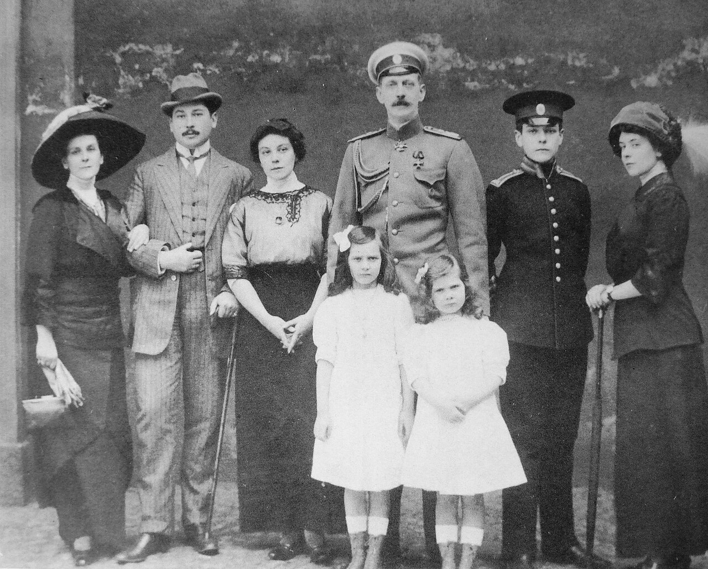

# Olga Erikovna von Pistohlkors

🌳 [See in the GEDCOM Viewer](https://theo-armour.github.io/gedcom-viewer/#wiki=Olga-Ericovna-von-Pistohlkors-1888-1963)

| `1911~-family-of-princess-paley.jpg` | "The family of Princess Olga Paley", about 1911; photographer unknown. Geni uses this photograph for Olga's profile, but neither Geni nor Wikimedia Commons says which figure she is. Public domain. | [Source](https://commons.wikimedia.org/wiki/File:The_family_of_Princess_Oga_Paley.JPG) |

**Olga Erikovna von Pistohlkors** (Russian: Ольга Эриковна Пистолькорс; by her first marriage Countess von Kreutz, by her second Princess Kudasheva; 8 October 1888 – 1963) was a Russian noblewoman of Baltic-German descent. She was a daughter of Major General Erich von Pistohlkors and of Olga Valerianovna Karnovich, who later became [Princess Paley](https://theo-armour.github.io/genealogy/#Wiki/Olga-Valerianovna-Paley-1865-1929/README-Olga-Valerianovna-Paley-1865-1929.md), the morganatic wife of Grand Duke Paul Alexandrovich of Russia.[1][2] In 1922, in Florence, she became the second wife of [Prince Sergei Vladimirovich Kudashev](https://theo-armour.github.io/genealogy/#Wiki/Sergei-Vladimirovich-Kudashev-1863-1933/README-Sergei-Vladimirovich-Kudashev-1863-1933.md) (1863–1933).[1][2][3]

Very little is recorded about her own life. The fullest glimpses of her are in her mother's memoir, *Souvenirs de Russie* (1923), where she appears as "Countess Kreutz".[10] This page sets out what the sources say and marks what is not yet confirmed.

| **Olga Erikovna von Pistohlkors** | |
| :--- | :--- |
| **Native name** | Ольга Эриковна Пистолькорс |
| **Born** | 8 October 1888 Kronstadt, near St. Petersburg, Russian Empire[1] |
| **Died** | 1963 Rome, according to one source[3] |
| **Spouses** | Count Alexander Alexandrovich von Kreutz (m. 1906; divorced) Prince Sergei Vladimirovich Kudashev (m. 1922; d. 1933) |
| **Children** | Count Alexander Alexandrovich von Kreutz (1907–1980) [Olga Sergeyevna Kudasheva](https://theo-armour.github.io/genealogy/#Wiki/Olga-Sergeyevna-Kudasheva-Pela-1926-unknown/README-Olga-Sergeyevna-Kudasheva-Pela-1926-unknown.md) (b. 1926; later Olga Pelà) |
| **Father** | [Erich Gerhard von Pistohlkors](https://theo-armour.github.io/genealogy/#Wiki/Erich-Gerhard-von-Pistohlkors-1853-1935/README-Erich-Gerhard-von-Pistohlkors-1853-1935.md) (1853–1935) |
| **Mother** | Olga Valerianovna Karnovich, later Princess Paley (1864 or 1865–1929) |
| **House** | Pistohlkors |

## Family background

Her father, Erich Gerhard von Pistohlkors (Эрик Августович фон Пистолькорс, 1853–1935), was a Russian officer from a Baltic-German noble family who reached the rank of major general and died in Riga.[1][2] Her mother, Olga Valerianovna Karnovich, was the daughter of the chamberlain Valerian Gavrilovich Karnovich and Olga Vasilyevna Meszaros.[1][2] The couple married in 1884.[1][2]

The children of the marriage were:[1][2]

* Alexander Erikovich (1885–1944), a Life Guards officer, who married Alexandra Taneyeva
* Olga Erikovna (1886–1887), who died in infancy
* **Olga Erikovna** (1888–1963), the subject of this page, who was given the same name
* Marianna Erikovna (1890–1976), later Countess von Zarnekau, who has been named as a suspected co-conspirator in the murder of Grigori Rasputin[4]

The Geni tree also lists a son, Wladimir Erikovich, born in St. Petersburg on 28 December 1896.[1] Wikipedia gives the marriage "one son and three daughters".[2]

Olga was born on 8 October 1888 at Kronstadt, the naval fortress town near St. Petersburg.[1] Her younger sister Marianna was baptised in St. Andrew's Cathedral in Kronstadt in December 1890, which suggests the family was living there in those years.[1]

## Her mother's second marriage

During the 1890s her mother began an affair with Grand Duke Paul Alexandrovich, an uncle of Emperor Nicholas II, and in 1897 bore him a son, Vladimir. The affair caused a scandal at court. The Pistohlkors marriage ended in divorce, and on 10 October 1902 her mother married the Grand Duke in an Orthodox church in Livorno, Italy, without the Emperor's permission. In 1904 the Prince Regent of Bavaria made her Countess von Hohenfelsen, and Nicholas II later granted her the title Princess Paley.[2][4]

Olga was thirteen when her parents divorced. Through her mother's second marriage she had three half-siblings: the poet Prince Vladimir Pavlovich Paley (1897–1918), Princess Irina Pavlovna Paley (1903–1990), and Princess Natalia Pavlovna Paley (1905–1981), the fashion model and film actress.[2]

The sources consulted do not say where or with whom Olga lived after her parents separated. Her mother writes that the children of her first marriage called the Grand Duke "Diadia-Palia" (Uncle Paul).[10]

## First marriage

On 12 November 1906, in the church of the Life Guards Horse Regiment in St. Petersburg, Olga married Count Alexander Alexandrovich Kreutz, a cornet. The church register describes her as "daughter of Major General" Pistohlkors.[5] She was eighteen. Wikipedia names her husband as Count Alexander Belzig von Kreutz and gives his dates as 1883–1948.[2]

They had a son, Count Alexander Alexandrovich von Kreutz, born in St. Petersburg in November 1907 and baptised on 16 December 1907. He married Olga Nikolaevna Bobrikova (1914–2015) in 1941, died in Spain on 13 January 1980, and is buried in the Russian cemetery at Sainte-Geneviève-des-Bois, near Paris.[1] Their son, also Alexander (1942–1975), died in a road accident in Spain and is buried in the same cemetery.[1][6]

The marriage ended in divorce. The date is not recorded in the sources consulted.[1] Her mother's memoir still calls her Countess Kreutz in 1916 and 1917 and never mentions her husband.[10]

## In her mother's memoir, 1916–1917

In 1917 Olga had a flat in Petrograd at 29 Admiralty Canal, in one of the houses that belonged to Grand Duke Paul. Her grandmother, Olga Vasilyevna Karnovich, lived in the flat below.[10]

She was at her mother's house at Tsarskoe Selo for the family Christmas tree on Christmas Eve 1916, the day after her stepbrother Grand Duke Dmitri was sent to Persia for his part in the killing of Rasputin. Her mother remembered "the sad countenances, and eyes filled with tears" of the family that evening, and names "Countess Olga Kreutz" among them.[10]

After the February Revolution Olga often came out to Tsarskoe Selo, and she was the one in the family who saw the danger. At the end of April 1917 she decided to leave for Sweden with her son, then aged nine, and she pressed her mother to get the others out as well:[10]

> "The lives of the Grand Duke and Vladimir are in danger. I beg of you, Mama, make them leave — the Grand Duke will do whatever you want."

Her mother did not act on it, and wrote afterwards: "Why did not I listen to this dear child of mine?" Of the parting she says: "My eldest daughter went off, miserable at having to leave us; she also loved her country and her home, but she realised that to remain was becoming dangerous."[10] The memoir gives no date for the departure. It falls in the narrative before 29 May 1917.

Olga's empty flat was used once more. In November 1917, when the Bolsheviks released Grand Duke Paul from detention at the Smolny Institute, he, her mother and her two young half-sisters lived there for eleven days before returning to Tsarskoe Selo.[10]

## Revolution and exile

Her mother's family was hit hard by the Revolution. Her half-brother Vladimir Paley was killed by the Bolsheviks at Alapayevsk in July 1918, and her stepfather, Grand Duke Paul, was shot in the Peter and Paul Fortress in Petrograd in January 1919.[1][2][10] Her brother Alexander fled to Sweden through Finland at the end of December 1917 and was writing to their mother from Stockholm in 1918 and 1919.[10] Her mother escaped to Finland in February 1919.[10]

Mother and daughter did not meet again for two and a half years. "I did not see her again until November, 1919, in Paris," her mother wrote.[10] The memoir says nothing about Olga's life in Sweden. Her mother died in Paris in 1929, and her father in Riga on 8 November 1935.[1][2]

By the spring of 1922 Olga was in Florence.

## Marriage to Prince Sergei Kudashev

On 10 April 1922, in Florence, Olga married Prince Sergei Vladimirovich Kudashev, a former chamberlain of the Imperial court, company director and art collector.[1][3] She was thirty-three and he was fifty-eight. He had been a widower since the death of his first wife, [Princess Vera Maximilianovna](https://theo-armour.github.io/genealogy/#Wiki/Vera-Maximilianovna-Kudasheva-von-Nieroth-1874-1920/README-Vera-Maximilianovna-Kudasheva-von-Nieroth-1874-1920.md), in Paris in January 1920.[7] When her mother's memoir was published in 1923, a footnote to the name Countess Kreutz read: "Actuellement la princesse Serge Koudacheff" (now Princess Serge Koudacheff).[10]

How the two met is not recorded. Both were in Sweden as refugees: Olga went there in the spring of 1917, and Prince Sergei and his family lived at Saltsjöbaden, near Stockholm, in 1917–1918.[7][10] No source seen so far says that they knew each other there.

The marriage made her stepmother to his two grown children, [Princess Maria (Myra) Sergeyevna](https://theo-armour.github.io/genealogy/#Wiki/Maria-Sergeyevna-Kudasheva-1896-1990/README-Maria-Sergeyevna-Kudasheva-1896-1990.md) (1896–1990), the wife of the American diplomat Norman Armour, and Prince Sergei Sergeyevich (1901–1991). Olga was eight years older than her stepdaughter.

In 1926 Olga and Sergei had a daughter, Olga Sergeyevna Kudasheva, who married Achille Pelà in 1955.[1][3][7] In the same year Sergei obtained Italian recognition of his princely title by a Royal Decree of 3 September 1926.[7]

Prince Sergei died in Florence on 27 or 28 February 1933 and was buried in the Cimitero Evangelico agli Allori.[7] Olga was a widow at forty-four, with a daughter of six or seven.

## Later life and death

Nothing has yet been found about the thirty years between her husband's death and her own. She died in 1963.[1][2] A note drawn from Jacques Ferrand's genealogy of the Russian princely families gives the place as Rome.[3]

A Find a Grave memorial exists under the name "Olga Erikovna Koudacheff".[8] It could not be opened when this page was written, so her burial place is not confirmed here.

In July 2026 the State Archives of Florence told the provenance researcher Erik Van der Graaf that they hold no records of Prince Sergei or of his second wife.[9]

## Residences

* **Kronstadt.** She was born there in 1888.[1]
* **29 Admiralty Canal, Petrograd (to 1917).** A flat in a house belonging to Grand Duke Paul.[10]
* **Sweden (from spring 1917).** No address is known.[10]
* **Paris (November 1919).** She met her mother there. Whether she lived in Paris is not recorded.[10]
* **Florence (by April 1922).** Prince Sergei lived at Villa Granduchessa.[7]
* **Rome.** Given as her place of death in 1963.[3]

## Names and spellings

* Russian: Ольга Эриковна Пистолькорс
* Patronymic: Erikovna, also Ericovna (as in the name of this folder)
* Family name: von Pistohlkors, also Pistolkors, Pistolekors
* First married name: Kreutz, von Kreutz, Belzig von Kreutz (Russian: Крейц)
* Second married name: Kudasheva, Koudacheff, Kudaschew (Russian: Кудашева)
* The Geni tree calls her "Olga II" to tell her apart from the sister who died in 1887

## Discrepancies and unverified claims

* **Date of birth.** 8 October 1888 comes from Geni alone. Geni does not say whether it is Old Style or New Style, and no baptismal record is cited.
* **Place of birth.** Geni gives Kronstadt. Wikipedia says her sister Marianna was born in St. Petersburg, while the baptismal record quoted on Geni places Marianna's baptism in Kronstadt.[1][4]
* **Her parents' marriage.** Geni: 30 May 1884, St. Petersburg. Wikipedia: 1884, Riga.[1][2]
* **Her parents' divorce.** Geni gives 12 August 1902, two months before her mother's remarriage. Wikipedia gives no date.[1][2]
* **Her father's birth.** Geni: 25 November 1853, Frankfurt am Main. Wikipedia: 13 November 1853. The twelve-day gap matches the difference between the two calendars.[1][2]
* **Her son's birth.** Geni: 29 November 1907. A Geneall entry quoted on Geni: 16 November 1907. The thirteen-day gap again matches the two calendars.[1]
* **Her son's occupation.** The Geni profile gives an occupation for him during the Second World War. It cites no source, and it is not repeated here.
* **Her first husband.** The Geni export has no profile for him, only the marriage record and the divorce. His dates (1883–1948) are from Wikipedia alone.[2]
* **Marriage or "second household".** The biography of Prince Sergei on this site says that he "established a second household" with her. Geni, Wikipedia and the Ferrand note all record a marriage, in Florence, on 10 April 1922.[1][2][3] Her mother's memoir, published in 1923, calls her "la princesse Serge Koudacheff".[10] No church or civil record has been seen.
* **Departure for Sweden.** The memoir dates her decision to the end of April 1917 but not the journey itself. The English edition prints the footnote about her second marriage inside the sentence, as "Countess (now Princess Serge Koudachoff) Kreutz"; the French original has it as a footnote.[10]
* **Christmas 1916.** The English edition lists "my daughters" and "Countess Olga Kreutz" as if they were different people. The French reads "de mes filles, la comtesse Olga Kreutz et Marianne de Derfelden".[10]
* **Place of death.** Rome rests on a single note that has not been checked against Ferrand's book.[3]
* **Her mother's date of death.** Wikipedia gives 2 November 1929 in one article and 2 December 1929 in another.[2][4]
* **Her brother Wladimir.** Listed on Geni only.[1]

## References

1. Geni.com family tree for Olga Ericovna von Pistohlkors, GEDCOM export of 26 October 2026. Theo Armour Genealogy. [export-geni/export-BloodTree.ged](export-geni/export-BloodTree.ged). Geni in turn cites the *Genealogisches Handbuch der baltischen Ritterschaften* (Pistohlkors, VII.6.3) and Geneall.
2. "Princess Olga Paley". *Wikipedia*. <https://en.wikipedia.org/wiki/Princess_Olga_Paley> (read November 2026).
3. Ferrand, Jacques (1997). *Les familles princières de l'ancien Empire de Russie* (2nd ed.). Kudashev chapter, as reported in a research note in this repository; not checked against the book. <https://koudachev.wordpress.com/wp-content/uploads/2010/07/koudachev-geneology.pdf>
4. "Marianne Pistohlkors". *Wikipedia*. <https://en.wikipedia.org/wiki/Marianne_Pistohlkors> (read November 2026).
5. Marriage register of the church of the Life Guards Horse Regiment, St. Petersburg, 12 November 1906. Central State Historical Archive of St. Petersburg (ЦГИА СПб), fond 19, opis 128, delo 893. Quoted on Geni [1]: "Крейц граф, корнет Александр Александрович — Пистолькорс дочь ген-м Ольга Эриковна". The original has not been seen.
6. *Русская мысль* (Paris), 3 April 1975, no. 3045; Grezin, I. (1995). *Алфавитный список русских захоронений на кладбище Сент-Женевьев-де-Буа*. Paris. Both as cited on Geni [1].
7. "Prince Sergei Vladimirovich Kudashev". Theo Armour Genealogy. <https://theo-armour.github.io/genealogy/#Wiki/Sergei-Vladimirovich-Kudashev-1863-1933/README-Sergei-Vladimirovich-Kudashev-1863-1933.md>
8. "Olga Erikovna Koudacheff". Find a Grave, memorial 160529125. <https://www.findagrave.com/memorial/160529125/olga_erikovna-koudacheff> (not read).
9. Van der Graaf, Erik. Note to Theo Armour, 8 July 2026. Theo Armour Genealogy. <https://theo-armour.github.io/genealogy/#Wiki/Sergei-Vladimirovich-Kudashev-1863-1933/additional-notes-not-in-README.md>
10. Paley, Princess [Olga Valerianovna] (1923). *Souvenirs de Russie (1916–1919)*. Paris: Librairie Plon. Chapters IV, XI, XVI and XXVII, and author's note 4. English edition: *Memories of Russia, 1916–1919* (London: Herbert Jenkins, 1924). Both texts are on this site: <https://theo-armour.github.io/genealogy/#Kudashev/souvenirs-de-russie/souvenirs-de-russie.md>; <https://theo-armour.github.io/genealogy/#Kudashev/souvenirs-de-russie/memories-of-russia.md>
