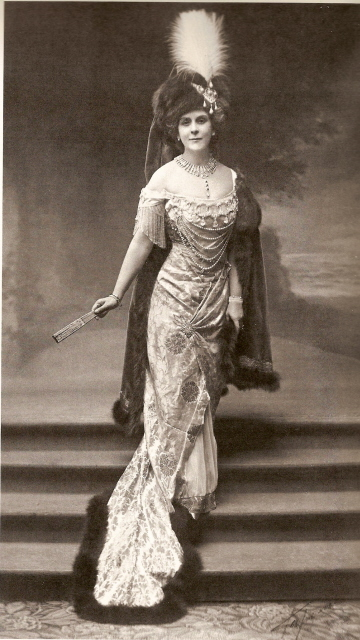
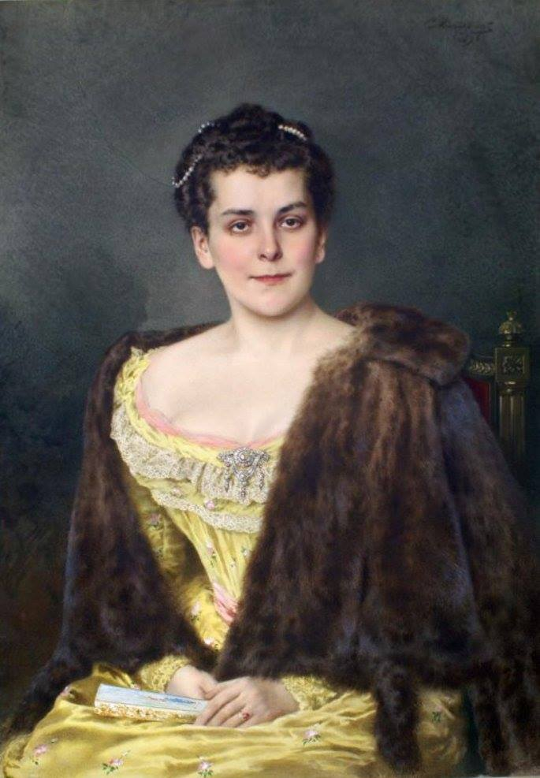
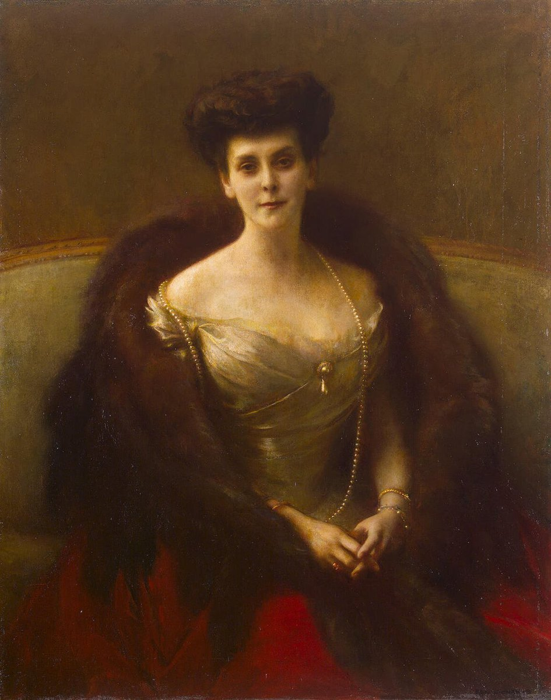
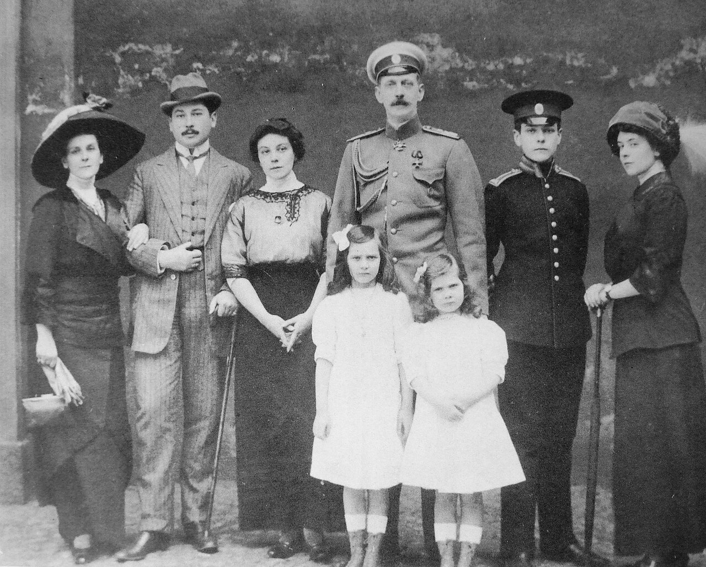
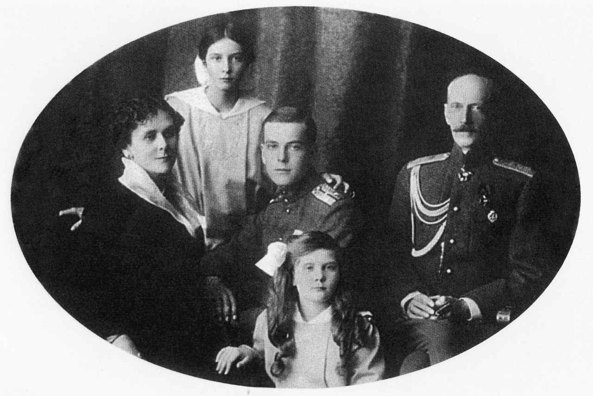
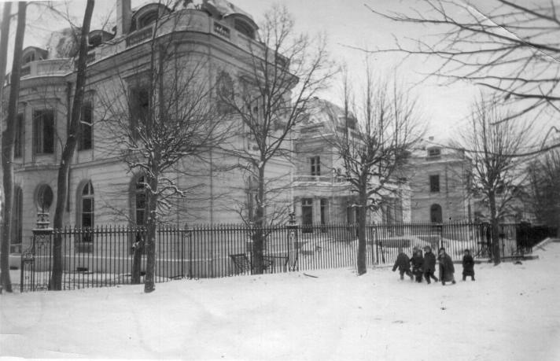
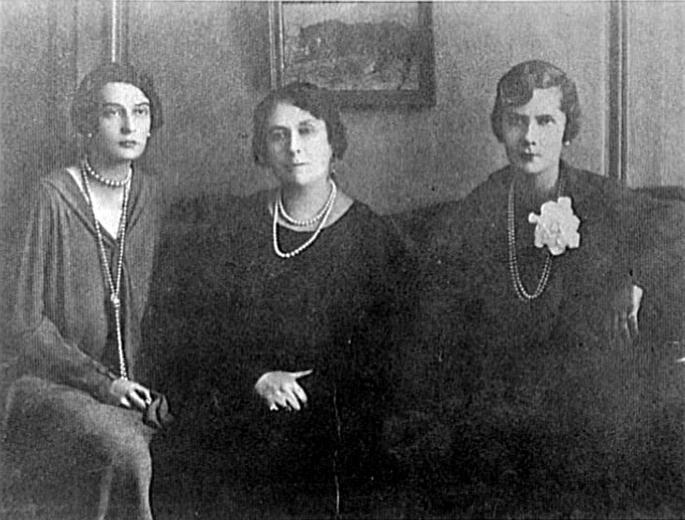
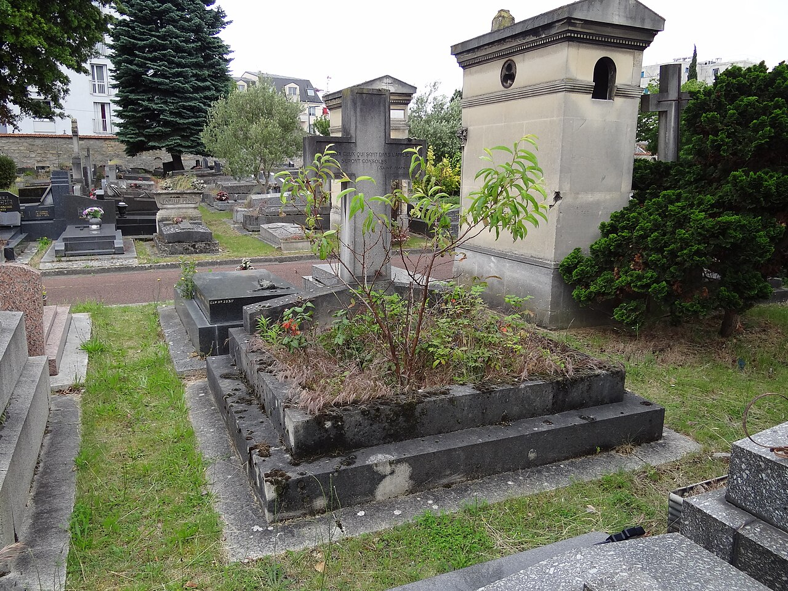

# Princess Olga Valerianovna Paley

| `1890s-olga-paley-portrait.jpg` | Olga Valerianovna, full-length portrait. Wikimedia Commons dates the photograph to the 1890s; photographer unknown. Public domain. | [Source](https://commons.wikimedia.org/wiki/File:Olga_Valerianovna_Palej.jpg) |

**Princess Olga Valerianovna Paley** (Russian: Ольга Валериановна Палей; née **Karnovich**; by her first marriage **von Pistohlkors**; from 1904 **Countess von Hohenfelsen**; 14 December [O.S. 2 December] 1865 – 2 November 1929) was a Russian aristocrat and memoirist, and the second, morganatic wife of Grand Duke Paul Alexandrovich of Russia, a son of Emperor Alexander II.[2][3] Her marriage to the Grand Duke in 1902 cost him twelve years of banishment from Russia. In 1918 and 1919 the Bolsheviks killed her son, the poet Prince Vladimir Paley, and her husband. She escaped across the ice to Finland and wrote an account of those years, *Souvenirs de Russie* (1923).[6]

She belongs in this family history through her eldest daughter, [Olga Erikovna von Pistohlkors](https://theo-armour.github.io/genealogy/#Wiki/Olga-Ericovna-von-Pistohlkors-1888-1963/README-Olga-Ericovna-von-Pistohlkors-1888-1963.md) (1888–1963), who in 1922 became the second wife of [Prince Sergei Vladimirovich Kudashev](https://theo-armour.github.io/genealogy/#Wiki/Sergei-Vladimirovich-Kudashev-1863-1933/README-Sergei-Vladimirovich-Kudashev-1863-1933.md).[7] The French and English texts of her memoir are [on this site](https://theo-armour.github.io/genealogy/#Kudashev/souvenirs-de-russie/README.md).

| **Princess Olga Valerianovna Paley** | |
| :--- | :--- |
| **Native name** | Ольга Валериановна Палей |
| **Born** | Olga Valerianovna Karnovich 14 December (O.S. 2 December) 1865 St. Petersburg, Russian Empire |
| **Died** | 2 November 1929 (aged 63) Paris, France |
| **Resting place** | Cimetière Gabriel-Péri, Colombes, near Paris |
| **Titles** | Countess von Hohenfelsen (Bavaria, 1904) Princess Paley (Russia, 1915) |
| **Spouses** | Erich Gerhard von Pistohlkors (m. 1884; divorced) Grand Duke Paul Alexandrovich of Russia (m. 1902; d. 1919) |
| **Children** | Alexander Erikovich von Pistohlkors (1885–1944) Olga Erikovna von Pistohlkors (1886–1887) Olga Erikovna von Pistohlkors (1888–1963) Marianna Erikovna von Pistohlkors (1890–1976) Prince Vladimir Pavlovich Paley (1897–1918) Princess Irina Pavlovna Paley (1903–1990) Princess Natalia Pavlovna Paley (1905–1981) |
| **Father** | Valerian Gavrilovich Karnovich (d. 1891) |
| **Mother** | Olga Vasilyevna Meszaros (d. 1919) |

🌳 [See in the family tree](https://theo-armour.github.io/gedcom-viewer/#wiki=Olga-Valerianovna-Paley-1865-1929)

## Family background

Olga Valerianovna Karnovich was born in St. Petersburg.[2][3] Her father, Valerian Gavrilovich Karnovich, was a chamberlain of the Imperial court and an official of the Ministry of State Property; he died on 17 April 1891.[1][2][3] Her mother, Olga Vasilyevna Meszaros, was of Hungarian and German descent and died in August 1919.[1][2][6] The Karnovich family held the village of Pyatnitskaya Gora in Yaroslavl Governorate.[3]

She was the youngest of the family, with one sister and four brothers.[6] Her sister Lyubov married Evgeny Sergeyevich Golovin. Her brothers were Vladimir, Gavriil, Denis (1849–1908), a privy councillor, and Sergei (1853–1918), an actor.[2][3]

## First marriage

On 30 May 1884 she married Erich Gerhard von Pistohlkors (Эрик Августович фон Пистолькорс, 1853–1935), a Guards officer from a Baltic-German family, who was an aide-de-camp of Grand Duke Vladimir Alexandrovich and later a major general.[1][3][5] They had four children:[1][2]

* Alexander Erikovich (1885–1944), a Life Guards officer, who married Alexandra Taneyeva
* Olga Erikovna (1886–1887), who died in infancy
* [Olga Erikovna](https://theo-armour.github.io/genealogy/#Wiki/Olga-Ericovna-von-Pistohlkors-1888-1963/README-Olga-Ericovna-von-Pistohlkors-1888-1963.md) (1888–1963), who married Count Alexander von Kreutz in 1906 and Prince Sergei Kudashev in 1922
* Marianna Erikovna (1890–1976), who married Peter Durnovo, Christoph von Derfelden and Count Nicholas von Zarnekau

## Grand Duke Paul

Grand Duke Paul Alexandrovich (1860–1919) was an uncle of Emperor Nicholas II. His first wife, Princess Alexandra of Greece, died in 1891, leaving him two children, Grand Duchess Maria Pavlovna and Grand Duke Dmitri Pavlovich.[1] Paul was a friend of Pistohlkors, who was a captain in his regiment, and spent evenings with the couple at Tsarskoe Selo.[4][5] In the mid-1890s he and Olga began an affair.[3][5] Their son Vladimir was born on 9 January 1897 (O.S. 28 December 1896), while she was still married to Pistohlkors.[3][4]

The affair became a public scandal when she appeared at court wearing diamonds that had come from the Imperial family. The State Secretary Alexander Polovtsov recorded in his diary that she came to a court reception with "an enormous diamond bow on her breast" that the Grand Duke had bought and given to her, that the couple were struck from the list of those invited to court balls, and that Grand Duke Vladimir was told to dismiss Pistohlkors as his adjutant.[1] Another account says that the jewels had belonged to Paul's mother, Empress Maria Alexandrovna, and that the Dowager Empress recognised them and had Olga removed from the ball.[2][5]

The Pistohlkors marriage ended in divorce. Nicholas II refused Paul permission to marry her. On 10 October 1902 they were married all the same, in an Orthodox church in Livorno, Italy.[3][5] The Emperor banished Paul from Russia, dismissed him from his military commands and seized his property. Guardianship of Maria and Dmitri passed to Paul's brother, Grand Duke Sergei.[1][5] "He was banished from Russia for twelve years on account of his marriage with me," she wrote, "because I was not a Princess of royal blood."[6]

## Boulogne-sur-Seine

The couple settled at Boulogne-sur-Seine, on the edge of Paris, in a house she decorated herself.[4][5] Their daughters Irina and Natalia were born in France in 1903 and 1905.[1][3] In 1904 Luitpold, Prince Regent of Bavaria, created her Countess von Hohenfelsen, a title that passed to her children by the Grand Duke.[3][4]

She was received in Paris society.[4] The novelist Paul Bourget, who wrote the preface to her memoir, remembered that she "presided with such grace over the beautiful house in which they lived at Boulogne". She records that the singer Feodor Chaliapin made his Paris debut at a concert there.[6]

## Return to Russia

The Emperor eventually forgave his uncle. In January 1914 the couple came from Paris to see to the house they were building at Tsarskoe Selo, and they moved in "two months before the war, in May, 1914".[6] The palace was designed by the architect Karl Schmidt and, in her words, was "built and decorated by French workmen".[3][6] She quotes Nicholas II as saying: "The Princess has at Tsarskoe the most beautiful house in the world."[6]

In 1915 the Emperor granted her and her three children by the Grand Duke the title of Prince and Princess Paley.[1][3] One account says that she asked Rasputin to put her case to the Emperor.[2]

## The war and the end of the monarchy

During the war she founded and presided over a workroom for the troops in the ballroom of the palace, under the patronage of the Empress, and a hospital for the wounded was set up in one wing.[3][6] From 1915 to 1917 she chaired the council of the All-Russian Society for Aid to Prisoners of War.[3] Her son Vladimir served at the front with the Emperor's Hussars, and Grand Duke Paul commanded the First Corps of the Guard.[6]

Her memoir begins in the autumn of 1916. Rasputin was killed on the night of 29–30 December (O.S. 16–17 December) 1916, and her stepson Grand Duke Dmitri was among those involved. Her daughter Marianna was arrested for two days for visiting him. Olga drafted the petition in which members of the Imperial family asked the Emperor to pardon Dmitri; Dmitri was sent to Persia.[6]

During the February Revolution the Grand Dukes' manifesto promising a constitution was drafted in her house. On 16 March (O.S. 3 March) 1917 the abdication was read to them at half past four in the morning, and Paul went to break the news to the Empress.[6]

## 1917–1919

After the Revolution her eldest daughter Olga begged her to take the Grand Duke and Vladimir out of the country. She asked Alexander Kerensky for permission to leave for France and was refused. Olga left for Sweden in the spring of 1917. "Why did not I listen to this dear child of mine?" her mother wrote later.[6]

What followed, as she tells it:[6]

* **September 1917.** The family was held under house arrest for eighteen days by order of the Provisional Government.
* **November 1917.** The Bolsheviks searched the house and took Paul to the Smolny Institute. He was released, and the family lived for eleven days in her daughter Olga's empty flat at 29 Admiralty Canal in Petrograd.
* **January 1918.** They moved to a cottage for want of fuel. The palace was declared a "Museum of the People"; for a time she was left in charge and showed visitors round herself. Her brother Sergei was shot by robbers in Petrograd and died three days later. The banks were confiscated, and with them the Grand Duke's jewels.
* **March–July 1918.** Vladimir was summoned by the Cheka and told to renounce his father. He refused. On 4 April he was sent into exile at Vyatka, then to Ekaterinburg, then to Alapayevsk, where he was killed with other members of the Imperial family on 18 July 1918.
* **August 1918.** Paul was arrested at three in the morning on the night of 12–13 August and held in the Shpalernaya prison, where she visited him twice a week and brought his food.
* **Autumn 1918.** The palace was nationalised "with all it contains". She was turned out of the cottage and took her daughters to Marianna's home in Petrograd.
* **December 1918.** Paul was moved to a prison hospital. On 17 December she sent Irina and Natalia across the border to Finland in the care of an officer, on false passports. She saw her husband for the last time on Christmas Day.

She appealed for Paul's release to everyone she could reach, among them the writer Maxim Gorky, Chaliapin, and the King of Sweden, whose envoy visited the Grand Duke in prison. Paul twice refused a plan of escape, the second time for fear of reprisals against his cousins, who were held with him.[6]

Grand Duke Paul was shot in the Peter and Paul Fortress at about three in the morning on 30 January 1919, with three other Grand Dukes. She learned of it from a friend and from the newspaper the next morning. His body was refused to her.[6]

## Escape

She was hidden for a week by an actress whom she does not name. About 9 February 1919 she left Petrograd by sledge with Count Shuvalov, crossed the ice of the Gulf of Finland past Kronstadt, and reached Terijoki in Finland at four in the morning. She rejoined her daughters at the Rauha sanatorium near Imatra, where she told them, "Papa is dead."[6]

She had read a Bolshevik report in July 1918 that the Alapayevsk prisoners had escaped, and she went on hoping that Vladimir was alive. She learned the truth at Rauha, after 25 March 1919, from a letter enclosing General Knox's account of the murders. "Until I read this letter I still had hope."[6] Her mother, who had stayed behind, died that August.[6]

## Exile and death

By November 1919 she was in Paris, where she saw her daughter Olga again after two and a half years.[6] She lived first in the house at Boulogne, then in the sixteenth arrondissement of Paris, and built a villa at Biarritz.[4] She gave generously to Russian exiles and organised charity events for them, in particular for the children of émigrés.[3][4]

Her daughter Irina married Prince Feodor Alexandrovich of Russia in 1923. Natalia, a fashion model and later a film actress, married Lucien Lelong in 1927.[2][4]

Princess Paley died in Paris on 2 November 1929, aged 63, and is buried in the Gabriel-Péri cemetery at Colombes.[3][4]

## Souvenirs de Russie

*Souvenirs de Russie (1916–1919)* was published in Paris by Plon in 1923, with a preface by Paul Bourget of the Académie française and five portraits. She says that she wrote it in June 1922. An English translation, *Memories of Russia, 1916–1919*, was published in London by Herbert Jenkins in 1924, and a Russian translation in Moscow in 2005.[3][6]

The book covers only the years 1916 to 1919. It does not give her maiden name, her birth, her first husband's name or the story of her second marriage. It is a witness's account, written within four years of the events by someone who had lost a husband and a son, and it should be read as that.

## Pictures

All from Wikimedia Commons. The dates and names are those given there and have not been checked.

| `1898-alexandrovsky-olga-von-pistohlkors.jpg` | Olga Valerianovna von Pistohlkors, portrait by Stepan Alexandrovsky, 1898. Public domain. | [Source](https://commons.wikimedia.org/wiki/File:Olga_Valerianovna_von_Pistohlkors.jpg) |

| `1904-dagnan-bouveret-olga-paley.jpg` | Portrait by Pascal Dagnan-Bouveret, painted between 1902 and 1904, the first years of the exile in France. Public domain. | [Source](https://commons.wikimedia.org/wiki/File:Pascal-Adolphe-Jean_Dagnan-Bouveret_La_Princesa_Olga_Paley_1904.jpg) |

| `1911~-family-of-princess-paley.jpg` | "The family of Princess Olga Paley", about 1911; photographer unknown. Commons does not name the people. Geni uses the same photograph for the profile of her daughter Olga Erikovna, so the grown-up children of her first marriage are probably among them. Public domain. | [Source](https://commons.wikimedia.org/wiki/File:The_family_of_Princess_Oga_Paley.JPG) |

| `1916-grand-duke-paul-and-family.jpg` | Grand Duke Paul and his second family, 1916: Princess Paley, the Grand Duke, and their children Vladimir, Irina and Natalia. Her memoir lists a portrait of "the Grand Duke Paul and his family in 1916" among its illustrations. Public domain. | [Source](https://commons.wikimedia.org/wiki/File:Grand_Duke_Paul_Alexandrovich_and_his_second_family.jpg) |

| `1911-1914-paley-palace-tsarskoe-selo.jpg` | The Paley palace at Tsarskoe Selo, built 1911–1914, architect Karl Schmidt. Public domain. | [Source](https://commons.wikimedia.org/wiki/File:Schmidt_dvorets_paley.jpg) |

| `1920s-olga-paley-with-irina-and-natalia.png` | Princess Paley in exile with her daughters Irina and Natalia, 1920s; photographer unknown. Public domain. | [Source](https://commons.wikimedia.org/wiki/File:Princess_Olga_Paley_with_her_daughters_Irina_and_Natlia.png) |

| `2024-tomb-olga-paley-colombes.jpg` | Her tomb in the Gabriel-Péri cemetery at Colombes, division 7. Photograph by Antoine Rex, 2024. CC0. | [Source](https://commons.wikimedia.org/wiki/File:Tombe_d%27Olga_Karnovitch_Paley_(1865%E2%80%931929)_1.jpg) |

## Names and spellings

* Russian: Ольга Валериановна Палей; née Карнович
* Maiden name: Karnovich, also Karnovitch, Karnowitsch
* First married name: von Pistohlkors, also Pistolkors, Pistolekors
* Countess von Hohenfelsen (German: Gräfin von Hohenfelsen; Russian: графиня Гогенфельзен)
* Princess Paley, also Palei, Paleÿ (French: la princesse Paley)

## Discrepancies and unverified claims

* **Year of birth.** The English, Russian and French Wikipedia articles give 2 December 1865 (Old Style), and her age at death, 63, agrees.[2][3][4] A note on Geni cites the baptismal register of St. Isaac's Cathedral (ЦГИА СПб, fond 19, opis 124, delo 925) and says that she was born on 2 December 1864, not 1865.[1] The register has not been seen.
* **Her father.** Born 1823 (Geni, Russian Wikipedia) or 1833 (English Wikipedia). The French Wikipedia calls him a court physician; the others call him a chamberlain.[1][2][3][4]
* **Her mother's birth.** 1826 (Geni) or 1830 (Wikipedia).[1][2]
* **Brothers and sisters.** Her memoir says one sister and four brothers. Geni lists seven children in the family.[1][6]
* **First marriage.** St. Petersburg (Geni) or Riga (English Wikipedia).[1][2]
* **Divorce.** 12 August 1902 (Geni); 1902 (English Wikipedia, on Grand Duke Paul); 1901 (Russian Wikipedia); about 1900 (French Wikipedia).[1][3][4][5]
* **Start of the affair.** 1893 (Geni), 1895 (English Wikipedia) or "the mid-1890s" (Russian Wikipedia). In 1918 the Grand Duke thanked her for "twenty-five years of happiness", which points to about 1893.[1][3][5][6]
* **The diamonds.** The two accounts differ on what the jewel was and whose it had been.[1][2]
* **The return to Russia.** Permission is dated 1908 (Russian Wikipedia), 1912 (English Wikipedia) or 1913 (French Wikipedia; Bourget's preface says the Grand Duke wished to return "towards the end of 1913"). The move itself, in May 1914, is from her own memoir.[3][4][5][6]
* **The Paris house.** One account says that Paul bought a mansion in the Bois de Boulogne in 1900; another that the couple built a house at Boulogne-sur-Seine.[4][5]
* **Rasputin and the Paley title.** Only the English Wikipedia says that she asked Rasputin to intervene.[2]
* **Grand Duke Paul's death.** Her memoir gives the night of 30 January 1919 (O.S. 17 January). The English Wikipedia gives 28 January in one place.[5][6]
* **The escape.** The Wikipedia articles say that she fled with her two daughters, across Lake Ladoga, in 1919 or 1920.[2][3][4] Her own account is that the girls left separately in December 1918 and that she crossed the Gulf of Finland in February 1919.[6]
* **Date of death.** 2 November 1929 in most sources; the English Wikipedia article on her daughter Marianne gives 2 December 1929, aged 64.[2][3][4]
* **Place of death.** The French Wikipedia gives Paris (16th arrondissement) and also says she ended her life at Neuilly-sur-Seine.[4]
* **Sources.** References 2 to 5 are Wikipedia articles. The books they cite, listed below, have not been checked.

## References

1. Geni.com family tree, GEDCOM export of 26 October 2026, including the diary of A. A. Polovtsov as quoted there. Theo Armour Genealogy. [export-BloodTree.ged](../Olga-Ericovna-von-Pistohlkors-1888-1963/export-geni/export-BloodTree.ged)
2. "Princess Olga Paley". *Wikipedia*. <https://en.wikipedia.org/wiki/Princess_Olga_Paley> (read November 2026). Cites Perry, John Curtis, and Pleshakov, Constantine, *The Flight of the Romanovs*.
3. "Палей, Ольга Валериановна". *Russian Wikipedia*. <https://ru.wikipedia.org/wiki/Палей,_Ольга_Валериановна> (read November 2026). Cites Pchelov, E. V. (2004), *Романовы. История династии*; Semyonova, G. (2009), "Дворец княгини Палей", *Адреса Петербурга* no. 20.
4. "Olga Karnovitch Paley". *French Wikipedia*. <https://fr.wikipedia.org/wiki/Olga_Karnovitch_Paley> (read November 2026). The article carries a notice that it does not cite enough sources. Bibliography: Zeisler, Wilfried (2018), *Vivre la Belle Époque à Paris: Olga Paley et Paul de Russie*, Paris: Mare et Martin.
5. "Grand Duke Paul Alexandrovich of Russia". *Wikipedia*. <https://en.wikipedia.org/wiki/Grand_Duke_Paul_Alexandrovich_of_Russia> (read November 2026). Cites Zeepvat, Charlotte, *The Camera and the Tsars*; Van der Kiste, John, *The Romanovs 1818–1959*.
6. Paley, Princess (1923). *Souvenirs de Russie (1916–1919)*. Preface by Paul Bourget. Paris: Librairie Plon. English edition: *Memories of Russia, 1916–1919*. London: Herbert Jenkins, 1924. Both texts are on this site: <https://theo-armour.github.io/genealogy/#Kudashev/souvenirs-de-russie/souvenirs-de-russie.md>; <https://theo-armour.github.io/genealogy/#Kudashev/souvenirs-de-russie/memories-of-russia.md>
7. "Olga Erikovna von Pistohlkors". Theo Armour Genealogy. <https://theo-armour.github.io/genealogy/#Wiki/Olga-Ericovna-von-Pistohlkors-1888-1963/README-Olga-Ericovna-von-Pistohlkors-1888-1963.md>
