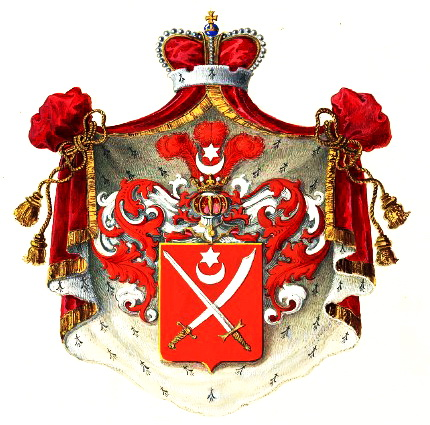
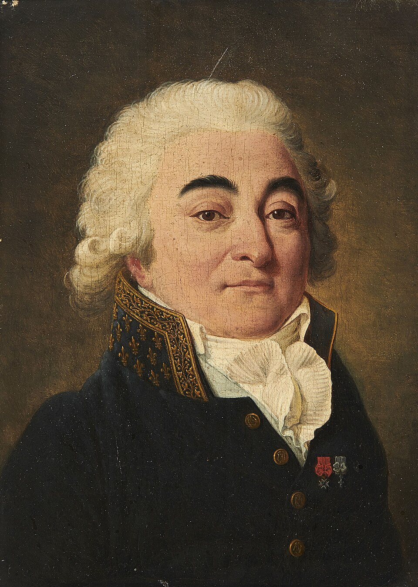
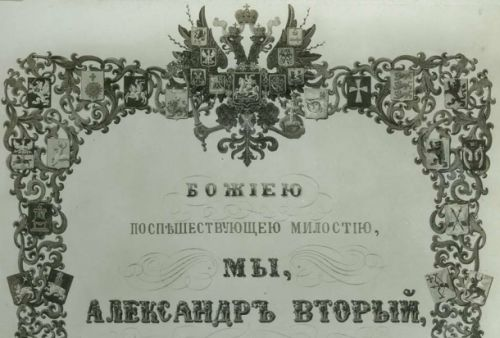

# Prince Sergei Danilovich Kudashev

| `kudashev-coat-of-arms-1904.jpg` | Coat of arms of the Princes Kudashev, from the *Общий гербовник* (General Armorial), part 17, 1904. Public domain.[13] | [Source](https://commons.wikimedia.org/wiki/File:Kudashev_17-6.jpg) |

*No portrait of Prince Sergei Danilovich or of his wife has been found.*

**Prince Sergei Danilovich Kudashev** (Russian: Князь Сергей Данилович Кудашев; 29 May 1795 – 18 March 1862) was a Russian nobleman, courtier and provincial official. He was Vice-Governor of [Kiev Governorate](https://en.wikipedia.org/wiki/Kiev_Governorate) from 1838 to 1844 and Governorate Marshal of the Nobility of [Kherson Governorate](https://en.wikipedia.org/wiki/Kherson_Governorate) from 1844 to 1847. He held the court rank of *[Kammerherr](https://en.wikipedia.org/wiki/Chamberlain_(office))* (chamberlain) and the civil rank of State Councillor.[1][10][11] He married Countess Mathilde de Choiseul-Gouffier and had ten children. Through his daughter Alexandra he was the grandfather of the philosopher [Nikolai Berdyaev](https://en.wikipedia.org/wiki/Nikolai_Berdyaev), and through his son Vladimir the grandfather of the St. Petersburg art collector Prince Sergei Vladimirovich Kudashev.[3][10][14]

| **Prince Sergei Danilovich Kudashev** | |
| :--- | :--- |
| **Native name** | Князь Сергей Данилович Кудашев |
| **Born** | 29 May 1795 Beletskovka, near [Kremenchuk](https://en.wikipedia.org/wiki/Kremenchuk) (according to one source) |
| **Died** | 18 March 1862 (aged 66) Kiev, Russian Empire |
| **Resting place** | [Kiev-Pechersk Lavra](https://en.wikipedia.org/wiki/Kyiv_Pechersk_Lavra) (unconfirmed) |
| **Offices** | Vice-Governor of Kiev Governorate (1838–1844) Marshal of the Nobility of Kherson Governorate (1844–1847) |
| **Ranks** | *Kammerherr* (chamberlain) State Councillor (*статский советник*) |
| **Spouse** | [Countess Mathilde de Choiseul-Gouffier](https://theo-armour.github.io/genealogy/#Wiki/Mathilde-de-Choiseul-Gouffier-Kudasheva-1806-1867/README-Mathilde-de-Choiseul-Gouffier-Kudasheva-1806-1867.md) (1806–1867) |
| **Children** | Alexei, Viktor, Maria, Nikolai, Alexander, Yekaterina, [Vladimir](https://theo-armour.github.io/genealogy/#Wiki/Vladimir-Sergeyevich-Kudashev-1833-1871/README-Vladimir-Sergeyevich-Kudashev-1833-1871.md) (1833–1871), Sergei (1834–1915), Olga, Alexandra (1838–1912) |
| **Father** | Prince Daniil (Danila) Ivanovich Kudashev |
| **Mother** | Yekaterina Sergeyevna, born Princess Baratova or Baranova (sources differ) |
| **House** | [Kudashev](https://ru.wikipedia.org/wiki/Кудашевы) |

🌳 [See in the family tree](https://theo-armour.github.io/gedcom-viewer/#wiki=Sergei-Danilovich-Kudashev-1795-1862)

## Family background and early life

Sergei Danilovich Kudashev was born on 29 May 1795.[12] A local-history article by A. Reznik says he was born at Beletskovka, the family estate near Kremenchuk in Poltava Governorate, and cites an entry in the register of its St. Nicholas church.[11] The Kudashevs were a princely family of Tatar origin, descended from Murza Chepai Kudashev, whose princely title was confirmed by the Russian Senate.[2][10][14]

His father was Prince Daniil (Danila) Ivanovich Kudashev, a colonel. His dates are given as 1760–1845 by Russian Wikipedia and Geni, and as 1737–c. 1840 by the genealogy forum VGD.[10][15] His mother was Yekaterina Sergeyevna. The VGD forum names her as Princess Baratova (Баратова), of the Georgian princely house of Baratov; earlier versions of this page gave Baranova. VGD lists Sergei as the youngest of seven children. His siblings included Major General Prince Nikolai Danilovich Kudashev (1784–1813), who married Yekaterina Mikhailovna, a daughter of Field Marshal Mikhail Kutuzov. Nikolai commanded a partisan detachment in 1812 and died of wounds received at the Battle of Leipzig.[2][5][15]

Reznik also says that Sergei Danilovich served in the war of 1812 and the foreign campaigns of the Russian army that followed.[11] *(Unsound: the article cites no source for this, and no service record has been found.)*

## Kiev and Kherson

Russian Wikipedia's list of the vice-governors of Kiev Governorate, compiled from official sources, shows "Kudashev, Sergei Danilovich, prince, *nadvorny sovetnik* (court councillor)" in office from 1 February 1838 to 6 July 1844.[16] As vice-governor he was the civil governor's deputy and ran the provincial administration.

He was already a prominent figure in Kiev society before then. Count Mikhail Dmitrievich Buturlin, who lived in Kiev in 1836, wrote in his memoirs: "Другой гостеприимный дом был князя Кудашева (Сергей Данилович), женатого на графине Матильде Шуазёль-Гуфье" ("Another hospitable house was that of Prince Kudashev (Sergei Danilovich), married to Countess Mathilde Choiseul-Gouffier").[17]

From 1844 to 1847, immediately after leaving the vice-governorship, he was Governorate Marshal of the Nobility of Kherson Governorate. The *Памятные книжки Херсонской губернии* (Kherson Governorate yearbooks) list "Кудашев … князь, статский советник, камергер, 1844–1847".[18] That list gives his patronymic as "Vasilyevich", evidently in error: Reznik's article independently places him in the same office for the same years.[11] The marshal was elected by the nobility of the governorate, so he must have held land in Kherson Governorate. His son Vladimir later sat in the zemstvo of Yelisavetgrad Uyezd there as a landowner.[19]

By the time the Senate's list of titled families was compiled he was "Статский советник, камергер" (State Councillor and *Kammerherr*).[10] Earlier versions of this page called him an *Active* State Councillor, which is one class higher. The sources consulted do not support this.

## Residences and estates

* **Kiev.** In 1836 Buturlin describes the Kudashevs' "hospitable house" in Kiev.[17] K. Shcherotsky's guidebook to Kiev names "the houses of Prince Kudashev" among the mansions of [Lipki](https://en.wikipedia.org/wiki/Lypky), the aristocratic quarter, where lavish balls and receptions were given in the 1850s.[20] No street or house number has been found. He died in Kiev in 1862.[12]
* **Beletskovka, Kremenchuk Uyezd, Poltava Governorate.** This was his father's estate and, according to Reznik, his birthplace.[11]
* **Veselyi Kut, Chigirin Uyezd, Kiev Governorate.** His father bought the village from General Vysotsky in 1804. According to Pokhilevich (1864), it then passed to General Belsky, the husband of Prince Daniil's daughter, who built a three-storey stone manor house there. After Belsky's death in 1832 his widow held it until 1848 and then a nephew, who sold it in 1855 to Major General Alexei Vasilyevich Enokhin.[6] So it did not pass to Sergei Danilovich. Earlier versions of this page said that it did.
* **Kherson Governorate.** His election as marshal of the nobility shows that he held land there. The town of [Mala Vyska](https://en.wikipedia.org/wiki/Mala_Vyska) in Yelisavetgrad Uyezd was formerly called Kudasheva after a Prince Kudashev who received land there from Catherine II, and the estate was sold to a nobleman named Ulashin in the mid-19th century.[21] *(Unsound: that account is unsourced, and the source does not say which Kudashev held it.)*

## Marriage and descendants

Kudashev married **Countess Mathilde de Choiseul-Gouffier** (1806–1867), who appears in Russian records as Matilda Oktavyevna.[10][12] Her patronymic points to Count Antoine-Louis-Octave de Choiseul-Gouffier, who emigrated to Russia with his father, served as chamberlain to the Russian emperor, and married Countess Wiktoria Potocka in 1801.[22] That would make her a granddaughter of Count [Marie-Gabriel-Florent-Auguste de Choiseul-Gouffier](https://en.wikipedia.org/wiki/Marie-Gabriel-Florent-Auguste_de_Choiseul-Gouffier) (1752–1817). He had been French ambassador to the Ottoman Empire, and in Russia Paul I made him director of the Imperial Academy of Arts and of the Imperial Public Library.[2][22]

| `choiseul-gouffier-portrait-by-boilly.jpg` | Count Marie-Gabriel-Florent-Auguste de Choiseul-Gouffier (1752–1817), Mathilde's grandfather, by [Louis-Léopold Boilly](https://en.wikipedia.org/wiki/Louis-L%C3%A9opold_Boilly), early 19th century. Public domain.[23] | [Source](https://commons.wikimedia.org/wiki/File:Marie-Gabriel-Florent-Auguste,_comte_de_Choiseul-Gouffier.jpg) |

The Senate list names ten children, in this order: Alexei (married to Yekaterina Alexeyevna), Viktor, Maria, Nikolai, Alexander (*titulyarny sovetnik*, titular councillor), Yekaterina, Vladimir, Sergei, Olga and Alexandra. It also names a grandson, Alexander Alexandrovich.[10] A patent of nobility issued under Alexander II names the same ten children. The family-history site that published a scan of it dates it to 1864, two years after Sergei Danilovich's death.[14] Among the children:

* **Prince Alexander Sergeyevich Kudashev** (died 1877). He was a director of the Kiev Land Bank and of the Kiev Private Commercial Bank, and managed the house at Bulvarno-Kudriavska 25 in Kiev, bought by Princess Sofia Kudasheva in 1872. He died of tuberculosis on 5 September 1877.[24] The Senate list's "titular councillor Alexander" is presumably the same man, and Alexander Alexandrovich presumably his son. Russian Wikipedia gives his dates as 1830–1877 and his wife as Sofia Ivanovna Orlova. Their son was the diplomat [Prince Nikolai Alexandrovich Kudashev](https://theo-armour.github.io/genealogy/#Wiki/Nikolai-Alexandrovich-Kudashev-1868-1925/README-Nikolai-Alexandrovich-Kudashev-1868-1925.md) (1868–1925), the last imperial Russian envoy to China.
* **[Prince Vladimir Sergeyevich Kudashev](https://theo-armour.github.io/genealogy/#Wiki/Vladimir-Sergeyevich-Kudashev-1833-1871/README-Vladimir-Sergeyevich-Kudashev-1833-1871.md)** (1833–1871). He was a lieutenant and a zemstvo deputy in Yelisavetgrad Uyezd, married Olga Nikolaevna Horvat, and was the father of the art collector [Prince Sergei Vladimirovich Kudashev](https://theo-armour.github.io/genealogy/#Wiki/Sergei-Vladimirovich-Kudashev-1863-1933/README-Sergei-Vladimirovich-Kudashev-1863-1933.md) (1863–1933).[15][19]
* **Prince Sergei Sergeyevich Kudashev** (1834–1915). He was a retired colonel, manager of the Moscow branch of the State Noble Land Bank, and author of *История императора Александра Павловича* (*History of Emperor Alexander Pavlovich*, 1912).[2][8] He was the father of the aviation pioneer [Prince Alexander Sergeyevich Kudashev](https://theo-armour.github.io/genealogy/#Wiki/Alexander-Sergeyevich-Kudashev-1872-1917/README-Alexander-Sergeyevich-Kudashev-1872-1917.md) (1872–1917?).
* **Princess Alexandra Sergeyevna Kudasheva** (1838–1912). She married Alexander Mikhailovich Berdyaev, a cavalry officer and Kiev marshal of the nobility. Their younger son was the religious philosopher **Nikolai Alexandrovich Berdyaev** (1874–1948), who wrote about his Kudashev and Choiseul-Gouffier ancestry in his autobiography *Самопознание* (*Self-Knowledge*).[3][4]

The other children (Alexei, Viktor, Maria, Nikolai, Yekaterina and Olga) are known so far only from the Senate list and the patent.

## Death

Prince Sergei Danilovich Kudashev died in Kiev on 18 March 1862, aged 66.[12] Reznik says he was buried at the Kiev-Pechersk Lavra.[11] *(Unsound: the article cites no source, and no burial record has been found.)* His widow Mathilde died in 1867.[12]

| `1864-kudashev-patent-of-nobility.jpg` | Heading of the patent of nobility confirming Prince Sergei Danilovich Kudashev and his ten children: "Божиею поспешествующею милостию, Мы, Александр Вторый…" (By the grace of God, We, Alexander the Second…). Dated 1864 by the publishing site. The image shows only the top of the document.[14] | [Source](https://koudachev.wordpress.com/2010/08/05/nobility-patent-prince-sergei-danilovitch-kudashev/) |

## Discrepancies and unverified claims

* **Birthplace.** Beletskovka comes from one article (Reznik), which says it is based on a parish register but does not give the archive reference.[11]
* **Service in 1812–1814.** This is claimed by Reznik without a source.[11]
* **Burial at the Kiev-Pechersk Lavra.** This is claimed by Reznik without a source.[11]
* **Death year.** One Rodovid note and a Proza.ru article give 1865. Most sources give 1862.[12]
* **His mother's surname.** Baratova (VGD) or Baranova (earlier versions of this page).[15]
* **His father's dates.** 1760–1845 (Russian Wikipedia, Geni) or 1737–c. 1840 (VGD).[10][15]
* **His rank.** State Councillor in the Senate list and the Kherson list. Earlier versions of this page said Active State Councillor.[10][18]
* **Patronymic in the Kherson list.** The list has "Sergei Vasilyevich", which is evidently a misprint.[18]
* **Veselyi Kut.** Earlier versions of this page said he inherited it. Pokhilevich shows that it passed to the Belsky line and was sold in 1855.[6]
* **References 1, 7 and 9.** These come from the earlier version of this page and have not been checked against the publications.

## References

1. Polovtsov, A. A., ed. (1887). *Азбучный указатель имен русских деятелей для Русского биографического словаря* [Alphabetical Index of Names of Russian Figures for the Russian Biographical Dictionary]. Vol. 1 (А–Л), *Сборник Императорского Русского Исторического Общества*, Vol. 60. St. Petersburg: Imperial Russian Historical Society. Entry: "Кудашев, князь Сергей Данилович". *(Not checked.)*
2. "Кудашевы" [Kudashev family]. *Brockhaus and Efron Encyclopedic Dictionary*. St. Petersburg. 1890–1907.
3. Berdyaev, Nikolai (1949). *Самопознание: Опыт философской автобиографии* [Self-Knowledge: An Essay in Philosophical Autobiography]. Paris: YMCA-Press. Chapter 1.
4. Volkogonova, Olga (2010). *Николай Бердяев* [Nikolai Berdyaev]. Moscow: Molodaya Gvardiya (*Жизнь замечательных людей*).
5. Mikhailovsky-Danilevsky, A. I. (1839). *Описание Отечественной войны в 1812 году* [Description of the Patriotic War of 1812]. St. Petersburg.
6. Pokhilevich, Lavrenty (1864). *Сказания о населенных местностях Киевской губернии* [Tales of Populated Localities of Kiev Governorate]. Kiev: Kiev Pechersk Lavra Press. Entry: "Веселый Кут". Summarised at <http://otkudarodom.ua/ru/veselyy-kut>
7. *Heraldica: Исторический сборник* [Heraldica: Historical Collection]. Vol. 1. St. Petersburg. 1900. *(Not checked.)*
8. Kudashev, S. S. (1912). *История императора Александра Павловича* [History of Emperor Alexander Pavlovich]. Part 3. Moscow: A. I. Mamontov Printing House.
9. *Vingt-cinq tableaux de la collection du prince Serge Wladimirowich Koudacheff à St. Pétersbourg (Mokhowaja 6)*. St. Petersburg: A. I. Vil'borg. 1902. *(Not checked for any mention of Sergei Danilovich.)*
10. *Список титулованным родам и лицам Российской империи* [List of titled families and persons of the Russian Empire]. St. Petersburg: Департамент герольдии Правительствующего Сената, 1892. "Татарские и Калмыцкие князья. Кудашевы", pp. 283–284. Quoted in "Кудашевы". *Wikipedia* (Russian). <https://ru.wikipedia.org/wiki/Кудашевы>
11. Резник, А. "Князь Д. И. Кудашев и его семья в истории Белецковки" [Prince D. I. Kudashev and his family in the history of Beletskovka]. *KremenHistory*, 7 September 2018. <https://kremenhistory.org.ua/knjaz-d-i-kudashev-i-ego-semja-v-istorii-beleckovki/>
12. "Сергей Данилович Кудашев р. 29 май 1795 ум. 18 март 1862" and "Семья: Сергей Данилович Кудашев + Матильда Октавьевна". *Родовод* (Rodovid). <https://ru.rodovid.org/wk/Запись:310268>; <https://ru.rodovid.org/wk/Семья:74717>
13. "File:Kudashev 17-6.jpg" (Coat of Arms of Kudashev family). *Wikimedia Commons*. From *Общий гербовник дворянских родов Всероссийской империи*, part 17, 1904, via <https://gerbovnik.ru/arms/2757>. Public domain. <https://commons.wikimedia.org/wiki/File:Kudashev_17-6.jpg>
14. "Patent of Nobility for Prince Sergei Danilovitch Kudashev [1795–1862]". *The Princes Kudachev (Koudacheff)* (family history blog), 5 August 2010. <https://koudachev.wordpress.com/2010/08/05/nobility-patent-prince-sergei-danilovitch-kudashev/>
15. "Кудашев Данило Иванович 1737" and "Кудашев Владимир Сергеевич 22.03.1833". *КУДАШЕВ: Персональный список*. Всероссийское генеалогическое древо (VGD) forum. <https://baza.vgd.ru/1/17728>; see also "Danilo Ivanovitch Kuodashev (1760–1845)". *Geni*. <https://www.geni.com/people/Danilo-Kuodashev/6000000002659953365>
16. "Киевская губерния", section "Вице-губернаторы". *Wikipedia* (Russian). <https://ru.wikipedia.org/wiki/Киевская_губерния>
17. Бутурлин, М. Д. *Записки* [Memoirs]. First published in *Русский архив*, 1897–1901; republished Moscow: Любимая книга, 2006. Online text: "Михаил Дмитриевич Бутурлин. Записки о моей жизни". *Librapress*. <https://www.librapress.ru/2025/09/mihail-dmitrievich-buturlin-zapiski-o-moej-zhizni.html>
18. "Губернские предводители дворянства" [Governorate marshals of the nobility], from *Памятные книжки Херсонской губернии*. *Родовое гнездо*. <https://rodovoyegnezdo.narod.ru/Kherson/Predvoditeli.htm>
19. *Адрес-календарь Херсонской губернии на 1866 год*. "Гласные Елисаветградскаго уезднаго земскаго собрания". *Родовое гнездо*. <https://rodovoyegnezdo.narod.ru/Kherson/Adres-kalendar_1866_zemelisavetgraduezd.htm>
20. "До історії київської садиби ХІХ-ХХ століть: вулиця Липська №16". *Код Києва* (kiev-code.com.ua). Quotes K. Shcherotsky's guidebook to Kiev. <https://www.kiev-code.com.ua/site/page.php?lang=RU&id_part=805>
21. "Малая Виска". *Wikipedia* (Russian). <https://ru.wikipedia.org/wiki/Малая_Виска>
22. "Marie-Gabriel-Florent-Auguste de Choiseul-Gouffier", section on his descendants. *Wikipedia* (French). <https://fr.wikipedia.org/wiki/Marie-Gabriel-Florent-Auguste_de_Choiseul-Gouffier>
23. "File:Marie-Gabriel-Florent-Auguste, comte de Choiseul-Gouffier.jpg". *Wikimedia Commons*. Louis-Léopold Boilly, early 19th century; credit Artcurial. Public domain. <https://commons.wikimedia.org/wiki/File:Marie-Gabriel-Florent-Auguste,_comte_de_Choiseul-Gouffier.jpg>
24. "Воровского, 27 (бывшая Бульварно-Кудрявская, 25)". *Код Киева* (kiev-code.com.ua). <https://kiev-code.com.ua/site/page.php?lang=RU&id_part=599>

## Further reading

* Лобанов-Ростовский, А. Б. *Русская родословная книга*. 2nd ed. Vol. 1. St. Petersburg, 1895. pp. 289–293, 450–452.
* Думин, С. В.; Первушкин, В. В.; Шишлов, С. Л. "Князья Кудашевы". In *Дворянские роды Российской империи*. Vol. 3. Moscow, 1996. pp. 165–171.
* The formulary service record (*формулярный список*) of S. D. Kudashev, which should be in the files of the Kiev provincial administration or the Heraldry Department (RGIA, St. Petersburg). It would settle his birthplace, his war service and his ranks.
