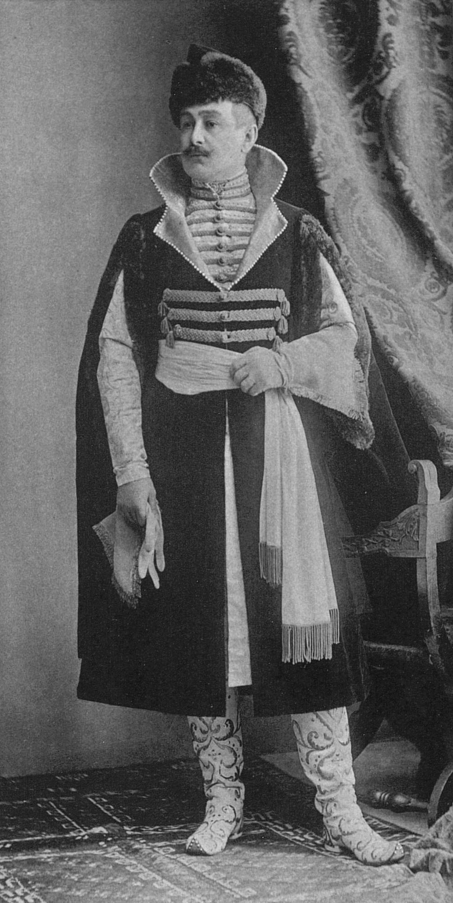

# Prince Sergei Vladimirovich Kudashev

| `1903-ball-sergei-kudashev.jpeg` | Prince Sergei Vladimirovich Kudashev at the costume ball in the Winter Palace, February 1903. Public domain.[10] | [Source](https://commons.wikimedia.org/wiki/File:1903_ball_-_Serg.Vl._Kudashev.jpeg) |

**Prince Sergei Vladimirovich Kudashev** (Russian: Князь Сергей Владимирович Кудашев; 14 December [O.S. 14 September] 1863 – 27/28 February 1933) was a Russian nobleman, Imperial courtier, corporate financier, and art collector. Serving at the court of Emperor Nicholas II as a *Kammerherr* (Chamberlain) and Active State Councillor, he also sat on the boards of major late-Imperial financial and industrial enterprises and assembled a noted gallery of 17th-century Dutch and Flemish Old Masters prior to fleeing the 1917 Russian Revolution into European exile.[1][2] Settling in Florence, he secured formal Italian recognition of his princely title in 1926–1927 via a Royal Decree signed by King Victor Emmanuel III and Prime Minister Benito Mussolini, resulting in his inscription in the *Libro d'Oro della Nobiltà Italiana*.[15]

| **Prince Sergei Vladimirovich Kudashev** | |
| :--- | :--- |
| **Native name** | Князь Сергей Владимирович Кудашев |
| **Born** | 14 December (O.S. 14 September) 1863 Kiev, Kiev Governorate, Russian Empire |
| **Died** | 27/28 February 1933 (aged 69) Florence, Kingdom of Italy |
| **Resting place** | Cimitero Evangelico agli Allori, Florence (Plot Q. III.017) |
| **Nationality** | Russian |
| **Occupations** | Imperial courtier, state official, corporate director, art collector |
| **Titles & ranks** | Prince (Russian Empire; recognized in Italy, 1926–1927) *Kammerjunker* (1899) *Kammerherr* (1908) Active State Councillor |
| **Spouses** | Countess Vera Maximilianovna von Nieroth (m. 1894; d. 1920) [Olga Erikovna von Pistohlkors](https://theo-armour.github.io/genealogy/#Wiki/Olga-Ericovna-von-Pistohlkors-1888-1963/README-Olga-Ericovna-von-Pistohlkors-1888-1963.md) (m. 1922; d. 1963) |
| **Children** | Princess Maria (Myra) Sergeyevna (1896–1990) Prince Sergei Sergeyevich (1901–1991) [Olga Sergeyevna](https://theo-armour.github.io/genealogy/#Wiki/Olga-Sergeyevna-Kudasheva-Pela-1926-unknown/README-Olga-Sergeyevna-Kudasheva-Pela-1926-unknown.md) (b. 1926) |
| **Father** | Prince Vladimir Sergeyevich Kudashev (1833–1871) |
| **Mother** | [Princess Olga Nikolaevna Horvath](https://theo-armour.github.io/genealogy/#Wiki/Olga-Nikolaevna-Kudasheva-1840-1907/README-Olga-Nikolaevna-Kudasheva-1840-1907.md) (1840–1907) |
| **House** | Kudashev |

🌳 [See in the family tree](https://theo-armour.github.io/gedcom-viewer/#wiki=Sergei-Vladimirovich-Kudashev-1863-1933)

## Family background and early life

Sergei Vladimirovich Kudashev was born in Kiev on 14 December (14 September Old Style) 1863 into the Kudashev family, a Russian princely dynasty of Tatar origin whose noble title had been recognized in Russia since the 17th century.[1][3] His great-grandfather, Prince Daniil Ivanovich Kudashev, bought the estate of Veselyi Kut in Chigirin Uyezd of Kiev Governorate (modern-day Cherkasy Oblast, Ukraine) in 1804.[4][5] It passed to the family of Daniil's son-in-law, General Belsky, and was sold in 1855, eight years before Sergei was born.[4] His grandfather, [Prince Sergei Danilovich Kudashev](https://theo-armour.github.io/genealogy/#Wiki/Sergei-Danilovich-Kudashev-1795-1862/README-Sergei-Danilovich-Kudashev-1795-1862.md) (1795–1862), was Vice-Governor of Kiev and marshal of the nobility of Kherson Governorate.[16] His great-uncle, Major General [Prince Nikolai Danilovich Kudashev](https://theo-armour.github.io/genealogy/#Wiki/Nikolay-Danilovich-Kudashev-1784-1813/README-Nikolay-Danilovich-Kudashev-1784-1813.md) (1784–1813), married a daughter of Field Marshal Mikhail Kutuzov and commanded a partisan detachment during the Patriotic War of 1812.[3]

His parents were [Prince Vladimir Sergeyevich Kudashev](https://theo-armour.github.io/genealogy/#Wiki/Vladimir-Sergeyevich-Kudashev-1833-1871/README-Vladimir-Sergeyevich-Kudashev-1833-1871.md) (1833–1871), a lieutenant and zemstvo deputy, and Olga Nikolaevna, born Horvat (1840–1907).[1][16] A Russian genealogy forum lists four siblings: Matilda (born 1857), Maria (born 1869), Vsevolod (born 1870) and Vladimir (died 1957).[17] His father died in Kiev in 1871, when Sergei was seven or eight. Earlier versions of this page said that Sergei then inherited a "cabinet" of paintings, rare books and coins.[6] *(Unsound: no source for a collection belonging to his father has been found, and the 1902 catalogue cited for it has not been checked.)* His paternal uncle, Moscow banking administrator and historian Prince Sergei Sergeyevich Kudashev (1834–1915), remained the senior male member of that family line during Sergei Vladimirovich's youth.[3][7]

Several of his first cousins had notable careers. [Prince Nikolai Alexandrovich Kudashev](https://theo-armour.github.io/genealogy/#Wiki/Nikolai-Alexandrovich-Kudashev-1868-1925/README-Nikolai-Alexandrovich-Kudashev-1868-1925.md) (1868–1925) was the last imperial Russian envoy to China, and his brother Prince Ivan Alexandrovich Kudashev was envoy to Denmark and Belgium and ambassador to Spain. [Prince Alexander Sergeyevich Kudashev](https://theo-armour.github.io/genealogy/#Wiki/Alexander-Sergeyevich-Kudashev-1872-1917/README-Alexander-Sergeyevich-Kudashev-1872-1917.md) (1872–1917?) built and flew the first Russian aeroplane in 1910. The philosopher [Nikolai Berdyaev](https://en.wikipedia.org/wiki/Nikolai_Berdyaev) (1874–1948) was the son of his aunt Alexandra.[16][18]

## Imperial court service and corporate career

Entering state service in St. Petersburg during the reign of Emperor Nicholas II, Kudashev worked in the Main Directorate of Appanages (*Главное управление уделов*), the Imperial ministry responsible for administering the private estates, agricultural properties, and revenues of the Romanov family.[1] At the Imperial Court, he was appointed *Kammerjunker* (Gentleman of the Bedchamber) in 1899 and promoted to *Kammerherr* (Chamberlain) in 1908, holding the civil rank of Active State Councillor.[1][8]

In 1894, Kudashev married Countess Vera Maximilianovna von Nieroth (1874–1920), a former Maid of Honor (*freilina*) to Empress Alexandra Feodorovna and daughter of Imperial Master of the Hunt Count Maximilian von Nieroth and Anastasia Fyodorovna Trepova.[1][9] In February 1903, the couple participated in the Winter Palace Costume Ball celebrating the 290th anniversary of the Romanov dynasty, where they were photographed in 17th-century Muscovite boyar attire.[10]

By the early 20th century, Kudashev also became active in St. Petersburg finance and industry. Residing at Mokhovaya Ulitsa, 6 in 1902 and later at Bol'shaya Morskaya Ulitsa, 57 (recorded in court and city directories from 1915 to 1917), he served on the boards of directors of several major enterprises:[2][6][8][11]

* Russian Trade and Industrial Bank (*Русский торгово-промышленный банк*)
* Insurance Company "Salamandra" (*Страховое товарищество «Саламандра»*)
* Trade and Industrial Company "Alfa-Nobel" (*Торгово-промышленное товарищество «Альфа-Нобель»*)
* Podolia Railway Company (*Общество Подольской железной дороги*)

These four are only part of the picture. A search of Russian newspapers for 1892–1917 by Ksenya Kiebuzinski of the University of Toronto, reported by the provenance researcher Erik Van der Graaf in July 2026, found him involved in more than 15 businesses: banks, insurance companies, railways, manufacturing and mining companies, mainly as a board member.[19] The full list has not yet been published here. The same research found that he owned an estate, possibly a family one, in the Volokolamsk area, about 130 kilometres north-west of Moscow.[19]

## Art collection

Building upon the collection left by his father, Kudashev assembled a private gallery specializing in 17th-century Dutch and Flemish Old Masters, alongside early printed books and historical medals.[6][12] Works in his collection included paintings attributed to Pieter Brueghel the Younger (*The Peasant Wedding*), Jan van Goyen (*A Sandy Road with Thatched Cottage*), Cornelis van Poelenburgh, Jan van Noordt, and Theodoor van Thulden.[6][12]

Kudashev invited European and Russian art historians—including Dutch scholar Cornelis Hofstede de Groot and Russian critic Alexandre Benois—to study and verify attributions within his gallery.[6] In 1902, he privately published an illustrated folio catalogue in St. Petersburg bound with his gilt princely coat of arms, titled *Vingt-cinq tableaux de la collection du prince Serge Wladimirowich Koudacheff à St. Pétersbourg (Mokhowaja 6)*.[6]

The Berlin museum director and art historian [Wilhelm von Bode](https://en.wikipedia.org/wiki/Wilhelm_von_Bode) helped him prepare the 1902 catalogue. Letters from Kudashev to Bode, written between October 1904 and January 1905 and held in Berlin, give his reasons for selling the collection. He wrote them from Villa Granduchessa in Florence, where he was staying because of his son's poor health.[19] The letters have not yet been transcribed here.

During the political and financial upheaval of the 1905 Russian Revolution and the Russo-Japanese War, Kudashev elected to sell his painting collection abroad.[12] On 27 June 1905, the gallery was auctioned in Amsterdam by Frederik Muller & Cie under the pseudonym "Prince Tatarsky" (*Catalogue des tableaux anciens formant la collection du Prince Tatarsky à St. Pétersbourg*).[12] Several paintings entered major European collections—including acquisitions by Swedish collector Wilhelmina von Hallwyl now preserved in the Hallwyl Museum in Stockholm—while converting Kudashev's holdings into liquid capital twelve years before the 1917 Bolshevik nationalizations.[12]

## Revolution, exile, and Italian royal recognition

Following the 1917 Russian Revolution and the October Bolshevik seizure of power, Kudashev's Imperial court titles and banking directorships placed him and his family at acute risk.[1] Private banks were nationalized in December 1917, and noble estates across Russia and Ukraine were expropriated.

With the assistance of Norman Armour—then Second Secretary at the American Embassy in Petrograd, who procured false identity papers for the family and was briefly imprisoned by Bolshevik authorities for his role in their escape—Prince Sergei, Princess Vera, and their two children, Princess Maria (Myra) (1896–1990) and Prince Sergei (1901–1991), crossed the Finnish border in winter and traveled to neutral Sweden.[1][13] In Sweden, the family resided at Villa Skärtofta in Saltsjöbaden, outside Stockholm, which became a gathering place for displaced Russian aristocrats and diplomats.[13] In February 1919, Princess Maria married Norman Armour in Brussels.[13]

Following Princess Vera's death in Paris in January 1920, Kudashev relocated to Florence, Italy, which hosted an established Russian émigré community centered around the Russian Orthodox Church of the Nativity of Christ and St. Nicholas.[1][14] Supported in part by capital preserved from his 1905 art sale, he resided at Villa Granduchessa.[1] In Florence, he established a second household with [Olga Erikovna von Pistohlkors](https://theo-armour.github.io/genealogy/#Wiki/Olga-Ericovna-von-Pistohlkors-1888-1963/README-Olga-Ericovna-von-Pistohlkors-1888-1963.md) (1888–1963), a daughter of [Princess Paley](https://theo-armour.github.io/genealogy/#Wiki/Olga-Valerianovna-Paley-1865-1929/README-Olga-Valerianovna-Paley-1865-1929.md), with whom he had a daughter, Olga Sergeyevna Kudasheva (born 1926; later Olga Pelà).[1]

### Recognition of princely title in Italy (1926–1927)

Living as a stateless émigré in Italy without legal recognition of his Imperial Russian noble status, Kudashev sought official confirmation of his princely title under Italian heraldic law, which at the time lacked a statutory mechanism to recognize titles of foreign origin.[15] In 1926, he mobilized an influential diplomatic and aristocratic network to lobby for a legislative amendment, including Spanish Ambassador to Italy Cipriano Muñoz y Manzano, Count of Viñaza (who had previously served in St. Petersburg alongside Kudashev's cousin, Russian Ambassador Prince Ivan Alexandrovich Kudashev), Italian parliamentarian Count Girolamo Marcello, Duke Agostino de Vargas Machuca (President of Italy's High Council of Nobility, the *Consulta Araldica*), and Prince Ludovico Chigi Albani della Rovere, Grand Master of the Sovereign Military Order of Malta.[15]

On 4 August 1926, the Count of Viñaza informed Kudashev that the legal obstacles had been overcome and that Prime Minister Benito Mussolini had confirmed the necessary legislative amendment.[15] Following the **Royal Decree of 3 September 1926** (accompanied by supporting documentation dated 6 February 1917), Kudashev received an official patent signed by **King Victor Emmanuel III** and **Benito Mussolini** recognizing and confirming his princely title in the Kingdom of Italy, entering him and his family into the Golden Book of the Italian Nobility (*Libro d'Oro della Nobiltà Italiana*), and authorizing the use of the princely Kudashev coat of arms.[15] Under the terms of the patent, the title was transmissible within Italy exclusively to legitimate and natural male-line descendants.[15]

Prince Sergei Vladimirovich Kudashev died in Florence on 27 or 28 February 1933, aged 69, and was buried in Florence's non-Catholic Cimitero Evangelico agli Allori (Plot Q. III.017).[1][14]

## Residences

* **Kiev.** He was born there in 1863, and his father died there in 1871.[1][17] No address is known. His grandfather's house was in Lipki, the aristocratic quarter.[16]
* **Mokhovaya Street 6, St. Petersburg (1902).** The address is given on the title page of his catalogue.[6]
* **Bolshaya Morskaya Street 57, St. Petersburg (by 1912 to 1917).** The newspaper *День* of 6 October 1912 reports "chamberlain Prince S. V. Kudashev of Morskaya st." returning from abroad, and the *Весь Петроград* directory lists him at Morskaya 57, telephone 53038.[2][20] The building still stands. Theo Armour visited it with his daughter in 2008.[20]
* **Villa Granduchessa, Florence.** He was staying there in 1904–1905, and lived in Florence again from 1920 until his death in 1933.[1][19]
* **Volokolamsk area, Moscow Governorate.** He owned an estate there.[19]
* **Stockholm and Saltsjöbaden, Sweden (1917–1918).** The family stayed first at the Grand Hôtel in Stockholm and then at Villa Skärtofta in Saltsjöbaden.[13][20]

## Discrepancies and unverified claims

* **Birth date.** This page gives "14 December (O.S. 14 September) 1863". The two dates are three months apart, so one is not a conversion of the other. In 1863 the calendars differed by 12 days. Rodovid gives 14 September 1863; Geni gives 14 December.
* **A collection inherited from his father.** No source has been found (see "Family background and early life").
* **Veselyi Kut.** Earlier versions of this page called it the family's "ancestral landed seat". Pokhilevich shows that it was sold in 1855.[4]
* **Date of the escape from Russia.** This page places it after the October Revolution. The profile page in this folder, drawing on Erik Van der Graaf's research, places it soon after the February Revolution, with the family reaching Sweden in the spring of 1917.[20]
* **Maria's birth year.** 1896 here; 1895 in some other pages of this wiki.
* **The Hermitage and the Impressionists.** A family tradition holds that he was involved in acquiring Impressionist paintings for the Hermitage.[20] No evidence for this has been found.
* **Visits by Hofstede de Groot and Benois.** These are cited only to the 1902 catalogue, which has not been checked.[6]
* **References 1, 2, 8, 11 and 14.** These come from the earlier version of this page and have not been checked against the publications.

## Historiographical note

Secondary summaries occasionally attribute the 1912 historical study *История императора Александра Павловича* (*History of Emperor Alexander Pavlovich*, Moscow: A. I. Mamontov, 1912) to Prince Sergei Vladimirovich Kudashev. Bibliographic records of the Russian State Library and the Boris Yeltsin Presidential Library confirm that the author ("кн. С. С. Кудашев") was his paternal uncle, Moscow banking official Prince Sergei Sergeyevich Kudashev (1834–1915).[3][7]

## References

1. Volkova, N., ed. (2015). *Придворный календарь на 1915 год. Комментарии* [Imperial Court Calendar for 1915: Commentary]. Entry: "Кудашев Сергей Владимирович".
2. *Весь Петроград на 1917 год* [All Petrograd for 1917] (24th ed.). Petrograd. 1916. Col. 359, pp. 1413, 1427.
3. "Кудашевы" [Kudashev family]. *Brockhaus and Efron Encyclopedic Dictionary*. St. Petersburg. 1890–1907.
4. Pokhilevich, Lavrenty (1864). *Сказания о населенных местностях Киевской губернии* [Tales of Populated Localities of Kiev Governorate]. Kiev: Kiev Pechersk Lavra Press. Entry: "Веселый Кут".
5. *Heraldica: Исторический сборник* [Heraldica: Historical Collection]. Vol. 1. St. Petersburg. 1900.
6. *Vingt-cinq tableaux de la collection du prince Serge Wladimirowich Koudacheff à St. Pétersbourg (Mokhowaja 6)*. St. Petersburg: A. I. Vil'borg. 1902.
7. Kudashev, S. S. (1912). *История императора Александра Павловича* [History of Emperor Alexander Pavlovich]. Part 3. Moscow: A. I. Mamontov Printing House.
8. Bokhanov, A. N. (1994). *Деловая элита России 1914 г.* [Business Elite of Russia, 1914]. Moscow: Institute of Russian History, Russian Academy of Sciences.
9. *Список фрейлин российского императорского двора* [List of Maids of Honor of the Russian Imperial Court]. St. Petersburg.
10. *Альбом костюмированного бала в Зимнем дворце в феврале 1903 г.* [Album of the Costume Ball at the Winter Palace in February 1903]. St. Petersburg: Expedition for the Preparation of State Papers. 1904.
11. Mykhailovskyi, V. (2017). "Подільська залізниця – грандіозний проект початку ХХ століття" [The Podolia Railway: A Grandiose Project of the Early 20th Century]. *Хмельниччина: історія та сучасність*. Khmelnytskyi. p. 66.
12. *Catalogue des tableaux anciens formant la collection du Prince Tatarsky à St. Pétersbourg*. Amsterdam: Frederik Muller & Cie. 27 June 1905.
13. Armour, Norman. Biographical and diplomatic papers; contemporary press reports on the February 1919 Brussels wedding of Norman Armour and Princess Maria Kudasheva.
14. *Русско-итальянский архив* [Russian-Italian Archive]. Vol. 8 (Florentine Necrology). Salerno. 2010.
15. Koudacheff Family Archive. Letter from Cipriano Muñoz y Manzano, Count of Viñaza, to Prince Sergei Vladimirovich Kudashev (4 August 1926); Italian Royal Patent confirming the princely title and coat of arms under Royal Decree of 3 September 1926, signed by King Victor Emmanuel III and Benito Mussolini (1926–1927).
16. "Prince Sergei Danilovich Kudashev" and "Prince Vladimir Sergeyevich Kudashev". Theo Armour Genealogy. <https://theo-armour.github.io/genealogy/#Wiki/Sergei-Danilovich-Kudashev-1795-1862/README-Sergei-Danilovich-Kudashev-1795-1862.md>; <https://theo-armour.github.io/genealogy/#Wiki/Vladimir-Sergeyevich-Kudashev-1833-1871/README-Vladimir-Sergeyevich-Kudashev-1833-1871.md>
17. "Кудашев Владимир Сергеевич 22.03.1833". *КУДАШЕВ: Персональный список*. Всероссийское генеалогическое древо (VGD) forum. <https://baza.vgd.ru/1/17728>
18. "Prince Nikolai Alexandrovich Kudashev" and "Prince Alexander Sergeyevich Kudashev". Theo Armour Genealogy. <https://theo-armour.github.io/genealogy/#Wiki/Nikolai-Alexandrovich-Kudashev-1868-1925/README-Nikolai-Alexandrovich-Kudashev-1868-1925.md>; <https://theo-armour.github.io/genealogy/#Wiki/Alexander-Sergeyevich-Kudashev-1872-1917/README-Alexander-Sergeyevich-Kudashev-1872-1917.md>. Ivan Alexandrovich's postings are from the profile page [20].
19. Van der Graaf, Erik. Research notes to Theo Armour, 8 and 16 July 2026, reporting newspaper research by Ksenya Kiebuzinski (University of Toronto) and the Kudashev–Bode correspondence in Berlin. Theo Armour Genealogy. <https://theo-armour.github.io/genealogy/#Wiki/Sergei-Vladimirovich-Kudashev-1863-1933/additional-notes-not-in-README.md>
20. "Sergei Vladimirovich Kudashev (1863–1933)" (profile page, with Theo Armour's notes and extracts from Russian newspapers and directories, 1878–1917). Theo Armour Genealogy. <https://theo-armour.github.io/genealogy/#Wiki/Sergei-Vladimirovich-Kudashev-1863-1933/additional-notes-not-in-README.md>
