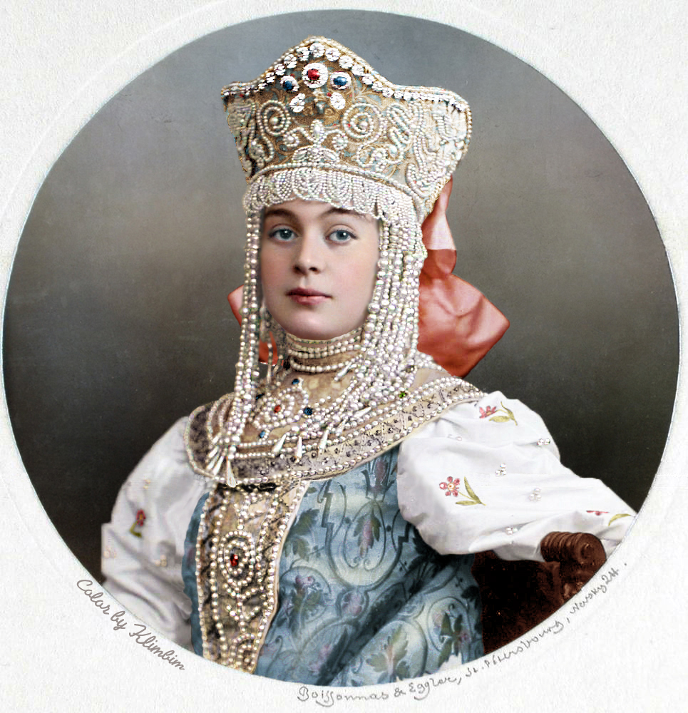
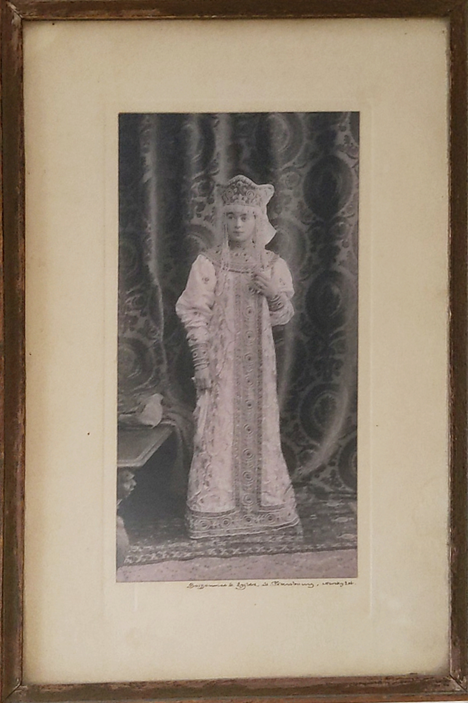
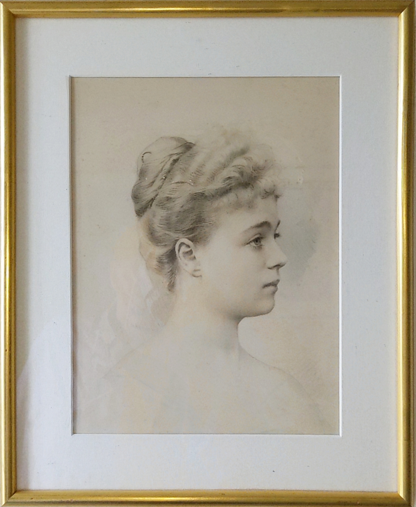

# Additional Notes Not in README — Princess Vera Maximilianovna Kudasheva

Extracted on 2026-11-21 from `Vera-Maximilianovna-Kudasheva-von-Nieroth-1874-1920.md` by comparison against `README-Vera-Maximilianovna-Kudasheva-von-Nieroth-1874-1920.md`.

## Alternate Names, Spellings & Locations

* **Russian (with title and verification note):** `Вера Максимилиановна Кудашева (урождённая графиня фон Нирод) ~ verify` (includes `графиня`, omitted from the README's `Вера Максимилиановна Кудашева, урождённая фон Нирод`).
* **Modern transliteration (`ks` spelling):** `Vera Maksimilianovna Kudasheva (née Countess von Nieroth)` / `Princess Vera Maksimilianovna Kudasheva (born von Nieroth)` (vs. `Maximilianovna` in README).
* **Misspelling note:** `Also seen as: von Neiroth ~ misspelling in the evereverland image file names`
* **Husband's name as recorded in Genealogy:** `Prince Sergei Vladimirovich "Serge Vladimirovich Koudachev" Kudashev (born Koudacheff)`

## Additional Links & Images

### Local Portrait Images

### External Links

* [Geni — Princess Vera Kudasheva](https://www.geni.com/people/Princess-Vera-Kudasheva/6000000019323779328)
* [Evereverland portrait (court dress) — `1900~-unknown-vera-von-neiroth-in-court-dress.jpg`](https://evereverland.github.io/2019/everlandings/theo-armour/armour-fine-art/1900~-unknown-vera-von-neiroth-in-court-dress.jpg)
* [Evereverland portrait — `1900~-unknown-vera-von-neiroth.jpg`](https://evereverland.github.io/2019/everlandings/theo-armour/armour-fine-art/1900~-unknown-vera-von-neiroth.jpg)
* [kudashev.com — Portrait of Moltedo by Ingres](https://www.kudashev.com/2007/10/portrait-of-moltedo-by-ingres.html)

## Research Notes, Drafts & Correspondence

* `Russian: Вера Максимилиановна Кудашева (урождённая графиня фон Нирод) ~ verify`
