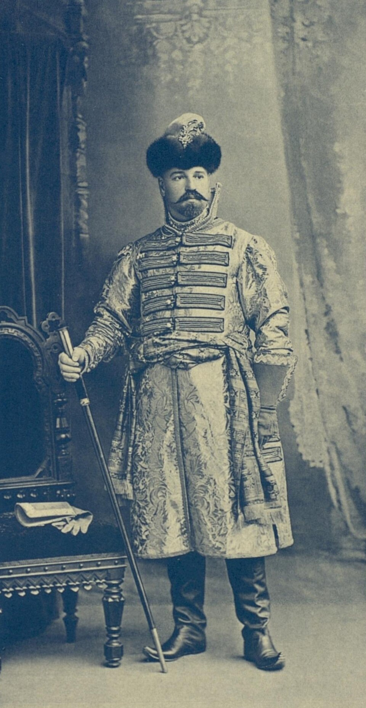

# Vladimir Fyodorovich Trepov

| `1903-ball-vladimir-trepov.jpg` | Vladimir Fyodorovich Trepov in seventeenth-century boyar dress at the costume ball in the Winter Palace, February 1903. Public domain.[3] | [Source](https://commons.wikimedia.org/wiki/File:1903_ball_-_Vl._F._Trepov.jpg) |

**Vladimir Fyodorovich Trepov** (Russian: Владимир Фёдорович Трепов; 6 [18] January 1863 – August or September 1918) was a Russian official and politician. He was Governor of Taurida (the Crimea and the adjoining mainland) from 1902 to 1905, a senator, and from 1908 a member of the State Council, where he led the far right. In 1911 he and Pyotr Durnovo organised the defeat of Prime Minister [Pyotr Stolypin](https://en.wikipedia.org/wiki/Pyotr_Stolypin)'s western zemstvo bill, which set off a constitutional crisis and ended Trepov's own career. He was shot by the Bolsheviks at Kronstadt in 1918.[1] He was the youngest son of [General Fyodor Fyodorovich Trepov (senior)](https://theo-armour.github.io/genealogy/#Wiki/Fyodor-Fyodorovich-Trepov-1812-1889/biography_of_general_fyodor_fyodorovich_trepov_1812_1889.md) and a brother of Theo Armour's great-great-grandmother Anastasia.[2]

| **Vladimir Fyodorovich Trepov** | |
| :--- | :--- |
| **Native name** | Владимир Фёдорович Трепов |
| **Born** | 6 (18) January 1863 |
| **Died** | August or September 1918 (aged 55) Kronstadt, Russia |
| **Education** | Imperial Alexander Lyceum (1881) |
| **Offices** | Governor of Taurida (1902–1905) Senator (1905–1908) Member of the State Council (1908–1911) |
| **Ranks** | Privy Councillor; *Stallmeister* (master of the horse) of the court |
| **Spouse** | Yevgenia Alexeyevna Siritsa (1858–1904) |
| **Children** | Fyodor (1883–1915), Boris (1885–1964) |

## Career

Trepov graduated from the Imperial Alexander Lyceum in 1881 and entered the Ministry of the Interior.[1]

From 1902 to 1905 he was Governor of Taurida. Prince V. A. Obolensky, a liberal member of the local zemstvo, remembered him as a man "известен своими правыми взглядами" (known for his right-wing views).[1] He was a senator from 1905 to 1908 and was then appointed to the State Council, where he led the group of the far right.[1]

## The western zemstvo crisis, 1911

In early 1911 Trepov and Pyotr Durnovo led the opposition in the State Council to Stolypin's bill to introduce zemstvos (elected local councils) in the western governorates. The Council rejected the bill. Nicholas II then suspended both legislative chambers for several days and enacted the bill by decree. Trepov and Durnovo were ordered to declare themselves ill and to stay away from the Council until 1912. Trepov chose to resign instead, on 29 April 1911.[1]

## Death

In 1918 he took part in an underground organisation in Petrograd. In August or September of that year he was "расстрелян большевиками в Кронштадте" (shot by the Bolsheviks at Kronstadt).[1]

## Family

He married **Yevgenia Alexeyevna Siritsa** (1858 – 21 April 1904). She died at Yalta of a haemorrhage of the lungs. After a funeral in the Alexander Nevsky Cathedral there, she was buried at the Vydubychi Monastery in Kiev, where his father also lay.[1] They had two sons:[1]

* **Fyodor Vladimirovich** (1883–1915), colonel of the Life Guards Horse Artillery, a knight of St. George.
* **Boris Vladimirovich** (1885–1964), colonel of the Life Guards Horse Artillery, a knight of St. George.

## Residences

* **St. Petersburg (Petrograd).** He was schooled there, served there as senator and member of the State Council, and was living there in 1918.[1]
* **Simferopol**, the capital of Taurida Governorate, 1902–1905. His wife died at Yalta in 1904.[1]

## Discrepancies and unverified claims

* **Birthplace.** Not given by Russian Wikipedia.[1]
* **Birth date.** Russian Wikipedia gives 6 (18) January 1863 for Vladimir and 18 (30) September 1862 for his brother Alexander. The two dates are less than four months apart, and Vera Vasilyevna Lukashevich is recorded as the mother of both. One of the dates must be wrong.[1][2]
* **Boris's birth year.** 1885 in the article on Vladimir and in the family tree; 1876 in the text of the article on the family.[1][2]
* **Date of death.** Only "August or September 1918" is known.[1]

## References

1. "Трепов, Владимир Фёдорович". *Wikipedia* (Russian). Cites Оболенский, В. А., *Моя жизнь. Мои современники* (Paris: YMCA-Press, 1988), and the registers of the Alexander Nevsky Cathedral, Yalta (State Archive of the Republic of Crimea, F. 1420, op. 1, d. 606, p. 83). <https://ru.wikipedia.org/wiki/Трепов,_Владимир_Фёдорович>
2. "Треповы" and "Трепов, Александр Фёдорович". *Wikipedia* (Russian). <https://ru.wikipedia.org/wiki/Треповы>
3. "File:1903 ball - Vl. F. Trepov.jpg". *Wikimedia Commons*. Public domain. <https://commons.wikimedia.org/wiki/File:1903_ball_-_Vl._F._Trepov.jpg>

## Further reading

* "Pyotr Stolypin". *Wikipedia*. On the western zemstvo crisis of 1911. <https://en.wikipedia.org/wiki/Pyotr_Stolypin>
* Оболенский, В. А. *Моя жизнь. Мои современники*. Paris: YMCA-Press, 1988.
