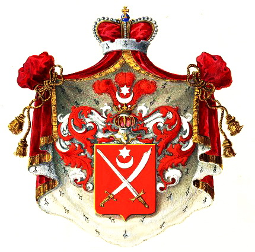
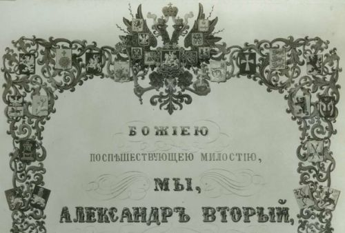

# Prince Vladimir Sergeyevich Kudashev

| `kudashev-coat-of-arms-1904.jpg` | Coat of arms of the Princes Kudashev, from the *Общий гербовник* (General Armorial), part 17, 1904. Public domain.[12] | [Source](https://commons.wikimedia.org/wiki/File:Kudashev_17-6.jpg) |

*No portrait or photograph of Prince Vladimir Sergeyevich has been found.*

**Prince Vladimir Sergeyevich Kudashev** (Russian: Князь Владимир Сергеевич Кудашев; French: *Wladimir Serguéiévitch Koudachev*; 22 or 23 March 1833 – 2 October 1871) was a Russian nobleman of the [Kudashev](https://ru.wikipedia.org/wiki/Кудашевы) princely family. He held the military rank of [*poruchik*](https://en.wikipedia.org/wiki/Poruchik) (lieutenant) and in 1866 sat as a landowners' deputy in the [zemstvo](https://en.wikipedia.org/wiki/Zemstvo) assembly of [Yelisavetgrad Uyezd](https://en.wikipedia.org/wiki/Yelisavetgradsky_Uyezd), [Kherson Governorate](https://en.wikipedia.org/wiki/Kherson_Governorate).[1][2] He was the father of the St. Petersburg art collector Prince [Sergei Vladimirovich Kudashev](https://theo-armour.github.io/genealogy/#Wiki/Sergei-Vladimirovich-Kudashev-1863-1933/0-Sergei-Vladimirovich-Kudashev-1863-1933.md) (1863–1933) and an uncle of the philosopher [Nikolai Berdyaev](https://en.wikipedia.org/wiki/Nikolai_Berdyaev).[1][3][4]

| **Prince Vladimir Sergeyevich Kudashev** | |
| :--- | :--- |
| **Native name** | Князь Владимир Сергеевич Кудашев |
| **Born** | 22 March 1833 (other sources: 23 March) [Kiev](https://en.wikipedia.org/wiki/Kyiv), Russian Empire |
| **Died** | 2 October 1871 (aged 38) Kiev, Russian Empire |
| **Rank** | *Poruchik* (lieutenant) |
| **Spouse** | Olga Nikolaevna Horvat (Хорват) (1840–1907) |
| **Children** | Matilda (b. 1857) Sergei (1863–1933) Maria (b. 1869) Vsevolod (b. 1870) Vladimir (d. 1957) |
| **Father** | Prince [Sergei Danilovich Kudashev](https://theo-armour.github.io/genealogy/#Wiki/Sergei-Danilovich-Kudashev-1795-1862/README-Sergei-Danilovich-Kudashev-1795-1862.md) (1795–1862) |
| **Mother** | Countess Mathilde de Choiseul-Gouffier |
| **House** | Kudashev |

## Early life and family

Vladimir Sergeyevich Kudashev was born in Kiev in March 1833. Russian genealogical compilations give the date as 22 March;[1][5] the family-tree database Geneanet, as carried into Ancestry exports, gives 23 March.[6] The sources do not say whether the date is Old Style ([Julian](https://en.wikipedia.org/wiki/Old_Style_and_New_Style_dates)) or New Style; Old Style was the civil calendar of the Russian Empire at the time.

He was the son of Prince Sergei Danilovich Kudashev (1795–1862), a *Kammerherr* (chamberlain) and State Councillor, and his wife Mathilde, born Countess de Choiseul-Gouffier, who appears in Russian records as Matilda Oktavyevna.[5][7] The 1892 list of titled families published by the Department of Heraldry of the Governing Senate names Sergei Danilovich, his wife Matilda and their children, including Vladimir and Sergei, among the Kudashevs whose princely title was confirmed.[7]

A patent of nobility issued under Emperor [Alexander II](https://en.wikipedia.org/wiki/Alexander_II_of_Russia) confirmed Sergei Danilovich's princely status. It traced his descent from Murza Chepai Kudashev and named each of his ten children, Vladimir among them. The family history site that published a scan of the patent dates it to 1864, two years after Sergei Danilovich's death; that date has not been checked against the document itself. The scan was passed down through Vladimir's son Vladimir Vladimirovich, and the whereabouts of the original are unknown.[13]

| `1864-kudashev-patent-of-nobility.jpg` | Heading of the patent of nobility confirming Prince Sergei Danilovich Kudashev and his children, Vladimir among them: "Божиею поспешествующею милостию, Мы, Александр Вторый…" (By the grace of God, We, Alexander the Second…). Dated 1864 by the publishing site. The image shows only the top of the document.[13] | [Source](https://koudachev.wordpress.com/2010/08/05/nobility-patent-prince-sergei-danilovitch-kudashev/) |

A local-history article by A. Reznik says that Sergei Danilovich was marshal of the nobility of Kherson Governorate in 1844–1847 and is buried at the [Kiev-Pechersk Lavra](https://en.wikipedia.org/wiki/Kyiv_Pechersk_Lavra).[17] *(Unsound: the article cites no sources for either claim.)* If the marshalship is correct, it would explain the family's land in Kherson Governorate, where Vladimir later sat in the zemstvo.

His siblings included Prince Sergei Sergeyevich Kudashev (1834–1915) and Princess Alexandra Sergeyevna Kudasheva (1838–1912), who married Alexander Mikhailovich Berdyaev. Their son was the religious philosopher Nikolai Berdyaev (1874–1948), who was therefore Vladimir's nephew.[4][8]

## Career

Little is known of his career. The *Address-Calendar of Kherson Governorate for 1866* lists "Кудашев Владимир Сергеевич, князь, поручик" (Kudashev, Vladimir Sergeyevich, prince, lieutenant) among the deputies (*glasnye*) elected by the landowners to the Yelisavetgrad Uyezd zemstvo assembly.[2] The zemstvos, the new elected local councils created by the [1864 reform](https://en.wikipedia.org/wiki/Zemstvo), held their first assemblies in 1865–1866, so he sat in one of the first of them. A seat in the landowners' class means he owned land in Yelisavetgrad Uyezd; the sources do not say which estate.

The rank of *poruchik* indicates earlier military service. His regiment and years of service have not been found.

The town of [Mala Vyska](https://en.wikipedia.org/wiki/Mala_Vyska), in the same uyezd, was formerly called Kudasheva (Kudashevo). Russian Wikipedia says it was named by a Prince Kudashev who received land there from Catherine II, and that the estate was sold to a nobleman named Ulashin in the mid-19th century.[9] That account cites no source and gives no first names, so it is not known whether this was Vladimir's land.

## Marriage and children

Kudashev married Olga Nikolaevna Horvat (Ольга Николаевна Хорват), born in Kiev in 1840 (15 April, according to Geneanet). She outlived him by 36 years and died at [Yalta](https://en.wikipedia.org/wiki/Yalta) on 25 October 1907.[1][6] Her father is given as Nikolai Antonovich Horvat (Николай Антонович Хорват, born 1797) in the family tree on the Russian Wikipedia article about her grandson Nikolai Vsevolodovich Kudashev.[16] *(Unsound: the tree cites no source, and no record naming her parents has been found.)* The surname Horvat is shared with the Serbian family of General Ivan Horvat, founder of [New Serbia](https://en.wikipedia.org/wiki/New_Serbia_(Russian_Empire)) in what became Yelisavetgrad Uyezd, but no link between that family and Olga Nikolaevna has been established.

The genealogical forum VGD lists five children:[1]

* **Matilda** (born 1857)
* **Sergei** (1863–1933), born in Kiev; later *Kammerherr*, Active State Councillor and collector of Dutch and Flemish paintings in St. Petersburg; died in emigration.[3][7]
* **Maria** (born 1869)
* **Vsevolod** (born 1870), whose son [Nikolai](https://ru.wikipedia.org/wiki/Кудашев,_Николай_Всеволодович) (1903–1978), born in [Kremenchuk](https://en.wikipedia.org/wiki/Kremenchuk), died in New York and is described as a poet.[1][10][16]
* **Vladimir** (died 22 February 1957)

A birth year of 1857 for Matilda would mean the marriage took place by about 1856, when Olga was about sixteen. That date has not been checked against a primary record.

## Residences

No street address for any of Vladimir's homes has been found.

* **Kiev, Lipki (1850s).** K. Shcherotsky's guidebook to Kiev lists "the houses of Prince Kudashev" among the mansions of [Lipki](https://en.wikipedia.org/wiki/Lypky), the city's aristocratic quarter, where lavish balls and receptions were given in the 1850s.[14] This was almost certainly the house of his father, Sergei Danilovich. Since Vladimir was born and died in Kiev, he probably grew up there, but no source says so, and the guidebook gives no street or house number. The memoirs of Count Mikhail Dmitrievich Buturlin (*Записки*, published in *Русский архив*, 1897–1901) are said to describe "the hospitable house of Prince Kudashev", married to Countess Mathilde de Choiseul-Gouffier. *(Unsound: the passage has not been found in the text, and it is not confirmed that it refers to Kiev.)*
* **Yelisavetgrad Uyezd, Kherson Governorate (1866).** His seat as a landowners' deputy in the zemstvo shows that he owned land in the district.[2] The estate is not named. Mala Vyska, formerly "Kudasheva", is a possible candidate (see [Career](#career)). *(Unsound: unconfirmed.)*
* **Not his: Bulvarno-Kudriavska 25 (now 27), Kiev.** Princess Sofia Kudasheva bought this house on 28 August 1872, almost a year after Vladimir's death. Prince Alexander Sergeyevich Kudashev (1830–1877), Vladimir's brother and Sofia's husband, mortgaged it on her behalf. Their son was the diplomat [Prince Nikolai Alexandrovich Kudashev](https://theo-armour.github.io/genealogy/#Wiki/Nikolai-Alexandrovich-Kudashev-1868-1925/README-Nikolai-Alexandrovich-Kudashev-1868-1925.md). He was a director of the Kiev Land Bank and the Kiev Private Commercial Bank, and died of tuberculosis on 5 September 1877. The house was sold in 1877 to Baron Rudolf Steinheil.[15]

Records that could settle the question: the Kiev city council's property files in the State Archive of Kyiv; the Kiev address calendars of the 1860s; the Kherson Governorate address calendars, which may name the Yelisavetgrad estate; and the 1871 Kiev parish death register, which would give his parish.

## Death

Prince Vladimir Sergeyevich Kudashev died in Kiev on 2 October 1871, aged 38.[1][5][6] His son Sergei was then seven years old. The cause of death and place of burial are not known.

## Discrepancies and unverified claims

* **Birth date.** 22 March 1833 (VGD, Rodovid) and 23 March 1833 (Geneanet). Neither source cites a parish register.
* **A second "Vladimir Sergeyevich".** RuWiki's Kudashev family table lists a Vladimir Sergeyevich Kudashev with the dates 1830–1877.[11] This may be an error or a different person.
* **Date of the patent of nobility.** The family blog dates the patent to 1864, but Sergei Danilovich died in 1862.[13] The patent may have been issued after his death, or the date may be wrong. The scan shown here does not include the date.
* **Olga's father.** Nikolai Antonovich Horvat (born 1797) comes from an unsourced family-tree template on Russian Wikipedia.[16]
* **Sergei Danilovich's offices and burial.** The burial at the Kiev-Pechersk Lavra comes from an article that cites no sources.[17] The Kherson marshalship (1844–1847) is confirmed by the Kherson Governorate yearbooks. It began straight after his term as Vice-Governor of Kiev (1 February 1838 – 6 July 1844), so the two offices do not overlap. See [his biography](https://theo-armour.github.io/genealogy/#Wiki/Sergei-Danilovich-Kudashev-1795-1862/README-Sergei-Danilovich-Kudashev-1795-1862.md).
* **A collection inherited by Sergei.** Earlier drafts of the family biographies say that Vladimir collected paintings, rare books and coins, and that eight-year-old Sergei inherited this "cabinet" in 1871. No source for this has been found. The 1902 catalogue of Sergei's collection cited for it has not been checked for any mention of his father.

## References

1. "Кудашев Владимир Сергеевич 22.03.1833". *КУДАШЕВ: Персональный список* [Kudashev: personal list]. Всероссийское генеалогическое древо (VGD) forum, post of 3 May 2005, edited 17 February 2007. <https://baza.vgd.ru/1/17728>
2. *Адрес-календарь Херсонской губернии на 1866 год* [Address-Calendar of Kherson Governorate for 1866]. "Гласные Елисаветградскаго уезднаго земскаго собрания" [Deputies of the Yelisavetgrad Uyezd zemstvo assembly], transcribed at *Родовое гнездо*. <https://rodovoyegnezdo.narod.ru/Kherson/Adres-kalendar_1866_zemelisavetgraduezd.htm>
3. "Sergei Vladimirovich Kudashev (1863–1933)". Theo Armour Genealogy. <https://theo-armour.github.io/genealogy/#Wiki/Sergei-Vladimirovich-Kudashev-1863-1933/0-Sergei-Vladimirovich-Kudashev-1863-1933.md>
4. "Nikolai Berdyaev". *Wikipedia*. <https://en.wikipedia.org/wiki/Nikolai_Berdyaev>
5. "Владимир Сергеевич Кудашев", "Сергей Данилович Кудашев р. 29 май 1795 ум. 18 март 1862" and "Ольга Николаевна Хорват (Кудашева)". *Родовод* (Rodovid). <https://ru.rodovid.org/wk/Запись:310268>; <https://ru.rodovid.org/wk/Запись:310283>
6. "Wladimir Serguéiévitch Koudachev" and "Olga Nikolaïevna Horvath". Geneanet, tree *ivehel*. <https://gw.geneanet.org/ivehel?n=koudachev&oc=&p=wladimir+sergueievitch>; <https://gw.geneanet.org/ivehel?n=horvath&oc=&p=olga+nikolaievna>. Also in the Ancestry GEDCOM export in this repository: [2025-08-23-carley-armour-family-tree.ged](https://theo-armour.github.io/genealogy/#Online-Genealogy/gedcom-files/2025-08-23-carley-armour-family-tree.ged).
7. *Список титулованным родам и лицам Российской империи* [List of titled families and persons of the Russian Empire]. St. Petersburg: Департамент герольдии Правительствующего Сената, 1892. pp. 283–284. Cited in "Кудашевы". *Wikipedia* (Russian). <https://ru.wikipedia.org/wiki/Кудашевы>
8. "Семья: Сергей Данилович Кудашев + Матильда Октавьевна". *Родовод* (Rodovid). <https://ru.rodovid.org/wk/Семья:74717>; and "Prince Sergey Sergeievich Kudashev (1834–1915)". *Geni*. <https://www.geni.com/people/Prince-Sergey-Kudashev/6000000015780292903>
9. "Малая Виска". *Wikipedia* (Russian). <https://ru.wikipedia.org/wiki/Малая_Виска>
10. "Николай Всеволодович Кудашев р. 29 апрель 1903 ум. сентябрь 1978". *Родовод* (Rodovid). <https://ru.rodovid.org/wk/Запись:816569>
11. "Кудашевы". *RuWiki*. <https://ru.ruwiki.ru/wiki/Кудашевы>
12. "File:Kudashev 17-6.jpg" (Coat of Arms of Kudashev family). *Wikimedia Commons*. From *Общий гербовник дворянских родов Всероссийской империи*, part 17, 1904, via <https://gerbovnik.ru/arms/2757>. Public domain. <https://commons.wikimedia.org/wiki/File:Kudashev_17-6.jpg>
13. "Patent of Nobility for Prince Sergei Danilovitch Kudashev [1795–1862]". *The Princes Kudachev (Koudacheff)* (family history blog), 5 August 2010. <https://koudachev.wordpress.com/2010/08/05/nobility-patent-prince-sergei-danilovitch-kudashev/>. See also "The Princes Kudachev (Koudacheff)", 9 February 2009, which names Vladimir Sergeevitch (1833–1871) and his wife "Olga, née Khorvat, born in 1840". <https://koudachev.wordpress.com/2009/02/09/the-princes-kudachev-koudacheff/>
14. "До історії київської садиби ХІХ-ХХ століть: вулиця Липська №16" [On the history of a Kiev estate of the 19th–20th centuries: Lypska Street No. 16]. *Код Києва* (kiev-code.com.ua). Quotes K. Shcherotsky's guidebook to Kiev (its note 8). <https://www.kiev-code.com.ua/site/page.php?lang=RU&id_part=805>
15. "Воровского, 27 (бывшая Бульварно-Кудрявская, 25)" [Vorovskogo 27, formerly Bulvarno-Kudriavska 25]. *Код Киева* (kiev-code.com.ua). <https://kiev-code.com.ua/site/page.php?lang=RU&id_part=599>
16. "Кудашев, Николай Всеволодович". *Wikipedia* (Russian). Family-tree template. <https://ru.wikipedia.org/wiki/Кудашев,_Николай_Всеволодович>
17. Резник, А. "Князь Д. И. Кудашев и его семья в истории Белецковки" [Prince D. I. Kudashev and his family in the history of Beletskovka]. *KremenHistory*, 7 September 2018. <https://kremenhistory.org.ua/knjaz-d-i-kudashev-i-ego-semja-v-istorii-beleckovki/>

## Further reading

These are the standard printed genealogies of the family. They have not yet been checked for Vladimir Sergeyevich:

* Лобанов-Ростовский, А. Б. *Русская родословная книга* [Russian Genealogical Book]. 2nd ed. Vol. 1. St. Petersburg, 1895. pp. 289–293, 450–452.
* Думин, С. В.; Первушкин, В. В.; Шишлов, С. Л. "Князья Кудашевы" [The Princes Kudashev]. In *Дворянские роды Российской империи* [Noble Families of the Russian Empire]. Vol. 3. Moscow, 1996. pp. 165–171.
* State Archive of Kyiv (ДАК): parish registers of Kiev for 1833 and 1871, which would settle the birth and death dates and give the place of burial.
