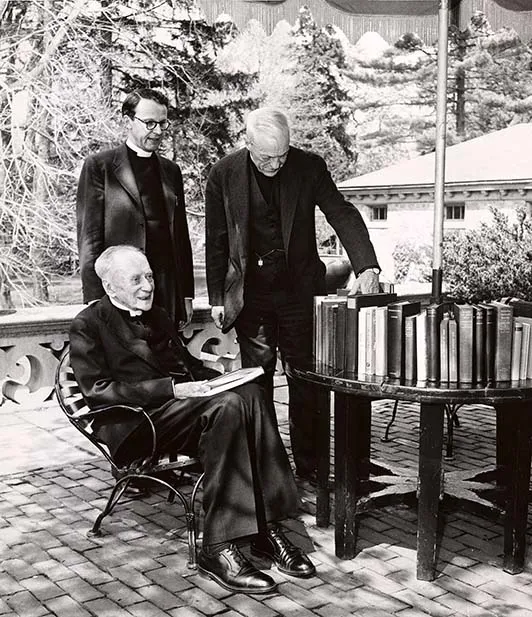

# Walter Lowrie

🌳 [See in the family tree](https://theo-armour.github.io/gedcom-viewer/#wiki=Walter-Lowrie-1868-1959)

| `Walter_Lowrie_AC058_Box_MP35.webp` | Walter Lowrie in old age, seated in clerical dress on a brick terrace, with two standing clergymen and a table of books. The date and the other two men are not identified. | Source not recorded. The file name suggests the Princeton University Archives (AC058, box MP35); this has not been checked. |

**Walter Lowrie** (26 April 1868 – 12 August 1959) was an American Episcopal clergyman, author and translator. He was rector of St. Paul's American Church in Rome from 1907 to 1930, and after retiring to Princeton, New Jersey, he taught himself Danish and translated the works of Søren Kierkegaard into English, and wrote two biographies of him.[1][2][3] He was the husband of [Barbara Armour Lowrie](https://theo-armour.github.io/genealogy/#Wiki/Barbara-Armour-Lowrie-1889-1981/README-Barbara-Armour-Lowrie-1889-1981.md), the sister of Theo Armour's paternal grandfather, and so Theo Armour's great-uncle by marriage.[1][6][7]

| **Walter Lowrie** | |
| :--- | :--- |
| **Born** | 26 April 1868 Philadelphia, Pennsylvania |
| **Died** | 12 August 1959 (aged 91) Princeton Hospital, Princeton, New Jersey |
| **Occupation** | Episcopal clergyman; author and translator |
| **Spouse** | [Barbara Armour](https://theo-armour.github.io/genealogy/#Wiki/Barbara-Armour-Lowrie-1889-1981/README-Barbara-Armour-Lowrie-1889-1981.md) (married 19 February 1918) |
| **Children** | None |
| **Parents** | Rev. Samuel Thompson Lowrie Elizabeth Albertine Dickson |

## Family and education

Walter Lowrie was born in Philadelphia on 26 April 1868, the son of Samuel Thompson Lowrie, a clergyman, and Elizabeth Albertine Dickson.[1] Find a Grave links him to three sisters, Sarah Dickson Lowrie (1870–1957), Harriet Lowrie Derr and Marjorie Howard Lowrie Sage, and to a half-sister, Rachel Lowrie (1861–1957).[5]

He attended the Lawrenceville School in New Jersey from 1879 to 1886 and entered Princeton College in the fall of 1886, graduating in 1890. According to the finding aid for his papers at Princeton, he went on to Princeton Theological Seminary and took a master's degree in divinity in 1893.[1] In 1893–1894 he studied abroad, at Greifswald and Berlin in Germany, at Florence, and at Vevey in Switzerland.[1]

## Ministry in America

In 1894 he returned to America and entered the Episcopal Church in Philadelphia. He was made deacon on 9 June 1895, and that summer assisted at St. Hubert's Church, Keene Valley, New York, where he ministered for all or part of each summer until 1906.[1] He spent the academic year 1895–1896 at the American School for Classical Studies in Rome. He was ordained priest on 27 December 1896 and was curate of St. James Church, Philadelphia, for two years.[1][2]

In 1898 he moved to the Philadelphia City Mission. He was again at the American School in Rome in 1899, the year of his first book, *Doctrine of St. John*. In 1900 he studied at Princeton while preparing *Monuments of the Early Church* (1901).[1] Between 1901 and 1907 he served the City Mission and a series of parishes: Trinity Church, Southwark, Pennsylvania, as rector; Emmanuel Church, Boston, as curate in 1904–1905; and Trinity Church, Newport, Rhode Island, as rector in 1905–1907.[1]

## Rome, 1907–1930

From 1907 to 1930 Lowrie was rector of St. Paul's American Church in Rome (St. Paul's-within-the-Walls). He twice spent a year in America as an exchange pastor: at Christ Church, Cincinnati, in 1912–1913 and at Calvary Church, New York, in 1922–1923.[1][2][6] His papers include a "Report to the Red Cross on the Journey to the Italian Front, Summer 1917".[1] The cover of Donald Hardie Fox's biography of him lists a "Gold Medal from the King of Italy, 1917" among his honours.[8]

On 19 February 1918 he married Barbara Armour at Trinity Church, Princeton. She was the daughter of [George Allison Armour](https://theo-armour.github.io/genealogy/#Wiki/George-Allison-Armour-1856-1936/README-George-Allison-Armour-1856-1936.md) of Princeton and the sister of the diplomat [Norman Armour Sr](https://theo-armour.github.io/genealogy/#Wiki/Norman-Armour-Sr-1887-1982/README-Norman-Armour-Sr-1887-1982.md). They had no children.[1][4][6][7]

In March 1929 he preached his first sermons on Kierkegaard, and in May 1930 he gave the last sermon of his ministry in Rome. The finding aid quotes him:[1]

> In leaving Italy I have given up much that is agreeable to me but I have gained my own soul.

## Princeton and Kierkegaard

In June 1930 the Lowries returned to Princeton, to the house at 83 Stockton Street that had been her father's since 1895.[1][6] He called what followed an "itinerant ministry". He began to lecture on Karl Barth and on Kierkegaard, and in 1932–1933 he travelled to China and Japan to lecture on Kierkegaard.[1]

In December 1933 he began to study Danish.[1] His biography *Kierkegaard* was finished in June 1937 and published in 1938; Howard A. Johnson recorded that Professor Eduard Geismar called it "the best single volume on Kierkegaard in any language".[1][3] *A Short Life of Kierkegaard* followed in 1942.[1][3] His translations of Kierkegaard's works appeared from 1939; the last were finished in August 1954 and published in 1955.[1] For part of the work he collaborated with David F. Swenson of the University of Minnesota.[2]

Johnson wrote that when no publisher would take the risk, Lowrie paid for the books himself, and quoted him:[3]

> Having confidence in this enterprise, I was undismayed when at one time I was out of pocket to the amount of $18,000.

On 25 July 1947 Denmark made him a Knight of the Order of Dannebrog, according to Wikipedia "as an appreciation of his extensive efforts to spread the knowledge of the intellectual production of Søren Kierkegaard in the Anglo-Saxon world".[2] The cover of Fox's biography also lists honorary doctorates of divinity from Princeton University (1930) and Virginia Theological Seminary (1949).[8]

Kierkegaard was not his only subject. Johnson lists writings on Rudolph Sohm, Albert Schweitzer, Karl Barth, Gustav Theodor Fechner, Hamann and Soloviev, and books on Christian art and archaeology, church polity and unity, liturgics and New Testament interpretation.[3] Wikipedia names *The Short Story of Jesus* (1943).[2] In 1957, for his eighty-ninth birthday, nine American friends gave him a volume called *Dr. Lowrie of Princeton & Rome*, for which he compiled his own bibliography.[3]

From April 1944 to March 1945 he was Episcopal chaplain at Princeton University. In October 1952 he became secretary of the Class of 1890, and his last class column appeared in the *Princeton Alumni Weekly* on 21 November 1958.[1] *A Princeton Companion* records that he once began a column: "I greet each of my classmates with the cheerful salutation: 'Moriturus te saluto!'"[6]

## Death and legacy

Walter Lowrie died at Princeton Hospital on 12 August 1959.[1] Johnson, his executor, wrote in the Danish journal *Kierkegaardiana* that he was "in his ninety-second year and had been at work at his desk until within six days of his death".[1][3] He is buried in Princeton Cemetery.[5]

In 1960 his widow gave the house at 83 Stockton Street to Princeton University in his memory. As the Walter Lowrie House it was a university guest house until 1968 and has since been the residence of the university's president.[6][9] His papers (39 boxes) are in the Manuscripts Division of Princeton University Library; he gave material during his life, and his widow and Howard A. Johnson added to it after his death.[1]

## Works

A short list, limited to titles named in the sources read for this page. Fox's *Complete Bibliography* (1979) has not been seen.

* *Doctrine of St. John* (1899)[1]
* *Monuments of the Early Church* (1901)[1]
* *Kierkegaard* (1938)[1][2][3]
* *A Short Life of Kierkegaard* (1942)[1][3]
* *The Short Story of Jesus* (1943)[2]
* *Art in the Early Church* (paperback edition with a preface dated 1 August 1958)[1]
* Translations of Kierkegaard, published 1939–1955[1]

## Residences

* **Philadelphia, Pennsylvania.** Born there in 1868; in the ministry there from 1894 to about 1903.[1]
* **Lawrenceville and Princeton, New Jersey**, as a schoolboy and student, 1879–1893.[1]
* **Keene Valley, New York**, in the summers of 1895–1906.[1]
* **Boston, Massachusetts, and Newport, Rhode Island**, 1904–1907.[1]
* **Rome, Italy**, 1907–1930, as rector of St. Paul's.[1][6]
* **83 Stockton Street, Princeton, New Jersey**, from 1930 until his death.[6]

## Open questions

* **Where he took his master's degree.** The finding aid for his papers says Princeton Theological Seminary, "a master's degree in divinity in 1893".[1] Wikipedia says he received his M.A. in 1893 from Princeton University.[2]
* **Dates with the Philadelphia City Mission.** The finding aid gives 1898, and then 1901 to 1903.[1] Wikipedia gives 1898–1899 and 1900–1903.[2]
* **When he began Danish.** The finding aid says December 1933, "at the age of sixty-four"; by his date of birth he was then sixty-five.[1] Johnson says he taught himself Danish "at the age of sixty-five".[3] *A Princeton Companion* says sixty-two.[6]
* **How many books.** Wikipedia and the profile page say 39.[2][7] Lowrie's own count at eighty-eight, quoted by Johnson, was "38 books and 59 substantial articles".[3] Johnson and *A Princeton Companion* speak of twenty-seven books in the twenty-seven years after 1930.[3][6]
* **The Kierkegaard translations.** Wikipedia and the profile page say twelve volumes from 1939 to 1945.[2][7] The finding aid says twelve volumes between 1939 and 1944, the first two finished in June 1938 and "published in 1941", and the last published in 1955.[1] Johnson counts fourteen translations.[3]
* **Swenson.** The profile page says the twelve volumes were published "in collaboration with" David F. Swenson.[7] Wikipedia says only that Lowrie "worked very closely" with him.[2] Which volumes they shared has not been checked.
* **The verdict on his biography.** Johnson gives Geismar's words as "the best single volume on Kierkegaard in any language"; *A Princeton Companion* quotes "the greatest one-volume work on Kierkegaard in any language" without naming the authority.[3][6]
* **Date of the house.** *A Princeton Companion* says the house was built in 1845.[6] The Princetoniana Museum's reference page gives 1848 for the commission and 1849 for occupancy, and prints "1830" for the year the Lowries moved in, which must be 1930.[9]
* **The portrait.** The source and date of the photograph at the head of this page are not recorded.

## Questions for Theo

Points that family knowledge or family papers may settle.

* **The photograph.** Where did the terrace photograph come from, and who are the two men standing with him? Is the terrace at 83 Stockton Street?
* **Recollections.** Did you know him or visit the house on Stockton Street? Any recollection would belong in a separate file in this folder.
* **The other image.** `walter-lowrie.jpg` in this folder is the cover of Donald Hardie Fox's book *The Long Life of Walter Lowrie*, not a plain portrait. Should the profile page and `Peeps-in-My-Family.md` go on using it?

## References

1. *Walter Lowrie Papers, 1843–1978 (bulk 1891–1959)* (C0286). Manuscripts Division, Special Collections, Princeton University Library. Finding aid: biographical note, scope and contents, and source of acquisition. <https://findingaids.princeton.edu/catalog/C0286>
2. "Walter Lowrie (author)". *Wikipedia*. The statement about the Order of Dannebrog is attributed there to the Danish royal orders' historiographer (not seen). <https://en.wikipedia.org/wiki/Walter_Lowrie_(author)>
3. Johnson, Howard A. "Walter Lowrie: 1868–1959". Obituary, with portrait, from the Danish journal *Kierkegaardiana*, pp. 98–100. The volume number and year do not appear on the pages in this folder. Copy in this repository: [images/admin,+Nekrolog_Johnson_98-100 (2).pdf](<images/admin,+Nekrolog_Johnson_98-100 (2).pdf>)
4. Family-tree exports in this repository, records for Walter Lowrie and Barbara Armour: Geni (`GEDCOM-files/2025/2025-08-18-export-geni/export-BloodTree.ged`) and a FamilySearch-derived tree that cites the New Jersey marriage index for 1915–1919 (not seen) (`GEDCOM-files/2025/2025-08-28-matthew-family-tree.ged`).
5. Find a Grave, memorial 108027153, "Walter Lowrie", Princeton Cemetery, Princeton, Mercer County, New Jersey. <https://www.findagrave.com/memorial/108027153/walter-lowrie>
6. Leitch, Alexander. "Lowrie, Walter, House". *A Princeton Companion*. Princeton University Press, 1978, p. 292 ff. Online text: <https://pr.princeton.edu/history/companion/lowrie_house.html>; also reproduced at <https://www.princetonianamuseum.org/artifact/77c68fae-369d-46c4-9d63-96b21361ffaf>
7. "Walter Lowrie ~ Paternal great-uncle". Profile page in this repository. [additional-notes-not-in-README.md](https://theo-armour.github.io/genealogy/#Wiki/Walter-Lowrie-1868-1959/additional-notes-not-in-README.md) (extracted from `Walter-Lowrie-1868-1959.md`). The same text appears in `Peeps-in-My-Family.md`. For the Armour family see also `Armour/README-Armour.md`.
8. Fox, Donald Hardie. *The Long Life of Walter Lowrie*. Front cover only, in the image [images/walter-lowrie.jpg](images/walter-lowrie.jpg). The book has not been seen. Princeton's finding aid describes it as a thesis for Princeton Theological Seminary, May 1985.[1]
9. "Reference: Lowrie House". Princetoniana Museum. <https://www.princetonianamuseum.org/reference/7c12f747-767c-406a-a30f-80b76184c3a0>

## Further research

* Fox, *The Long Life of Walter Lowrie*, and his *Complete Bibliography of Walter Lowrie* (Fox Head Press, 1979).
* *Dr. Lowrie of Princeton & Rome* (1957), the birthday volume, for his own account of his life and his bibliography.
* The Walter Lowrie Papers at Princeton: three autobiographical volumes, a diary of 1887–1924, and his letters to his mother from Europe.
* Princeton University and Princeton Theological Seminary records, to settle where he took the 1893 degree.
* Newspaper reports of the wedding of 19 February 1918 and obituaries of August 1959 (*The New York Times*, the Princeton papers, the *Princeton Alumni Weekly*).
* The volume and year of *Kierkegaardiana* in which Johnson's obituary appeared.
* The source of the terrace photograph, starting from the file name.
