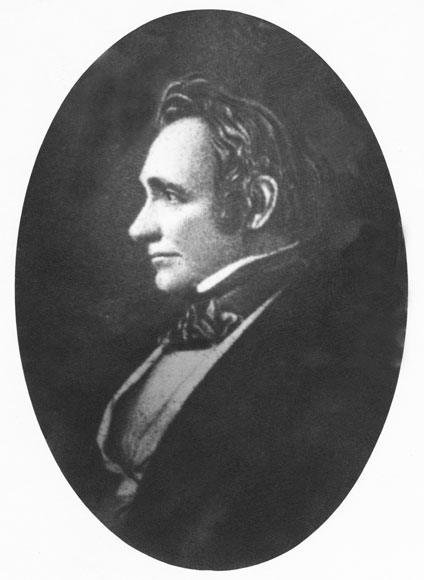

# William Savin Fulton

| `william-fulton.jpg` | William S. Fulton (1795–1844). Oval bust portrait in left profile, in a dark coat, high collar and bow cravat. Wikimedia Commons dates it to about 1836 and gives the artist as unknown.[11] | [Wikimedia Commons](https://commons.wikimedia.org/wiki/File:WSFulton.jpg), which credits the Encyclopedia of Arkansas |

**William Savin Fulton** (2 June 1795 – 15 August 1844) was a Maryland-born lawyer who became Secretary of Arkansas Territory in 1829, the last governor of the Territory in 1835, and one of the first two United States senators from Arkansas in 1836, an office he held until his death.[2][3][4] As a young man he served at Fort McHenry during the bombardment of 1814 and was private secretary to General Andrew Jackson in the Seminole campaign of 1818.[2] His daughter Sophia married Chief Justice George C. Watkins of Arkansas, and through their daughter Ida Watkins he was Theo Armour's maternal great-great-great-grandfather.[5][9][12]

| **William Savin Fulton** | |
| :--- | :--- |
| **Born** | 2 June 1795 Cecil County, Maryland |
| **Died** | 15 August 1844 (aged 49) "Rosewood", Little Rock, Arkansas |
| **Occupation** | Lawyer; county judge in Alabama; Secretary and Governor of Arkansas Territory; United States senator |
| **Spouse** | Matilda Frances Nowland (married 9 February 1823 at Florence, Alabama) (see Open questions for the name) |
| **Children** | Elizabeth Rebecca (Mrs Moorhead Wright), [Sophia](https://theo-armour.github.io/genealogy/#Wiki/Sophia-Fulton-Watkins-1830-1865/README-Sophia-Fulton-Watkins-1830-1865.md) (Mrs James M. Curran, later Mrs [George C. Watkins](https://theo-armour.github.io/genealogy/#Wiki/George-Claiborne-Watkins-1815-1872/README-George-Claiborne-Watkins-1815-1872.md)), Ida (Mrs William Hunter), and five others who died young (see Open questions) |
| **Parents** | [David Fulton](https://theo-armour.github.io/genealogy/#Wiki/David-Fulton-1771-1843/README-David-Fulton-1771-1843.md) (1771–1843) Elizabeth Savin |

## Family and education

William Savin Fulton was born in Cecil County, on the Eastern Shore of Maryland, on 2 June 1795.[2][3][4] His father, [David Fulton](https://theo-armour.github.io/genealogy/#Wiki/David-Fulton-1771-1843/README-David-Fulton-1771-1843.md), was born in Ireland and came to Maryland as a young man; his mother, Elizabeth Savin, was a native of Maryland.[2][3] A parish history of 1900 names two sons and a daughter of the marriage who were later "well-known citizens" of Little Rock: William, Dr John Fulton and Jane.[5]

John Hallum's history of Arkansas (1887) prints an extract from Fulton's own diary, lent by his daughter Elizabeth Wright. In it Fulton says that he became a pupil of the Rev. Samuel Knox on 2 February 1804, graduated from Baltimore College in September 1813, and began to read law under William Pinkney in November 1813.[2] The Encyclopedia of Arkansas attributes his formal education to "his mother's wealth".[3]

## Fort McHenry and General Jackson

In the same diary Fulton wrote that in September and October 1814 he served as aid to "Colonel Armstead" (so printed) at Fort McHenry, that he "was much exposed, and performed the principal service during the bombardment", and that he afterwards served "Commodore Rogers" in the same capacity while the commodore commanded the fort during the colonel's illness. He recorded the colonel's parting words from his sick-bed: "Fulton, I shall never forget you."[2] The Encyclopedia of Arkansas says he served as a corporal in the Baltimore Fencibles, a volunteer unit, alongside his father.[3]

Fulton wrote that he "moved from Baltimore in 1815" and entered Felix Grundy's law office in Nashville, Tennessee, in April 1816. Hallum adds that the family moved to Sumner County, Tennessee, in November 1815.[2] He began to practise law in April 1817 and made his first appearance at the bar in the circuit court at Gallatin.[2]

"In January, 1818," the diary continues, "I was appointed private secretary to General Jackson, and served in that capacity during the Seminole campaign, when we underwent every hardship, but had no fighting."[2] Hallum says that the family had become intimate with Jackson in Tennessee and that the general's friendship "was a powerful factor in promoting the fortunes of the son".[2]

## Florence, Alabama

Fulton moved to Florence, Lauderdale County, Alabama, in June 1820. He was licensed to practise law in Alabama in June 1821 and at the same time was elected by the state legislature judge of the county court of Lauderdale County; he first presided in January 1822, in a temporary court-house at Florence. He also wrote the editorials of the *Florence Gazette* from October 1821.[2]

On 9 February 1823, at Florence, he married Matilda Frances Nowland.[4][9] The Encyclopedia of Arkansas describes her as his first cousin, and Hallum says her mother was a Savin.[2][3] On 4 April 1823 Jackson wrote to him from the Hermitage with advice for a newly married man: the one rule to adopt was "to learn to live within your means".[2]

## Arkansas Territory

President Jackson appointed Fulton Secretary of Arkansas Territory in 1829, in place of Robert Crittenden.[3][4] Fay Hempstead's history (1890) dates the appointment 8 April and says that Fulton reached the seat of government with his family on 21 May 1829; because Governor John Pope had not yet arrived, he also served as acting governor.[4] A letter from Fulton to his father dated at Little Rock on 25 May 1829 is printed by Hallum.[2]

The Encyclopedia of Arkansas says that Fulton bought several lots in Little Rock, which he called Rosewood, on the present site of the Arkansas governor's mansion, and that his standing let him place relatives in office: his brother John became secretary to Governor Pope.[3] His name stood first, after those of the collectors, on the subscription list for the first Episcopal church in Little Rock, and his family attended its services.[5]

Jackson appointed him governor of the Territory on 9 March 1835, and he held the office until Arkansas was admitted as a state in 1836.[2][3][4] He opposed immediate statehood, on the ground that neither the people nor the resources were ready, and was criticised for it by politicians, newspapers and the public.[3] Hallum, writing with the help of Fulton's daughter, put it that he opposed admission "from conscientious convictions ... against the will of a large majority of the people".[2]

## United States Senate

In spite of that, the state legislature elected him to the United States Senate in 1836, where he sat with Ambrose H. Sevier.[2][3] Wikipedia gives the start of his term as 18 September 1836.[7] Hallum says that he drew the short term and was re-elected in 1839 "with practical unanimity".[2] Josiah Shinn (1908) prints part of a speech he made on Senator Benton's pre-emption bill, describing how speculators combined at public land sales.[6]

## Death

Fulton died at Rosewood, his home at Little Rock, on 15 August 1844.[2][4] Hallum's account is that he came back from Washington about the first of August in perfect health; Rosewood had just been painted, he occupied it before the paint was dry, and he died from the effects.[2] The Encyclopedia of Arkansas gives the same story as "family lore".[3] He was buried in Mount Holly Cemetery, Little Rock, in the Fulton-Nowland plot.[3][8]

Fulton County, Arkansas, is named for him.[7]

## Children and descendants

Hempstead wrote in 1890 that three daughters were born of the marriage: Mrs Moorhead Wright, "who is still living"; Mrs James M. Curran, afterwards Mrs George C. Watkins; and Mrs William Hunter. Fulton's name, he added, survived only as a given name among their descendants, "from the failure of any male line to perpetuate it".[4] The Encyclopedia of Arkansas names eight children and says that only Elizabeth, Sophia and Ida lived to be adults.[3]

Sophia Fulton married first James M. Curran, a lawyer, and second Chief Justice George C. Watkins. The parish history of 1900 lists the children of the second marriage as Maria Louise, Elizabeth Wright (died), Georgie Claiborne and Ida Watkins, and adds: "Ida married Marshall Shirk; they have one daughter, Anne Bell Shirk."[5] Anne Bell Shirk, later [Anne Bell Burrage](https://theo-armour.github.io/genealogy/#Wiki/Anne-Bell-Burrage-1890-1983/README-Anne-Bell-Burrage-1890-1983.md), was Theo Armour's grandmother, the mother of [Cynthia Burrage Hovey](https://theo-armour.github.io/genealogy/#Wiki/Cynthia-Burrage-Hovey-1921-1983/README-Cynthia-Burrage-Hovey-1921-1983.md).[9][12]

## Residences

* **Cecil County, Maryland.** Born there in 1795.[2][4]
* **Baltimore, Maryland.** He graduated from Baltimore College in 1813 and "moved from Baltimore in 1815".[2]
* **Nashville and Gallatin (Sumner County), Tennessee**, 1815 or 1816 to 1820.[2]
* **Florence, Lauderdale County, Alabama**, June 1820 to 1829.[2]
* **Little Rock, Arkansas**, from May 1829; his property there was called Rosewood.[3][4]
* **Washington, D.C.**, during sessions of the Senate, 1836 to 1844.[2][3]

## Open questions

* **His wife's surname.** Hempstead, the parish history, the Encyclopedia of Arkansas and Wikipedia give **Nowland**.[3][4][5][7] The digitised text of Hallum prints Noland, Rowland and Howland in different places, which looks like poor character recognition.[2] The one family tree in this repository that records her calls her "Matilda Francis Howland", born 15 September 1803 in Maryland, died 15 January 1879 at Little Rock.[9]
* **When he served General Jackson.** Fulton's diary says January 1818, and Shinn and Wikipedia agree.[2][6][7] The Encyclopedia of Arkansas says he went to Florida as Jackson's private secretary in 1815.[3] The diary calls the post "private secretary"; Shinn and Wikipedia call it "military secretary".[2][6][7]
* **The move to Tennessee.** The diary and Hallum put it in 1815–1816.[2] The Encyclopedia of Arkansas says he "moved to Tennessee in 1820 and then to Florence, Alabama".[3]
* **War service.** The diary speaks of service as an aide at Fort McHenry in September and October 1814.[2] The Encyclopedia of Arkansas says corporal in the Baltimore Fencibles.[3] Wikipedia says corporal in "Captain Nicholson's Company of Artillery", Maryland Militia, 1813–1814.[7] These may describe the same service; no muster roll has been seen.
* **Start of his schooling.** The diary says 2 February 1804; the Encyclopedia of Arkansas says 1803.[2][3]
* **"Elected to the legislature".** Wikipedia says that in 1821 he "was elected to the Legislature" of Alabama, and the profile page says he "won election to its legislature".[1][7] His diary says that in June 1821 he was elected *by* the legislature as county judge.[2] No record of him as a member of the legislature has been seen.
* **Dates as Secretary.** Hempstead's narrative says he was appointed on 8 April 1829; a list elsewhere in the same book reads "appointed March 8th, 1829".[4] Hempstead says he held the office until February 1835; Hallum says May 1829 to March 1835; Wikipedia gives 8 April 1829 to 23 February 1835.[2][4][7]
* **Length of his Senate service.** Hempstead says he "served till 1841".[4] Hallum, Shinn, the Encyclopedia of Arkansas and Wikipedia all have him a senator until his death in 1844.[2][3][6][7]
* **Date of death.** Hallum, Hempstead, Shinn, Find a Grave, Wikipedia and the opening of the Encyclopedia of Arkansas entry give 15 August 1844.[2][3][4][6][7][8] The body of the same Encyclopedia entry says he died "in the late fall of 1844".[3]
* **The children.** The Encyclopedia of Arkansas lists Elizabeth Rebecca (born 1824), David Peregrine (1826), Mary Jane (1829), Hickory, Sophia, Matilda Frances, "Maria Eller" and Ida.[3] The family tree in this repository lists Elizabeth Rebecca (born 23 March 1821 at Florence, died 22 October 1894), David Peregrine (1826–1831), Mary Jane (1829–1835), Hickory (1832–1835), Sophie Caroline (born 4 April 1830 in the District of Columbia, died 23 July 1865), Marie Ellen (1836–1839), Mary Juliet, and Ida W. (born 12 May 1845, died 6 August 1886).[9] The tree's birth date for Elizabeth is before her parents' marriage, and its birth date for Ida is nine months after her father's death. None of the underlying records has been seen.
* **Sophia or Sophie.** The parish history and the Encyclopedia of Arkansas call her Sophia; the family tree calls her Sophie Caroline.[3][5][9]
* **"Only surviving child".** Hallum (1887) calls Mrs Wright "the only surviving child of Governor Fulton".[2] The family tree gives the death of her sister Ida as 1886, which would agree.[9]
* **The portrait.** Hallum wrote in 1887: "It is much regretted that no portrait of that distinguished citizen ... survives."[2] The portrait in this folder comes from Wikimedia Commons, which credits the Encyclopedia of Arkansas and gives no artist.[11] Where it came from, and when it was made, has not been established.

## Questions for Theo

Points that family knowledge or family papers may settle. Each links to a conflict described above.

* **Nowland or Howland?** The family tree export spells his wife's surname Howland; the Arkansas sources say Nowland. Is anything known in the family?
* **Ida Watkins's line.** The Shirk page says Ida Watkins was a daughter, "or by another account a granddaughter", of Chief Justice Watkins. The 1900 parish history lists her as a daughter of George C. Watkins and Sophia Fulton. Which account is the other one?
* **The portrait.** Is there a family copy of this portrait, or any note of where the original is?
* **The profile page.** It says he "won election to" the Alabama legislature. His diary says the legislature elected him a county judge. Should the profile page change?
* **Family papers.** Hallum printed letters and a diary that were in Elizabeth Wright's hands in 1887. Did any Fulton or Watkins papers come down through Ida Watkins?

## References

1. "William S. Fulton (1795–1844)". Profile page in this repository. [additional-notes-not-in-README.md](https://theo-armour.github.io/genealogy/#Wiki/William-S-Fulton-1795-1844/additional-notes-not-in-README.md) (extracted from `William-S-Fulton-1795-1844.md`)
2. Hallum, John. *Biographical and Pictorial History of Arkansas*, vol. 1. Albany: Weed, Parsons and Company, 1887. "Mrs. Elizabeth R. Wright", pp. 180–181; "Governor William Savin Fulton", pp. 183–198, including the extract from his diary (pp. 184–185), Jackson's letter of 4 April 1823 (pp. 186–187), Fulton's letter of 25 May 1829 (p. 191), and his offices and death (pp. 194–195). Read in the Internet Archive's machine-read text, which has many character errors. <https://archive.org/details/biographicalpict01hall>
3. Baker, Lea Flowers. "William Savin Fulton (1795–1844)". *Encyclopedia of Arkansas*, Central Arkansas Library System. <https://encyclopediaofarkansas.net/entries/william-savin-fulton-2653/>
4. Hempstead, Fay. *A Pictorial History of Arkansas, from Earliest Times to the Year 1890*. St. Louis and New York: N. D. Thompson Publishing Company, 1890, pp. 222–223; also a list of territorial officers later in the book (page not noted). <https://archive.org/details/pictorialhistory00hemp_0>
5. Cantrell, Ellen Harrell. *The Annals of Christ Church Parish of Little Rock, Arkansas, from 1839 to 1899*. Little Rock: Arkansas Democrat Co., 1900, pp. 57–59 (section "William S. Fulton"). <https://archive.org/details/annalsofchristch00cant>
6. Shinn, Josiah H. *Pioneers and Makers of Arkansas*. 1908. Chapter 25, "Senator William S. Fulton". <https://archive.org/details/pioneersandmake00shingoog>
7. "William S. Fulton". *Wikipedia*. For the county name it cites Gannett, Henry, *The Origin of Certain Place Names in the United States* (1905), p. 133 (not seen). <https://en.wikipedia.org/wiki/William_S._Fulton>
8. "William Savin Fulton (1795–1844)". Find a Grave memorial 22363, Mount Holly Cemetery, Little Rock. <https://www.findagrave.com/memorial/22363/william-savin-fulton>
9. Ancestry- and FamilySearch-derived family tree, records for William Savin Fulton, Matilda Francis Howland, their children, Sophie Caroline Fulton, George Claiborne Watkins, Ida W Watkins and Anne Bell Shirk. For William it cites Find a Grave, *Appletons' Cyclopaedia of American Biography* and an Alabama marriage index (9 February 1823, Lauderdale); none of these records has been seen directly. `Online-Genealogy/gedcom-files/2025-08-28-matthew-family-tree.ged`
10. "Fulton, William Savin". *Biographical Directory of the United States Congress*. Not seen: the site refused automated access. <https://bioguide.congress.gov/search/bio/F000425>
11. "File:WSFulton.jpg". Wikimedia Commons. <https://commons.wikimedia.org/wiki/File:WSFulton.jpg>
12. "Shirk Read Me", `Shirk/README-Shirk.md`, and the biography of Anne Bell Burrage, `Wiki/Anne-Bell-Burrage-1890-1983/README-Anne-Bell-Burrage-1890-1983.md`, in this repository.

## Further research

* The William Savin Fulton Collection at the Arkansas State Archives, Little Rock, which the Encyclopedia of Arkansas lists, and Lea Flowers Baker's article "William Savin and Matilda Fulton: A Brief Look at a Territorial Arkansas Family", *Pulaski County Historical Review* 48 (Winter 2000), pp. 74–84.
* The Biographical Directory of the United States Congress entry and the Senate's own record of his terms and election dates.
* The *Arkansas Gazette* of August 1844 for an obituary, and the Senate eulogy by Ambrose H. Sevier that Hallum mentions.
* Muster rolls for the defence of Fort McHenry in 1814, for both William and his father.
* The Lauderdale County, Alabama, marriage record of 9 February 1823, for the spelling of his wife's name.
* Mount Holly Cemetery records for the Fulton-Nowland plot, for the children who died young.
* The original of the portrait.
